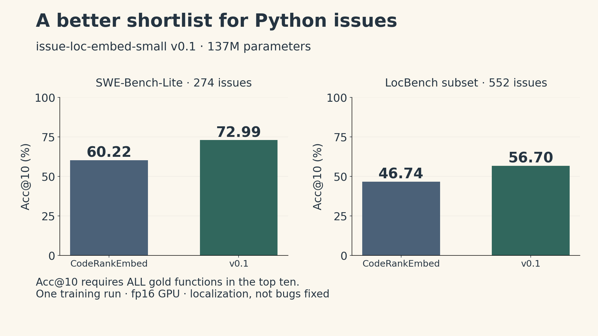

A bug report describes what went wrong. A repository contains thousands of functions that might explain it. Before writing a patch, someone has to decide where to look.

I released **[issue-loc-embed-small v0.1](https://huggingface.co/ickma2311/issue-loc-embed-small/tree/v0.1)** for that first search. It is a 137M-parameter embedding model fine-tuned from CodeRankEmbed. Given an issue and the repository at its base commit, it ranks functions and methods. On the recorded Python evaluations, its top-ten shortlist contains every gold function for **72.99% of SWE-Bench-Lite issues**, versus **60.22%** for the base model; on the 552-issue LocBench subset, the corresponding scores are **56.70% and 46.74%**.

Those are localization results. The model does not generate a patch, and these percentages do not measure whether an issue gets resolved. The contribution is a small, released ranker with a better shortlist on these tests, together with enough detail to see where that improvement stops.

This article covers the Python-trained first release. The [second field note](issue-loc-embed-v02.qmd) follows its extension to eight more training languages.

## What a successful shortlist means

The model encodes an issue and each candidate function separately. With normalized embeddings, a dot product gives their cosine similarity:

$$
s(q,d_j)=\frac{q^\top d_j}{\|q\|_2\|d_j\|_2}.
$$

Here $q$ is the issue embedding and $d_j$ is the embedding of candidate function $j$. After normalization, both norms equal one, so the score reduces to $q^\top d_j$. Sorting these scores produces a ranked list. The same repository's function embeddings can be reused for multiple issues as long as the code snapshot and encoding settings are unchanged. This ranking step does not require an LLM to generate text.

The benchmark metric is stricter than finding one relevant function. Let $G_i$ be the set of gold functions for issue $i$, and $T_{i,k}$ its top-$k$ candidates. Then

$$
\operatorname{Acc@}k=\frac{100}{N}\sum_{i=1}^{N}\mathbf{1}\{G_i\subseteq T_{i,k}\}.
$$

For a constructed example, suppose a fix changes two functions. If they rank third and twelfth, the issue fails Acc@10 even though one useful function appears near the top. If both rank within the first ten, it passes. A passing shortlist still leaves the work of understanding and fixing the bug.

Candidates in these evaluations are functions and methods from **non-test files at the issue's base commit**. Each is represented by its path and function identity followed by source code. Changing that candidate set or text format changes the task.

## Rebuilding the data recipe

The starting point was the [SweRank data recipe](https://arxiv.org/abs/2505.07849), independently implemented on [CodeRankEmbed](https://huggingface.co/nomic-ai/CodeRankEmbed). SweRank code and weights were not used for training, filtering or mining. The released weights and [project code](https://github.com/ickma2311/issue-loc-embed/blob/7bd6b5fa74f50e14c77267eb5f213bb692b0159f/LICENSE) use Apache-2.0; CodeRankEmbed's copied components retain their MIT attribution.

The training set contains **18,784 Python tasks** from SWE-rebench and SWE-rebench-V2, using real issue text and a source-repository license allowlist. Issue–modified-function pairs are useful supervision, but a changed function is not necessarily a good semantic match for the issue description. A fix can contain incidental edits, and class-level labels mapped to constructors add noise.

The recipe therefore has three important parts:

1. **Consistency filtering.** The base model ranks the labelled positive within a file-level sample of repository functions, about 300 per snapshot. A pair is retained if the positive is sufficiently near the top: the model card specifies a top-$K$ cutoff based on 20 and scaled to the sample size. This is a relevance heuristic, not proof that the label is correct.
2. **Hard negatives.** Each retained pair gets 15 mined alternatives from that sample. These are functions the encoder can confuse with the positive, giving training a more demanding contrast than arbitrary unrelated code.
3. **Two mining rounds.** After round one, that model mines new negatives. Round two starts training again from CodeRankEmbed; it does not continue updating the round-one checkpoint.

Training uses InfoNCE with in-batch negatives, batch size 64, learning rate $2\times10^{-5}$ and temperature 0.05. Each round runs for 286 steps on an L4 GPU. The [data documentation](https://github.com/ickma2311/issue-loc-embed/blob/7bd6b5fa74f50e14c77267eb5f213bb692b0159f/docs/DATA.md) describes selection, labels and published pointers. Code and issue text are not redistributed. The pointer files are CC-BY-4.0 adaptations of Nebius data; source-code licenses and issue-text rights remain separate from the model's license.

### The filter is supported by one controlled comparison

The most informative recipe comparison is within round one. With the same number of training pairs and the same number of steps, the unfiltered arm reaches **56.57 Acc@10** on SWE-Bench-Lite; the filtered arm reaches **70.07**. That is an observed **13.50 percentage-point difference**.

It is evidence that this selection rule mattered in this experiment. There was one run per arm, so it does not establish a universal gain or assign all of the final model's improvement to filtering.

The second round is less straightforward. Compared with round one, the released model improves Acc@10 from **70.07 to 72.99**, but Acc@5 falls from **63.14 to 59.49**. A developer inspecting five functions would see a different trade-off from someone inspecting ten.

## Results under a fixed evaluation protocol

| Python benchmark | Issues | Base Acc@5 | v0.1 Acc@5 | Base Acc@10 | v0.1 Acc@10 |
|---|---:|---:|---:|---:|---:|
| SWE-Bench-Lite | 274 | 52.19% | 59.49% | 60.22% | 72.99% |
| LocBench subset | 552 | 38.77% | 46.20% | 46.74% | 56.70% |

The main base-versus-release comparisons use sentence-transformers, fp16 on GPU, with 1,024-token queries and 512-token code units. The query prefix and unit format are the same for both models. Full results and runtime distinctions for additional models appear in the [v0.1 model card](https://huggingface.co/ickma2311/issue-loc-embed-small/blob/8bd461219ab1cf30f68398ccf7377ce6663bf571/README.md).

{fig-alt="Two panels show Acc at 10 on zero-to-100 percent axes. SWE-Bench-Lite, 274 issues: CodeRankEmbed 60.22, v0.1 72.99. LocBench subset, 552 issues: CodeRankEmbed 46.74, v0.1 56.70. These are localization scores from one training run, not issue-resolution rates."}

The Acc@10 gains are **12.77 percentage points** on Lite and **9.96 points** on LocBench. Paired bootstrap intervals over issues are approximately **8.4–17.2** and **7.1–13.0 points**, respectively. These intervals describe benchmark sampling uncertainty; they do not measure variation across independently trained models.

LocBench's denominator matters. Eight issues from Qiskit and sktime were excluded before scoring because training contained a renamed repository and a fork. On all 560 issues, the base and v0.1 score **47.32% and 57.32%**. The two denominators should not be mixed in one comparison.

The v0.1 release also evaluates SweRankEmbed-Small on Lite: **74.82% Acc@10**, compared with v0.1's 72.99%. The paired difference is −1.82 points, with a 95% interval from −6.20 to +2.19. The models used different inference engines in this comparison. An interval crossing zero does not establish equivalent quality, and no such claim follows here.

## The input format carries part of the gain

A function's location and identity matter. Consider this illustrative unit:

```text
src/pkg/io.py/Reader/read
class Reader:    def read(self, path):
        ...
```

The first line identifies the path, class and method. The class prefix precedes the original method source. The released extractor produces this exact convention; a generic chunker may not.

In the retained vLLM robustness runs, when the Lite comparison uses **source code only**, Acc@10 is **50.73% for CodeRankEmbed and 55.84% for v0.1**. The gain is then 5.11 points, rather than 12.77 with the identity line. Both scores also fall. This supports treating formatting as part of the evaluated system, rather than expecting the weights to reproduce the headline with arbitrary chunks.

Specialization has a cost elsewhere. On CodeSearchNet Python's docstring-to-code task, nDCG@10 falls from **95.53 to 94.39**. That is a different metric and task; it should not be placed on the same accuracy axis as localization. Those side-effect runs retain summary outputs, not per-query records, so they do not support a new paired uncertainty calculation.

## What the evaluation cannot rule out

There is one training seed and one base-model family. The Lite protocol was established after inspecting reference-model results; there was no separate validation set, although this model's training settings and final-step checkpoint were fixed before its evaluation. LocBench was not used for tuning.

Repository-name exclusion also does not guarantee independent code. A later check found a matchms repository copy affecting one issue still inside the 552-issue headline set. Excluding it after scoring leaves a 551-issue sensitivity check with a **9.98-point gain**. A SymPy fork remains in training, and three evaluation gold functions have identical copies in the training candidate pool. They were not training positives; whether they were selected as hard negatives is unknown because the original mined records were not retained.

There is no temporal holdout, semantic near-duplicates were not checked, and contamination in the base model's pre-training data is unknown. These boundaries matter when deciding how much confidence to place in a promising benchmark result.

## Loading the actual v0.1 weights

The default model branch now points to v0.2. To load v0.1 reliably, download its snapshot first and load the local directory. Passing `revision=` directly to the model constructor is insufficient here because inherited remote code can fetch default-branch weights.

```python
from huggingface_hub import snapshot_download
from sentence_transformers import SentenceTransformer

model_dir = snapshot_download(
    "ickma2311/issue-loc-embed-small",
    revision="8bd461219ab1cf30f68398ccf7377ce6663bf571",  # v0.1
)
model = SentenceTransformer(model_dir, trust_remote_code=True)

# issue_text and units come from your issue and repository snapshot.
model.max_seq_length = 1024
q = model.encode(
    [issue_text],
    prompt="Represent this query for searching relevant code: ",
    normalize_embeddings=True,
)
model.max_seq_length = 512
d = model.encode(units, normalize_embeddings=True)
ranked_indices = (q @ d.T)[0].argsort()[::-1]
```

Use the [repository's extractors](https://github.com/ickma2311/issue-loc-embed/tree/7bd6b5fa74f50e14c77267eb5f213bb692b0159f/issueloc) for the unit format. The inherited configuration default of 8,192 tokens is not the evaluated cutoff. The default float32 load above is not the fp16 GPU path used for the reported scores. This example specifies the ranking interface, not a new benchmark run.

## Release walkthrough

The v0.1 walkthrough includes both a success and a failure: v0.1 ranks a Sphinx function first versus CodeRankEmbed's rank 23, but ranks a Django function nineteenth versus the base model's rank 5. These selected examples illustrate ranking behavior; they do not add another aggregate evaluation.

```{=html}
<video controls preload="metadata" playsinline poster="issue-loc-assets/v01-results.png" style="width:100%;max-width:960px" aria-label="issue-loc-embed-small v0.1 release demo, English narration with English and Chinese captions">
<source src="https://huggingface.co/ickma2311/issue-loc-embed-small/resolve/74f0f39da8ebb9d6e39de2ddaec59393bfd98002/demo/issue-loc-embed-demo.mp4" type="video/mp4">
<a href="https://huggingface.co/ickma2311/issue-loc-embed-small/blob/74f0f39da8ebb9d6e39de2ddaec59393bfd98002/demo/issue-loc-embed-demo.mp4">Open the v0.1 demo</a>.
</video>
```

For a practical evaluation, preserve the repository snapshot, extraction rules, prefix, cutoffs and shortlist budget. Then measure whether the shortlist helps the next step of your workflow. The release establishes a localization improvement on the recorded tests; whether that improves a developer's or agent's final fix remains a separate question.
