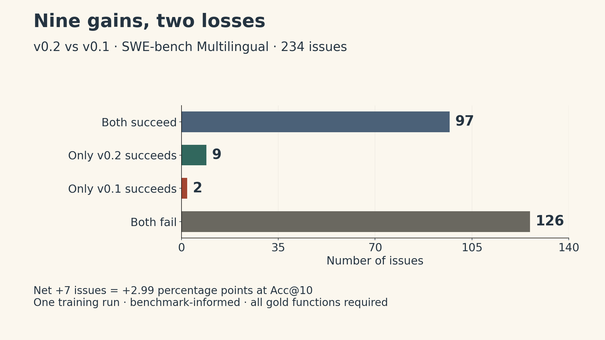

On 234 SWE-bench Multilingual issues, **issue-loc-embed-small v0.2 gets nine top-ten shortlists right that v0.1 missed, and loses two that v0.1 got right**. The net change is seven issues: Acc@10 rises from **42.31% to 45.30%**.

That is the useful starting point for the second release. Training added eight languages to the [Python-trained v0.1 model's data recipe](issue-loc-embed-v01.qmd), but it also used more optimization steps. The observed improvement is small, comes from one training run, and was measured on a benchmark that informed the extension. It supports a bounded result, not a broad claim of better multilingual software engineering.

The [released model](https://huggingface.co/ickma2311/issue-loc-embed-small/tree/v0.2) still has **137 million parameters**. It ranks functions for an issue; it does not generate or validate a patch.

## What changed between releases

Both versions fine-tune CodeRankEmbed using consistency-filtered issue–function pairs, mined hard negatives and an InfoNCE objective. The second mining round uses round one's rankings to select negatives, then restarts training from the base model.

| Training property | v0.1 | v0.2 |
|---|---:|---:|
| Python tasks | 18,784 | 18,784 |
| Tasks in additional languages | 0 | 14,554 |
| Total tasks, before filtering | 18,784 | 33,338 |
| Training steps per round | 286 | 604 |
| Mining/training rounds | 2 | 2 |

The new tasks comprise **Go 4,802; TypeScript 3,092; JavaScript 2,337; Rust 2,197; Java 1,212; PHP 820; C 56; and C++ 38**. There is no Ruby training data. These counts describe tasks before consistency filtering, not equal exposure for every language.

For v0.2, mining scored 141,870 issue–function pairs and kept **66,383** after consistency filtering. Training retained the recipe's 15 hard negatives, batch size 64, learning rate $2\times10^{-5}$ and temperature 0.05. Each round ran for 604 steps on a Kaggle T4. The [data record](https://github.com/ickma2311/issue-loc-embed/blob/7bd6b5fa74f50e14c77267eb5f213bb692b0159f/docs/DATA.md) specifies the selected source revision, pointer files and extraction rules.

More languages, more examples and more steps changed together. This experiment cannot isolate which change caused the score difference. A data-only conclusion would need a comparison that controls training budget and the other relevant choices.

## Reading the result in issues, not just percentages

Acc@10 counts an issue as successful only when **all of its gold functions** appear in the top ten candidates. The candidates are functions and methods in non-test files at the issue's base commit. This is a localization metric, not the percentage of bugs fixed.

| Benchmark | Issues | CodeRankEmbed | v0.1 | v0.2 |
|---|---:|---:|---:|---:|
| SWE-bench Multilingual | 234 | 35.47% | 42.31% | 45.30% |
| SWE-Bench-Lite, Python | 274 | 60.22% | 72.99% | 74.09% |
| LocBench subset, Python | 552 | 46.74% | 56.70% | 57.61% |

All entries are Acc@10. The comparisons use sentence-transformers 5.7.0 and transformers 4.57.6, fp16 on a T4, with 1,024-token queries, the required query prefix and 512-token function units. v0.1 and v0.2 ran in the same session; the base-model results came from earlier runs with the same inputs and settings. Source: the [pinned v0.2 model card](https://huggingface.co/ickma2311/issue-loc-embed-small/blob/74f0f39da8ebb9d6e39de2ddaec59393bfd98002/README.md).

On Multilingual, v0.1 succeeds on 99 issues and v0.2 on 106. From the reported paired changes, the outcomes break down as follows:

| Paired outcome at Acc@10 | Issues |
|---|---:|
| Both versions succeed | 97 |
| Only v0.2 succeeds | 9 |
| Only v0.1 succeeds | 2 |
| Both versions fail | 126 |
| Total | 234 |

The net gain is $100(9-2)/234=2.99$ percentage points. The table above is arithmetic from totals derived from the reported percentages and the reported paired changes, not an additional evaluation.

{fig-alt="A paired-outcome chart for 234 SWE-bench Multilingual issues: both versions succeed on 97, only v0.2 succeeds on 9, only v0.1 succeeds on 2, and both fail on 126. The net change is seven issues, or 2.99 percentage points at Acc at 10. One training run; benchmark-informed evaluation."}

Most of the improvement over CodeRankEmbed already appeared in the Python-only version: v0.1 is 6.84 points above the base on this benchmark, before v0.2's additional 2.99 points. Assigning the entire 9.83-point base-to-v0.2 difference to the new training languages would be incorrect.

### Why the uncertainty depends on the question

A paired bootstrap over individual issues gives a 95% interval of **+0.43 to +5.98 points** for v0.2 minus v0.1. However, an exact paired test using the eleven discordant outcomes gives **p = 0.065**. Resampling the **38 repositories** instead of individual issues gives an interval of **0.00 to +5.91 points**.

These analyses ask related but different questions and use different sampling assumptions. The issue bootstrap is optimistic about precision if issues within a repository behave together. With only eleven changed outcomes, the result is sensitive to the method used. None of these calculations measures training-run variance: there was one run for each version.

The Python results also need their cutoffs attached. Acc@10 rises by 1.09 points on Lite (three net issues out of 274; gains are computed before rounding the table percentages) and 0.91 on LocBench, but both paired intervals cross zero. At Acc@1, LocBench falls from **26.09% to 25.72%**. “Python improved everywhere” would overstate the evidence.

The 552-issue LocBench set excludes eight Qiskit and sktime issues because training contains related repositories. On all 560 issues, Acc@10 is **47.32%, 57.32% and 58.21%** for the base, v0.1 and v0.2. These are separate denominator-specific results.

## The benchmark informed the extension

Before v0.2 training, the project's v0.1 and CodeRankEmbed results on SWE-bench Multilingual had already been inspected overall, by language and, for Go, issue by issue. The non-Python training-unit format was taken from the benchmark's candidate corpus. The added languages cover eight of its nine languages, excluding Ruby.

Training rules and step count were fixed before training, and the released checkpoint is the final step. No v0.2 checkpoint was evaluated before the final run. That limits one form of benchmark selection, but does not make the benchmark an untouched test of the whole design process. The appropriate description is **benchmark-informed evaluation**.

There is a comparison that must remain separate: the SweRank+ paper reports **44.02 Acc@10 for SweRankEmbed-Small**. This project's 45.30 comes from its own pipeline, and it did not run SweRankEmbed-Small on this benchmark. The [model card's published-reference note](https://huggingface.co/ickma2311/issue-loc-embed-small/blob/74f0f39da8ebb9d6e39de2ddaec59393bfd98002/README.md) is useful context, not evidence of a head-to-head win.

## What repository filters missed

The new-language selection rules checked repository names, project names, current GitHub names, fork parents and fork sources. Even these name, rename and fork checks missed code that later moved into another project.

Training included three Go tasks from **`prometheus/tsdb`**, whose storage code moved into `prometheus/prometheus`, and one Rust task from **`nushell/engine-q`**, which merged into `nushell/nushell`. The evaluation contains eleven issues from those destination repositories: seven Prometheus and four Nushell issues.

Removing all eleven after evaluation gives this sensitivity check:

| Multilingual evaluation subset | Issues | Base Acc@10 | v0.1 | v0.2 |
|---|---:|---:|---:|---:|
| Original set | 234 | 35.47% | 42.31% | 45.30% |
| Excluding the two destination repositories | 223 | 34.53% | 41.70% | 44.39% |

The incremental difference remains positive, about **2.69 points**, but the smaller subset is a post-hoc check. It neither replaces the original result nor proves the remaining issues independent of training.

The release also reports a heuristic screen of all 2,110 non-Python repositories with training tasks. For archived repositories and those described as moved or merged, 202 READMEs were searched for evaluation repository names. The screen found no additional lineage, but it cannot find a relationship that the repository never states. Exact and lexical near-duplicate checks do not rule out semantic copies. There is no time split, known Python overlap limits remain, and CodeRankEmbed pre-training contamination is unknown.

### Gold labels can be wrong too

Four Go benchmark issues associate the gold function text with another method of the same name in the same file. Excluding those four produces a **different**, 230-issue sensitivity check: **36.09% base, 43.04% v0.1 and 45.65% v0.2** at Acc@10.

Correcting the method bodies and rescoring is a stronger check than dropping issues. That was done for the base and v0.1, which each gain three issues, but **v0.2 was not rescored on corrected texts**. A corrected v0.2 score is therefore unknown.

This matters for language-level claims: the observed Go gain over v0.1 depends on one issue with incorrect gold text. The release makes no Go improvement claim. Across the small language groups, differences are only one or two issues; Ruby loses one, and several languages lose ground at Acc@1 or Acc@5. C++ has only one evaluation issue and TypeScript three under the benchmark's language tags. A pooled multilingual score cannot establish reliable performance for each language.

Training labels have separate weaknesses. For example, some JavaScript/TypeScript object-property functions are not extracted as units, and insertion-only edits can miss a Go positive under the indentation rule. The [documented extraction limitations](https://github.com/ickma2311/issue-loc-embed/blob/7bd6b5fa74f50e14c77267eb5f213bb692b0159f/docs/DATA.md) were counted after training, not systematically validated away.

## Using the release with the same representation

Pin the v0.2 snapshot before loading, just as for v0.1:

```python
from huggingface_hub import snapshot_download
from sentence_transformers import SentenceTransformer

model = SentenceTransformer(
    snapshot_download(
        "ickma2311/issue-loc-embed-small",
        revision="3f86bba53943f9b8948742c4dbbbc408b13e2cf4",  # v0.2
    ),
    trust_remote_code=True,
)
```

The [first article's encoding example](issue-loc-embed-v01.qmd#loading-the-actual-v0.1-weights) supplies the query prefix, normalization and evaluated token limits. The source snapshot above pins the released weights; the later model-card revision linked here records subsequent documentation and evaluation caveats.

Unit formatting depends on the language. Python, Java, PHP, C++ and JavaScript/TypeScript class methods use `path/Class/method`, followed by a `class Class:` prefix and the original source lines. Go, Rust and C functions, and other JavaScript/TypeScript functions, use `path/function` plus source; Go receiver types are not part of that identifier. Use the [released extractors](https://github.com/ickma2311/issue-loc-embed/tree/7bd6b5fa74f50e14c77267eb5f213bb692b0159f/issueloc) when matching the measured pipeline.

The weights and [project code](https://github.com/ickma2311/issue-loc-embed/blob/7bd6b5fa74f50e14c77267eb5f213bb692b0159f/LICENSE) are Apache-2.0, with CodeRankEmbed attribution. The data-pointer files have their own CC-BY-4.0 attribution, and source-code licenses and issue-text rights remain separate. The reported scores use fp16 GPU inference. General code-search quality was not measured for v0.2, so the v0.1 regression on that task cannot be assumed fixed.

## Release walkthrough and the next decision

The demo shows both directions of change. On a Preact issue, the changed function rises from rank 14 in v0.1 to rank 3 in v0.2; CodeRankEmbed ranks it 56th. On a Druid issue, v0.1's rank 8 becomes v0.2's rank 15. These are selected examples, not evidence that every repository benefits.

```{=html}
<video controls preload="metadata" playsinline poster="issue-loc-assets/v02-changes.png" style="width:100%;max-width:960px" aria-label="issue-loc-embed-small v0.2 release demo, English narration with English and Chinese captions">
<source src="https://huggingface.co/ickma2311/issue-loc-embed-small/resolve/74f0f39da8ebb9d6e39de2ddaec59393bfd98002/demo/issue-loc-embed-v02.mp4" type="video/mp4">
<a href="https://huggingface.co/ickma2311/issue-loc-embed-small/blob/74f0f39da8ebb9d6e39de2ddaec59393bfd98002/demo/issue-loc-embed-v02.mp4">Open the v0.2 demo</a>.
</video>
```

For a user choosing between versions, the measured case for v0.2 is a modest gain in top-ten localization across the pooled multilingual set. Test it with your repository representation and actual inspection budget. Before claiming a stronger general result, the important missing evidence is controlled training comparisons, repeated seeds, corrected benchmark labels and a fresh evaluation whose design was not already informed by its scores.
