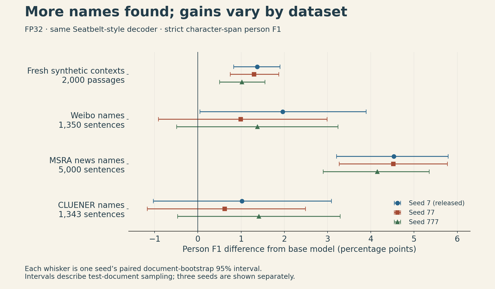
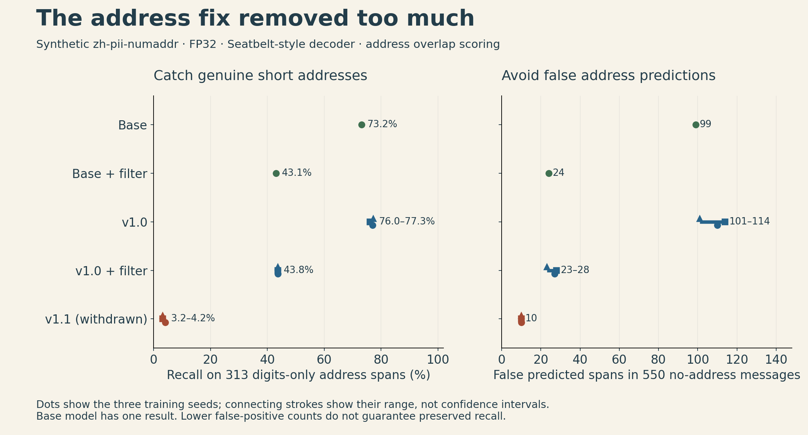

A local sensitive-data detector has two ways to disappoint its user. It can miss a name or room number that should have been masked. It can also mask an ordinary price, date or order number and damage the text someone wanted to send.

I released **[zh-pii-tagger-35m](https://huggingface.co/ickma2311/zh-pii-tagger-35m)** to improve Chinese person-name detection in a small model that can run before a request leaves the machine. The useful result is specific: it catches more names on several tested datasets. Address detection did not improve consistently, and a subsequent address fix missed so many genuine digits-only addresses that I withdrew it.

The current model weights are **v1.0**. An optional address filter is available separately on the repository’s current `main` revision and is disabled by default; the original `v1.0` tag does not contain that filter file. This field note explains the measured gains, the failed fix and the decision to keep the trade-off visible.

## What the model actually does

Personally identifiable information, or PII, is information such as a person's name, contact details or address. This model labels spans of text; an application can then decide which spans to mask before sending a request. Detection and the application's masking policy are separate steps.

The model is a fine-tune of [Seatbelt's 35M-parameter tagger](https://huggingface.co/cjhwong/seatbelt-pii-tagger), keeping its architecture, tokenizer and 18 entity types. Its 73 BIOES labels describe the beginning, inside, end or single-token form of an entity, plus the outside label. The contribution here is the Chinese adaptation and its evaluation, rather than a new architecture.

Training combined 39,200 FineWeb-2 passages containing inserted synthetic names and addresses with 57,062 replay texts labelled by the base model. Replay was intended to reduce forgetting of other entity types and English behaviour. It does not guarantee that those behaviours are preserved: the English evaluation covered person, email and phone only. Training used one epoch on a T4, with three seeds; seed 7 was selected for release by validation loss. The [model card](https://huggingface.co/ickma2311/zh-pii-tagger-35m/blob/a71798215e41c5c9331883a511a7db0e0b50424b/README.md) records the recipe and limits.

Local inference is useful when a cloud call would itself expose the text being checked. It is still a fallible detector, not a guarantee that the remaining text contains no personal information.

## Name recall improved, with uneven gains across datasets

Recall asks how much of the labelled personal information we found. Precision asks how much of what we flagged was labelled personal information. Their harmonic mean is

$$
F_1 = \frac{2PR}{P+R}.
$$

For person names, the main metric requires the predicted character span to match the gold span exactly. Both models must use the same decoder: changing how token labels are joined can change the score without changing the weights.

The comparison below uses FP32 weights and the Seatbelt-style BIOES-constrained Viterbi decoder, followed by punctuation stripping. This is a reimplementation of the decoder, not the entire upstream application's rule chain. The sets were built or selected after training and were not used to develop the model.

| Person-name test set | Base F1 | Fine-tuned F1, three seeds | Recall: base → fine-tuned |
|---|---:|---:|---:|
| zh-pii-fresh, 2,000 passages | 92.79% | 93.81–94.16% | 92.50% → 95.31–95.74% |
| Weibo NER train, 1,350 sentences | 38.36% | 39.35–40.32% | 36.76% → 42.33–43.55% |
| MSRA NER train sample, 5,000 sentences | 60.54% | 64.69–65.07% | 57.41% → 63.83–65.11% |
| CLUENER dev, 1,343 sentences | 50.85% | 51.47–52.26% | 57.63% → 61.94–62.58% |

These are ranges across training seeds, not confidence intervals. The “train” names refer to the original public dataset splits; those samples were used here for evaluation. Results come from the [retained per-seed evaluation table](https://github.com/ickma2311/zh-pii-tagger-eval/blob/7ca845fe9414714af21e9114f196637894ffd847/results/confirm/unseen_results.json).

{fig-alt="Four groups of paired F1 differences against Seatbelt, with one point and document-bootstrap 95 percent interval per training seed. Fresh and MSRA intervals are positive; Weibo and CLUENER include intervals crossing zero."}

The pattern is encouraging for recall, but it is not a uniform accuracy improvement. Across seeds, the Weibo and CLUENER results include intervals that cross zero. Absolute F1 on real-text name datasets also remains modest, which may partly reflect a task mismatch: their labels include public figures, while the base model's guideline targets private persons. Public-figure handling was not separately evaluated.

On three of the four sets, the recall gain comes with a precision cost; MSRA precision increases. On Weibo, person precision falls from 40.11% to 36.76–37.54%; on the fresh set, it falls from 93.09% to 92.36–92.63%. More names are caught, but more flagged spans are wrong.

A second fresh set, zh-pii-fresh-2, shows smaller person-F1 gains of about 0.6–1.0 points with the same decoder; its bootstrap intervals were not computed. Both fresh sets use Faker-generated entities, and the base model’s training data also contains Faker-generated text. That shared generator family may favour the base model.

There is a negative result too. On PII Bench ZH, which was used during development, person F1 with this decoder was about **0.4–0.65 points below** the base model. The project decoder gives a small positive difference of about 0.1–0.2 points, with reported intervals including zero. Reporting only the favourable decoder would hide information a user needs.

“Not used during development” also has limits. The fresh sets contain synthetic entities inside real contexts. Context overlap was checked against the FineWeb-2 fine-tuning passages, but not against the replay texts. These tests are useful evidence; they do not measure accuracy on real private messages.

## Why an address fix went wrong

Short numbers are ambiguous. In an illustrative message, `我住502` means “I live in 502”; the number can be a room identifier. In another context, `502` could be a price, an order number or an error code. These are constructed examples, not reported predictions from the released model.

The base model sometimes labelled ordinary numbers as addresses. One attempted fix removed number-only address spans from the base model’s generated labels in the Chinese-context and replay training data, then retrained the model. The published [training script’s `--addr-clean` path](https://github.com/ickma2311/zh-pii-tagger-eval/blob/7ca845fe9414714af21e9114f196637894ffd847/train_eval.py#L130-L134) implements that rule. The resulting v1.1 reduced these predictions, but it also missed genuine house and room identifiers. It was released and withdrawn on October 14; the public model card directs users back to v1.0.

The retained targeted synthetic test quantifies the regression. The `zh-pii-numaddr` set has 1,200 messages, including **313 gold address spans written as digits alone** and **550 messages containing no address**. For this comparison, a prediction of the correct entity type that overlaps the labelled address counts as a detection. That differs from the strict-span person metric above.

| System | Recall on 313 digits-only addresses | False address predictions in 550 no-address messages |
|---|---:|---:|
| Base model | 73.16% | 99 |
| Base + optional filter | 43.13% | 24 |
| v1.0 | 76.04–77.32% | 101–114 |
| v1.0 + optional filter | 43.77% | 23–28 |
| Withdrawn v1.1 | 3.19–4.15% | 10 |

FP32, the same Seatbelt-style decoder, three fine-tuning seeds; single values for the base. Counts are predicted spans, not a count or percentage of affected messages. Source: [address comparison data](https://github.com/ickma2311/zh-pii-tagger-eval/blob/7ca845fe9414714af21e9114f196637894ffd847/results/numaddr/compare.json), `numaddr_pure` and `numaddr_neg` subsets.

{fig-alt="Two panels compare digits-only address recall and false address prediction counts. v1.0 has about 76 to 77 percent recall and 101 to 114 false predictions; its optional filter has about 44 percent recall and 23 to 28 false predictions. Withdrawn v1.1 has only 3 to 4 percent recall, despite reducing false predictions to 10. Base-model comparisons are included."}

The fix looked effective if the only question was “Did we stop flagging ordinary numbers?” The positive-address subset showed what that metric omitted. For a detector placed before a cloud request, silently losing a room number is a consequential failure.

These numbers are diagnostic, not deployment error rates. The messages were generated from templates; some address examples are debatable, and the generator's templates partly shared example sentences with the filter's design. Real-address accuracy was not measured. Those limitations restrict generalization, but the large regression helps explain why v1.1 was unsuitable.

## A rule makes the choice explicit—but does not remove the cost

The optional filter published alongside the restored v1.0 weights removes an address prediction that is a bare number unless an address cue appears nearby. With v1.0, it reduces false address predictions from 101–114 to 23–28 on the no-address subset. On the digits-only positive subset, recall falls from about 77% to about 44%.

That is roughly **33 percentage points of recall traded for fewer false positives**. The filter is therefore off by default. A user who wants to preserve ordinary prices may make a different choice from a user who wants to catch every possible room number.

The base model plus the same filter is an essential comparison. It scores highest on the synthetic full-address sets in the model card, although zh-pii-ctx-heldout informed the filter’s design; fresh-2 was not listed among the sets used to design the rule. Fine-tuning should not receive credit for a gain that a simple post-processing rule already supplies.

There was another evaluation trap: the fine-tune tends to mark an entire address, including building and room suffixes, as one span. This can produce a large strict-span gain over a base model that marks shorter pieces. It is not automatically better detection. Using overlap scoring helps expose that difference, although it does not measure whether the application masks the complete address.

## What the released model costs to run

The int8 ONNX file is **35.6 MB**. On the recorded Apple M-series setup with four CPU threads, warm inference took **1.969 ms per passage**, versus **1.980 ms** for the base model. The passages had a median length of 78 characters; the statistic is the median of three interleaved rounds' mean times. This timing used the project decoder. Model loading and startup were excluded, and the optional filter was not enabled. This is one measured workload, not a universal latency promise.

The int8 evaluation also differed by platform. On zh-pii-ctx-heldout, using the project decoder, the same int8 files produced person F1 of 73.2% for the fine-tune versus 69.7% for the base on Apple Silicon; on the x86 CPU, the scores were 72.2% versus 70.4%. Those observations do not establish the cause of the difference. They are a reason to test the actual deployed runtime and hardware rather than assuming a model-file match guarantees identical scores.

On x86 int8, address overlap F1 on zh-pii-ctx-heldout was 4.0–5.1 points below the base, compared with 1.6–2.4 points below in FP32. PII Bench ZH person F1 was about one point lower with the Seatbelt-style decoder. The compact artifact does not remove the quality trade-offs.

The release contains FP32 weights and int8 ONNX, but no Core ML package; none was exported or tested. An upstream installation that still selects an older Core ML file can keep running the base model. Check the artifact actually loaded. See the [compatibility notes](https://huggingface.co/ickma2311/zh-pii-tagger-35m#compatibility) before substituting files.

## Trying it without overreading the result

Start with the [current model card and decoder example](https://huggingface.co/ickma2311/zh-pii-tagger-35m#usage) and the [evaluation repository](https://github.com/ickma2311/zh-pii-tagger-eval). The short usage example uses argmax with merging; to reproduce the Seatbelt-style tables above, use the evaluation repository’s corresponding decoder. Compare the fine-tune and Seatbelt on the text types you expect, with the same span decoding and masking policy. Include both genuine short addresses and ordinary numbers. If you enable the filter, measure what it removes from each group.

The example truncates inputs at 512 tokens, so long documents need an explicit handling strategy. Detection outside the inspected window cannot be assumed. Neither the label inventory nor the Chinese name results establish quality for every entity type, language or domain.

The release demo below compares the models on fictional messages and the recorded evaluations. It uses int8 ONNX on a Mac CPU; the FP32 tables in this article are a different evaluation path.

```{=html}
<video controls preload="metadata" playsinline style="width:100%;max-width:960px" aria-label="Chinese PII tagger comparison demo, English narration with English and Chinese captions">
<source src="https://huggingface.co/ickma2311/zh-pii-tagger-35m/resolve/a71798215e41c5c9331883a511a7db0e0b50424b/demo/zh-pii-tagger-demo.mp4" type="video/mp4">
<a href="https://huggingface.co/ickma2311/zh-pii-tagger-35m/blob/a71798215e41c5c9331883a511a7db0e0b50424b/demo/zh-pii-tagger-demo.mp4">Open the model comparison demo</a>.
</video>
```

The result worth keeping is a small, runnable model with measured Chinese-name recall gains and explicit limits. The result worth learning from is the rollback: before fixing a class of false positives, build the positive cases that the fix might erase. In this project, those cases show why fewer false positives were not enough to keep the fix.
