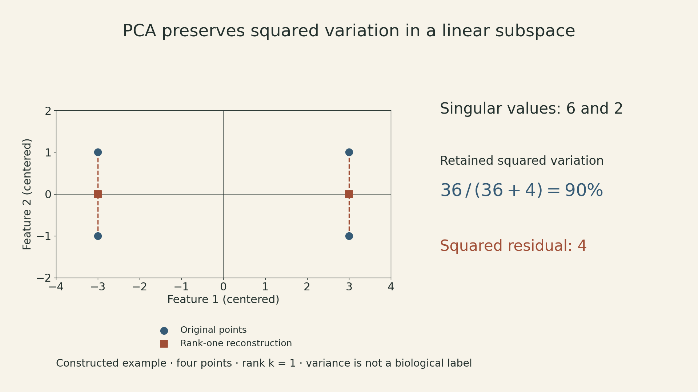
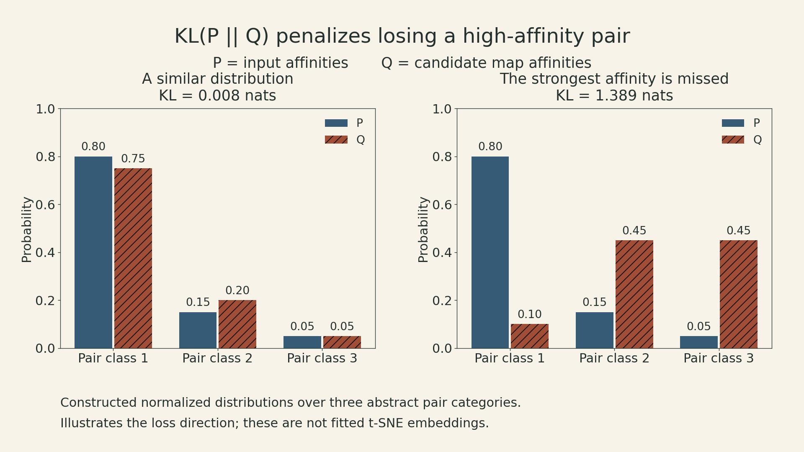
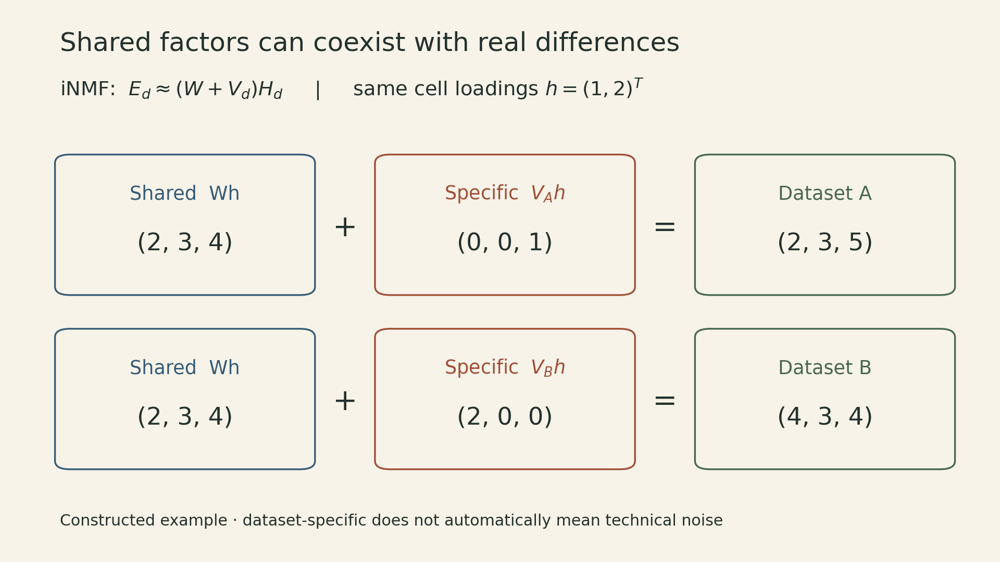

A single-cell expression matrix may contain thousands of measurements for each cell. A two-dimensional picture makes that matrix easier to explore, but every reduction makes a choice about what to retain. PCA retains variation under a linear reconstruction criterion. t-SNE emphasizes neighborhood affinities. An autoencoder learns codes that support its reconstruction objective. Integrative nonnegative matrix factorization separates shared and dataset-specific contributions.

Those choices determine what the picture can support. Two islands on a map may suggest a useful comparison; establishing distinct cell types takes evidence beyond the islands.

In MIT 6.874's Spring 2021 Lecture 11, Manolis Kellis develops the dimensionality-reduction foundations, and Joshua Welch connects them to integration across single-cell datasets. The course schedule calls the lecture *Dimensionality Reduction, Genetics, and Variation*. The central question here is how a representation preserves cellular variation when measurements also contain technical effects.

## 1. Decide whether the question is about groups, differences, or geometry

Let a count matrix have cells in rows and genes in columns. Three questions use that same matrix differently:

| Question | Typical object | Evidence still needed |
|---|---|---|
| Which cells resemble one another? | A representation, neighbor graph, or clustering | Stability and independent annotation |
| Which genes differ between conditions? | An effect estimate and statistical test | A suitable count model and biological replication |
| Do corresponding cell states occur across datasets? | A joint representation | Preservation of real differences as well as alignment |

Differential expression is not itself a classifier. It tests associations with a condition or group; a classifier predicts labels for new observations. Clusters discovered from a dataset also do not automatically become valid independent groups for testing on that same dataset.

The lecture introduces the negative binomial as a way to model overdispersed counts. Under a common parameterization,

$$
\mathbb E[C]=\mu,\qquad \operatorname{Var}(C)=\mu+\alpha\mu^2,
$$

where $\alpha\geq0$ is a dispersion parameter. The Poisson model has variance $\mu$; the additional term accommodates variability beyond that. Library size, condition, and biological replicate belong in the model design. Thousands of cells from one donor do not create thousands of independent donors.

After finding a gene set, enrichment asks a different question. Suppose a declared universe contains $N=1000$ eligible genes, a category contains $K=20$, and a selected set contains $n=30$. Under uniform sampling without replacement, its overlap $T$ has probability

$$
P(T=t)=\frac{\binom{K}{t}\binom{N-K}{n-t}}{\binom{N}{n}}.
$$

An observed overlap of three gives $P(T=3)\approx0.0174$, while the enrichment tail is $P(T\geq3)\approx0.0197$. The tail includes more extreme overlaps. A biased gene universe or selection process can invalidate the null model.

Testing many categories requires a further correction. Bonferroni uses threshold $\alpha_0/m$ for $m$ valid tests and controls the probability of at least one false rejection **without requiring independence**. The union bound gives this directly:

$$
P(\text{at least one false rejection})
\leq\sum_{j\in\mathcal H_0}P(p_j\leq\alpha_0/m)
\leq\alpha_0.
$$

Benjamini–Hochberg instead targets the expected false-discovery proportion. It finds the largest rank $r$ with $p_{(r)}\leq r q/m$ and rejects through that rank. Its standard guarantee assumes independent tests or suitable positive dependence; it is not an unrestricted guarantee for arbitrary dependence.

## 2. PCA gives a precise answer to a linear question

For PCA, let $X\in\mathbb R^{n\times g}$ be the matrix after the chosen preprocessing and **column centering**. A one-dimensional projection chooses a unit vector $v$ to maximize

$$
\|Xv\|_2^2=v^\top X^\top Xv,\qquad \|v\|_2=1.
$$

The maximizer is a leading eigenvector of $X^\top X$. With an economy-size singular value decomposition,

$$
X=U\Sigma V^\top,
\qquad Z=XV_k=U_k\Sigma_k,
\qquad X_k=ZV_k^\top.
$$

Here $V_k$ has shape $g\times k$, the cell scores $Z$ have shape $n\times k$, and $X_k$ reconstructs the original $n\times g$ matrix with rank at most $k$.

Why does maximizing variance minimize reconstruction error? Orthogonal projection splits the squared norm:

$$
\|X\|_F^2
=\|XV_kV_k^\top\|_F^2
+\|X-XV_kV_k^\top\|_F^2.
$$

The total is fixed. Retaining more squared variation leaves less squared residual. Truncated SVD solves this rank-constrained least-squares problem, with

$$
\|X-X_k\|_F^2=\sum_{j>k}\sigma_j^2,
\qquad
\|X-X_k\|_2=\sigma_{k+1}.
$$

The first expression sums all discarded squared singular values; the second is the spectral norm. These are different error measures.

{fig-alt="Four constructed points at plus or minus 3 horizontally and plus or minus 1 vertically project onto the horizontal axis. Singular values are 6 and 2; rank-one reconstruction retains 90 percent of squared variation and has squared Frobenius residual 4."}

For the four rows $(3,1),(3,-1),(-3,1),(-3,-1)$, we have $X^\top X=\operatorname{diag}(36,4)$. The first component is horizontal, the singular values are $6$ and $2$, and retaining one component preserves $36/(36+4)=90\%$ of squared variation. The four discarded vertical coordinates contribute squared error $4$.

This is a constructed geometry example, not measured expression data. In biological data, the largest direction might reflect a cell program, sequencing depth, or another technical effect. PCA does not know which interpretation matters. Feature selection and scaling change the geometry before PCA begins; a small-variance direction can still be important for a particular question. Singular-vector signs are arbitrary; repeated singular values also make the choice of basis within a tied subspace nonunique.

## 3. t-SNE preserves affinities, with a different loss

PCA has one global linear map. t-SNE assigns low-dimensional coordinates to the observed points by matching probability distributions over pairs.

In the input space, define

$$
p_{j\mid i}
=\frac{\exp[-\|x_i-x_j\|^2/(2s_i^2)]}
{\sum_{\ell\ne i}\exp[-\|x_i-x_\ell\|^2/(2s_i^2)]},
\qquad
p_{ij}=\frac{p_{j\mid i}+p_{i\mid j}}{2n}.
$$

Set $p_{ii}=0$. Each bandwidth $s_i$ is chosen to match a requested perplexity, $2^{H(P_i)}$ when entropy is measured in bits. Perplexity is an effective neighborhood size, not a hard cutoff that keeps exactly that many neighbors.

For low-dimensional points $y_i$, t-SNE uses

$$
q_{ij}=\frac{(1+\|y_i-y_j\|^2)^{-1}}
{\sum_{a\ne b}(1+\|y_a-y_b\|^2)^{-1}},
\qquad q_{ii}=0,
$$

and minimizes

$$
C=\operatorname{KL}(P\|Q)
=\sum_{i\ne j}p_{ij}\log\frac{p_{ij}}{q_{ij}}.
$$

**$P$ describes input-space affinities; $Q$ describes map-space affinities.** A large $p_{ij}$ represented by a tiny $q_{ij}$ incurs a large positive contribution: an important input neighbor has been separated on the map. This asymmetry does not make other mistakes free, because all $q_{ij}$ share a normalization. Individual KL terms can be negative, although the complete divergence is nonnegative.

{fig-alt="Three abstract pair categories have input probabilities 0.80, 0.15, and 0.05. A similar candidate distribution is 0.75, 0.20, and 0.05; a missed-neighbor candidate is 0.10, 0.45, and 0.45. The second has much larger KL divergence from the input distribution. These are probability illustrations, not fitted cell embeddings."}

The heavy-tailed low-dimensional kernel helps with crowding: moderate input-space separations need room in a small-dimensional map. It does not make every distance faithful. Optimization is nonconvex, so initialization and optimization settings also matter. The [original t-SNE paper](https://www.jmlr.org/papers/volume9/vandermaaten08a/vandermaaten08a.pdf) gives the probability definitions and objective.

A practical reading of a t-SNE map therefore separates three observations:

- **Nearby points:** a candidate local relationship worth checking in the input representation.
- **Island area:** not a direct estimate of the original cluster's variance or population prevalence.
- **Distance between islands:** not a calibrated measure of biological dissimilarity.

The number of points reflects abundance in the analyzed sample, which may differ from tissue abundance because of sampling and filtering.

Re-running with different reasonable settings is a sensitivity check, not proof that a surviving island is a new cell type. t-SNE itself is an embedding algorithm, not a clustering rule or a statistical test.

## 4. Other reductions preserve other structures

The lecture materials compare several ways of specifying the structure that a low-dimensional space should retain.

| Method | What its construction emphasizes | Main caveat |
|---|---|---|
| Classical MDS | A low-rank approximation to the centered Gram matrix recovered from squared distances | With Euclidean distances it recovers PCA scores up to axis signs and basis choices within tied eigenspaces; this equivalence does not cover every MDS loss |
| Isomap | Distances along shortest paths in a neighborhood graph | A shortcut edge can distort estimated geodesic distances |
| Locally linear embedding | Weights reconstructing each point from its neighbors | Neighborhood choice and graph connectivity matter |
| Diffusion-based methods | Connectivity through a random walk | The result depends on graph construction and normalization |
| Autoencoder | Reconstruction through a learned bottleneck | Good reconstruction alone does not guarantee useful neighborhood geometry |

For LLE, weights $w_{ij}$ first reconstruct $x_i$ from selected neighbors, with $\sum_j w_{ij}=1$. The same weights then define the embedding objective $\sum_i\|y_i-\sum_jw_{ij}y_j\|^2$. Centering and scale constraints on $Y$ are needed; otherwise collapsing every point to zero would solve the objective trivially.

A linear autoencoder with squared error, a suitable bottleneck, no extra constraints, and a global optimum can recover the PCA reconstruction subspace. Its internal coordinates need not equal the PCA scores. Nonlinear autoencoders are more flexible: they can reconstruct inputs while distorting distances between codes. Neighborhood regularization or label information changes what the code is asked to preserve.

Single-cell count models such as scVI also model observation noise and covariates. A latent code and a count likelihood answer different parts of the problem. A zero count can reflect limited sampling or low expression; it is not automatically an observation that should be replaced with a positive value. Whether a zero-inflation component is useful depends on the assay and model.

The lecture's examples of archetypes, multiresolution graphs, pathway scores, trajectories, and imputation extend the same idea. A choice of resolution can conceal smaller groups. A pathway score summarizes a chosen gene set. Pseudotime is an ordering inferred from a model, not a direct clock or a demonstrated lineage. Graph smoothing can help reveal patterns while also introducing dependencies between estimates. Downstream uncertainty must reflect those transformations.

## 5. Integration needs room for differences as well as common structure

Welch's guest lecture moves from representing one dataset to comparing several. Cells from different donors or technologies may share programs while also differing in important ways. Making every dataset overlap perfectly can erase the differences being studied.

LIGER uses integrative nonnegative matrix factorization, or iNMF. To keep the shapes explicit, use **genes in rows and cells in columns in this section**:

$$
E_d\in\mathbb R_+^{g\times n_d},\qquad
W,V_d\in\mathbb R_+^{g\times k},\qquad
H_d\in\mathbb R_+^{k\times n_d}.
$$

The reconstruction is $E_d\approx(W+V_d)H_d$. Here $W$ contains shared metagene weights, $V_d$ contains dataset-specific additions to those weights, and $H_d$ describes each cell's factor loadings. Nonnegativity makes reconstruction additive; it does not prove that each factor is one biological pathway.

The objective is

$$
\min_{W,V_d,H_d\geq0}
\sum_d\left[
\|E_d-(W+V_d)H_d\|_F^2
+\lambda\|V_dH_d\|_F^2
\right].
$$

The first term fits each dataset. The second penalizes the contribution reconstructed through its specific component. Increasing $\lambda$ applies more pressure toward shared structure; it does not certify that the removed variation was technical. The [LIGER method documentation](https://welch-lab.github.io/liger/reference/runINMF.html) states this objective.

{fig-alt="For a cell loading vector h equals 1,2, shared metagene matrix W produces 2,3,4. Dataset A adds 0,0,1 to produce 2,3,5; dataset B adds 2,0,0 to produce 4,3,4. All numbers are a constructed example. A dataset-specific contribution may contain biological or technical variation."}

Consider the constructed matrices

$$
W=\begin{pmatrix}2&0\\1&1\\0&2\end{pmatrix},\quad
V_A=\begin{pmatrix}0&0\\0&0\\1&0\end{pmatrix},\quad
V_B=\begin{pmatrix}0&1\\0&0\\0&0\end{pmatrix},\quad
h=\begin{pmatrix}1\\2\end{pmatrix}.
$$

Both cells have shared contribution $Wh=(2,3,4)^\top$. Dataset A adds $V_Ah=(0,0,1)^\top$; dataset B adds $V_Bh=(2,0,0)^\top$. Their reconstructed measurements differ even though they have the same factor loadings.

This example shows what the model permits, not what an optimizer is guaranteed to recover. Factorization is not uniquely identifiable, and the joint objective is nonconvex. Alternating nonnegative least-squares updates optimize one matrix block while holding the others fixed; they do not establish a global optimum. Unlike centered PCA, this model requires nonnegative input, so preprocessing must preserve that constraint.

The guest lecture also describes refinement and quantile normalization of cell factors before joint clustering. The factorization formula alone is not the entire integration pipeline. Matching cells across unpaired datasets is an inferred correspondence, not evidence that the same physical cell was measured twice.

The reported examples span donors, spatial and dissociated measurements, and multiple modalities. They motivate a useful validation question: **does the representation align corresponding states while preserving a difference known to be real?** Mixing by dataset label alone cannot answer it. A donor-specific component may contain biology, a technical artifact, or both; metadata and independent evidence are needed to interpret it.

## 6. Larger atlases change the computation, not the validation requirement

Welch describes online iNMF for three settings: an already available dataset processed in minibatches, newly arriving datasets incorporated incrementally, and new observations projected into a fixed reference. These have different implications. Updating the reference changes the representation; projecting into a fixed reference assumes its learned factors remain adequate.

The memory idea can be seen in ordinary dictionary learning. For data columns $x_t$ and codes $h_t$ with dictionary $D$, expanding a squared reconstruction loss gives

$$
\sum_t\|x_t-Dh_t\|_2^2
=\text{constant}-2\operatorname{tr}(D^\top B)
+\operatorname{tr}(D^\top D A),
$$

where $A=\sum_t h_th_t^\top$ and $B=\sum_t x_th_t^\top$. Holding the codes fixed, these accumulated products summarize the dictionary-dependent part of the loss. The online iNMF algorithm uses a related surrogate with its shared and specific terms. This derivation explains the memory principle; it is not the complete iNMF update rule or a global convergence proof. Reporting all cell embeddings still requires storing or recomputing those outputs.

The lecture then considers datasets with only partially shared features. Restricting everything to the intersection can discard useful information. An extended factorization can connect datasets through shared features while retaining separate feature blocks. It still needs enough meaningful overlap or other justified linkage to anchor the comparison; arbitrary disconnected measurements do not become aligned merely by choosing a larger model.

Finally, the guest lecture introduces MichiGAN, combining a representation learned by a variational autoencoder with a conditional generative model. The architectural idea is to retain the encoder's codes while training a generator conditioned on them. The reported representation-versus-generation tradeoff motivates that design; it is not a universal rule that all VAEs disentangle factors or all GANs lack interpretable latents. A realistic synthetic profile and a scientifically meaningful representation require separate evaluation.

## 7. Read the objective before reading the islands

A useful cell map begins with a question about the data. Linear reconstruction, neighborhood affinities, additive shared factors, and count-model likelihoods preserve different things. None automatically identifies the cause of the variation it preserves.

For an analysis built on these methods, three checks keep the interpretation grounded: inspect which features drive the representation, test sensitivity to preprocessing and modeling choices, and compare the proposed interpretation with independent evidence. A compelling map helps formulate the next question. Its geometry alone cannot settle that question.

## Sources and lecture

- [MIT 6.874 Spring 2021 course schedule](https://mit6874.github.io/), Lecture 11, March 30.
- [Lecture slides A](https://mit6874.github.io/assets/sp2021/slides/l11a.pdf): differential expression, PCA/SVD, t-SNE, and single-cell analysis.
- [Lecture slides B](https://mit6874.github.io/assets/sp2021/slides/l11b.pdf): integration methods including CCA and MNN, manifold methods, and autoencoders.
- [Lecture recording](https://www.youtube.com/watch?v=0byf2OF6AT0): Welch's guest lecture begins around 38:49; shared/specific factorization around 46:04; online integration around 1:03:52.
- [van der Maaten and Hinton, *Visualizing Data using t-SNE*](https://www.jmlr.org/papers/volume9/vandermaaten08a/vandermaaten08a.pdf), 2008, Sections 2–3.
- [LIGER iNMF objective and matrix roles](https://welch-lab.github.io/liger/reference/runINMF.html).


