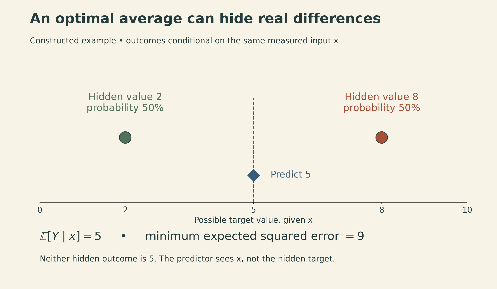
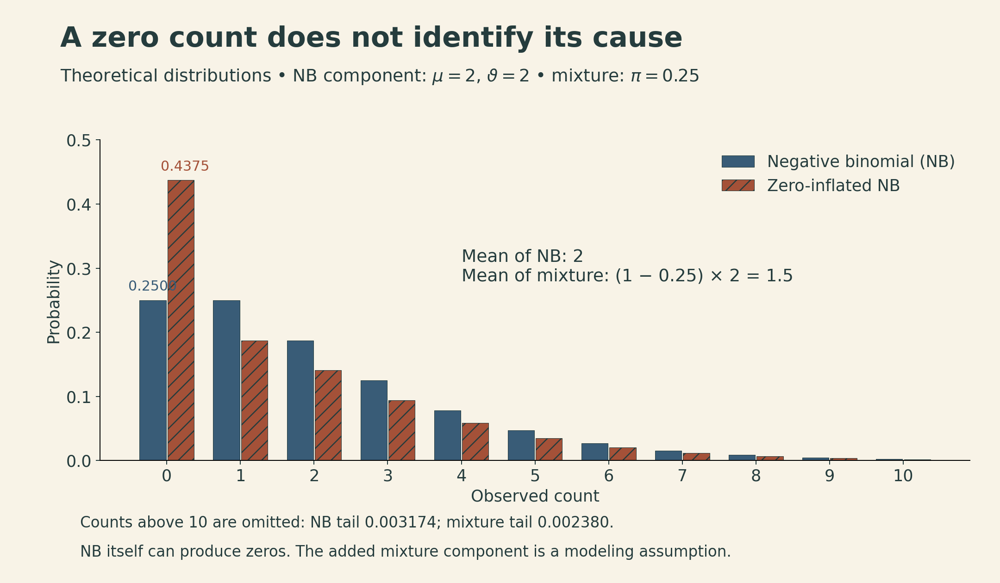
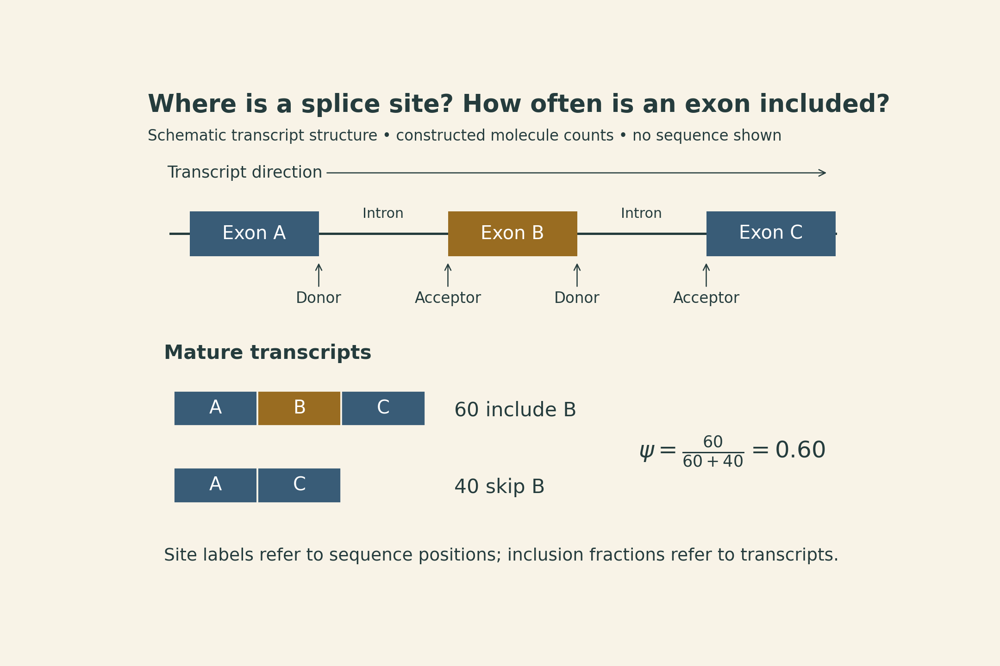

Suppose two samples have the same measured expression values for a small set of genes. An unmeasured gene has expression 2 in one sample and 8 in the other. A model trained with squared error may predict 5 for both.

That prediction can be optimal for its objective even though neither sample has expression 5. The model has recovered a useful average but cannot identify which sample has which hidden value from those inputs alone.

MIT 6.874 Lecture 9 brings together several ways of learning from incomplete molecular observations: inferring expression from a subset of genes, predicting expression classes from chromatin measurements, learning compact representations of single cells, and predicting splice sites from sequence. Their common question is **which missing quantity the available evidence can support**.

These notes follow the Spring 2021 lecture by Manolis Kellis, with guest contributions from Zhanlin Chen, Xiaohui Xie, and Kyle Kai-How Farh. The methods illustrate modeling ideas from that course edition; they are not a ranking of current tools.

## 1. Define the quantity before choosing the model

Gene expression is often represented as a matrix: rows are samples or cells, columns are genes, and entries describe measured RNA abundance. The units and preprocessing matter. Raw counts, normalized counts, and transformed microarray intensities are different statistical objects.

Splicing adds another question. A gene can produce transcripts that retain different combinations of exons. Knowing total RNA abundance does not fully specify which transcript forms are present.

| Task | Input | Target | Appropriate interpretation |
|---|---|---|---|
| Expression imputation | Measured genes | Unmeasured expression values | Conditional prediction on the training measurement scale |
| Expression classification | Chromatin measurements | High/low expression label | Probability of a defined class |
| Single-cell representation | Count or accessibility matrix | Latent state and a model of observations | A compressed description shaped by the likelihood and assumptions |
| Splice-site prediction | Sequence context | Acceptor, donor, or neither at each position | Scores for local site labels |
| Exon-inclusion estimation | RNA evidence for a splicing event | Fraction of transcripts including an exon | An event-specific quantity in a sample or tissue |

The [previous lecture](sequence-labels-to-contact-maps.qmd) compared different shapes of genomic predictions. Here, a related distinction appears even when outputs are all numbers: an expression estimate, a class probability, and an inclusion fraction have different meanings.

## 2. Why a smaller representation can work

Genes often vary together across samples. A large expression matrix can therefore have useful lower-dimensional structure. If $X\in\mathbb{R}^{n\times g}$ contains $n$ samples and $g$ genes, a rank-$k$ approximation writes

$$
X\approx ZW^\top,
\qquad Z\in\mathbb{R}^{n\times k},\quad W\in\mathbb{R}^{g\times k}.
$$

Each row of $Z$ summarizes a sample using $k$ coordinates; $W$ maps those coordinates back to genes. For an appropriately centered matrix, principal component analysis gives a linear version of this compression.

The singular value decomposition makes the approximation precise. Retaining the first $k$ singular components gives $X_k$. If the singular values are $\sigma_1\geq\cdots\geq\sigma_r>0$, then for $k<r$,

$$
\|X-X_k\|_F^2=\sum_{j=k+1}^{r}\sigma_j^2,
\qquad
\|X-X_k\|_2=\sigma_{k+1}.
$$

The first expression adds squared error over all entries; the second measures the largest residual amplification along a direction. They are different error measures. For singular values $5,3,1$ and $k=1$, the Frobenius error is $\sqrt{10}$, whereas the spectral-norm error is $3$.

An autoencoder replaces the linear maps with an encoder $z=f_\phi(x)$ and a decoder $\hat x=g_\theta(z)$. Nonlinear structure can be useful, but a compact representation does not automatically correspond to biological causes. Likewise, a two-dimensional visualization such as t-SNE can help inspect local neighborhoods without making every distance or cluster separation biologically meaningful.

Clustering uses these patterns without a predefined label. Classification instead learns to predict supplied labels. A visually distinct cluster and a validated cell-type classifier are different kinds of evidence.

## 3. Inferring unmeasured expression with D-GEX

The landmark-gene idea is to measure a smaller set of informative genes and infer others from their statistical relationships. D-GEX uses a feed-forward neural network with shared hidden layers to predict many target genes together.

For measured vector $x\in\mathbb{R}^{m}$ and target vector $y\in\mathbb{R}^{q}$, the task is

$$
\hat y=f_\theta(x),
\qquad
\mathcal L(\theta)=\frac{1}{nq}\sum_{i=1}^{n}\sum_{j=1}^{q}
\bigl(y_{ij}-f_\theta(x_i)_j\bigr)^2.
$$

The published implementation divided the targets between two networks to fit available GPU memory; sharing occurs among the targets within each network. Sharing hidden layers lets the model reuse patterns across targets. Each target retains its own output weights, so it can use those shared features differently.

The loss above averages over both samples and targets; D-GEX sums the per-target mean squared errors, differing by a constant factor of $q$. Its reported evaluation metric is mean absolute error (MAE), which should not be confused with the training objective.

The L1000 platform is associated with 978 landmark genes. The processed benchmark used in the [D-GEX paper](https://pmc.ncbi.nlm.nih.gov/articles/PMC4908320/) contains **943 landmark inputs and 9,520 target genes** after harmonizing microarray probes with Gencode annotations across the jointly normalized datasets. These counts refer to different stages of the problem, so they should not be used interchangeably.

### What squared error asks the model to predict

For a fixed observed input $x$, consider a scalar target $Y$ and a proposed prediction $a$. Expanding around the conditional mean gives

$$
\mathbb E[(Y-a)^2\mid X=x]
=\operatorname{Var}(Y\mid X=x)
+\bigl(\mathbb E[Y\mid X=x]-a\bigr)^2.
$$

The variance term does not depend on $a$. Thus, with unrestricted model capacity and the population objective, the best squared-error prediction is the conditional mean. A finite trained network only approximates that ideal.

In the opening constructed example, $Y=2$ or $8$ with equal probability given the same $x$. The best prediction is $5$, and the minimum expected squared error is

$$
\tfrac12(2-5)^2+\tfrac12(8-5)^2=9.
$$

{fig-alt="Two equally likely samples share the same observed input but have hidden target values 2 and 8. Both receive the conditional-mean prediction 5. The average squared error is 9, and neither sample has target value 5."}

This is a reason to distinguish measured entries from inferred ones in downstream analysis. Imputed values can improve an average prediction while smoothing away rare states or variation that was not identifiable from the measured inputs.

D-GEX also compares performance across measurement platforms. That raises a separate question from fitting a random holdout within one dataset: do the learned relationships survive changes in platform, tissue mixture, normalization, or population? Lower error on one benchmark does not establish universal recovery of unmeasured expression.

### Composite measurements use a different kind of compression

The lecture also discusses work by Cleary and colleagues on composite expression measurements. At the mathematical level, a composite observation is a mixture $b=Ax$, where $x\in\mathbb R^g$ is an expression profile and $A\in\mathbb R^{m\times g}$ describes $m<g$ mixtures.

Such a system generally has many solutions. Recovery becomes possible only with additional structure. One model is $x\approx Da$, where columns of $D$ represent gene modules and the activity vector $a$ is sparse. Sparsity here concerns active modules; it does not require most genes to have zero expression.

Landmark prediction learns relationships from selected individual measurements. Composite recovery combines mixed observations with a structural prior. Both approaches depend on whether the assumed structure continues to describe the samples being analyzed.

## 4. Chromatin models predict the labels they receive

DeepChrome uses spatial patterns of histone modifications around genes to predict a high/low expression label. This is a classification problem, rather than the continuous expression-regression problem above. Its convolutional representation preserves information about the positions of measured marks.

AttentiveChrome adds a hierarchy of attention: positions within a mark and information across marks. This can make the model's weighting easier to inspect. Attention weights still describe a computation in the fitted model; they do not alone establish which chromatin features causally control expression.

The DECODE contribution moves from coarse regional labels toward finer localization. A classifier learns associations between chromatin features and assay-defined regional activity, then an attribution map highlights locations contributing to its score. A coarse label can support a useful localization hypothesis without providing a directly observed label for every position.

Reporter-assay activity also has its own context. A sequence fragment's activity in a reporter system is not automatically its contribution to a particular endogenous gene in an intact cell. Connecting those claims requires additional evidence.

Across these examples, the interpretation follows a chain: **measurement → training label → model output → biological claim**. Each transition deserves attention. A well-predicted label can support a narrower claim than the biological mechanism one ultimately wants to understand.

## 5. A generative model describes uncertainty in the observations

An ordinary autoencoder reconstructs a point estimate. A variational autoencoder (VAE) instead specifies a latent-variable model

$$
p_\theta(x)=\int p_\theta(x\mid z)p(z)\,dz.
$$

The latent variable $z$ represents unobserved structure. The decoder defines a distribution over observations conditional on that structure. An encoder $q_\phi(z\mid x)$ approximates the posterior distribution over $z$.

The evidence lower bound, or ELBO, is

$$
\log p_\theta(x)\geq
\mathbb E_{q_\phi(z\mid x)}[\log p_\theta(x\mid z)]
-D_{\mathrm{KL}}\bigl(q_\phi(z\mid x)\,\|\,p(z)\bigr).
$$

The reconstruction term rewards explaining the observation. The KL term penalizes departure of the approximate posterior from the prior. Maximizing the ELBO balances those terms; it does not prove that each latent coordinate has a unique biological meaning.

For a diagonal Gaussian encoder, a sample can be written as

$$
z=\mu_\phi(x)+\sigma_\phi(x)\odot\epsilon,
\qquad \epsilon\sim\mathcal N(0,I).
$$

This reparameterization separates the random draw from the learned location and scale, allowing gradients to pass through those learned quantities. Changing the KL weight, as in a $\beta$-VAE, changes the compression tradeoff. Interpretable, independent biological factors are not guaranteed by that change alone.

### Counts need a count model

RNA counts are nonnegative integers, often with variability greater than a Poisson distribution would allow. A negative binomial (NB) model with mean $\mu$ and dispersion parameter $\vartheta>0$ has

$$
\mathbb E[C]=\mu,
\qquad \operatorname{Var}(C)=\mu+\frac{\mu^2}{\vartheta},
\qquad P(C=0)=\left(\frac{\vartheta}{\vartheta+\mu}\right)^\vartheta.
$$

A zero-inflated negative binomial (ZINB) adds a mixture component that always produces zero, with probability $\pi$. Its zero probability becomes

$$
P(C=0)=\pi+(1-\pi)
\left(\frac{\vartheta}{\vartheta+\mu}\right)^\vartheta.
$$

Here $\mu$ remains the mean of the NB component; the full mixture has mean $(1-\pi)\mu$.

For the illustrative parameters $\mu=2$, $\vartheta=2$, and $\pi=0.25$, the NB zero probability is $0.25$, whereas the ZINB zero probability is $0.4375$. The ZINB mean is $1.5$. An observed zero alone cannot tell us which component produced it.

{fig-alt="Theoretical bars compare negative binomial counts with mean 2 and dispersion 2 against a zero-inflated mixture with pi 0.25. Zero probabilities are 0.25 and 0.4375. The means are 2 and 1.5 respectively. Only counts 0 through 10 are shown; the remaining tail is reported."}

The lecture introduces DCA, a count autoencoder, and scVI, a probabilistic latent-variable approach. The original scVI formulation models counts together with batch and library-size effects. These examples show why choosing an observation distribution is part of the scientific model. They do not imply that every zero is technical dropout or that every count dataset requires zero inflation.

## 6. Separate cell state from nuisance variation—with care

Single-cell measurements vary for biological and technical reasons. SAILER applies an invariant-representation objective to single-cell chromatin-accessibility data. Its decoder receives both a latent representation $z$ and recorded covariates $c$, including batch and read depth.

The intended division is that $z$ carries useful cell-state information while $c$ accounts for known nuisance variation. The objective discourages dependence between $z$ and $c$, expressed through a mutual-information term $I(z;c)$ alongside the generative modeling objective.

This is a modeling goal, not a certificate that all confounding has disappeared. Suppose one cell type occurs only in batch A and another only in batch B. Removing every signal associated with batch can also remove the distinction between the cell types. The observations alone do not cleanly separate the two explanations.

The lecture extends this representation perspective to paired RNA and accessibility measurements. Shared latent information can connect modalities, while modality-specific information retains what only one measurement captures. A predicted missing modality is still a conditional reconstruction, not a new measurement of that cell.

Spatial data add another structure: cells have physical neighbors. A graph can encode proximity and support models of spatial patterns. Proximity itself does not imply identical cell states, and smoothing must allow genuine boundaries to remain.

## 7. Splice sites and exon inclusion answer different questions

During RNA processing, introns are removed and exons are joined. A splice donor marks the beginning of an intron in transcript orientation; an acceptor marks its end. Alternative splicing can retain an exon in some transcripts and skip it in others.

For a simple exon-skipping event, the inclusion fraction $\psi$ describes the proportion of relevant transcripts that include the exon. If 60 of 100 fully resolved transcripts include it, then $\psi=0.6$. This is a constructed molecule-level example. Estimation from short reads requires accounting for which observations support each path and their sampling opportunities; it is not automatically a raw ratio of arbitrary read counts.

Earlier splicing models in the lecture combine engineered sequence features and tissue information to predict inclusion patterns. SpliceAI instead learns a sequence representation using a residual convolutional architecture with broad context. Its basic output assigns scores to three labels at each position: acceptor, donor, or neither.

{fig-alt="A schematic pre-mRNA has exons A, B, and C separated by introns, with donor and acceptor boundaries labeled in transcript orientation. Two mature transcript paths retain or skip exon B. An illustrative 60 included and 40 skipped molecules give psi 0.60. Site-label scores do not directly equal this inclusion fraction."}

Broader context helps distinguish plausible local patterns from sites used within a larger transcript structure. The [SpliceAI paper](https://doi.org/10.1016/j.cell.2018.12.015) evaluates held-out chromosomes and excludes paralogous genes from the test set to reduce leakage from closely related training examples.

Its reported **95% top-k splice-site accuracy** has a specific definition: the number of predicted sites is set equal to the number of true sites, and the metric measures their overlap. It is not ordinary accuracy across all sequence positions. That distinction matters because most positions are not splice sites, so an all-negative classifier can score well under an unsuitable overall-accuracy metric.

Nor does a site score directly specify the exon-inclusion fraction in a particular tissue, every full-length transcript, or the clinical consequence of a variant. The paper investigates connections between predictions and RNA evidence; those are additional evaluations, not meanings automatically attached to a classifier's output.

## 8. Evaluate the missing information you actually care about

These models become easier to compare once the evaluation question is explicit:

- **For expression imputation:** which genes and sample populations were held out, on which measurement scale, and does uncertainty remain visible?
- **For a low-dimensional representation:** does it preserve a biological distinction on independent evidence, rather than merely making a clean visualization?
- **For a chromatin classifier or attribution map:** what did the assay label measure, and what finer claims still require validation?
- **For splice-site prediction:** are the metric, held-out units, and downstream interpretation aligned with the desired use?

The practical connection across the lecture is that a model can add information from learned relationships while also importing assumptions from its training data. Useful predictions require both: evidence that those relationships generalize and a clear account of what remains unobserved.

The next lecture develops the single-cell setting further. The distinction to carry forward is between explaining an observation, compressing a cell state, and claiming a biological mechanism.

## Sources and lecture

- [MIT 6.874 Spring 2021 course](https://mit6874.github.io/) — Lecture 9, *Gene Expression, Splicing*, March 18, 2021; [slides](https://mit6874.github.io/assets/sp2021/slides/l09.pdf).
- [Chen et al., *Gene expression inference with deep learning* (2016)](https://pmc.ncbi.nlm.nih.gov/articles/PMC4908320/) — landmark-gene regression and cross-platform evaluation.
- [Cleary et al., *Efficient Generation of Transcriptomic Profiles by Random Composite Measurements* (2017)](https://doi.org/10.1016/j.cell.2017.10.023) — composite measurements and sparse module activity.
- [Singh et al., *DeepChrome* (2016)](https://arxiv.org/abs/1607.02078) and [*Attend and Predict* (2017)](https://arxiv.org/abs/1708.00339) — chromatin-based expression classification.
- [Chen et al., *DECODE* (2021)](https://doi.org/10.1093/bioinformatics/btab283) — coarse activity labels and localization.
- [Eraslan et al., *Single-cell RNA-seq denoising using a deep count autoencoder* (2019)](https://doi.org/10.1038/s41467-018-07931-2) and [Lopez et al., *Deep generative modeling for single-cell transcriptomics* (2018)](https://doi.org/10.1038/s41592-018-0229-2).
- [Cao et al., *SAILER* (2021)](https://doi.org/10.1093/bioinformatics/btab303) — invariant representations of accessibility data.
- [Jaganathan et al., *Predicting Splicing from Primary Sequence with Deep Learning* (2019)](https://doi.org/10.1016/j.cell.2018.12.015) — SpliceAI and its evaluation metrics.



[Watch the lecture on YouTube](https://www.youtube.com/watch?v=6ArtsTQ0eiM).
