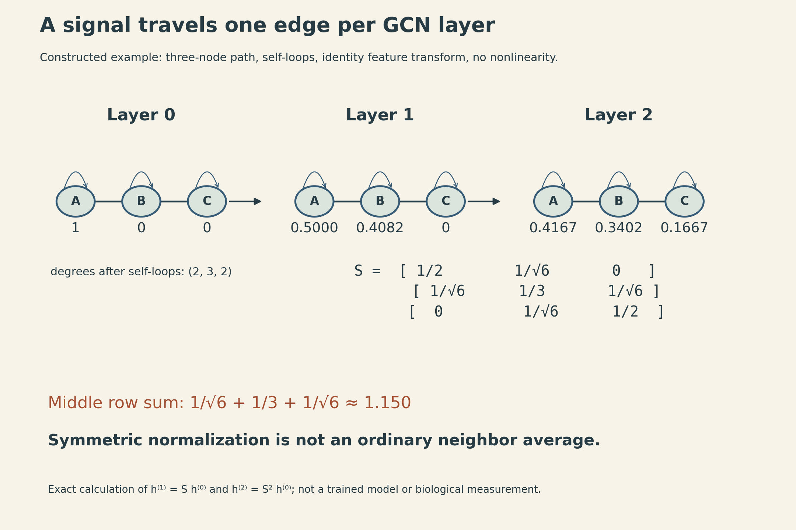
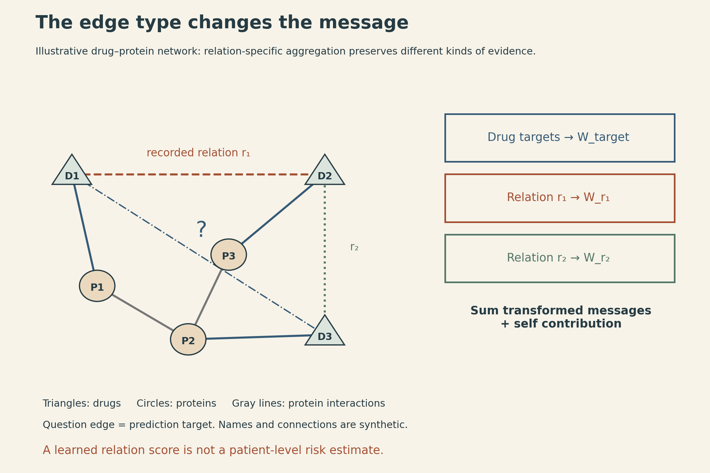
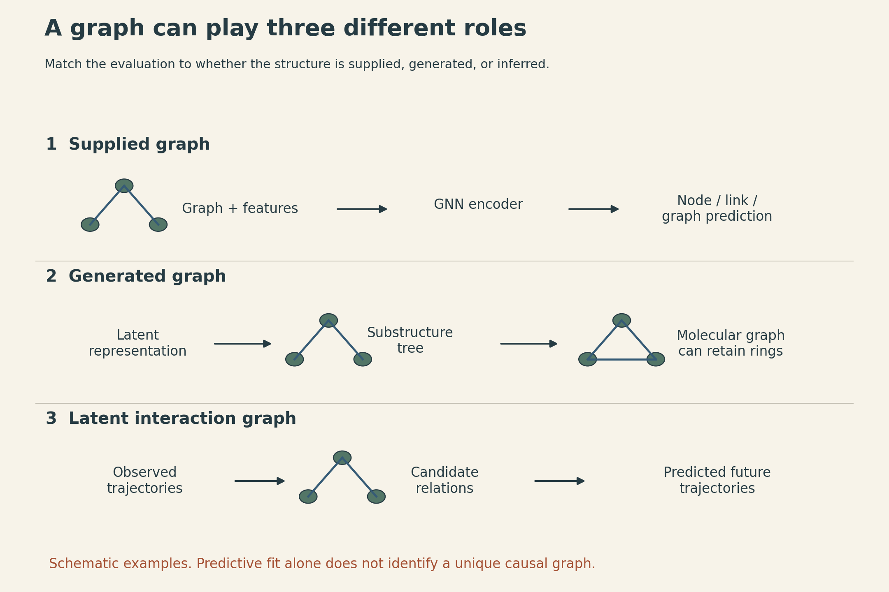

Two genes can be connected because their proteins physically interact, because one regulates the other, or because their measured expression profiles are similar. A line between two nodes does not tell us which of those claims has been made.

For a graph neural network, that line has another role: it determines where information is allowed to travel. Changing the graph changes the computation, even when the node features and neural-network weights stay the same.

MIT 6.874 Lecture 15 moves from classical network analysis to graph neural networks, molecular generation, and biological applications. Its central connection is between **the meaning of an edge, the rule for sharing information across it, and the prediction used to train that rule**.

## First decide what the graph represents

A graph consists of vertices and edges. In a protein interaction graph, the vertices may be proteins and the edges may represent evidence of physical interaction. In a co-expression graph, an edge may instead represent similarity between expression profiles. Regulatory graphs can be directed and signed; molecular graphs distinguish atoms and bond types. These are modeling choices appropriate to different questions, not interchangeable versions of one biological network.

Let $A$ be an adjacency matrix. For the undirected, nonnegative-weighted examples below, $A_{ij}=A_{ji}\geq0$. A binary adjacency records whether an edge is present; a weighted adjacency also assigns it strength. For directed graphs, the convention for source and destination must be specified. Here, when writing a message update, $A_{ij}$ weights information sent from node $j$ to node $i$.

A node feature matrix $X\in\mathbb R^{n\times d_0}$ stores one row per node: gene expression, atom attributes, or another measured description. The graph and the features answer different questions. The features describe the entities; the graph supplies relationships through which their descriptions can be combined. [Part A, pp. 7–16](https://mit6874.github.io/assets/sp2021/slides/l15a.pdf).

## Classical network analysis already describes information flow

Before learning a transformation, a graph can be analyzed directly. Different centrality measures capture different notions of importance:

- **Degree** counts immediate connections; weighted degree sums their weights.
- **Betweenness** measures participation in shortest paths. For each eligible pair of other nodes, count the fraction of its shortest paths passing through the node, then sum. Normalization conventions differ.
- **Closeness** uses distances to other nodes. On a connected unweighted graph, one common normalization is $(n-1)/\sum_{j\ne i}d(i,j)$.
- **Eigenvector centrality** assigns more weight to connections with already central neighbors: $Ac=\lambda c$.

For a connected undirected graph with nonnegative weights, Perron–Frobenius theory supports a positive leading eigenvector. Signed or disconnected networks need additional care. None of these scores by itself identifies a causal regulator or an essential protein; they describe the specified graph.

The Laplacian provides a different view. With $D_{ii}=\sum_j A_{ij}$ and $L=D-A$,

$$
x^\top Lx=\frac12\sum_{i,j}A_{ij}(x_i-x_j)^2.
$$

At a fixed vector norm, a lower value indicates greater weighted smoothness across connected nodes. This identity explains why low-eigenvalue Laplacian vectors are useful for finding smooth partitions. On a connected undirected graph, the smallest eigenvalue is zero with a constant eigenvector; the next eigenvector, orthogonal to the constant vector, supplies a relaxed direction for separating regions. It does not automatically solve every discrete graph-cut objective exactly.

The lecture also connects matrix decomposition, low-rank representations, sparse PCA, modules, and diffusion. SVD finds compact linear structure; sparse PCA encourages loadings involving fewer variables; diffusion-based similarities consider propagation through a network. These approaches illustrate that network learning has both a structural and an algebraic foundation. [Part A, pp. 18–36](https://mit6874.github.io/assets/sp2021/slides/l15a.pdf).

## A GCN combines a fixed graph operator with learned feature transformations

A graph convolutional network repeatedly transforms and mixes node features. For the standard undirected GCN of Kipf and Welling, add self-loops and normalize:

$$
\widetilde A=A+I,\qquad
\widetilde D_{ii}=\sum_j\widetilde A_{ij},\qquad
S=\widetilde D^{-1/2}\widetilde A\widetilde D^{-1/2}.
$$

One layer is

$$
H^{(\ell+1)}=\sigma\left(SH^{(\ell)}W^{(\ell)}\right),\qquad H^{(0)}=X.
$$

Here $H^{(\ell)}$ has shape $n\times d_\ell$, $W^{(\ell)}$ has shape $d_\ell\times d_{\ell+1}$, and $S$ has shape $n\times n$. The same weight matrix is used at every node in a layer. It changes feature channels; $S$ mixes information across graph positions. Self-loops retain a route for the node's own features. This normalization assumes a nonnegative adjacency with well-defined positive degrees after self-loops; signed relations need a suitable separate treatment. [GCN, Eq. 2](https://arxiv.org/abs/1609.02907).

A three-node path makes the weights concrete. Take $A$–$B$–$C$, add one self-loop to each node, and obtain degrees $(2,3,2)$. Then

$$
S=\begin{bmatrix}
1/2 & 1/\sqrt6 & 0\\
1/\sqrt6 & 1/3 & 1/\sqrt6\\
0 & 1/\sqrt6 & 1/2
\end{bmatrix}.
$$

For a constructed scalar feature $h^{(0)}=(1,0,0)^\top$, an identity feature transform, and no nonlinearity,

$$
h^{(1)}=Sh^{(0)}=(1/2,1/\sqrt6,0)^\top,
$$

$$
h^{(2)}=S^2h^{(0)}=(5/12,5/(6\sqrt6),1/6)^\top.
$$

After one layer, information has reached $B$; after two, it reaches $C$. The middle row of $S$ sums to about 1.150, so **symmetric GCN normalization is not an ordinary row-wise average**. A random-walk matrix $\widetilde D^{-1}\widetilde A$ would be a different operator.

{fig-alt="Constructed three-node path A-B-C with one self-loop per node and degrees two, three, two. The symmetric normalized matrix has diagonal one-half, one-third, one-half and adjacent weights one over square root six. Scalar features change from 1,0,0 to 0.5,0.4082,0 and then 0.4167,0.3402,0.1667. The figure states that there is no learned transform or nonlinearity in this calculation, and the middle row sum is about 1.150 rather than one."}

## Shared aggregation removes dependence on arbitrary node order

Renaming nodes should not change a graph-level prediction. For node-level predictions, renaming should simply reorder the outputs.

Let $P$ be a permutation matrix. Relabeling gives $A'=PAP^\top$ and $X'=PX$. The normalized operator becomes $S'=PSP^\top$, so

$$
S'X'W=PSP^\top PXW=PSXW.
$$

An elementwise nonlinearity preserves that row permutation. This is **permutation equivariance**, not invariance of the entire node-output matrix. An order-invariant readout, such as summing node embeddings, can then produce a graph representation.

The aggregation rule matters. A sum, mean, or shared transformation followed by elementwise max pooling is invariant to neighbor order. GraphSAGE combines an aggregated neighbor vector with the node's own vector and learns a reusable embedding function, which can be applied to new nodes when compatible features and neighborhoods are available. Its original LSTM aggregator processes randomly ordered neighbors, but its output generally depends on the sampled ordering. Randomizing inputs does not turn it into a mathematically symmetric operator. [GraphSAGE, §2–3](https://arxiv.org/abs/1706.02216).

Graph attention makes neighbor weights depend on their current features. More general message-passing models construct messages from both endpoints and possibly edge attributes. Self-attention can be viewed through this message-passing lens over a dense or masked graph; it is not identical to the fixed normalized GCN above. Positional encodings and causal masks also affect the comparison with language Transformers.

## The loss determines what the embeddings are useful for

A shared encoder can support several tasks. A node classifier predicts one label per node. A graph readout predicts a property of a whole molecule. A link decoder scores pairs of node embeddings.

In semi-supervised node classification, all permitted node features and graph structure may participate in message passing, while only the labeled subset $\mathcal V_L$ contributes supervised loss:

$$
\mathcal L_{\mathrm{node}}=-\sum_{i\in\mathcal V_L}\sum_{c=1}^C Y_{ic}\log Z_{ic}.
$$

$Z$ contains class probabilities and $Y$ contains target labels. In the transductive setting, unlabeled nodes belong to the observed graph. This is different from claiming performance on a completely new graph or population. Test labels must stay out of the loss, and any test-edge access must match the declared task. [GCN, §3.1, Eq. 10](https://arxiv.org/abs/1609.02907).

Without labels, the training signal can come from graph structure. Neighboring nodes or nodes reached by short random walks can form positive pairs; sampled nodes can form negatives. A simple decoder uses $p_{ij}=\operatorname{sigmoid}(z_i^\top z_j)$. The encoder, sampling rule, latent geometry, decoder, and loss are separate choices. “Unsupervised” does not mean assumption-free: a missing edge is not necessarily a verified absence of biological interaction.

Adding layers expands the receptive field, but repeated mixing can suppress useful distinctions. In the simplified linear iteration $h^{(k)}=S^kh^{(0)}$ on a connected nonnegative undirected graph with self-loops, repeated propagation approaches the leading eigenspace. For symmetric normalization that direction is proportional to $\sqrt{\widetilde d_i}$, so the limiting coordinates need not be numerically identical across nodes. Learned weights, nonlinearities, residual paths, and graph structure change the full model's behavior. This explains an oversmoothing mechanism without treating a particular layer count as a universal limit.

## A typed edge requires a typed transformation

A heterogeneous graph can contain drug nodes, protein nodes, drug–protein target edges, protein–protein interactions, and several drug–drug relation types. Collapsing every edge into one adjacency discards which relationship it describes.

A representative relational update is

$$
h_i'=\sigma\left(W_0h_i+
\sum_{r\in\mathcal R}\sum_{j\in\mathcal N_r(i)}
\frac{1}{c_{i,r}}W_rh_j\right).
$$

Here vectors are columns, $W_r$ maps the input feature width to the output width, and $c_{i,r}$ is a chosen positive normalization, for example the number of neighbors of type $r$. Empty relation neighborhoods contribute zero. This formula illustrates relation-specific aggregation; it is not a claim that every heterogeneous GNN uses this exact normalization or self-update.

If there are many relations, learning a full independent matrix for each may be expensive. A basis parameterization uses

$$
W_r=\sum_{b=1}^{B}a_{rb}V_b.
$$

The $V_b$ are shared matrices of the same shape as $W_r$, not necessarily lower-dimensional matrices. It is the number of independent basis matrices that is reduced. [R-GCN, §2.2, Eq. 3](https://arxiv.org/abs/1703.06103v4).

{fig-alt="Illustrative heterogeneous network with triangular drug nodes D1, D2, D3 and circular proteins P1, P2, P3. Solid blue edges denote drug targets, gray edges denote protein interactions, and two dashed patterns denote different recorded drug-pair relation types. Separate neighbor groups feed relation-specific transformations before summation. A dashed question edge is a prediction target, not an observed biological fact. Labels explicitly state that drug names and edges are synthetic and that a relation score is not a patient-level risk estimate."}

### Decagon predicts a relation, not just an unspecified interaction

Decagon applies relation-specific message passing to polypharmacy side effects. Its encoder uses a symmetric per-relation normalization, rather than the mean-normalization example above. Its graph combines proteins, drug targets, and drug pairs linked by specific recorded side-effect types. The published dataset includes 964 drug–drug relation types. A pair can have more than one type; the task is not to choose exactly one mutually exclusive label.

Its encoder shares information through the heterogeneous network. For drug embeddings $z_i,z_j\in\mathbb R^d$, its decoder uses a shared interaction matrix $R$ and a side-effect-specific diagonal matrix $D_r$:

$$
g_r(i,j)=z_i^\top D_rRD_rz_j,\qquad
p_r(i,j)=\operatorname{sigmoid}(g_r(i,j)).
$$

The shared matrix lets different side-effect tasks use common interaction structure, while the diagonal factors change how embedding dimensions matter for each relation. Protein–protein and drug–protein relations use a different bilinear decoder. [Decagon, §4](https://pmc.ncbi.nlm.nih.gov/articles/PMC6022705/).

The supervision comes from recorded associations, including adverse-event reporting data. The output is a model score for a drug-pair/side-effect relation. It is not automatically a calibrated probability that a particular patient will experience that side effect. The original evaluation splits drug pairs within each side-effect type into 80% training, 10% validation, and 10% test. That protocol differs from holding out all observations of a new drug or all relation types for an entire drug pair. [Decagon, §2 and §5](https://pmc.ncbi.nlm.nih.gov/articles/PMC6022705/).

## Sometimes the graph is the output

A graph autoencoder can encode known nodes and predict edges between them. If its decoder factors over edges conditional on node latents, it makes a conditional-independence modeling assumption; real biological interactions need not be conditionally independent given those latents.

Generating a new molecule is a different problem. The model must decide which atoms or substructures exist and how to connect them, while satisfying structural constraints. GraphRNN illustrates sequential node and edge generation. Junction Tree VAE instead first generates a tree of chemical substructures and then assembles those substructures into a molecular graph.

The junction tree is a coarse representation; it does not mean the resulting molecule has no rings. Rings can be represented inside its constituent substructures. Tree decoding predicts whether to expand or backtrack, and which substructure label to add; the graph assembly stage resolves attachments. [Junction Tree VAE, §2](https://proceedings.mlr.press/v80/jin18a.html).

Its evaluation separates reconstruction from validity and property optimization. A chemically valid generated structure need not reconstruct the input molecule, and chemical validity does not establish biological activity or clinical safety. The paper's Bayesian-optimization experiment optimizes a penalized logP objective using a sparse Gaussian-process surrogate in latent space. That computable objective should not be described as experimentally demonstrated drug potency. [Junction Tree VAE, §3](https://proceedings.mlr.press/v80/jin18a.html).

## Sometimes the graph itself has to be inferred

Neural Relational Inference starts with observed trajectories and treats interactions as latent variables. An encoder proposes a distribution over edge types; a dynamics decoder predicts trajectories conditional on those types. Its variational objective balances trajectory fit with a prior over relations:

$$
\mathcal L_{\mathrm{ELBO}}=
\mathbb E_{q_\phi(E\mid X)}[\log p_\theta(X\mid E)]
-\mathrm{KL}\!\left(q_\phi(E\mid X)\|p(E)\right).
$$

Here $X$ denotes trajectory observations, rather than the static node-feature matrix used earlier, and $E$ denotes the latent edge-type configuration. The model maximizes this bound. A continuous relaxation of categorical edge samples permits gradient-based training. During forecasting, the observations supplied to the encoder must respect the available-time boundary. [NRI, §3](https://proceedings.mlr.press/v80/kipf18a.html).

{fig-alt="Three labeled lanes distinguish graph roles. A supplied network and node features lead to predicted node labels. A latent molecular representation leads to a generated substructure tree and then a molecular graph with a ring. Observed trajectories lead to a candidate hidden interaction graph and future trajectories. A final note separates predictive fit from identifying a causal graph; all mini-networks and traces are schematic."}

A model can forecast well while using a latent graph that is not the unique physical or causal explanation. Hidden variables, model misspecification, and observational ambiguity can leave different structures compatible with the data. NRI's controlled simulations permit comparison against known interactions; prediction on real trajectories does not by itself provide the same guarantee.

## New cell types require more than a closed set of labels

Maria Brbić closes the lecture with MARS, a related representation-learning application rather than another GCN update rule. MARS combines annotated single-cell experiments with an unannotated experiment, learns a shared nonlinear cell embedding, and learns cell-type landmarks for both.

Annotated cells are encouraged toward their known landmarks. Cells in the unannotated experiment are encouraged toward their closest inferred landmarks, while landmarks within an experiment are separated. This lets the method form groups that need not correspond to a cell type already labeled in the reference data.

The held-out experiment's expression measurements still participate in learning; its cell-type labels do not. That distinction matters when interpreting generalization. Identifying a cluster and suggesting its annotation also does not replace biological validation of a newly proposed cell type. [MARS, overview and evaluation](https://doi.org/10.1038/s41592-020-00979-3).

Across these examples, graph learning changes more than the shape of the input. The graph may supply the computation, be the structure being generated, or be a hidden explanation fitted to observations. Each role supports a different claim—and needs a different evaluation.

## Lecture and sources



[Watch the official lecture](https://www.youtube.com/watch?v=mv2Df-_p7EQ).

- [MIT 6.874 Spring 2021 course](https://mit6874.github.io/), [Part A slides](https://mit6874.github.io/assets/sp2021/slides/l15a.pdf), and [Part B slides](https://mit6874.github.io/assets/sp2021/slides/l15b.pdf).
- [Graph Convolutional Networks](https://arxiv.org/abs/1609.02907) and [GraphSAGE](https://arxiv.org/abs/1706.02216), and [Relational GCN](https://arxiv.org/abs/1703.06103v4).
- [Decagon](https://pmc.ncbi.nlm.nih.gov/articles/PMC6022705/), [Junction Tree VAE](https://proceedings.mlr.press/v80/jin18a.html), and [Neural Relational Inference](https://proceedings.mlr.press/v80/kipf18a.html).
- [MARS](https://doi.org/10.1038/s41592-020-00979-3).

