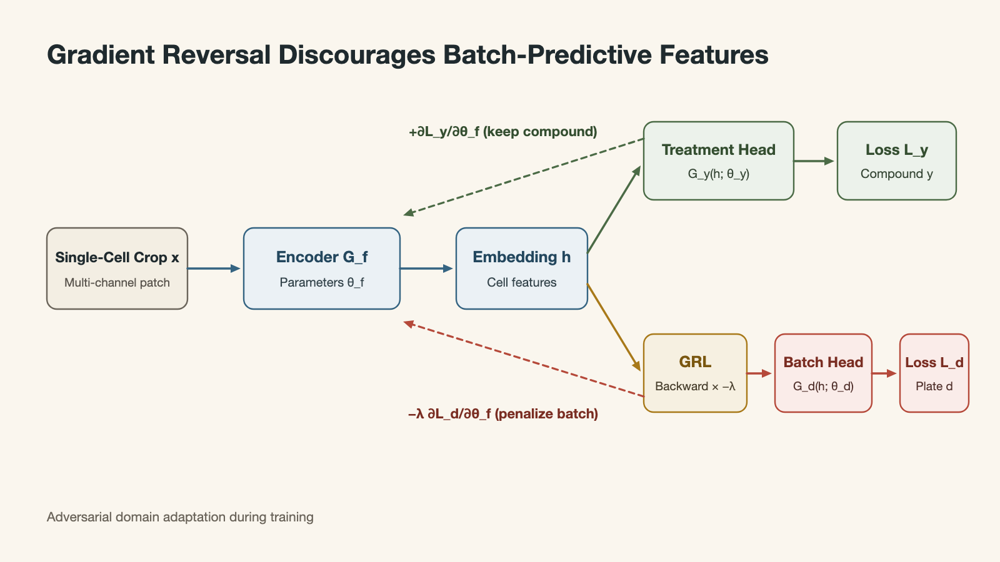

In 2012, researchers screening compounds for acute megakaryoblastic leukemia (AMKL) did not train a deep neural network to classify microscopy images end to end. Instead, they segmented DNA-stained nuclei and measured total per-cell DNA content ([p. 3](https://mit6874.github.io/assets/sp2021/slides/l21.pdf#page=3); Wen et al., 2012). Comparing the assay's positive-control compound `SU6656` against the neutral `DMSO` control showed a rightward shift in $\log_2(\text{Per-cell DNA content})$ from roughly $6\text{–}8$ to $9\text{–}11$, confirming that image segmentation could track nuclear polyploidization (with visual cell enlargement noted in the talk); subsequent screen hits, target-identification experiments, and testing of **Alisertib** led to clinical trials in adult AMKL ([recording, 02:55–04:40](https://www.youtube.com/watch?v=MVDUnbVXMGM&t=175s)).

Most biological screens lack a single pre-known morphological readout like cell size or DNA content. When comparing perturbed cell populations across thousands of candidate drugs or gene knockdowns, **image-based profiling** replaces hand-picked biomarkers with quantitative morphological representations extracted across multi-well plates ([pp. 5–6](https://mit6874.github.io/assets/sp2021/slides/l21.pdf#page=5); Caicedo et al., 2016).

[MIT 6.874 Lecture 21](https://mit6874.github.io/) (Spring 2021; the syllabus row reads *Video processing, structure determination*, while the official linked slides and recording—titled *Lecture 20: Deep Learning for Cell Imaging Segmentation* on YouTube—present guest lecturer **Juan C. Caicedo** from the Broad Institute on *Image-based cell phenotyping with deep learning*) splits that profiling workflow into two distinct deep-learning problems ([p. 7](https://mit6874.github.io/assets/sp2021/slides/l21.pdf#page=7); [07:40–07:56](https://www.youtube.com/watch?v=MVDUnbVXMGM&t=460s)): **cell segmentation** (a supervised detection task) and **single-cell representation learning** (a weakly supervised embedding task with optional adversarial batch correction).

![Conceptual synthesis of the two deep-learning stages across the MIT 6.874 Lecture 21 modules, pairing a real 2018 Data Science Bowl fluorescence nuclei image and its manual reference mask (p. 12) with two separate EGFR multi-channel single-cell crops (p. 25: Control and Wild Type), weakly supervised embeddings with optional GRL, and aggregated similarity profiles (Caicedo et al., 2017–2019). Note that the 2018 weakly supervised profiling study used Otsu DNA thresholding to crop cells, while the lecture pairs generic segmentation with learned embeddings.](lifesci21-assets/cell-profiling-pipeline.png){fig-alt="Four-stage synthesis on warm cream background. Panel 1 Raw Images shows a DSB fluorescence field. Panel 2 Cell Segmentation shows its manual reference masks (pretrained benchmark: 0.816 F1, 0 h). Panel 3 Single-Cell CNN feeds two separate EGFR cell crops (Control and Wild Type) into an encoder and embedding h, branching forward to y and GRL to d with backward -lambda. Panel 4 Profiles shows barcode vectors, a four-leaf dendrogram, and a similarity heatmap."}

## Stage 1: Generic cell segmentation across microscopy image groups

Historically, every time a biology lab changed a stain, microscope objective, or tissue preparation, its segmentation algorithm broke ([pp. 8–9](https://mit6874.github.io/assets/sp2021/slides/l21.pdf#page=8); [08:00–09:40](https://www.youtube.com/watch?v=MVDUnbVXMGM&t=480s)). Unlike face detectors in consumer photography—which work across indoor, outdoor, and crowded scenes without per-camera tuning—classical microscopy segmentation stayed brittle and protocol-specific ([p. 10](https://mit6874.github.io/assets/sp2021/slides/l21.pdf#page=10); [09:40–10:12](https://www.youtube.com/watch?v=MVDUnbVXMGM&t=580s)).

To test whether one supervised deep model could segment nuclei across divergent microscopy protocols, Caicedo and collaborators organized the **2018 Data Science Bowl** (\$100,000 prize; reported in the lecture as 3 months, 3,634 teams, 65,333 experiments, and roughly 32,000 manually annotated single cells across 30 experiments—while the published competition paper reports 3,891 first-stage teams, 68,017 submissions, and 37,333 annotated nuclei; [p. 11](https://mit6874.github.io/assets/sp2021/slides/l21.pdf#page=11)). The dataset spanned five visual image groups across fluorescence and brightfield microscopy, split into a public training set, a feedback test set (Test 1), and a blind final evaluation set (Test 2) with an observed **image-group distribution shift** between training and held-out splits ([p. 12](https://mit6874.github.io/assets/sp2021/slides/l21.pdf#page=12); [11:30–14:55](https://www.youtube.com/watch?v=MVDUnbVXMGM&t=690s)):

::: {.table-scroll}

| Visual Image Group | Training Share | Test Share | Shift (Test − Train) |
|---|---:|---:|---:|
| Small fluorescent | 80.6% | 67.9% | −12.7 pp |
| Purple tissue | 15.5% | 15.1% | −0.4 pp |
| Grayscale tissue | 2.4% | 0.9% | −1.5 pp |
| Large fluorescent | 0.9% | 11.3% | +10.4 pp |
| Pink and purple tissue | 0.6% | 4.7% | +4.1 pp |

:::

Note that the training shares sum to $100.0\%$, whereas the test shares reported on [p. 12](https://mit6874.github.io/assets/sp2021/slides/l21.pdf#page=12) sum to $99.9\%$ due to one-decimal rounding. Large fluorescent and pink-and-purple tissue images together made up only $1.5\%$ of training data yet $16.0\%$ of test data, forcing models to generalize across stain polarity, cell scale, and crowded tissue boundaries.

### How object overlap and F1-score measure segmentation

Each predicted nucleus mask $A_{\text{pred}}$ is matched against a ground-truth nucleus mask $A_{\text{true}}$ by **Intersection over Union (`IoU`)**:

$$
\text{IoU}(A_{\text{pred}}, A_{\text{true}}) = \frac{|A_{\text{pred}} \cap A_{\text{true}}|}{|A_{\text{pred}} \cup A_{\text{true}}|}.
$$

At a fixed threshold such as $\tau = 0.7$ (distinct from the competition's multi-threshold ranking average across IoU cutoffs), matched pairs exceeding the strict cutoff ($\text{IoU} > \tau$) count as true positives ($\text{TP}$), unmatched predictions count as false positives ($\text{FP}$), and missed real nuclei count as false negatives ($\text{FN}$), giving the image-level $F_1$ score ([p. 12](https://mit6874.github.io/assets/sp2021/slides/l21.pdf#page=12), [p. 15](https://mit6874.github.io/assets/sp2021/slides/l21.pdf#page=15)):

$$
\text{Precision} = \frac{\text{TP}}{\text{TP} + \text{FP}}, \qquad
\text{Recall} = \frac{\text{TP}}{\text{TP} + \text{FN}}, \qquad
F_1 = \frac{2\,\text{TP}}{2\,\text{TP} + \text{FP} + \text{FN}}.
$$

As **constructed numerical checks** (not lecture data) to build intuition for those thresholds:

- **Concentric boundary tolerance:** If a predicted circle sits entirely inside a ground-truth circle of radius $R$, then $\text{IoU} = \pi r^2 / (\pi R^2) = (r/R)^2$. Hitting the slide's $\text{IoU} = 0.7$ boundary requires $r/R = \sqrt{0.7} \approx 0.8367$, and passing the strict $\text{IoU} > 0.7$ match rule requires $r/R > \sqrt{0.7}$—so even a concentric mask that looks visually close misses over $16\%$ of the radius at the cutoff.
- **Object-count F1 check:** In an image with $21$ real nuclei where a model makes $19$ predictions—$16$ exceeding the $\text{IoU} > 0.7$ cutoff ($\text{TP}=16$), $3$ false splits or background hits ($\text{FP}=3$), and $5$ missed nuclei ($\text{FN}=5$)—precision is $16/19 \approx 0.8421$, recall is $16/21 \approx 0.7619$, and $F_1 = 32/40 = 0.8000$.

### Three architectures—and why the DSB ensemble outscored group-specific workflows

The top three Data Science Bowl entries spanned three distinct segmentation paradigms ([p. 14](https://mit6874.github.io/assets/sp2021/slides/l21.pdf#page=14); [15:10–32:10](https://www.youtube.com/watch?v=MVDUnbVXMGM&t=910s)):

1. **1st place (`[ods.ai] topcoders`) — U-Net & FPN ensemble:** An ensemble of 32 trained networks (8 U-Net and Feature Pyramid Network configurations across `DPN-92`, `ResNet34/101/152`, `InceptionResnetV2`, and `DenseNet121/169` trained over 4 cross-validation folds) evaluated with 8-way flip/rotation test-time augmentation ([23:00–25:30](https://www.youtube.com/watch?v=MVDUnbVXMGM&t=1380s); count of 32 at [24:04](https://www.youtube.com/watch?v=MVDUnbVXMGM&t=1444s)). Caicedo noted that its accuracy margin over second and third place was small relative to its heavy compute cost ([24:50–25:25](https://www.youtube.com/watch?v=MVDUnbVXMGM&t=1490s)).
2. **2nd place (`jacobkie`) — Feature Pyramid Network with boundary-distance encoding:** Rather than predicting binary foreground masks directly, the model predicted multi-scale per-pixel distances from cell interiors to boundaries along four fixed directions (described in the talk as distance/direction cues toward boundaries and centers), improving separation in crowded nuclei ([19:20–21:40](https://www.youtube.com/watch?v=MVDUnbVXMGM&t=1160s)).
3. **3rd place (`Deep Retina`) — Mask R-CNN:** A Mask R-CNN architecture (illustrated with a COCO-pretrained `ResNet50-FPN` diagram on [p. 14](https://mit6874.github.io/assets/sp2021/slides/l21.pdf#page=14), while the `Deep Retina` team's submitted implementation used a COCO-pretrained `ResNet101-FPN` backbone) with a Region Proposal Network (`RPN`), `RoIAlign`, and parallel box, class, and mask heads. Other teams ran the same public codebase without matching this score; Caicedo noted that the other teams' exact configurations were unknown, making hyperparameter calibration and preprocessing a plausible explanation ([15:20–18:50](https://www.youtube.com/watch?v=MVDUnbVXMGM&t=920s)).

To measure practical lab effort and accuracy, Caicedo et al. (2019, *Nature Methods*) compared four segmentation workflows by mean per-image `F1-score @ 0.7 IoU` across Stage 2 held-out images spanning all five image groups (106 scored images in the benchmark paper, introduced as a 100-image scenario in the talk at [27:56](https://www.youtube.com/watch?v=MVDUnbVXMGM&t=1676s); [p. 15](https://mit6874.github.io/assets/sp2021/slides/l21.pdf#page=15)):

{fig-alt="Paired horizontal bar chart titled The DSB Ensemble Outscored Group-Specific Workflows comparing four cell segmentation workflows on the Stage 2 benchmark across five image groups (Caicedo et al., 2019). Top DSB model achieves 0.816 mean per-image F1-score at 0.7 IoU with 0 h configuration time for the pretrained model; CellProfiler Expert reaches 0.743 in 3 h; U-Net Data scientist reaches 0.620 in 20 h; CellProfiler Novice reaches 0.616 in 5 h."}

Training five separate per-group U-Nets (`0.620` $F_1$, `20 hours` of estimated data-scientist tuning) trailed a `CellProfiler` expert (`0.743` $F_1$, `3 hours`) and matched a `CellProfiler` novice (`0.616` $F_1$, `5 hours`), with Caicedo noting that imbalanced training coverage across image groups—alongside intrinsic differences in boundary difficulty—likely contributed to lower accuracy on scarce tissue types ([29:21–30:10](https://www.youtube.com/watch?v=MVDUnbVXMGM&t=1761s)). Using the single pretrained top-performing DSB model reached **`0.816` $F_1$ with zero per-lab configuration time** (`0 h` for an already-trained model)—though because the benchmark changes training data, architecture, and ensembling together, it reflects the full generalist workflow rather than isolating image-group pooling alone. Follow-on community tools adopted all three competition architectures ([p. 16](https://mit6874.github.io/assets/sp2021/slides/l21.pdf#page=16)): **`Cellpose`** (Stringer et al., 2020; U-Nets, supporting both nuclei and whole-cell cytoplasm segmentation), **`nucleAIzer`** (Hollandi et al., 2020; Mask R-CNN, targeting nuclei segmentation), and **`Mesmer`** (Greenwald et al., 2021; Feature Pyramid Networks, segmenting both nuclei and whole cells).

## Stage 2: Weakly supervised single-cell representation learning

Once cells are located, the profiling pipeline follows five steps ([p. 19](https://mit6874.github.io/assets/sp2021/slides/l21.pdf#page=19); Caicedo et al., 2017): raw images $\to$ segmented cells $\to$ single-cell feature matrix $\to$ population-level treatment profiles $\to$ downstream statistical comparisons. Classical profiling computes hand-engineered descriptors—area, shape, color distribution, and nuclear size ([p. 20](https://mit6874.github.io/assets/sp2021/slides/l21.pdf#page=20)).

Replacing hand-engineered descriptors with learned neural features runs into an immediate supervision problem: **there are no ground-truth biological phenotype labels** during drug discovery or functional genomics ([36:35–37:45](https://www.youtube.com/watch?v=MVDUnbVXMGM&t=2195s)). We do not know beforehand which compounds work or which share a mechanism of action.

**Weakly supervised profiling** ([p. 22](https://mit6874.github.io/assets/sp2021/slides/l21.pdf#page=22); Caicedo et al., 2018, *CVPR*, which located cells via Otsu DNA thresholding; extended in `DeepProfiler`) solves this by pairing an **auxiliary training task** with a different **main profiling goal**:

- **Auxiliary task (single-cell treatment classification):** Given a cropped single-cell image $x_k$ from a multi-well plate, we know the applied treatment label $y_k \in \{1,\dots,T\}$ from the plate map. A CNN extracts an embedding $h_k = \phi_\theta(x_k) \in \mathbb{R}^d$ and passes logits $z_k = W h_k + b \in \mathbb{R}^T$ through a softmax cross-entropy loss:
  $$
  \mathcal{L}_{\text{CE}}(\theta, W, b) = -\frac{1}{K}\sum_{k=1}^{K} \log \frac{\exp(z_{k, y_k})}{\sum_{c=1}^{T}\exp(z_{k, c})}.
  $$
- **Main goal (treatment-level profiling):** At inference time, we discard the classification head. For each treatment $i$ with single-cell set $X_i$, we aggregate cell embeddings into a treatment profile $\mu(X_i) = \frac{1}{|X_i|}\sum_{k \in X_i}\phi_\theta(x_k)$ and compute pairwise similarity $Z_{i,j}$ (for example via Pearson correlation or cosine similarity) across treatments ([37:45–39:00](https://www.youtube.com/watch?v=MVDUnbVXMGM&t=2265s)).

### Pairwise graph evaluation and benchmark enrichment

To test whether learned profiles recover real biology without peeking at labels during inference, Caicedo evaluates the **all-pairs similarity graph** over $M$ treatments, which contains $\binom{M}{2} = \frac{M(M-1)}{2}$ undirected connections—for instance, $M = 13$ points on [p. 23](https://mit6874.github.io/assets/sp2021/slides/l21.pdf#page=23) yield $\binom{13}{2} = 78$ pairwise connections. Ranking all pairs by similarity $Z_{i,j}$ and checking how often the top $q\%$ of connections share a known Mechanism of Action (`MOA`) or pathway relative to the remaining $(100 - q)\%$ yields a fold enrichment score ([pp. 23–24](https://mit6874.github.io/assets/sp2021/slides/l21.pdf#page=23)).

As a **constructed arithmetic check** on a $13$-node, $78$-pair graph (the slide reports $13$ nodes and $78$ pairs, while the hit counts below are constructed): if $12$ of the $78$ pairs truly share an MOA, and the top $13$ highest-similarity pairs ($16.7\%$) contain $6$ same-MOA pairs ($6/13 \approx 46.2\%$) while the remaining $65$ pairs contain the other $6$ ($6/65 \approx 9.2\%$), the top connections show a $(6/13)/(6/65) = 5.00\times$ hit-rate ratio and an odds ratio of $(6/7)/(6/59) \approx 8.43$. (Slide 24 does not specify whether its vertical axis uses odds ratios or hit-rate ratios, though later `DeepProfiler` publications use per-query odds ratios.)

Across three five-channel Cell Painting benchmarks (`Nucleus`, `ER`, `Mitochondria`, `Actin/Golgi/Plasma membrane`, `Nucleoli/cyto RNA`) plotted from `0.4%` to `2.0%` top connections on [p. 24](https://mit6874.github.io/assets/sp2021/slides/l21.pdf#page=24) (whose y-axis is labeled verbatim as `Folds of enrichment (%)`), weakly supervised **deep learning (`DeepProfiler`) outperformed classical features across every threshold**:

::: {.table-scroll}

| Benchmark | Perturbation Scope | Reported Deep Learning vs. Classical at Top 0.4% Connections |
|---|---|---|
| `BBBC037` | Gene over-expression (`200` genes / ORFs) | $\approx 30\times$ vs. $\approx 9\times$ |
| `BBBC022` | Compound screen (`1,600` drugs, `453` MOAs) | $>8\times$ vs. $<3\times$ |
| `BBBC036` | Compound screen (`2,240` drugs, `693` MOAs) | $>8\times$ vs. $\approx 6.6\times$ |

:::

Beyond compound screening, single-cell morphological similarity can quantify phenotypic differences when evaluating whether a sequenced tumor mutation acts as a **driver** or a **passenger** ([pp. 25–26](https://mit6874.github.io/assets/sp2021/slides/l21.pdf#page=25); [40:20–41:40](https://www.youtube.com/watch?v=MVDUnbVXMGM&t=2420s)). Comparing `EGFR` wild-type cells ($n = 8{,}457$), `EGFR_p.S645C` mutant cells ($n = 9{,}903$), and control cells ($n = 21{,}554$) showed shifted—though overlapping—single-cell distributions in the two-dimensional projection and a reported **variant impact score of `66.9%`** (an assay separation metric rather than a calibrated probability of oncogenicity).

## Batch confounders and Gradient Reversal (GRL)

Weak supervision has an Achilles' heel: **batch effects (`BE`)**. The causal diagram on [p. 21](https://mit6874.github.io/assets/sp2021/slides/l21.pdf#page=21) shows why naive treatment classification leaks spurious cues. The desired biological path runs **`CS -> MO -> PH`**: compound structure (`CS`) induces a morphological signature (`MO`), which reveals the phenotype (`PH`). However, batch effects—plate identity, imaging time, reagent lot, or technician—act as a **confounder** along two red shortcut paths:

1. `BE -> MO`: technical artifacts directly distort cell morphology.
2. `BE -> CS -> PH`: multi-well plate layouts often organize compounds systematically across specific plates or batches, creating a shortcut from batch to compound identity and phenotype prediction.

Because the CNN only needs to predict which treatment well a cell came from, it can memorize plate lighting or edge artifacts instead of biology. On [p. 27](https://mit6874.github.io/assets/sp2021/slides/l21.pdf#page=27), embeddings colored by platemap form tight batch islands; post-hoc batch correction collapses some global offset yet leaves visible plate-correlated structure behind ([41:45–42:15](https://www.youtube.com/watch?v=MVDUnbVXMGM&t=2505s)).

To discourage batch-predictive features during training, Caicedo introduces an adversarial **Gradient Reversal Layer (`GRL`)** ([p. 28](https://mit6874.github.io/assets/sp2021/slides/l21.pdf#page=28); Ganin & Lempitsky, 2015; [42:15–43:40](https://www.youtube.com/watch?v=MVDUnbVXMGM&t=2535s)):

{fig-alt="Two-branch neural network diagram. Single-Cell Crop x feeds Encoder G_f with parameters theta_f to produce Embedding h. Upper branch sends h to Treatment Head G_y and Loss L_y, returning positive gradient +dL_y/dtheta_f to keep compound signal. Lower branch passes h through GRL (Backward x -lambda) to Batch Head G_d and Loss L_d, returning reversed gradient -lambda dL_d/dtheta_f to penalize batch."}

Let $h = G_f(x; \theta_f)$ be the shared encoder embedding (denoted `features f` on [p. 28](https://mit6874.github.io/assets/sp2021/slides/l21.pdf#page=28)), $\hat{y} = G_y(h; \theta_y)$ the treatment head with loss $L_y$, and $\hat{d} = G_d(\mathcal{R}_\lambda(h); \theta_d)$ the batch/domain classifier head with loss $L_d$. In the forward pass, $\mathcal{R}_\lambda(h) = h$ acts as the identity map; in backpropagation, the custom `GRL` backward rule maps any incoming upstream gradient $g$ to $-\lambda g$ ($\lambda > 0$). Writing $\frac{\partial L_d}{\partial \theta_f}$ for the domain-loss gradient with respect to $\theta_f$ **before** reversal, one stochastic gradient descent step with learning rate $\eta$ updates the three parameter blocks as:

$$
\theta_y \leftarrow \theta_y - \eta \frac{\partial L_y}{\partial \theta_y}, \qquad
\theta_d \leftarrow \theta_d - \eta \frac{\partial L_d}{\partial \theta_d}, \qquad
\theta_f \leftarrow \theta_f - \eta \left(\frac{\partial L_y}{\partial \theta_f} - \lambda \frac{\partial L_d}{\partial \theta_f}\right).
$$

Notice the minimax tension: $\theta_d$ improves at predicting the plate/batch $d$, while the $-\lambda \frac{\partial L_d}{\partial \theta_f}$ term pushes $\theta_f$ **uphill** on $L_d$ (discouraging batch-predictive features) while $\frac{\partial L_y}{\partial \theta_f}$ pulls $\theta_f$ **downhill** on $L_y$ (preserving treatment discrimination).

As a **constructed 1D gradient check**, let $h = \theta_f x$ with $x = 2.0$, $\theta_f = 0.5$ ($h = 1.0$), linear heads $G_y(h) = w_y h$ and $G_d(h) = w_d h$ with $w_y = w_d = 1.0$, squared-error losses $L_y = \frac{1}{2}(\hat{y} - y)^2$ and $L_d = \frac{1}{2}(\hat{d} - d)^2$, targets $y = 2.0$, $d = 2.0$, and $\lambda = 0.5$. Before reversal, both losses push $\theta_f$ in the same direction:

$$
\frac{\partial L_y}{\partial \theta_f} = (\hat{y} - y)\,w_y x = (1.0 - 2.0)(1.0)(2.0) = -2.0, \qquad
\frac{\partial L_d}{\partial \theta_f} = (\hat{d} - d)\,w_d x = (1.0 - 2.0)(1.0)(2.0) = -2.0.
$$

With `GRL`, the effective encoder gradient becomes $-2.0 - 0.5(-2.0) = -1.0$, subtracting half of the batch-aligned component. With the heads held fixed and a small positive step $\eta$, this combined update still decreases both $L_y$ and $L_d$ (only the $-\lambda \frac{\partial L_d}{\partial \theta_f} = +1.0$ contribution opposes $L_d$), whereas in this equal-gradient example increasing $\lambda$ above $1.0$ reverses the net sign (more generally, reversing aligned gradients requires $\lambda \|g_d\| > \|g_y\|$).

On [p. 29](https://mit6874.github.io/assets/sp2021/slides/l21.pdf#page=29), training `ResNet18GRL` across 9 genetic perturbation/control classes (`0_CTRL`, `0_DGK`, `0_FIG4`, `0_GDAP1`, `0_GUK1`, `0_KIF1A`, `0_MFN2`, `0_RRM1`, `0_VCP`) and 9 dataset/batch sources (`1_DS1` through `1_DS9`) produced visible mixing of dataset colors (`1_DS1`–`1_DS9`) across both training and held-out validation projections while maintaining broad biological groupings (with visible overlap among some validation classes and no quantitative residual batch-accuracy metric reported).

## Open challenges

Caicedo closes both parts of the lecture with four unsolved bottlenecks ([p. 17](https://mit6874.github.io/assets/sp2021/slides/l21.pdf#page=17), [p. 30](https://mit6874.github.io/assets/sp2021/slides/l21.pdf#page=30); [33:15–34:00](https://www.youtube.com/watch?v=MVDUnbVXMGM&t=1995s), [43:50–44:25](https://www.youtube.com/watch?v=MVDUnbVXMGM&t=2630s)):

- **Segmentation scale and label efficiency:** Public annotated microscopy datasets remain small compared with natural-image benchmarks, making active learning from a few corrected examples a promising way to reduce expert annotation effort ([33:46](https://www.youtube.com/watch?v=MVDUnbVXMGM&t=2026s)).
- **Stronger domain adaptation and explainability:** Adversarial batch correction remains an active research problem—Caicedo introduced `GRL` as an approach his group was currently testing ([42:17](https://www.youtube.com/watch?v=MVDUnbVXMGM&t=2537s))—and deep single-cell embeddings remain difficult for biologists to interpret compared with classical morphology metrics.

## Lecture and sources

<iframe src="https://www.youtube.com/embed/MVDUnbVXMGM" title="MIT 6.874 Spring 2021 Lecture 21 — Image-Based Cell Phenotyping with Deep Learning (YouTube: Lecture 20)" allow="accelerometer; autoplay; clipboard-write; encrypted-media; gyroscope; picture-in-picture" allowfullscreen loading="lazy"></iframe>

- [MIT 6.874 Spring 2021 official schedule](https://mit6874.github.io/) (Lecture 21, May 6, 2021; syllabus row text reads *Video processing, structure determination*, while the linked slides and recording cover Caicedo's cell phenotyping lecture) and [official lecture recording](https://www.youtube.com/watch?v=MVDUnbVXMGM) (45:19; titled *Lecture 20: Deep Learning for Cell Imaging Segmentation* on YouTube).
- [Juan C. Caicedo, *Image-based cell phenotyping with deep learning*, Lecture 21 slides (32 pp.)](https://mit6874.github.io/assets/sp2021/slides/l21.pdf), especially pp. 2–3, 6–17, 19–31.
- Key cited studies: Wen et al., *Cell* (2012) (AMKL leukemia screen / Alisertib); Caicedo et al., *Curr. Opin. Biotechnol.* (2016) (image-based profiling overview); Caicedo et al., *Nature Methods* (2017) (profiling pipeline); Caicedo et al., *CVPR* (2018) (weakly supervised single-cell CNN); Caicedo et al., *Nature Methods* (2019) (2018 Data Science Bowl evaluation); Stringer et al., *Nature Methods* (2020) (`Cellpose`); Hollandi et al., *Cell Systems* (2020) (`nucleAIzer`); Greenwald et al., *bioRxiv* (2021) (`Mesmer`); Ganin & Lempitsky, *ICML* (2015) (Gradient Reversal Layer).
- Original explanatory figures: [create_figures.py](lifesci21-assets/create_figures.py) and [manifest.json](lifesci21-assets/manifest.json). Constructed worked checks (concentric-circle $\text{IoU}=0.7$, object-count $F_1$, 78-pair enrichment ratio, and 1D `GRL` gradient step) are labeled explicitly and separated from lecture-reported measurements.
