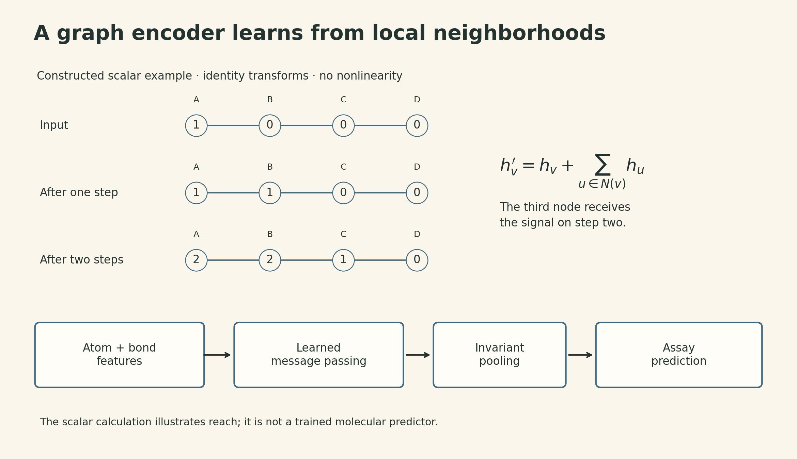
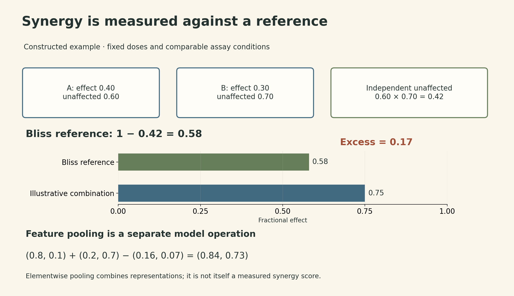
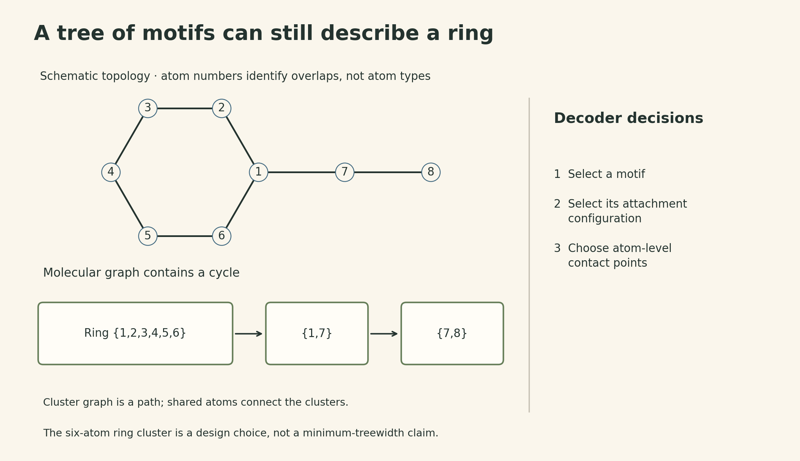

A molecular model can rank an existing compound, predict how two compounds might interact, or propose a new structure. These outputs lead to different experiments. A high score identifies something worth testing; it does not establish what happens in a patient.

Wengong Jin's guest lecture in MIT 6.874 connects these tasks through representation learning. Atoms and bonds provide the starting graph. Biological targets can give some hidden coordinates a specific meaning. Chemical fragments can become the units of a generative model. The representation determines both what the model can learn and what its output means.

## Screening and generation answer different questions

In learned property prediction, a molecular graph $G$ is mapped to an assay-specific prediction $\hat y=f_\theta(G)$. Virtual screening applies such a predictor to a candidate library and ranks the results. In the lecture's examples, selecting compounds that can be obtained quickly makes experimental follow-up easier. Virtual screening more broadly can also use docking or libraries of compounds that still need synthesis; it is not defined by commercial availability alone.

De novo design reverses the direction of the problem: desired properties guide the proposal of a structure. The output is a graph, with atom identities, bonds, and attachment choices, rather than a single score. A generator can propose structures outside the screened library, but it does not thereby exhaust chemical space. Its training data, vocabulary, and decoding rules constrain what it can produce. A proposal may also be difficult to synthesize. [Lecture slides, pp. 7–15 and 42–43](https://mit6874.github.io/assets/sp2021/slides/l16.pdf).

Both approaches ultimately depend on an experimental endpoint. Inhibition of bacterial growth, binding to a particular target, toxicity, and solubility are separate properties. A representation useful for one is not guaranteed to predict the others.

## A graph encoder learns which neighborhoods matter

Let $G=(V,E)$ represent a molecule. Each atom $v$ has features $x_v$, and each bond $(u,v)$ has features $e_{uv}$. A generic message-passing layer can be written as

$$
m_v^{(t+1)}=\sum_{u\in\mathcal N(v)}M_t(h_v^{(t)},h_u^{(t)},e_{uv}),
\qquad h_v^{(t+1)}=U_t(h_v^{(t)},m_v^{(t+1)}).
$$

Here $h_v^{(t)}\in\mathbb R^d$, messages lie in $\mathbb R^r$, $M_t$ maps the two node vectors and bond features to a message, and $U_t$ maps the node vector and aggregated message to its next state. Shared functions and a sum over neighbors remove dependence on the arbitrary order in which neighbors are listed. After $T$ local layers, a node can depend on information up to $T$ hops away. This describes the receptive field, not a guarantee that all different neighborhoods receive different embeddings.

A permutation-invariant readout, such as $h_G=\sum_{v\in V}h_v^{(T)}$, supplies a graph vector for a prediction head. Supervised training adjusts both the representation and the head. By contrast, a fixed molecular fingerprint specifies its representation before fitting the downstream predictor. [Lecture slides, pp. 20–24](https://mit6874.github.io/assets/sp2021/slides/l16.pdf).

{#fig-encoding fig-alt="Schematic graph A-B-C-D has illustrative scalar node values 1,0,0,0. The explicitly simplified update h new equals h plus the sum of neighboring h gives 1,1,0,0 after one step and 2,2,1,0 after two steps. A separate pipeline shows actual atom and bond features passing through learned message functions, invariant pooling, and an assay prediction head. The numerical example is not a chemical prediction or the directed bond-message model used in the antibiotic study."}

For a small constructed example, take a four-node path and the update $h_v'=h_v+\sum_{u\in\mathcal N(v)}h_u$. Starting from $(1,0,0,0)$ gives $(1,1,0,0)$ after one step and $(2,2,1,0)$ after two. Information reaches the third node only on the second step. These are illustrative scalar features with identity transforms and no nonlinearity; they are not measured molecular properties.

The antibiotic study used a **directed bond-message model**, augmented with computed RDKit descriptors and an ensemble. That distinction matters: its result does not establish that learned features must replace every hand-designed feature. The generic node update above explains information flow, rather than reproducing that implementation. [Stokes et al., Results](https://pmc.ncbi.nlm.nih.gov/articles/PMC8349178/).

## Halicin illustrates how ranking changes the testing queue

The study screened 2,560 compounds for inhibition of *E. coli* BW25113; deduplication left 2,335 unique structures. In a separate Drug Repurposing Hub screen, after removing molecular structures shared with the training set, 51 of 99 selected high-ranked candidates inhibited growth under the reported assay criterion. Halicin was an existing molecule, SU3327, whose antibacterial activity was identified through this process. It was not a new structure generated by the network. Follow-up work included bacterial assays and mouse infection models. [Stokes et al., Fig. 2 and Results](https://pmc.ncbi.nlm.nih.gov/articles/PMC8349178/).

The distinction between a ranking and an experiment explains the practical benefit. With a fixed testing budget, changing the order of candidates changes which compounds receive a measurement. The 51/99 result is a hit rate within a selected group; it is not the probability that an arbitrary molecule will work, or a clinical success rate. The lecture's retrospective ranking comparison makes this budget argument, but a successful case does not prove that one model family dominates every molecular task. [Lecture slides, pp. 25–29](https://mit6874.github.io/assets/sp2021/slides/l16.pdf).

## Biological targets can supervise the intermediate representation

Drug combinations add a data problem. There may be many measurements for individual compounds and their targets, but relatively few measured pairs. The lecture calls the model ComboNet; its earlier preprint describes it as a biological bottleneck model. It uses these additional tasks to shape the representation used for combination prediction.

Its biological bottleneck maps a molecular graph to $z_A\in[0,1]^{d_z}$. Here $d_z$ counts both supervised and latent coordinates. Some coordinates correspond to selected biological targets and receive drug–target supervision. Other coordinates are latent features learned through the antiviral tasks; they should not be assigned the names of known proteins without evidence. A downstream function $f$ maps this representation to a single-agent activity prediction:

$$
z_A=\phi(G_A),\qquad p_A=f(z_A).
$$

The preprint's explicit formulation uses $f(z)=\sigma(w^\top z+b)$, with $w\in\mathbb R^{d_z}$, scalar $b$, and sigmoid $\sigma$. The lecture presents the same biological-and-chemical representation idea diagrammatically. This is a model of relationships among structures, targets, and activity, rather than a simulation of a ligand moving in a three-dimensional protein pocket. [Biological Bottleneck Models preprint, §3.1–3.3](https://arxiv.org/abs/2011.04651v2).

For one disease, the training objective combines drug–target, single-agent, and combination supervision:

$$
\mathcal L=\lambda_{\mathrm{DTI}}\mathcal L_{\mathrm{DTI}}
+\lambda_S\mathcal L_S+\mathcal L_C.
$$

Only observed drug–target labels contribute to the corresponding supervised terms. A missing entry in an assay database is not a measured negative. The coefficients determine the relative influence of the auxiliary tasks. Sharing this structure can make limited combination data more useful, but neither the target coordinates nor the latent features automatically constitute a causal explanation. [Biological Bottleneck Models preprint, §3.4](https://arxiv.org/abs/2011.04651v2).

The preprint also transfers information from HIV drug–target, single-agent, and combination data. Its final multi-disease objective sums the corresponding losses across diseases, with a shared drug–target encoder and disease-specific activity heads. Thus the three-term expression above describes the components of one disease’s loss; it is not the entire multi-disease training objective. [Biological Bottleneck Models preprint, §3.4, Eq. 8](https://arxiv.org/abs/2011.04651v2).

## Synergy needs a reference model

Suppose $p_A,p_B\in[0,1]$ are fractional inhibitory effects at specified doses under comparable assay conditions. Under a Bliss independence reference, the unaffected fractions multiply:

$$
1-e_{AB}=(1-p_A)(1-p_B).
$$

Expanding gives

$$
e_{AB}=p_A+p_B-p_Ap_B.
$$

The subtraction accounts for the overlap implicit in the independence reference. Simply adding $p_A+p_B$ can exceed one and answers a different question. If the combination's effect is $p_{AB}$, the Bliss excess is $s_{AB}=p_{AB}-e_{AB}$. Positive excess means synergy relative to this reference at these conditions. It is not a statement that every dose pair is synergistic or that the combination is safe.

For a constructed example, let $p_A=0.4$ and $p_B=0.3$. The independent reference is $1-(0.6)(0.7)=0.58$. A combination effect of $0.75$ gives an excess of $0.17$, or 17 percentage points. These numbers illustrate the arithmetic; they are not experimental results for any named drugs.

{#fig-bliss fig-alt="Constructed effects at fixed doses are 0.40 for drug A and 0.30 for drug B. Their unaffected fractions are 0.60 and 0.70, giving an independent unaffected fraction of 0.42 and effect of 0.58. Bars on a common zero-to-one axis compare the 0.58 reference with an illustrative 0.75 combination effect; the difference is 0.17. A separate row shows elementwise target-feature pooling: vectors 0.8,0.1 and 0.2,0.7 combine to 0.84,0.73. Feature pooling and measured synergy are explicitly distinguished."}

ComboNet uses the same algebra at a different level. It combines the two **feature vectors** elementwise:

$$
z_{AB}=z_A+z_B-z_A\odot z_B,
\qquad p_{AB}=f(z_{AB}).
$$

For $z_A=(0.8,0.1)$ and $z_B=(0.2,0.7)$, the result is $(0.84,0.73)$. Each coordinate stays in $[0,1]$ and the operation is symmetric in A and B. It provides a union-like inductive bias. This does not prove that two drugs act independently on each target, and the pooled vector itself is not a synergy score. The model still compares $f(z_{AB})$ with $p_A+p_B-p_Ap_B$. Here $p_A$ and $p_B$ are model-predicted activity scores trained against binary active/inactive labels, rather than measured fractional inhibitory effects. The Bliss expression is therefore evaluated on model outputs; it does not by itself establish an experimental dose-specific synergy value. [Biological Bottleneck Models preprint, §3.2, Eqs. 3–4](https://arxiv.org/abs/2011.04651v2).

The lecture reports evaluation with 88 training and 71 test combinations, followed by experimental testing in Vero E6 cell assays. Its examples include remdesivir with reserpine and with IQ-1S. These are research results presented in the 2021 lecture, not treatment recommendations. A result in that cell system does not establish human efficacy, dose selection, or safety. The preprint reports 90 training and 72 test SARS-CoV-2 combinations, so the two versions should not be silently treated as one experimental configuration. [Lecture slides, pp. 39–40](https://mit6874.github.io/assets/sp2021/slides/l16.pdf).

## A generative model must decide how parts connect

Generating molecules introduces a structural output space. A SMILES model generates a sequence that encodes a graph. A direct graph model generates atoms and bonds. A hierarchical model can instead choose a chemical motif and then specify how it attaches to the partial structure.

The lecture highlights two difficulties. First, nearby molecular structures need not have nearby string representations. Second, an atom-by-atom decoder that considers every previous atom when adding a new one makes

$$
\sum_{k=1}^{N-1}k=\frac{N(N-1)}2
$$

candidate pair decisions for $N$ atoms, even if the final graph is sparse. At $N=100$, that is 4,950 possible pairs. This describes the stated decoding scheme, not a lower bound for every graph generator. [Lecture slides, pp. 44–48](https://mit6874.github.io/assets/sp2021/slides/l16.pdf).

The Junction Tree VAE introduces a tree over chemical substructures, followed by assembly into a molecular graph. Rings can live inside a substructure, so a tree at the coarse level does not require a ring-free molecule. The later hierarchical model supports larger motifs and makes three successive choices: which motif to add, its attachment configuration, and its atom-level contact points with the growing graph. Its encoder represents atoms, attachment configurations, and motifs at different levels. [Junction Tree VAE, §2](https://proceedings.mlr.press/v80/jin18a.html); [Hierarchical Generation, §2–3](https://proceedings.mlr.press/v119/jin20a.html).

{#fig-motifs fig-alt="A schematic molecule contains a six-node ring with a two-node tail. Three overlapping clusters are shown: the six ring atoms, atoms 1 and 7, and atoms 7 and 8. Their cluster graph is a three-node path, although the underlying molecular graph contains a cycle. The right panel lists motif selection, attachment configuration, and atom-level contact choice as distinct decoding decisions. The ring cluster uses six atoms by design and is not asserted to be a minimum-width tree decomposition."}

A ring with a two-atom tail gives a concrete coarse representation. Put the ring atoms in one cluster, the bond from the ring to the first tail atom in a second, and the final bond in a third. The clusters form a path and overlap at their shared atoms. The same ring remains present in the assembled graph. This is a schematic construction, not a claim that the pictured clusters minimize treewidth.

Fewer motif additions can shorten the generation sequence, but attachment choices still cost computation. A count of tree-expansion steps alone does not establish linear total runtime for arbitrary motifs. The original Junction Tree VAE and later hierarchical model also use different assembly procedures; their speed and vocabulary statistics should remain tied to the specific method.

## Reconstruction, validity, and useful activity are different tests

Reconstruction asks whether an encoder–decoder returns the input molecule. Validity asks whether the generated structure meets the representation's chemical constraints. Property optimization asks whether it improves the chosen score. Experimental validation asks whether an assay confirms a relevant effect. A strong result on one test does not automatically establish the next.

The lecture's QED comparison has a specific protocol in the hierarchical-generation paper: transform inputs with QED in $[0.7,0.8]$ to outputs in $[0.9,1.0]$, while retaining Tanimoto similarity over Morgan fingerprints of at least $0.4$. Each input receives 20 sampled candidates; success means at least one meets both constraints. Reported success rates are 58.5% for Seq2Seq, 73.6% for AtomG2G, and 76.9% for HierG2G. These are rates of successful **input transformations under a 20-candidate budget**, not per-sample success probabilities. [Hierarchical Generation, §4.2 and Table 2](https://proceedings.mlr.press/v119/jin20a.html).

QED is a computable drug-likeness score. Improving it does not demonstrate improved antibacterial potency, preserved target activity, or acceptable human toxicity. Those claims require evidence for those endpoints.

The three parts of the lecture therefore change three different decisions: which existing compounds to test, which pairs to investigate, and which structures to try making. Learned representations can make each decision more informed. The experimental question still has to be stated separately from the model's output.

## Lecture and sources



[Watch the official lecture](https://www.youtube.com/watch?v=AHVJv5RNqKs).

- [MIT 6.874 Spring 2021 schedule](https://mit6874.github.io/) and [Lecture 16 slides](https://mit6874.github.io/assets/sp2021/slides/l16.pdf).
- [Stokes et al. — A Deep Learning Approach to Antibiotic Discovery](https://pmc.ncbi.nlm.nih.gov/articles/PMC8349178/).
- [Jin et al. — Biological Bottleneck Models, preprint](https://arxiv.org/abs/2011.04651v2); [published ComboNet paper](https://doi.org/10.1073/pnas.2105070118).
- [Junction Tree Variational Autoencoder](https://proceedings.mlr.press/v80/jin18a.html) and [Hierarchical Generation of Molecular Graphs using Structural Motifs](https://proceedings.mlr.press/v119/jin20a.html).
