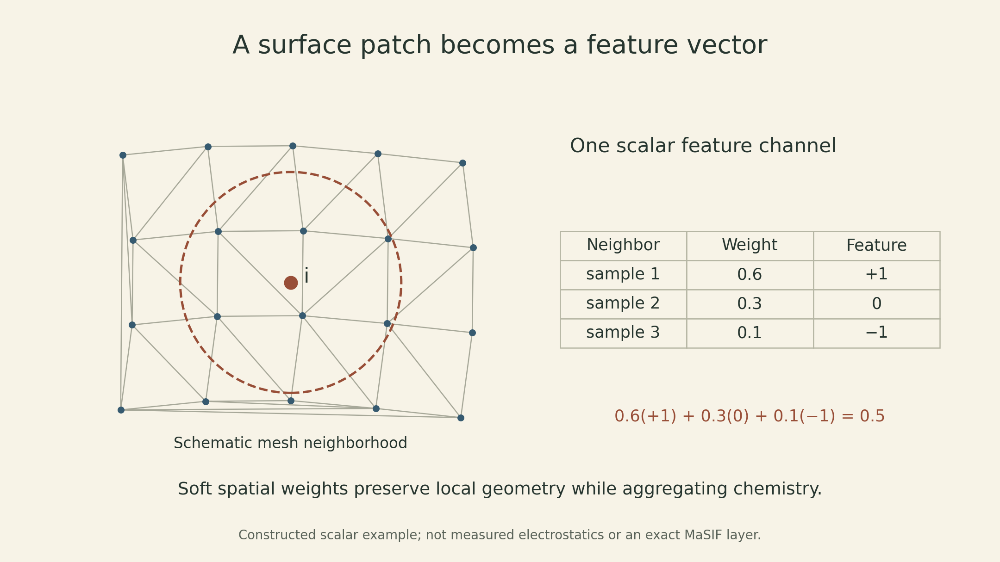
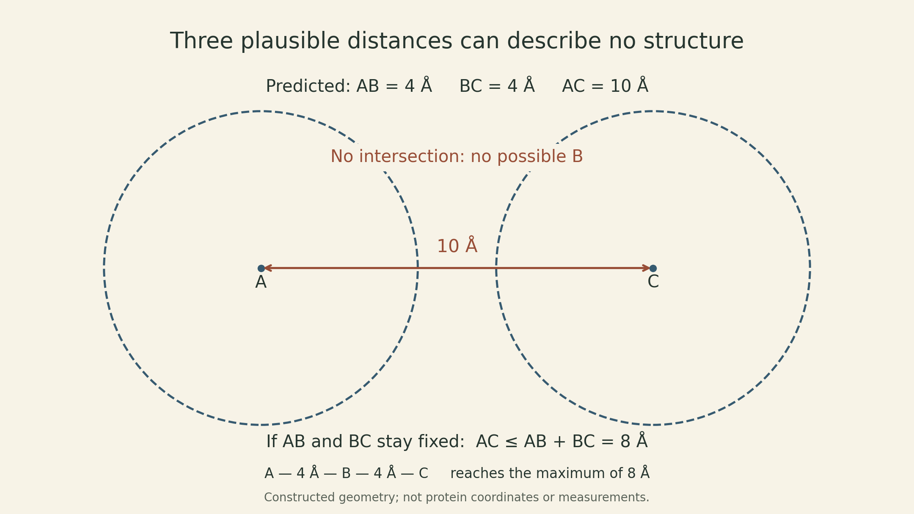
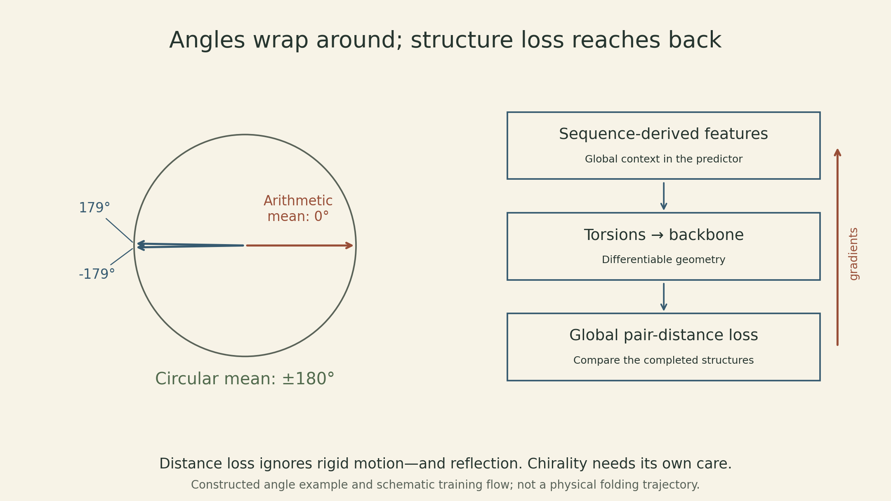

A predictor can assign a plausible distance to every pair of residues and still describe a protein that cannot exist. Three predicted distances of 4, 4, and 10 angstroms already fail: no triangle has those sides. Predicting many local relationships is useful, but they must eventually fit into one three-dimensional object.

[MIT 6.874 Lecture 17](https://mit6874.github.io/) brings together three views of that problem. Bruno Correia starts with a known structure and asks what its surface can tell us about interactions. Jinbo Xu predicts residue-pair relationships from sequence information and uses them to build a structure. Mohammed AlQuraishi places a differentiable geometric construction inside the model so that errors in the final structure can train the predictor.

These are connected tasks with different inputs and outputs. A good fold does not establish a binding partner, a surface match does not prove binding, and a predicted structure does not reconstruct the physical trajectory by which a protein folds. The methods below are the ones discussed in the **Spring 2021 lecture**, with the original RGN paper used to clarify the properties of its geometric loss.

## Start by specifying which object is predicted

A protein can be represented as a sequence, an atomic coordinate array, a residue graph, or a molecular surface. Each representation makes some relationships easy to express and hides others.

For a sequence of length $L$, an alignment of $M$ homologous sequences, projected onto the query positions with insertion columns removed, has $M\times L$ positions, including gaps. A general alignment can have more columns than the query has residues. A per-position profile summarizes each column; it loses the explicit row-wise association between columns. Pair features instead describe relationships between positions $i$ and $j$ and can form a tensor in $\mathbb R^{L\times L\times c}$, where $c$ is the number of channels. Coordinates for one chosen representative atom per residue form $R\in\mathbb R^{L\times3}$. A surface mesh has a different number of vertices, $n$, with features $X\in\mathbb R^{n\times d}$; its vertices are not simply the $L$ residues.

::: {.table-scroll}

| Task | Available information | Predicted object | What still needs checking |
|---|---|---|---|
| Surface fingerprinting | A structure and local surface chemistry/geometry | A patch descriptor or task-specific score | Whether the proposed interaction occurs |
| Pair prediction | Sequence, profiles, coevolution and sometimes templates | Contact or distance distributions | Whether they can form a coherent structure |
| Geometric structure prediction | Sequence-derived inputs | Coordinates through a geometric construction | Structural accuracy, physical plausibility and biological context |

:::

This distinction also separates **no explicit coevolution input** from **no evolutionary information**. A position-specific scoring matrix (PSSM) still comes from homologous sequences. A protein language model can take a single query sequence at inference while carrying information learned from many other sequences during training.

## A surface fingerprint answers a functional question

Correia's MaSIF framework begins with a protein structure. It constructs local patches on the molecular surface and represents their geometric and chemical properties. Features such as curvature, hydrophobicity, and electrostatics can distinguish two patches that look similar in a ribbon diagram. The resulting vector is a learned description for a particular prediction task, not a direct measurement of binding energy. [Part A, pp. 8–23](https://mit6874.github.io/assets/sp2021/slides/l17a.pdf)

The geometric challenge is that the surface is not a regular image grid. Around a mesh vertex $i$, a neighbor $j$ can be described by local geodesic polar coordinates $u_{ij}=(\rho_{ij},\vartheta_{ij})$. Geodesic distance follows the surface; Euclidean distance cuts through the surrounding space. A surface neighborhood can therefore differ from a spatial ball centered at the same point.

The lecture introduces soft spatial bins through MoNet (Monti and colleagues, 2017; Part A, pp. 14–17). One way to understand this idea is to write a Gaussian weighting function

$$
w_\ell(u)=\exp\!\left[-\tfrac12(u-\mu_\ell)^\top\Sigma_\ell^{-1}(u-\mu_\ell)\right],
$$

with positive-definite $\Sigma_\ell$, on a local coordinate chart that does not cross the angular cut. This Gaussian is not itself a globally periodic angular kernel. A normalized neighborhood summary is

$$
z_{i\ell}=\frac{\sum_{j\in\mathcal N(i)}w_\ell(u_{ij})x_j}
{\sum_{j\in\mathcal N(i)}w_\ell(u_{ij})},
\qquad h_i=\sigma\!\left(\sum_\ell W_\ell z_{i\ell}+b\right).
$$

Here $x_j\in\mathbb R^d$, $z_{i\ell}\in\mathbb R^d$, and $W_\ell\in\mathbb R^{d'\times d}$. This is a **schematic normalized aggregation**, not the exact MaSIF layer or a transcription of the slide's normalization. It shows how nearby samples contribute smoothly instead of being assigned to hard pixels. Actual angular coordinates also require handling their periodicity and the arbitrary local reference direction; the expression alone does not provide rotation invariance.

{fig-alt="Schematic surface patch with a center vertex and neighboring mesh samples. A soft spatial bin assigns weights 0.6, 0.3, and 0.1 to three scalar feature values 1, 0, and minus 1, giving a weighted sum 0.5. This illustrates aggregation only, not measured electrostatics or an exact MaSIF implementation."}

For a small constructed example, let three normalized weights be $(0.6,0.3,0.1)$ and one scalar feature channel have values $(1,0,-1)$. The summary is $0.6(1)+0.3(0)+0.1(-1)=0.5$. The learned representation can combine many such spatial and chemical summaries.

The lecture separates three uses. MaSIF’s pocket classifier predicts ligand preferences; MaSIF-site predicts likely protein-interaction sites without being given a binding partner; MaSIF-search compares complementary patch fingerprints, then aligns and ranks candidate complexes. A site score and a proposed docking pose answer different questions. Vector search can reduce the number of expensive spatial comparisons, but its timing is not the cost of the entire preparation-and-docking pipeline. [Part A, pp. 20–29](https://mit6874.github.io/assets/sp2021/slides/l17a.pdf)

dMaSIF addresses the cost of precomputing meshes and handcrafted features, moving toward learning directly on sampled surfaces. The design example then uses surface matches to select motifs, transfer them into folded scaffolds, and test the resulting binders experimentally. The experimental stage matters: a high-scoring patch match is a candidate, not confirmation of affinity or function. The lecture's PD-L1 case includes structural validation, while also naming missing solvent and dynamics as challenges for computational design. [Part A, pp. 27–45](https://mit6874.github.io/assets/sp2021/slides/l17a.pdf)

## Correlated residues are not necessarily in contact

Xu starts from a different direction: infer spatial relationships from related sequences. Residues that interact may undergo compensating substitutions, leaving correlated columns in a multiple sequence alignment. But correlation can also propagate indirectly. If positions $A$ and $B$ are associated, and $B$ and $C$ are associated, $A$ and $C$ may correlate without a direct contact.

A pairwise graphical model represents a sequence $s=(s_1,\ldots,s_L)$ as

$$
P(s)=\frac1Z\exp\!\left[\sum_i h_i(s_i)+\sum_{i<j}J_{ij}(s_i,s_j)\right].
$$

$Z$ normalizes the distribution, the fields $h_i$ describe single-position preferences, and couplings $J_{ij}$ describe pairwise dependencies. This is an exponential form of the unary/pairwise factorization in the lecture. Fitting all positions jointly aims to distinguish direct statistical dependencies from correlations induced through other positions. A fitted coupling remains a statistical signal; it is not a proof that two residues touch. Alignment quality, redundancy, evolutionary history, and available sequence diversity affect the inference. [Part B, pp. 9–13](https://mit6874.github.io/assets/sp2021/slides/l17b.pdf)

The supervised step adds another source of information: known structures. Sequential features have shape $L\times m$, pair features $L\times L\times c$, and a network predicts a label or distribution for each residue pair. Xu's residual convolutional approach treats the pair map much like an image, allowing nearby patterns in that map to inform one another. A residual block $H_{k+1}=H_k+F_k(H_k)$ requires compatible shapes on the two paths. Stacking such blocks expands the receptive field; it does not make every pair of residues communicate in one layer or guarantee freedom from overfitting. [Part B, pp. 14–20](https://mit6874.github.io/assets/sp2021/slides/l17b.pdf)

For coordinates $r_i\in\mathbb R^3$, define

$$
D_{ij}=\lVert r_i-r_j\rVert_2,
\qquad C_{ij}=\mathbf1\{D_{ij}<\tau\}\quad(i\ne j).
$$

The atom convention and threshold must be specified in a real benchmark. A binary contact discards how far a noncontact is, whereas a distance distribution can preserve distinctions useful for reconstruction. For protein-like structures with bounded local packing, nearby pairs grow roughly with $L$, while all candidate pairs grow with $L^2$; this creates a substantial label imbalance. It is an approximate scaling argument, not a statement that every protein has the same number of contacts per residue.

## A pair map must become one geometry

Let $p_{ij}(b)$ be the predicted probability of distance bin $b$ and let $q_{ij}(b)>0$ be a reference distribution over the same bins. A statistical potential can use a negative log ratio:

$$
E_{ij}(b)=-\log\frac{p_{ij}(b)}{q_{ij}(b)}.
$$

A bin with probability $0.6$ against reference probability $0.2$ receives $-\log3\approx-1.099$; a bin with $0.1$ against $0.2$ receives $-\log0.5\approx0.693$. These are dimensionless scores using natural logarithms. They are not calibrated thermodynamic energies. Zero probabilities require smoothing, and a differentiable coordinate optimization needs a suitable continuous interpolation or potential, not a raw stepwise bin lookup. [Part B, pp. 27–28](https://mit6874.github.io/assets/sp2021/slides/l17b.pdf)

A schematic reconstruction objective is

$$
\widehat R=\arg\min_R\left\{\sum_{i<j}\widetilde E_{ij}(\lVert r_i-r_j\rVert_2)
+\lambda E_{\rm geometry}(R)\right\}.
$$

The second term stands for additional structural constraints or priors; this is an explanatory objective, not a complete RaptorX energy function. Optimizing over coordinates forces the fitted distances to belong to one geometry, potentially sacrificing several individually favored pair predictions.

The triangle inequality makes the conflict visible. Suppose predictions for three points are $\widehat d_{AB}=4$, $\widehat d_{BC}=4$, and $\widehat d_{AC}=10$ Å. Since $10>4+4$, no placement in any Euclidean dimension can satisfy them. If the first two distances were fixed exactly, the third could be at most 8 Å. A solver cannot remove this inconsistency without changing at least one predicted distance.

{fig-alt="Constructed three-point distance example. Predictions AB equals 4 angstroms, BC equals 4 angstroms, and AC equals 10 angstroms violate the triangle inequality. Two radius-4 circles around A and C, separated by 10 angstroms, do not intersect. If AB and BC stay fixed at 4, the largest possible AC is 8, shown by a straight chain. These are geometric examples, not protein measurements."}

Triangle inequalities are necessary but do not guarantee a full distance matrix is realizable in three dimensions. Coordinates also do not automatically guarantee protein chemistry, correct chirality, absence of clashes, or the right biological assembly. Geometric consistency is one constraint among several.

## Put the final structure inside the training objective

AlQuraishi's recurrent geometric network (RGN) changes where the error signal is applied. A neural network predicts local torsion angles; geometric units use them to extend a backbone; a loss compares the resulting global geometry with an experimental structure. The coordinate-building step is differentiable, allowing a global structural error to affect the angle predictor. [Official lecture, approximately 1:24–1:34](https://www.youtube.com/watch?v=1YHsSFWn5OA&t=5040s)

An important detail is that angles live on a circle. An arithmetic average of $179^\circ$ and $-179^\circ$ is $0^\circ$, pointing in the opposite direction from their cluster. For weights $a_k\ge0$ summing to one, a circular mean is

$$
\theta=\operatorname{atan2}\!\left(\sum_k a_k\sin\theta_k,
\sum_k a_k\cos\theta_k\right).
$$

Equal weights on those two angles give $180^\circ$ (equivalently $-180^\circ$). The construction is undefined when both summed components vanish; near that point it is ill-conditioned. Using a circular representation fixes the wraparound example, not every difficulty of learning torsions. The original RGN uses a learned torsion alphabet with weighted angular averaging. [AlQuraishi, 2019, “Recurrent geometric networks”](https://pmc.ncbi.nlm.nih.gov/articles/PMC6513320/)

{fig-alt="Constructed circular-mean example with two directions at 179 degrees and minus 179 degrees close to the negative horizontal axis. Their arithmetic mean is 0 degrees on the opposite side; their circular mean is 180 degrees. A second panel shows sequence-derived features flowing to torsions, a differentiable backbone construction, and a global distance loss, with a return arrow indicating training gradients."}

To illustrate a distance-based structural loss, take $N\ge2$ selected atoms and average over unordered pairs:

$$
\mathcal L_{\rm pair}(R,R^*)=
\sqrt{\frac{2}{N(N-1)}\sum_{i<j}
\left(\lVert r_i-r_j\rVert_2-\lVert r_i^*-r_j^*\rVert_2\right)^2}.
$$

This explicitly chosen normalization illustrates dRMSD; atom selection, weighting, masking, and normalization must be matched when comparing an implementation. Unlike coordinate RMSD, this expression needs no alignment because rigid translations and rotations leave pair distances unchanged. It is also invariant to reflection. A mirror image can therefore receive zero loss, even though chirality matters for a protein. The RGN paper explicitly discusses this ambiguity and a corrective counter-reflection.

For a constructed check, if the three reference distances are $(4,4,6)$ Å and the predicted distances are $(4,5,6)$ Å, this loss is $\sqrt{1/3}\approx0.577$ Å. This is a pair-distance error, not a coordinate RMSD. The unsquared loss is generally nonsmooth at exact agreement; an implementation must define its behavior there, for example by using a smooth objective. This is a numerical caveat, not a claim about a particular RGN code path. Both sets satisfy the triangle inequalities, but that alone says nothing about a complete protein's physical validity.

Writing the coordinate construction as $R=G(\Theta)$ and the predictor as $\Theta=f_\omega(x)$ makes the training connection explicit:

$$
\nabla_\omega\mathcal L=
\left(\frac{\partial\Theta}{\partial\omega}\right)^\top
\left(\frac{\partial R}{\partial\Theta}\right)^\top
\nabla_R\mathcal L,
$$

with arrays understood as vectorized and derivatives taken where defined. A local torsion can move downstream atoms, so a distant pair error can influence that torsion. The geometric chain is built sequentially, but the original RGN's bidirectional recurrent computation uses context from both directions before predicting its angles. It should not be interpreted as a physical simulation that irrevocably folds one residue at a time.

## Information and evaluation determine what a result means

The original RGN uses a sequence and PSSM, without explicit pairwise coevolution features. In the final part of the lecture, AlQuraishi describes work using a protein language model to supply residue representations from a single query sequence, together with a geometric construction focused on $C_\alpha$ atoms. He also distinguishes the initial differentiable prediction from a refinement stage that improves accuracy at additional cost. “Single sequence” specifies the query input; it does not mean the model learned without other proteins. [Official lecture, approximately 1:35–1:45](https://www.youtube.com/watch?v=1YHsSFWn5OA&t=5700s)

These distinctions prevent several misleading comparisons. Contact precision is not fold accuracy. Performance on a selected set of hard targets is not a universal success rate. A post-CASP model is not a contemporaneous blind submission merely because it is evaluated on the same target names. Homologous sequences and structures can also leak information across nominal train/test splits. The RGN study uses time-specific ProteinNet datasets to approximate historical CASP conditions; Xu's slides label several results as post-CASP13. [RGN, “Assessment of model error”](https://pmc.ncbi.nlm.nih.gov/articles/PMC6513320/); [Part B, pp. 21–35](https://mit6874.github.io/assets/sp2021/slides/l17b.pdf)

Templates and alignment-derived information are different sources of evidence. In Xu's T0966 example, individual domains were predicted well but their relative placement was wrong without templates; combining template information with alignment-based deep learning improved the model. This example does not establish a universal sequence-identity cutoff. The lecture also discusses AlphaFold2 in the context of CASP14, before its full methods publication. Those early descriptions are historical context, not a specification of current systems.

The common thread is the object against which a claim is tested. A surface descriptor needs interaction labels and, for a designed binder, experimental validation. A residue-pair predictor needs a coherent geometric realization. A structure predictor needs independent structural evaluation and appropriate chemical checks. Better intermediate predictions help, but the final biological question determines which errors matter.

## Lecture and sources

<iframe src="https://www.youtube.com/embed/1YHsSFWn5OA" title="MIT 6.874 Spring 2021 Lecture 17 — Deep Learning for Protein Folding" allow="accelerometer; autoplay; clipboard-write; encrypted-media; gyroscope; picture-in-picture" allowfullscreen loading="lazy"></iframe>

- [MIT 6.874 Spring 2021 official schedule](https://mit6874.github.io/) and [Lecture 17 recording](https://www.youtube.com/watch?v=1YHsSFWn5OA).
- [Bruno Correia, molecular surface interaction fingerprints, Part A](https://mit6874.github.io/assets/sp2021/slides/l17a.pdf), especially pp. 8–29 and 31–45.
- [Jinbo Xu, protein structure prediction by deep learning, Part B](https://mit6874.github.io/assets/sp2021/slides/l17b.pdf), especially pp. 6–20 and 27–44.
- [Gainza et al., Deciphering interaction fingerprints from protein molecular surfaces using geometric deep learning](https://doi.org/10.1038/s41592-019-0666-6), Nature Methods 17, 184–192 (2020).
- [AlQuraishi, End-to-end differentiable learning of protein structure](https://pmc.ncbi.nlm.nih.gov/articles/PMC6513320/), Cell Systems 8, 292–301.e3 (2019).
