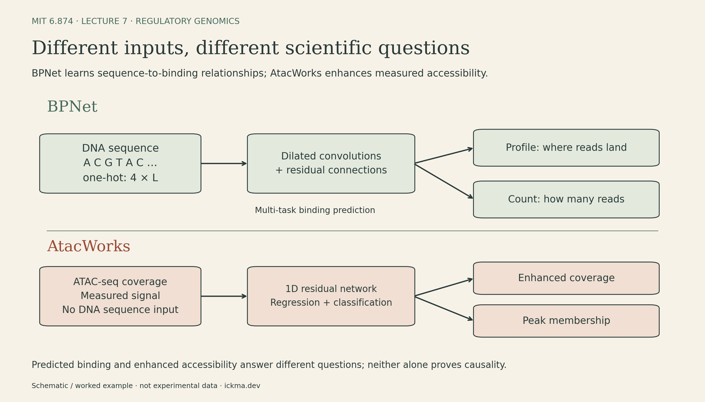
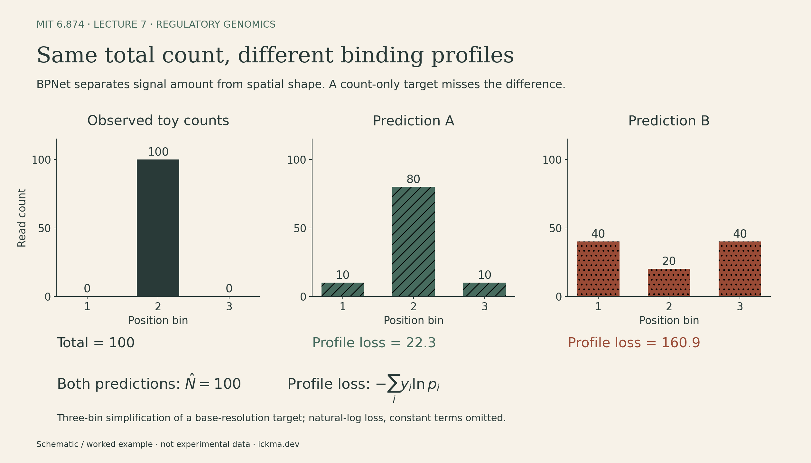

Notes on **MIT 6.874, Lecture 7: Regulatory Genomics** (Spring 2021), with Manolis Kellis, Anshul Kundaje, and Avantika Lal.

Two genomic regions can produce the same number of sequencing reads while placing them in very different patterns. A model trained only to predict the total cannot tell those patterns apart.

This is the central modeling question in regulatory genomics: **what information should the prediction target preserve?** BPNet learns how DNA sequence predicts protein-binding profiles. AtacWorks starts from measured accessibility and learns to enhance sparse signals. Both use convolutional networks, but their inputs, losses, and scientific uses differ.

<iframe src="https://www.youtube-nocookie.com/embed/5usrA2yWQjw" title="MIT 6.874 Lecture 7: Regulatory Genomics (Spring 2021)" style="position:absolute;inset:0;width:100%;height:100%;border:0;" loading="lazy" allow="accelerometer; autoplay; clipboard-write; encrypted-media; gyroscope; picture-in-picture; web-share" allowfullscreen></iframe>

[Lecture recording](https://www.youtube.com/watch?v=5usrA2yWQjw) · [Course and slides](https://mit6874.github.io/)

## Same genome, different regulatory states

Most cells in an organism share essentially the same genome, yet use different sets of genes. Regulation depends on which transcription factors are present, which sequences they recognize, and the chromatin context in which they act.

DNA wraps around histone proteins to form nucleosomes. This packaging affects access to DNA and carries regulatory information through histone modifications. Three related measurements help describe the state of a region:

- **Accessibility:** how available the DNA is to molecular machinery.
- **Histone modifications:** chemical marks associated with different chromatin states.
- **DNA methylation:** modifications to DNA that can change protein binding; the effect depends on the factor and context.

Promoters lie near transcription start sites. Enhancers can act from much farther away and often show strong differences across cell types. H3K4me3 is associated with promoters; H3K4me1 and H3K27ac help characterize enhancers, especially active enhancers for the latter mark. H3K27ac also occurs at active promoters. These marks are useful signatures, not universal definitions of function.

Chromatin-state discovery methods such as ChromHMM use a multivariate hidden Markov model: observed combinations of marks inform hidden states along the genome. Biological labels such as “promoter-like” or “enhancer-like” are interpretations of the learned patterns.

## From motif preferences to convolutional filters

A transcription factor recognizes a sequence pattern, or **motif**. A motif instance is one occurrence of that pattern in the genome.

A position weight matrix summarizes base preferences at each position. Under an independent-position model, a sequence can be scored against a background distribution:

$$
S(x)=\sum_{j=1}^{m}\log\frac{p_j(x_j)}{q(x_j)}.
$$

Here, the motif has length $m$, $p_j(b)$ is its probability for base $b$ at position $j$, and $q(b)$ is the background probability. Probabilities must be positive for finite scores; estimates commonly use pseudocounts.

A high score means the sequence resembles the motif relative to background. It does not establish that the factor binds there in a particular cell.

The connection to convolution is direct. Encode a sequence of length $L$ as $X\in\{0,1\}^{4\times L}$, with one row for each DNA base and one active entry per column. A width-$m$ filter $W\in\mathbb R^{4\times m}$ assigns a score to each sequence window:

$$
z_t=\beta+\sum_{j=1}^{m}\sum_{c=1}^{4} W_{cj}X_{c,t+j-1},
\qquad t=1,\ldots,L-m+1.
$$

With scalar bias $\beta=0$ and $W_{cj}=\log[p_j(c)/q(c)]$, this is the motif log-odds score. In the cross-correlation convention used by neural-network libraries, the filter slides without reversing its positions. Training a CNN learns such scores from a prediction objective instead of fixing a motif matrix in advance. A learned filter may resemble a motif, but is not automatically a normalized probability model.

Classical motif discovery has a related hidden-variable problem: the motif's starting position in each sequence is unknown. Expectation maximization alternates between estimating probabilities over those starting positions and updating the motif; Gibbs sampling samples positions while refining it. Protein-binding microarrays and SELEX instead measure binding preferences experimentally in vitro. These methods provide useful comparisons with learning sequence filters from a prediction objective.

Regulatory **syntax** adds the context that a single motif misses: which motifs occur together, their spacing and orientation, and how the corresponding proteins influence one another. These relationships can be cooperative and asymmetric.

{fig-alt="A 4 by 6 one-hot matrix for ACGTAC is scanned with a 4 by 3 toy filter giving +2 to A at position 1, C at position 2, and G at position 3, and -1 to every other base at each position. Window scores are 6, minus 3, minus 3, minus 3. A motif match alone does not establish binding."}

## What the experiments measure

**ChIP-seq** enriches DNA associated with a targeted protein or histone modification, then sequences and maps it to the genome. Higher-resolution variants such as ChIP-nexus can resolve detailed binding profiles.

**DNase-seq** and **ATAC-seq** probe accessible chromatin through enzymatic access. ATAC-seq uses Tn5 transposase to insert sequencing adapters. Accessibility can help locate regulatory regions, but does not by itself identify the bound transcription factor.

The shape of a signal track contains information. Two regions can contain the same total number of reads while placing those reads at very different positions. Collapsing each region to a single number discards that structure.

## BPNet separates signal amount from signal shape

BPNet takes DNA sequence and predicts binding signals at base resolution. Its example here models ChIP-nexus data for Oct4, Sox2, Nanog, and Klf4 in mouse embryonic stem cells.

A fully convolutional network preserves positional information. Dilated convolutions expand the receptive field so the model can learn relationships between separated motifs; residual connections help information pass through the network. Shared features support multiple transcription-factor outputs.

The important modeling choice is to separate **how much signal** from **where the signal falls**. Pooling an entire region into one scalar would discard the spatial detail the prediction task is meant to preserve. Assay-bias correction also matters: an experimental footprint can reflect both biological binding and the measurement process.

{fig-alt="BPNet maps one-hot DNA through dilated residual convolutions to a binding profile and total count. AtacWorks maps measured ATAC-seq coverage through a 1D residual network to enhanced coverage and peak membership; it does not use DNA sequence input."}

For one profile with $L$ positions, let $y_i$ be the observed read count at position $i$, and let $N=\sum_i y_i$. The model predicts probabilities $p_i>0$ for the profile, typically through a softmax:

$$
(y_1,\ldots,y_L)\mid N
\sim \operatorname{Multinomial}(N;p_1,\ldots,p_L),
\qquad \sum_i p_i=1.
$$

This is a conditional model for allocating reads across positions. It does not imply that the underlying regulatory effects of different DNA positions are independent.

Ignoring terms constant with respect to the model, its profile loss is

$$
\mathcal L_{\mathrm{profile}}=-\sum_{i=1}^{L}y_i\log p_i.
$$

A separate head predicts a log total count $\widehat\ell$, trained with squared error. A compact version of the combined objective is

$$
\mathcal L=\sum_{k=1}^{K}\left[
\mathcal L_{\mathrm{profile},k}
+\lambda\left(\widehat\ell_k-\log(N_k+1)\right)^2
\right],\qquad\lambda>0.
$$

Here $k$ indexes prediction tasks. The $+1$ is an explicit zero-count convention for this explanatory formula, not a claim about every implementation. The actual model handles strand-specific profiles and assay controls; this simplified notation isolates the two prediction targets.

A small example makes the distinction concrete. Suppose an illustrative three-bin region has counts $(0,100,0)$. Two predictions, $p^{(A)}=(0.1,0.8,0.1)$ and $p^{(B)}=(0.4,0.2,0.4)$, can share the same predicted total count of 100. Yet their profile losses are approximately $-100\log 0.8=22.3$ and $-100\log 0.2=160.9$. The second prediction puts too much probability away from the observed peak. A count-only target cannot distinguish them. These numbers are a worked example, not experimental measurements.

{fig-alt="Three bar charts share a read-count axis. Observed illustrative counts are 0,100,0. Predictions 10,80,10 and 40,20,40 both total 100 but have multinomial profile losses 22.3 and 160.9 respectively, so count alone cannot distinguish the wrong shape."}

Natural logarithms are used here. When a region has zero reads, this profile term contributes no information; the count head still has a target. The two losses preserve complementary information about the measurement.

## From accurate predictions to testable syntax

Evaluations of BPNet on held-out chromosomes compare profile agreement with replicate experiments and shuffled baselines. Replicate agreement provides context for measurement noise; it does not make every prediction correct.

Interpretation then proceeds at two scales. **DeepLIFT** assigns contributions to individual nucleotides for a chosen output. **TF-MoDISco** aggregates recurring patterns from high-contribution sequence segments into motifs.

The next step is to perturb the input: insert motifs into synthetic sequence, vary their spacing, or mutate motifs in real enhancers and predict the resulting binding profiles.

One striking example is a roughly 10.5-base-pair spacing preference involving Nanog, consistent with the helical periodicity of DNA. The examples also show asymmetric interactions: changing an Oct4/Sox2-related motif can affect Nanog binding more strongly than the reverse intervention affects Oct4/Sox2.

These are context-dependent, **soft preferences**, rather than a rigid grammar for every enhancer. In-silico perturbations reveal what the model predicts. Selected genomic editing experiments provide a separate test of those predictions; attribution alone does not establish a biological mechanism.

## AtacWorks: learn from noisy measurements

AtacWorks starts with an observed ATAC-seq coverage track. It predicts a denoised signal and classifies positions as belonging to accessible peaks or background.

Its one-dimensional convolutional residual network uses dilations and a combined regression-and-classification objective. The published loss is a weighted combination of mean squared error and a correlation term for the coverage track with binary cross-entropy for peak membership. Unlike BPNet, it does not take DNA sequence as input. This is a deliberate choice: sequence motifs associated with accessibility in one cell type may not carry the same meaning in another.

In notation, its input is a coverage vector $c\in\mathbb R_{\ge0}^{L}$. The outputs are an enhanced coverage vector and $L$ peak-membership predictions. These are different targets from BPNet's normalized profile and total-count head.

For depth enhancement, subsampling reads creates a sparse input while the fuller dataset supplies the target signal and peak labels. For single-cell data, subsampling cells from an abundant population creates a similar few-cells-to-many-cells training problem. The paper also trains on paired high- and low-enrichment tracks assembled from experimental replicates to address low-quality measurements. Subsampling does not simulate every source of experimental noise.

This is supervised reconstruction of a better-supported measurement. The target remains an experimental estimate, and the denoised output remains a prediction.

## Transfer depends on what changed

AtacWorks is tested on held-out cell types and genomic regions, using signal correlation and peak precision–recall metrics. These evaluate different outputs: a visually smooth track is not sufficient evidence of accurate peak calls.

Its single-cell application is especially useful for small populations. Aggregating all cells improves coverage but hides heterogeneity; studying smaller groups preserves distinctions while making their signal sparse. The lecture illustrates this with three groups of 50 hematopoietic stem cells selected from roughly 10,000 profiled cells. Their enhanced tracks expose candidate differences associated with lymphoid priming, erythroid priming, and long-term renewal. The groups and interpretation depend on the experimental selection; denoising alone does not demonstrate a cell's future lineage.

Transfer also depends on the experimental protocol. The lecture discussion notes imperfect transfer across protocol changes; the paper reports cross-platform improvements, with better results in some comparisons when training and test protocols match. Leaving sequence out of the input helps avoid one source of cell-type dependence, but does not remove differences in how measurements are produced.

Earlier approaches help put these choices in context: DeepBind learns sequence features for binding prediction; Basset shares features across accessibility tasks; ChromPuter combines sequence and experimental signals. These models differ in the information they receive and the conclusions their outputs can support.

The prediction target determines which scientific question a model can help answer. BPNet preserves profile structure to study regulatory sequence rules. AtacWorks uses signal structure to improve sparse measurements. Both become more informative when their outputs are checked against independent observations and the limits of the assay.

## Sources

- [Full lecture recording](https://www.youtube.com/watch?v=5usrA2yWQjw).
- [MIT 6.874 Spring 2021 syllabus](https://mit6874.github.io/) and [lecture slides](https://mit6874.github.io/assets/sp2021/slides/l07.pdf).
- The connection between motif log-odds and one-hot convolution is an explanatory derivation; the three-bin counts form a constructed worked example. The figures are schematics or worked examples, not measured data.
- [BPNet: Base-resolution models of transcription-factor binding reveal soft motif syntax](https://www.nature.com/articles/s41588-021-00782-6).
- [Deep learning-based enhancement of epigenomics data with AtacWorks](https://www.nature.com/articles/s41467-021-21765-5).
