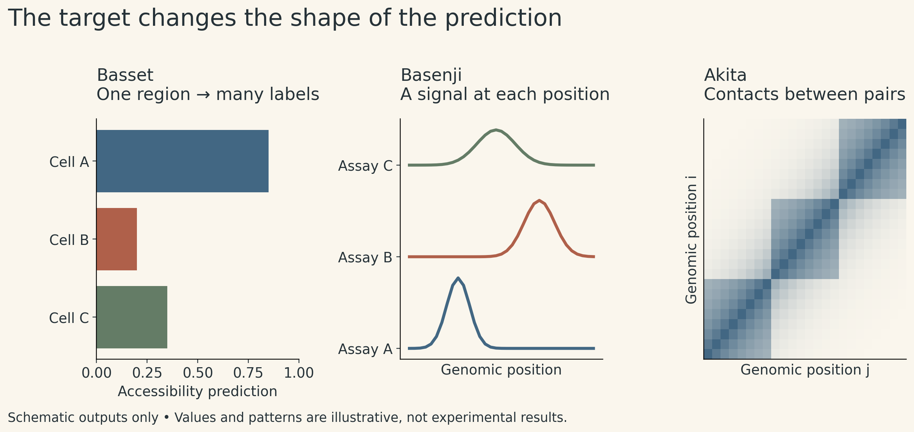
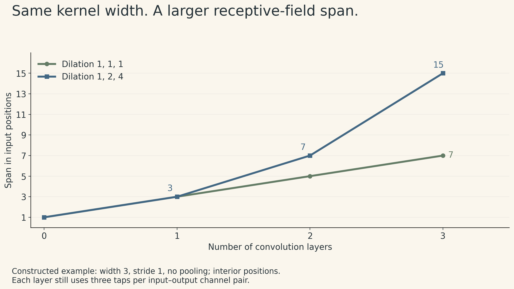
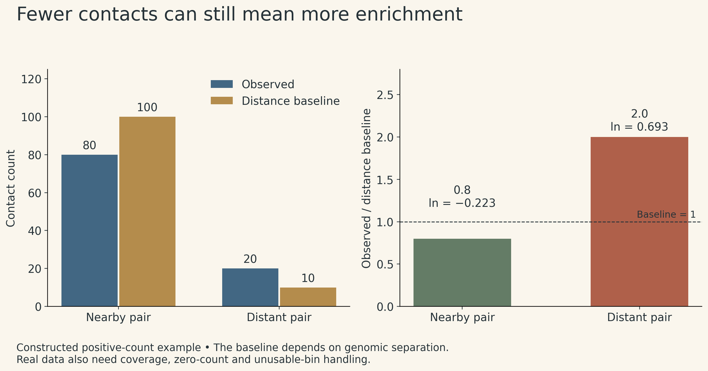

A DNA sequence can be associated with an accessible region, a transcriptional signal, or a contact between two distant parts of a chromosome. These observations live at different scales. A model that predicts one of them does not automatically predict the others.

That is the organizing idea of MIT 6.874 Lecture 8. Basset summarizes a region with several accessibility predictions. Basenji retains a position axis and predicts signals along it. Akita adds a second position axis to predict contacts between pairs of regions.

The progression is useful beyond genomics: **the meaning and shape of the target determine what information the model must preserve.**

These notes follow the Spring 2021 course, taught by Manolis Kellis with guest lecturer David Kelley. The models are historical examples of this principle, rather than a ranking of today's methods.

{fig-alt="Three panels compare a vector of accessibility predictions for Basset, position-by-assay signal tracks for Basenji, and a position-by-position contact matrix for Akita. All values are illustrative."}

## 1. A motif, a binding event, and an accessible region

A transcription factor (TF) is a protein that can recognize DNA and participate in regulating gene expression. A **motif** summarizes a sequence preference. An occurrence of a preferred pattern is a candidate binding location; whether the factor binds in a particular cell also depends on its availability, chromatin state, and other molecular context.

The distinction matters when defining labels:

| Measurement or representation | What it describes | What it does not establish by itself |
|---|---|---|
| Sequence motif | A recurring sequence preference | Binding in a specific cell |
| TF ChIP-seq signal | Enrichment associated with a selected protein | That every detected association is direct binding |
| DNase-seq or ATAC-seq signal | Chromatin accessibility | The identity of every bound TF |
| CAGE signal | Capped RNA 5′ ends, informative about transcription start sites and promoter activity | Every aspect of gene expression or protein abundance |
| Hi-C contact map | Population-level contact frequencies between genomic regions | A unique three-dimensional structure for one cell |

DNA methylation and histone modifications add further descriptions of chromatin state. They are not interchangeable with accessibility or TF binding. In particular, a model trained on accessibility labels has not thereby learned a methylation predictor.

A sequence-only model can nevertheless return different predictions for different cell types. In a multitask model, each output is associated with a particular experimental target. The cell-specific information is learned through those targets and their parameters; it is not a measurement of the current state of an arbitrary new cell.

This builds on [Lecture 7's distinction between biological measurements and model targets](regulatory-genomics.qmd). Lecture 8 extends it to the spatial information a prediction needs.

## 2. From motif discovery to learned representations

Classical motif discovery starts with a collection of related regions and asks which sequence patterns recur more often than expected. Position-specific models summarize preferences at each aligned position. A simple version assumes independence across positions and fixed spacing.

There is a hidden-variable problem: the motif profile is unknown, and so are the locations of its occurrences. Expectation maximization alternates between estimating probable occurrences and updating the profile. Gibbs sampling uses a sampling-based alternative. Enrichment, evolutionary conservation, and measurements of binding preferences provide complementary evidence.

A convolutional network changes the learning objective. It learns local features because they help predict an observed target. The same feature detector is applied at many positions, sharing parameters. Subsequent layers can combine local features over increasingly broad regions.

This gives a useful analogy between a first-layer filter and a motif, but not an identity. Filter weights are unconstrained learned numbers, not automatically a normalized probability matrix. A recognizable pattern may also be distributed across several filters.

Local pooling can reduce sensitivity to small shifts while sacrificing precise position. Flattening a feature map has a different effect: it removes the explicit position axis but retains the entries in a fixed order. A following dense layer can still assign different weights to different positions. Neither operation should be described as making the whole network indifferent to genomic position.

## 3. Basset: several answers for one region

Basset illustrates multitask learning with one shared representation and multiple accessibility outputs. The published study used DNase-seq data from **164 cell types**, with one binary accessibility target per cell type. Shared features support several related prediction tasks, while the final outputs can respond differently to the same input region. [Basset paper](https://genome.cshlp.org/content/26/7/990)

All logarithms below are natural logarithms. For a generic binary prediction, let $y_c$ be the observed label for target $c$, and let $p_c$ be its predicted probability. The usual binary cross-entropy contribution is

$$
\ell_c=-y_c\log p_c-(1-y_c)\log(1-p_c).
$$

Several cell types can have positive labels for the same region. These targets are therefore **multilabel**, rather than mutually exclusive categories. Their probabilities need not sum to one.

For a constructed two-target example, labels $(1,0)$ and predictions $(0.8,0.3)$ give a summed loss of

$$
-\log(0.8)-\log(0.7)\approx0.580.
$$

This is an arithmetic illustration, not an experimental result. It also exposes a common data mistake: an unmeasured target should not silently become a negative label. Missingness and measured absence are different statements.

Sharing representations can help when tasks have common structure, but it does not guarantee improvement for every task. A useful comparison also needs to distinguish performance on new genomic regions from performance in a new cell type. Those are separate generalization questions.

## 4. Basenji: keep the position axis

A single label for a short region cannot describe an entire signal track. Nor can a short input represent distant information that it never sees.

Basenji extends the sequence context and predicts quantitative experimental signals in bins along the genome. The important change is conceptual: instead of collapsing the region into one vector of labels, the model retains a **position-by-assay** output. This connects local features to broader context while preserving where the predicted signal belongs. The guest lecture discusses this transition around 1:02–1:17, alongside the [2018 Basenji paper](https://doi.org/10.1101/gr.227819.117).

### How dilation expands context

A dilated convolution samples positions farther apart while retaining the same number of kernel coefficients. Stacking layers lets information travel across increasingly long distances.

Consider a generic one-dimensional example with kernel width 3, stride 1, no pooling, and dilation factors $1,2,4$ (factor 1 means adjacent taps). Away from boundaries, the receptive-field span is

$$
R=1+(3-1)(1+2+4)=15.
$$

With three undilated layers, it is only

$$
R=1+3(3-1)=7.
$$

Both constructions use three taps per layer for each input–output channel pair. Dilation expands the span without increasing that coefficient count. It does not make long inputs or activation storage free. With pooling or strided layers, the receptive-field calculation must also account for the spacing represented by each intermediate position.

{fig-alt="Receptive-field spans after one, two, and three width-three stride-one convolution layers are 3, 5, 7 for dilation one throughout and 3, 7, 15 for dilation factors one, two, four. The example has no pooling and ignores boundary effects."}

### A residual connection passes the layer's input

For matching tensor shapes, a residual block has the form

$$
h_{\ell+1}=h_\ell+F_\ell(h_\ell).
$$

The bypass carries the input **to that block**, not the original raw DNA into every layer. Addition also differs from concatenation: addition retains the channel count, whereas concatenation generally enlarges it.

The lecture distinguishes a later residual formulation from the architecture in the original Basenji paper. That distinction matters when reading historical diagrams: a recommended refinement is not necessarily part of the originally reported model.

### Match the loss to the measured quantity

A binary accessibility call and a quantitative signal are different targets. Kelley discusses a Poisson objective for signals derived from counts. For an observed nonnegative integer count $y$ and predicted mean $\lambda>0$, the negative log-likelihood is

$$
\ell(\lambda;y)=\lambda-y\log\lambda+\log(y!).
$$

The final term is constant with respect to the prediction and can be omitted during optimization. For nonnegative normalized signals, the prediction-dependent expression $\lambda-y\log\lambda$ can still be used as a loss; it is then not literally a probability model for a continuous observation. Using this objective does not demonstrate that biological variation is exactly Poisson, or that a normalized assay track is an untouched integer count. The measurement and preprocessing still determine how to interpret the output.

## 5. Akita: a prediction for every pair of regions

A linear coordinate tells us where a region lies along a chromosome. It does not tell us which other regions are nearby in the folded nucleus.

Hi-C represents contacts as a matrix. Entry $(i,j)$ summarizes contacts between genomic bins $i$ and $j$. Nearby bins tend to have higher contact frequency, producing a strong diagonal. Blocks of enriched contacts can reveal domains; patterns at different scales describe different aspects of genome organization. A contact map aggregates a population and does not specify one uniquely determined fold.

Akita changes the output from a one-dimensional track to a two-dimensional map. It first forms representations along the sequence, then combines pairs of positions to construct pairwise features. The model predicts normalized contact maps for its training targets. The original work operates on windows of roughly one megabase, so information outside the input window is unavailable to it. [Akita paper](https://www.nature.com/articles/s41592-020-0958-x)

### Why raw contact counts are hard to compare

Suppose we want to compare two pairs of regions at different genomic separations. A larger raw count may simply reflect the fact that one pair is closer along the chromosome.

A distance-adjusted quantity compares observed contact frequency $O_{ij}$ to a baseline $E(d)$ for separation $d=|i-j|$. For positive values, a simple illustrative transformation is

$$
Z_{ij}=\log\!\left(\frac{O_{ij}}{E(|i-j|)}\right).
$$

In a toy example, a nearby pair has 80 observed contacts against a baseline of 100: its ratio is $0.8$. A distant pair has only 20 observed contacts against a baseline of 10: its ratio is $2$.

The distant pair has fewer raw contacts but greater enrichment relative to its baseline. With natural logarithms, the values are about $-0.223$ and $0.693$. This is why a map of normalized enrichment answers a different question from a map of raw counts. Actual datasets also require explicit treatment of zero counts, coverage, and unusable bins.

{fig-alt="A nearby pair has 80 observed contacts and a baseline of 100, giving ratio 0.8 and natural log minus 0.223. A distant pair has 20 observed and baseline 10, giving ratio 2 and natural log 0.693. Lower raw count can mean higher relative enrichment."}

Symmetry supplies another useful constraint. Contact between $i$ and $j$ describes the same pair as contact between $j$ and $i$. For a generic predicted matrix $A$, the operation

$$
S=\frac{A+A^\mathsf{T}}{2}
$$

ensures $S_{ij}=S_{ji}$. Akita uses re-symmetrization within its map-processing architecture. Symmetry makes the output consistent with the target's structure; it does not make the prediction biologically correct.

## 6. How the other models fit

The lecture's broader survey makes the same input–target distinctions visible:

- **DeepBind** learns sequence features for binding-related prediction tasks. Negative examples and the experimental target affect what the model learns.
- **DeepSEA** jointly predicts multiple chromatin features with one model; the [original paper](https://pmc.ncbi.nlm.nih.gov/articles/PMC4768299/) describes multitask joint learning.
- **Chromputer** uses measured chromatin-related inputs, alone or together with sequence, for tasks such as binding or chromatin-state prediction. Performance with those inputs answers a different question from sequence-only prediction.
- **DeepLIFT** is an attribution method: it compares activations with reference activations to assign contributions to a prediction difference. It is not simply another name for ordinary gradient-times-input. [DeepLIFT paper](https://proceedings.mlr.press/v70/shrikumar17a.html)

These methods need not be arranged into a single ladder of “better” models. A richer input can make a target easier to predict while changing what information is required at inference time.

## 7. What a convincing result still needs

Three checks help connect these predictions back to biology.

**First, define what is held out.** A new sequence region, a new chromosome, a new cell type, and a new assay are different tests. Overlapping or strongly related examples across training and evaluation can make a result look more general than it is.

**Second, interpret performance in the context of the labels.** For a constructed dataset with 100 positives and 900 negatives, predicting “negative” everywhere gives 90% accuracy and zero recall for positives. Precision–recall behavior and the prevalence of the positive class reveal what that accuracy hides. For quantitative assays, agreement between experimental replicates provides useful context for model–measurement agreement, but it is not a universal mathematical ceiling.

**Third, separate a model explanation from a causal mechanism.** Kelley shows why a recognizable motif can be spread across multiple filters: disabling one computational feature may have little effect because others carry similar information. That does not show that the corresponding biological factor is unimportant. Attribution also depends on the model, target, and reference choice. It can guide interpretation, but a highlighted feature is not by itself causal evidence.

The enduring lesson is to keep three questions together: **What was measured? What information did the model receive? What claim does the evaluation support?** Moving from labels to tracks to contact maps expands what a model can describe. It also expands the care needed to explain its predictions.

## Lecture and references

- [MIT 6.874 Spring 2021 course](https://mit6874.github.io/) and [Lecture 8 slides](https://mit6874.github.io/assets/sp2021/slides/l08.pdf).
- [Lecture 8 recording: Deep Learning for Regulatory Genomics](https://www.youtube.com/watch?v=iHOgKx1mqEw), Manolis Kellis and David Kelley.
- Kelley, Snoek, and Rinn (2016), [Basset](https://doi.org/10.1101/gr.200535.115).
- Kelley et al. (2018), [Sequential regulatory activity prediction across chromosomes with convolutional neural networks](https://doi.org/10.1101/gr.227819.117).
- Fudenberg, Kelley, and Pollard (2020), [Predicting 3D genome folding from DNA sequence with Akita](https://doi.org/10.1038/s41592-020-0958-x).
- Zhou and Troyanskaya (2015), [Predicting effects of noncoding variants with deep learning-based sequence model](https://doi.org/10.1038/nmeth.3547).
- Shrikumar, Greenside, and Kundaje (2017), [Learning Important Features Through Propagating Activation Differences](https://proceedings.mlr.press/v70/shrikumar17a.html).


