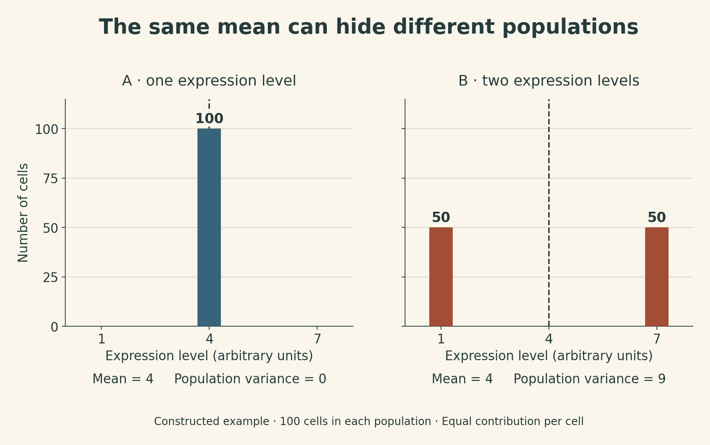
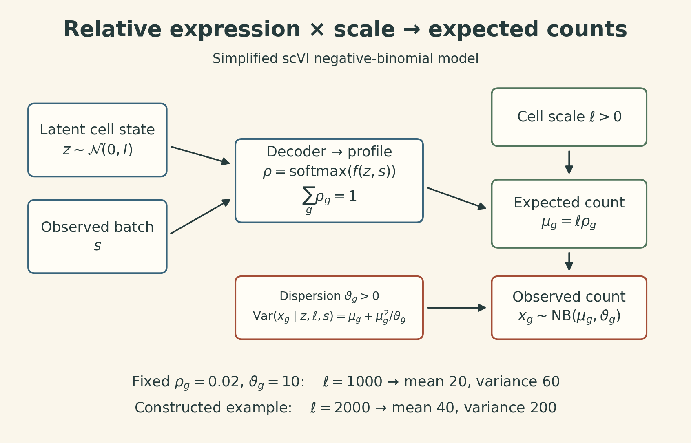
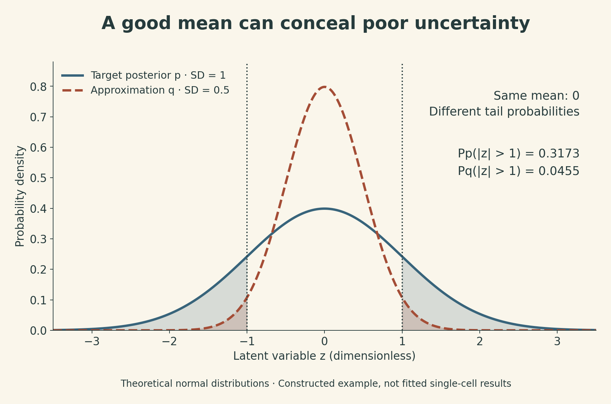

A tissue has an average expression level of 4 for a gene. That could mean every cell has level 4. It could also mean half the cells have level 1 and half have level 7. The average is identical; the populations are different.

Single-cell RNA sequencing preserves information about that distribution. It also produces sparse, noisy measurements whose differences can reflect cell identity, transient state, sampling depth, or experimental batch. A clean-looking cell map does not by itself separate those explanations.

MIT 6.874 Lecture 10 connects the measurement problem to representation learning and Bayesian inference. These notes follow the **Spring 2021** lecture by Manolis Kellis, with guest lectures by Fabian Theis and Romain Lopez. The central question is how much of a biological claim survives each step from counts to a model, then from a model to a decision.

## 1. What a single-cell measurement preserves

Write the observed expression matrix as $X\in\mathbb N_0^{N\times G}$, with cells as rows, genes as columns, and nonnegative integer counts as entries. In a UMI-based assay, the entries approximate counts of captured molecules after deduplication. They are not a complete census of every RNA molecule originally present in each cell.

In the opening constructed example, population A has 100 cells at expression level 4. Population B has 50 cells at level 1 and 50 at level 7. Under equal contributions per cell, both means are 4, but the population variances are 0 and 9:

$$
\bar x_B=\tfrac12(1)+\tfrac12(7)=4,
\qquad
\operatorname{Var}_B(X)=\tfrac12(1-4)^2+\tfrac12(7-4)^2=9.
$$

{fig-alt="Population A has all 100 cells at expression level 4. Population B has 50 cells at level 1 and 50 at level 7. Both means are 4, but their population variances are 0 and 9. These are constructed values, not measured single-cell data."}

Actual bulk measurements combine RNA contributions, so differences in total RNA content and capture can change the weighting. The simple example isolates one point: an aggregate can hide a mixture. Single-cell analysis adds the possibility of distinguishing changes in cell proportions from changes within a cell population.

### Three labels that answer different questions

The lecture surveys wells, droplets, and combinatorial indexing as ways to associate measurements with cells. Their throughput and sensitivity differ. For interpreting the resulting matrix, three distinctions matter:

| Information | What it helps identify | What it does not establish |
|---|---|---|
| Cell barcode | Which captured cell-associated partition a read belongs to | That the partition contained exactly one cell |
| Unique molecular identifier (UMI) | Which reads may be copies of the same original captured molecule | Every molecule that existed before capture |
| Sample or donor information | Which biological sample contributed an observation | A guarantee that all batch effects have disappeared |

UMIs reduce distortion from unequal amplification: many reads copied from one tagged molecule should not automatically count as many independent molecules. Capture losses, barcode errors, and collisions remain possible.

A **doublet** combines material from two cells in one apparent cell observation. It can look like a rare intermediate state. Sample labels and expression patterns can help detect some doublets, but no single signal identifies every case. More cells also do not automatically mean more independent biological replicates: many cells from one donor still share that donor's context.

The lecture extends beyond RNA to chromatin accessibility and paired modalities. Measuring RNA and protein in the same cell gives a different evidential link from predicting one modality using another. Both can be useful, but an inferred protein profile remains a prediction.

## 2. A cell map is a sequence of modeling choices

A typical analysis moves through quality checks, feature selection, normalization, dimensionality reduction, a neighborhood graph, and clustering or visualization. Each stage changes what “similar cells” means.

PCA finds linear directions of variation in its input matrix. Changing the genes, scaling, or transformation changes those directions. A principal component associated with read depth may explain considerable variance without defining a cell type. Conversely, a rare population may be biologically meaningful while contributing little to total variance.

The lecture's retina example illustrates how clustering can suggest cell populations and candidate markers. A cluster is a computational grouping; assigning a biological identity requires additional evidence. The same caution applies to gene co-variation: shared cell state, composition, or measurement effects can create correlations without direct regulation between the genes.

### Discrete types and continuous states

Clustering gives discrete labels. Diffusion maps and trajectory methods describe more continuous structure. Archetypal analysis represents observations using combinations of extreme profiles, allowing a cell to sit between several characteristic states.

The ACTIONet discussion brings together multiple resolutions of this representation and an adaptive neighborhood graph. This addresses a practical problem: one global number of clusters or factors can describe abundant populations well while missing finer structure elsewhere.

One mathematical ingredient is a distance between probability-like profiles. For normalized nonnegative vectors $p,q$, define $m=(p+q)/2$. Using natural logarithms,

$$
D_{\mathrm{KL}}(p\|q)=\sum_i p_i\log\frac{p_i}{q_i},
$$

$$
\operatorname{JS}(p,q)
=\tfrac12 D_{\mathrm{KL}}(p\|m)
+\tfrac12 D_{\mathrm{KL}}(q\|m).
$$

Zero-probability terms use the usual limiting convention. KL can be infinite and is not symmetric. Jensen–Shannon divergence is symmetric, and its square root is a metric. For the completely separated profiles $p=(1,0)$ and $q=(0,1)$, JS is $\log 2$ and the distance is about $0.833$. This is a mathematical example, not a biological separation threshold.

Graph construction and two-dimensional layout are also separate operations. A UMAP or t-SNE plot is a view of relationships under chosen objectives. Island size, spacing, and apparent gaps should not be read as a complete geometry of cell biology.

### Pseudotime, imputation, and integration

Trajectory methods order cells along an inferred graph, sometimes with branches. **Pseudotime is an inferred ordering**, not elapsed time in hours and not direct lineage tracing. The root, sampled states, and assumed graph structure affect the story a trajectory tells.

Gene-set methods such as PAGODA and VISION add prior functional groupings to the interpretation of variation. They can make patterns easier to describe, while remaining dependent on gene-set definitions and the underlying measurements.

Imputation introduces another dependence. MAGIC, for example, shares information through diffusion on a cell-similarity graph. This can reveal structure obscured by noise, but the output now reflects shared-neighbor assumptions. Correlation in a smoothed matrix is not independent confirmation of a regulatory relationship.

Integration methods such as CCA-based alignment and mutual nearest neighbors seek shared structure across datasets. Their success must be judged against both technical mixing and biological preservation. If cell state A appears only in batch 1 and state B only in batch 2, the data do not cleanly identify which differences are technical. An algorithm cannot recover that missing comparison merely by making the batches overlap.

## 3. Why scVI and DCA use a count likelihood

The lecture surveys several neural approaches with different objectives. MMD-ResNet learns a calibration mapping using a distributional discrepancy; DESC combines a learned representation with a clustering objective; AutoImpute reconstructs expression under its treatment of observed nonzero entries. These are different assumptions about the task, not interchangeable ways to certify a corrected matrix.

DCA and scVI put count distributions at the center. A squared-error autoencoder reconstructs numerical values. A count model instead asks how likely the observed integers are under a distribution parameterized by the decoder.

The [previous lecture](gene-expression-and-splicing.qmd) introduced negative binomial and zero-inflated models. Here, the useful next step is to see how their parameters connect to a cell representation.

### A compact version of scVI

The guest lecture presents a negative-binomial version of the model. For cell $n$, let $s_n$ be its observed batch, $z_n\in\mathbb R^d$ its latent representation, and $\ell_n>0$ a cell-specific scale:

$$
z_n\sim\mathcal N(0,I_d),
\qquad
\log\ell_n\sim\mathcal N(a_{s_n},b_{s_n}^2).
$$

Here $a_s$ and $b_s$ are the mean and standard deviation of the log-scale prior for batch $s$; the original paper specifies batch-specific prior parameters in its Methods. A decoder produces relative expression across the modeled genes:

$$
\rho_n=\operatorname{softmax}(f_\theta(z_n,s_n)),
\qquad \sum_{g=1}^{G}\rho_{ng}=1.
$$

The observation model is

$$
x_{ng}\mid z_n,\ell_n,s_n
\sim\operatorname{NB}(\mu_{ng},\vartheta_g),
\qquad \mu_{ng}=\ell_n\rho_{ng}.
$$

Here $\vartheta_g>0$ is a gene-specific dispersion parameter, with the convention

$$
\mathbb E[x_{ng}\mid z_n,\ell_n,s_n]=\mu_{ng},
\qquad
\operatorname{Var}(x_{ng}\mid z_n,\ell_n,s_n)
=\mu_{ng}+\frac{\mu_{ng}^2}{\vartheta_g}.
$$

The Gaussian prior is on **log scale**; $\ell_n$ is log-normal. Its role is distinct from $\rho_n$, a vector of relative expression values. In this NB formulation, $\ell_n$ is the conditional expected total count across the modeled genes, not the observed total itself.

For a constructed example, $\rho_{ng}=0.02$, $\ell_n=1000$, and $\vartheta_g=10$ give mean 20 and conditional variance 60. Doubling the scale to 2000 while keeping the relative profile fixed gives mean 40 and variance 200. Different count magnitudes can therefore arise without changing relative expression.

{fig-alt="Latent cell representation z and observed batch s enter a decoder producing relative expression rho. Cell-specific scale ell multiplies rho to give mean mu. Dispersion theta and mu define a negative binomial count distribution. With rho 0.02 and theta 10, ell 1000 gives mean 20 and variance 60; ell 2000 gives mean 40 and variance 200."}

The [original scVI paper](https://doi.org/10.1038/s41592-018-0229-2) includes a zero-inflated negative-binomial likelihood. The compact model above follows the guest slide's NB presentation. Zero inflation adds a separate zero component; it is not a claim that every zero is technical dropout. A zero can occur under an ordinary count distribution, and one observation does not reveal its cause.

The model usually factorizes the gene likelihoods **conditional on the latent variables**. This does not imply that genes are marginally independent: shared latent variation induces dependence after those variables are integrated out.

## 4. The encoder approximates a posterior

The decoder specifies how latent quantities could generate counts. Inference asks the reverse question: given counts, which latent values remain plausible?

Writing $u=(z,\ell)$ for the latent variables, Bayes' rule gives

$$
p_\theta(u\mid x,s)
=\frac{p_\theta(x,u\mid s)}{p_\theta(x\mid s)}.
$$

The difficulty is computing the normalizing integral. An encoder $q_\phi(u\mid x,s)$ supplies a tractable approximation. Insert this distribution into the marginal likelihood and use Jensen's inequality:

$$
\begin{aligned}
\log p_\theta(x\mid s)
&=\log\mathbb E_q\!\left[\frac{p_\theta(x,u\mid s)}{q_\phi(u\mid x,s)}\right]\\
&\geq\mathbb E_q\!\left[\log p_\theta(x,u\mid s)-\log q_\phi(u\mid x,s)\right]\\
&=\mathbb E_q[\log p_\theta(x\mid u,s)]
-D_{\mathrm{KL}}\!\left(q_\phi(u\mid x,s)\|p_\theta(u\mid s)\right).
\end{aligned}
$$

The final expression is the **evidence lower bound**, or ELBO. The equality in the first line requires appropriate support; the usual Gaussian/log-normal variational families cover the latent domain in this example.

Sharing encoder parameters across cells makes inference amortized: one learned function proposes a distribution for each observation. For a fixed model, the gap is

$$
\log p_\theta(x\mid s)-\operatorname{ELBO}
=D_{\mathrm{KL}}\!\left(q_\phi(u\mid x,s)\|p_\theta(u\mid x,s)\right).
$$

This explains both the appeal and the limitation. The same model supports embeddings, normalized-expression estimates, and probabilistic comparisons. All of those outputs inherit its assumptions and the quality of the posterior approximation.

Conditioning the decoder on batch does not guarantee that an inferred representation is batch-independent. The lecture's information-constraint section explicitly returns to this problem: independence in a generative model need not hold in the aggregated approximate posterior over real data. HSIC-constrained VAEs add a dependence penalty to the objective. Such a penalty encourages a chosen invariance; it cannot establish that everything removed was nuisance variation.

## 5. What can be transferred to a new dataset?

Fabian Theis's contribution connects latent models to reuse. Three ideas have different targets:

| Method discussed in the lecture | Reused information | Main interpretive boundary |
|---|---|---|
| scGen | A condition-associated displacement learned in latent space | Transfer assumes a sufficiently shared response structure |
| scArches | A reference model adapted to query data | A reference cannot guarantee coverage of an unfamiliar state |
| sfaira | Standardized datasets, architectures, and trained parameters | Reuse does not remove preprocessing or domain compatibility requirements |

The scGen example treats a change of condition as an approximately shared latent displacement. This is a testable modeling assumption. A successful held-out comparison does not make arbitrary biological changes linear or establish that the latent direction is a causal mechanism.

scArches uses architectural adaptation to place a query dataset relative to a learned reference while keeping selected reference parameters fixed. That can make an atlas reusable without rebuilding the entire analysis for every query. Matching gene definitions, measurement conventions, and the reference's biological coverage still matters.

The lecture also describes using a multimodal reference to infer an unmeasured modality in a query. Its RNA-to-protein example is a conditional prediction under the reference model. It does not turn the query's RNA measurement into a direct protein assay.

### Labels can be partially observed

Romain Lopez introduces **scANVI** for semi-supervised annotation. It extends the latent model with a cell-type variable: the label is observed for some cells and treated as missing for others. Labeled and unlabeled observations jointly inform the representation and annotation.

This is different from discovering a universally correct list of cell types. Incorrect seed labels can propagate. A classifier restricted to known labels can assign an unfamiliar state to the nearest available category. Annotation confidence should therefore be assessed alongside reference coverage and independent biological evidence.

The model-zoo and scvi-tools discussions address a practical part of the same problem: sharing data conventions, models, and implementations makes comparisons easier. It does not make their scientific assumptions identical.

## 6. Good reconstruction does not guarantee good uncertainty

Suppose a downstream decision depends on a posterior tail probability. Two distributions can have the same mean and very different tails.

In a constructed statistical example, take an exact posterior $p(z\mid x)=\mathcal N(0,1)$ and an approximation $q(z\mid x)=\mathcal N(0,0.5^2)$. Both have mean zero, but

$$
P_p(|z|>1)\approx0.3173,
\qquad P_q(|z|>1)\approx0.0455.
$$

{fig-alt="Two theoretical normal density curves share mean zero. The target posterior has standard deviation 1 and probability 0.3173 outside minus 1 to 1. A narrower approximation has standard deviation 0.5 and tail probability 0.0455. Dotted boundaries mark the same event for both curves."}

This matters for differential-expression questions. For example, one can define an event that the magnitude of a log expression ratio exceeds a chosen threshold $\delta$. A posterior probability of that event is meaningful only relative to the model, the comparison, and the approximation used to calculate it.

It is also useful to distinguish **posterior odds** from a **Bayes factor**:

$$
\frac{P(M_1\mid x)}{P(M_0\mid x)}
=\frac{p(x\mid M_1)}{p(x\mid M_0)}
\frac{P(M_1)}{P(M_0)}.
$$

The middle ratio is the Bayes factor; posterior odds equal it only when prior odds are one. For posterior probability 0.8 and prior probability 0.2, posterior odds are 4, prior odds are 0.25, and the Bayes factor is 16. A numerical decision threshold should not be transferred between these quantities without accounting for the prior.

### Two sources of error remain separate

The lecture's closing [decision-making work](https://papers.nips.cc/paper/2020/file/357a6fdf7642bf815a88822c447d9dc4-Paper.pdf) distinguishes errors in the fitted generative model from errors in approximating that model's posterior. Improving one does not automatically fix the other.

Suppressing the observed batch $s$ in the notation, for a fixed model let $Q=\mathbb E_{p(u\mid x)}[f(u)]$. Sampling from $q$ and averaging $f$ instead estimates an expectation under $q$. Self-normalized importance sampling reweights the samples:

$$
w_i=\frac{p(x,u_i)}{q(u_i\mid x)},
\qquad
\widehat Q_{\mathrm{IS}}
=\frac{\sum_i w_i f(u_i)}{\sum_i w_i},
\quad u_i\sim q(u\mid x).
$$

The unknown evidence cancels from the ratio. Adequate proposal support and suitable integrability conditions are required for consistency. The finite-sample ratio is generally biased, and a proposal that misses important posterior regions can give unstable weights. Reweighting is not an automatic repair.

The paper therefore separates model selection from fitting proposals for decision-making, then combines proposals through multiple importance sampling. The broader lesson is to evaluate the posterior quantity that drives the decision, rather than treating a good embedding as evidence that every downstream probability is reliable.

## 7. Reading a single-cell result carefully

These distinctions suggest a compact way to interrogate an analysis:

- **Measurement:** are the inputs reads, UMI counts, normalized values, or inferred quantities? What can a zero mean under that measurement?
- **Representation:** which features and similarity assumptions produced the graph? Does a visible grouping survive checks beyond the layout?
- **Integration:** does batch mixing preserve relevant cell differences, and is the comparison identifiable from the sampled batches and donors?
- **Transfer:** are the query's states and measurement conventions represented in the reference? What happens to unfamiliar cells?
- **Decision:** which posterior event or effect is being estimated, and how sensitive is it to model assumptions and approximate inference?

Single-cell measurements make population structure visible. Deep generative models provide a coherent language for linking that structure to counts and uncertainty. Their strongest contribution is an explicit set of assumptions that can be examined. The biological claim still has to be supported at the end of that chain.

## Lecture and references

- [MIT 6.874 Spring 2021 course](https://mit6874.github.io/), [Lecture 10 slides](https://mit6874.github.io/assets/sp2021/slides/l10.pdf), and [lecture video](https://www.youtube.com/watch?v=NNOkdgE4jNM). The methods and examples above belong to that course edition, rather than a current ranking of tools.
- Lopez et al., [Deep Generative Modeling for Single-cell Transcriptomics](https://doi.org/10.1038/s41592-018-0229-2), *Nature Methods*, 2018.
- Lopez et al., [Information Constraints on Auto-Encoding Variational Bayes](https://papers.nips.cc/paper_files/paper/2018/hash/9a96a2c73c0d477ff2a6da3bf538f4f4-Abstract.html), NeurIPS 2018.
- Lopez et al., [Decision-Making with Auto-Encoding Variational Bayes](https://papers.nips.cc/paper/2020/file/357a6fdf7642bf815a88822c447d9dc4-Paper.pdf), NeurIPS 2020.


