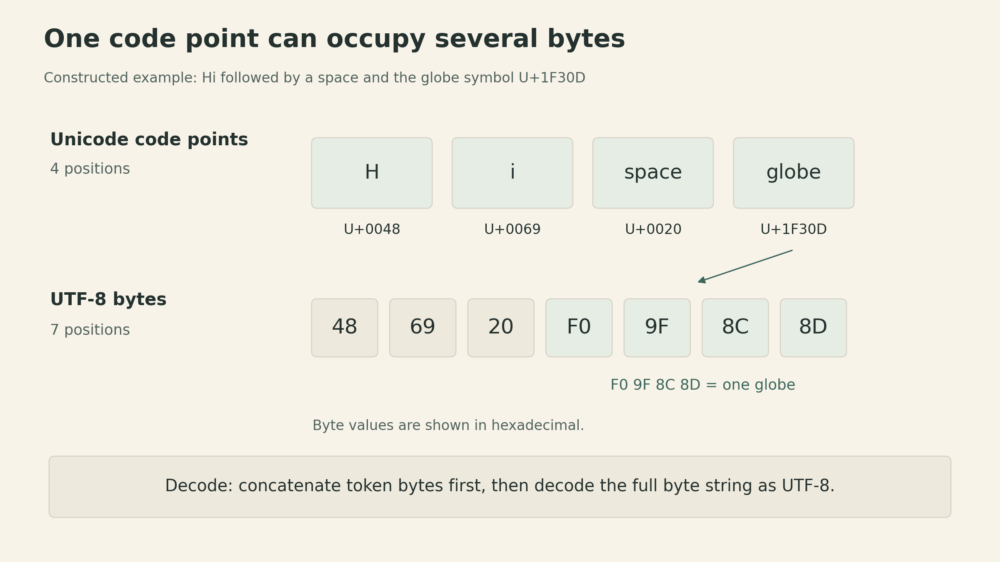
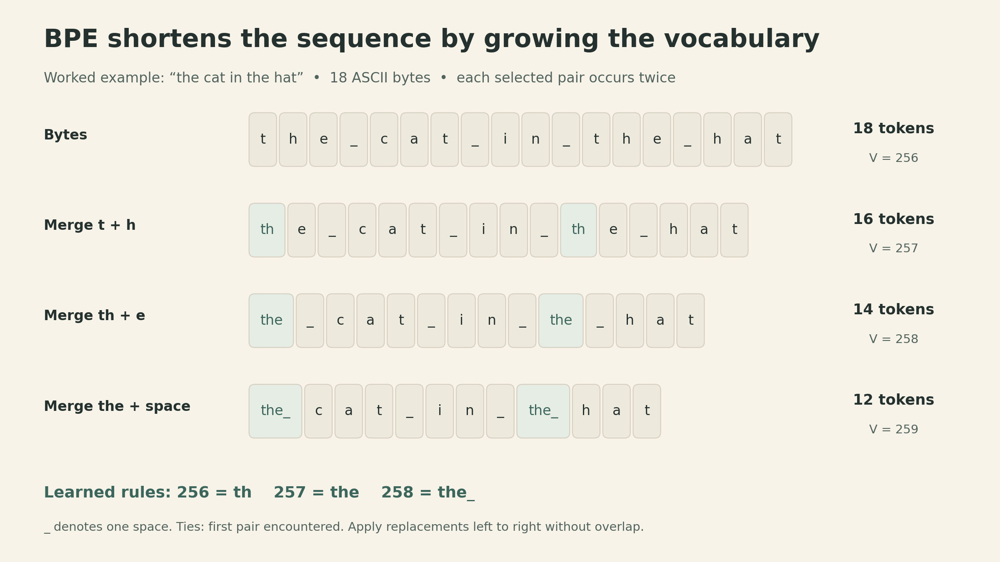
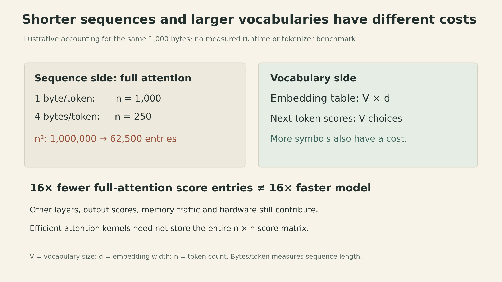

A language model does not receive a sentence as a collection of human-defined words. It receives a sequence of token IDs. Before the first attention layer runs, a tokenizer has already decided how many positions the model will process and which pieces of text share a vocabulary entry.

That makes tokenization a useful first example of the question running through [Percy Liang's opening CS336 lecture](https://www.youtube.com/watch?v=JuoVZkPBiKk): **what is the best model we can build with a given amount of data and computation?** A representation that preserves exactly the same text can create a different computational workload.

This article starts with the course's overall map, then follows one small string through bytes, learned merges, and decoding. The distinction to keep in mind is between preserving the text and choosing useful units for modeling it.

## The course begins with a resource budget

CS336 organizes language-model construction into five connected parts:

| Part | The question it answers |
|---|---|
| Basics | How do tokenization, architecture, loss, and optimization form a trainable model? |
| Systems | Where do time and memory go, and how can kernels and parallelism reduce the cost? |
| Scaling | What can smaller experiments tell us about a larger training run? |
| Data and evaluation | Which capabilities do we want, how will we measure them, and what data supports them? |
| Post-training and alignment | How can demonstrations, preferences, or verifiable outcomes improve model behavior? |

These parts affect one another. A tokenizer changes sequence length. Sequence length changes the cost of attention and the amount of text that fits in a context window. Data filtering changes how much of a training budget is spent on useful examples. A model architecture can improve expressivity while making training less stable or inference more expensive.

The systems perspective also extends beyond one GPU. Moving tensors between memory and compute units costs time; distributing a model adds communication between devices. Inference matters during deployment, but also when generating evaluation outputs, synthetic data, or reinforcement-learning trajectories. A fast training step alone does not make the entire learning process fast.

The lecture makes another distinction that is easy to lose: **mechanics, engineering habits, and empirical intuitions transfer differently across scales**. Implementing a component teaches what it computes. Profiling teaches how to locate a bottleneck. A favorable architecture or data mixture at one scale, however, may behave differently at another. Scaling recipes need evidence about how hyperparameters and loss change with the budget.

The historical overview explains why this matters. Language models have moved from components inside particular NLP systems to pretrained models, general text interfaces, and models used inside agents. The desired context lengths and inference workloads have changed along the way. Public weights help us use a model; access to training code, data, and experimental details helps us understand how it was built. Those are different levels of access.

For this series, that broad map gives us a place to return to. The first technical component is the interface between text and the model.

## A tokenizer has an encoding contract

Let $s$ be text that can be encoded as valid UTF-8. A tokenizer maps it to a sequence of IDs from a fixed vocabulary:

$$
\operatorname{encode}(s)=(z_1,\ldots,z_n),
\qquad z_i\in\{0,\ldots,V-1\}.
$$

Here $V$ is the vocabulary size and $n$ is the token count for this particular text. An ID is a label, not a numerical measure of meaning. In a typical model, it selects a learned embedding vector.

For a lossless tokenizer without text normalization, the basic contract is

$$
\operatorname{decode}(\operatorname{encode}(s))=s.
$$

This is a round-trip property of encoded text. It does not imply that every arbitrary sequence of token IDs decodes to valid UTF-8. A byte-based vocabulary can contain individual byte fragments that become valid text only when joined with other fragments.

Consider the constructed example `Hi 🌍`. In Python's Unicode representation it has four code points: `H`, `i`, a space, and the globe symbol. In UTF-8 it takes seven bytes:

```text
H   i   space   🌍
48  69  20     F0 9F 8C 8D     hexadecimal UTF-8 bytes
```

The globe is one code point encoded by four bytes. More generally, a visible character can contain multiple code points, so a code-point count is not a universal count of what a reader sees as characters.

{fig-alt="The string Hi followed by a space and a globe has four Unicode code points and seven UTF-8 bytes: 48, 69, 20, F0, 9F, 8C, 8D in hexadecimal. The four globe bytes form one code point."}

The distinction matters when implementing decoding. Map each token ID to its byte string, concatenate those byte strings, and then decode the resulting bytes as UTF-8. Decoding each fragment separately can fail even when the complete encoded text is valid.

## Three simple choices expose the tradeoff

The lecture compares code-point, byte, and word tokenization before introducing BPE.

**Code points** provide a straightforward reversible representation. But supporting a broad character inventory gives a large vocabulary, and common words still consume many positions. Rare symbols receive vocabulary entries even if there is little training data for them.

**Bytes** use a fixed base vocabulary of only 256 values. Every valid UTF-8 input can be represented without an unknown-word token. The cost is length: the seven bytes in `Hi 🌍` occupy seven positions in a pure byte tokenizer.

**Words** can give shorter sequences, but a finite word vocabulary cannot contain every name, identifier, spelling variation, or newly coined word. Mapping unseen words to one `UNK` symbol discards their identity. A reversible fallback can avoid that loss, but then the tokenizer needs smaller units as well.

Byte-level BPE combines a byte fallback with a data-dependent vocabulary. Frequent byte sequences can become one token; other text remains representable as smaller pieces. A token can be a word, part of a word, punctuation, a space combined with text, or a byte fragment. It is not necessarily a linguistic unit.

## BPE learns a sequence of merge rules

Byte-pair encoding repeatedly replaces a frequent adjacent pair with a new symbol. In byte-level BPE, training starts with the 256 possible single-byte tokens. At each step:

1. Count adjacent token pairs in the training sequence.
2. Select a pair with the highest count, using a specified rule for ties.
3. Add a new token whose bytes are the concatenation of the pair's bytes.
4. Replace non-overlapping occurrences of that pair and count again.

For the lecture's small example, use `the cat in the hat`. All its characters are ASCII, so the original 18 characters occupy 18 bytes. We use the lecture implementation's tie behavior: among equally frequent pairs, select the one first encountered while scanning the current sequence. Replacements proceed left to right.

| Round | Pair selected | New ID | Bytes represented | Remaining tokens |
|---|---|---:|---|---:|
| Start | — | — | Single bytes | 18 |
| 1 | `t` + `h` | 256 | `th` | 16 |
| 2 | `th` + `e` | 257 | `the` | 14 |
| 3 | `the` + space | 258 | `the ` | 12 |

Each selected pair occurs twice. The final sequence is

```text
[the ][c][a][t][ ][i][n][ ][the ][h][a][t]
```

The 18-byte string now occupies 12 tokens, giving 18/12 = 1.5 bytes per token. No text has been removed: the two occurrences of `the ` each have their own position in the encoded sequence.

{fig-alt="BPE training starts from the bytes of the cat in the hat. Three merge rules create th, the, and the followed by a space. Frequent sequences become reusable tokens while byte tokens remain available."}

The merge rule is learned from frequency, not from a dictionary of word meanings. The trailing space in `the ` is part of the token in this deliberately simple example. A different tie rule can produce a different learned vocabulary.

After $M$ successful merges that each add a distinct token, this construction has $256+M$ vocabulary entries, before reserving special tokens. The sequence gets shorter while the set of symbols the model must handle grows.

## Encoding new text reuses the learned rules

Tokenizer training and model training are separate processes. The BPE procedure learns a vocabulary and an ordered list of merges. The language model later learns parameters over the resulting IDs.

To encode new text, first represent it as bytes, then apply the learned merges in their learned order. The lecture's simple implementation scans the full sequence for every rule; faster implementations avoid checking irrelevant pairs. Encoding does not count the new document's pairs and retrain the tokenizer.

For example, the three rules above can merge the initial `the ` in `the quick brown fox`. The result is 16 tokens: one for the initial four-byte chunk and 15 for the remaining bytes. This tiny vocabulary has not learned larger pieces for the other words. The tokenizer remains able to represent them; they simply use more tokens.

Decoding reverses the representation, not the learning procedure: retrieve the bytes for each ID, join them, and decode. Token 258 maps directly to the four bytes of `the `.

Practical tokenizers also impose boundaries. **Pre-tokenization** divides text into chunks before BPE, so merges cannot cross those chunk boundaries. A rule that learns `the ` on a whole string may never arise under a pre-tokenizer that attaches spaces differently. Special tokens for document boundaries or control structure also need explicit handling. The worked example explains the merge mechanism; it is not a claim about the exact output of a production tokenizer.

## Shorter sequences move the cost elsewhere

The lecture measures compression as UTF-8 bytes per token. For a nonempty input with $B$ bytes and $n$ tokens, define

$$
r=\frac{B}{n}, \qquad n=\frac{B}{r}.
$$

This is a sequence-length measure. It does not count the bits needed to store token IDs or the vocabulary, so it is not a file-compression ratio.

Why does it matter to the model? In dense full attention, one head forms a score matrix

$$
QK^\top\in\mathbb{R}^{n\times n},
\qquad Q,K\in\mathbb{R}^{n\times d_k}.
$$

At fixed head dimension $d_k$, this matrix multiplication has work proportional to $n^2d_k$. If two representations of the same text use 1,000 and 250 tokens, the dense attention score matrices have 1,000,000 and 62,500 entries: a factor of 16. This is an illustrative comparison of one computation, not a measured 16-fold speedup for the whole model. Feed-forward layers, projections, vocabulary operations, hardware behavior, and the attention implementation also matter. Efficient attention kernels can avoid materializing the full score matrix.

{fig-alt="Illustrative resource accounting for 1000 bytes: one byte per token gives 1000 tokens and one million full-attention score entries per head; four bytes per token gives 250 tokens and 62500 entries. The vocabulary side has an embedding table of shape V by d and next-token scores over V possibilities. No runtime benchmark is shown."}

The vocabulary side has a different cost. With embedding width $d$, an embedding table has shape $V\times d$, so its parameter count grows linearly with $V$. A standard output projection also produces scores over $V$ possible next tokens. Some models share the input and output embedding weights, but weight sharing does not remove the vocabulary dimension of prediction.

Compression alone therefore cannot choose the tokenizer. Larger vocabularies may give common strings shorter representations while leaving rare entries poorly supported by data. A vocabulary learned from one data mixture can segment another language or domain much less compactly. A fixed token context window consequently contains different amounts of raw text for different inputs.

## What this first component teaches about the whole system

A tokenizer can preserve every input byte while changing the sequence length, the vocabulary, and the statistical units the model learns. Those changes reach into context capacity, parameter storage, and computation before we change the Transformer itself.

That is the opening lecture's broader lesson in a concrete form: representations, data, and systems choices need to be considered together. Byte-level models and learned chunking approaches explore other ways to make that tradeoff; BPE is a useful frequency-based heuristic, not an optimality guarantee or a model of meaning.

The next step is resource accounting: making the costs of tensors, parameters, activations, and operations explicit. The round-trip contract and the sequence length we established here give that accounting a precise starting point.

## Sources

- [Stanford CS336, Spring 2026 — course and syllabus](https://cs336.stanford.edu/).
- [Lecture 1: Overview and Tokenization — official recording](https://www.youtube.com/watch?v=JuoVZkPBiKk), especially 7:20–11:33, 27:17–1:04:42, and 1:05:06–1:19:13.
- [Official executable Lecture 1](https://github.com/stanford-cs336/lectures/blob/de53a9f979a6ee35f7d13a5e1aadee5ea1afc58e/lecture_01.py): `why_this_course_exists`, `current_lm_landscape`, `course_syllabus`, `tokenization`, `train_bpe`, and `BPETokenizer`.

[Watch the official lecture on YouTube →](https://www.youtube.com/watch?v=JuoVZkPBiKk)

```{=html}
<style>
main, section {min-width:0}
.cell, .sourceCode, mjx-container[display="true"] {max-width:100%; overflow-x:auto; overflow-y:hidden}
figure img {width:100%; height:auto}
@media(max-width:700px) {main table {display:block;max-width:100%;overflow-x:auto}}
</style>
```
