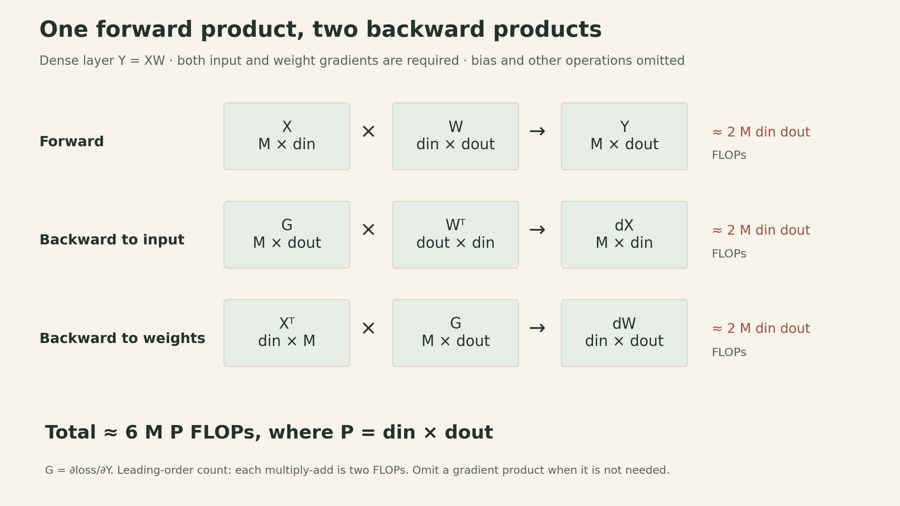
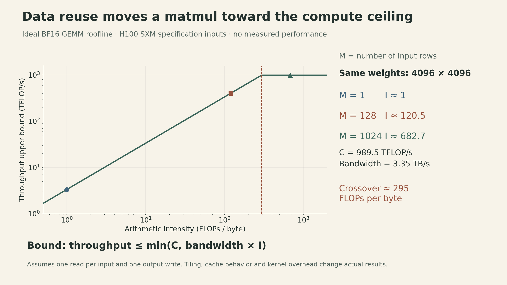
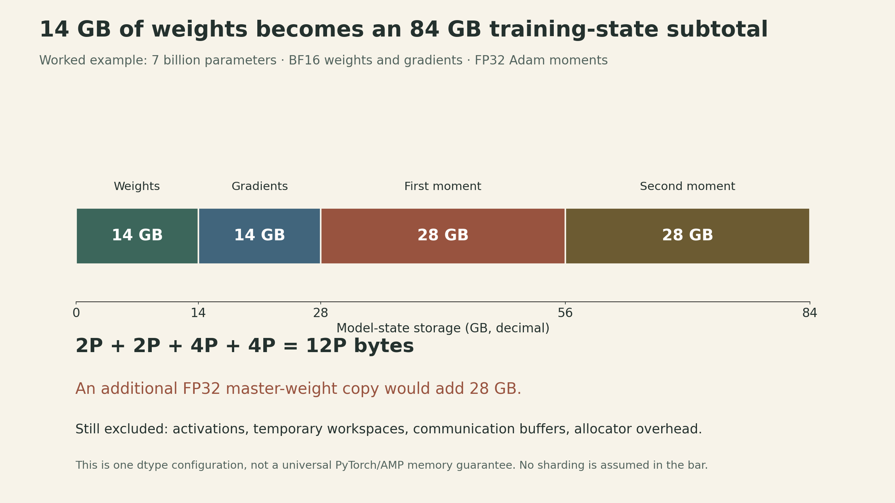

A seven-billion-parameter model needs about 14 GB to store its weights in BF16. That does not mean it can train in 14 GB. Under the lecture's illustrative dtype assumptions, weights, gradients, and Adam's two moment buffers already require 84 GB—before activations and temporary buffers enter the calculation.

There is a second surprise. A matrix multiplication can perform far more arithmetic than an elementwise operation and still use the GPU more effectively. The difference is how much useful work it performs for each byte brought from memory.

[Percy Liang's second CS336 lecture](https://www.youtube.com/watch?v=kuYAsz7zspQ) connects these observations through resource accounting. For each operation, ask three questions: **what must be stored, what arithmetic must be performed, and what data must move?** The answers explain both whether a model fits and why a training step takes time.

[Official lecture recording](https://www.youtube.com/watch?v=kuYAsz7zspQ) · [Interactive lecture notes](https://cs336.stanford.edu/lectures/?trace=lecture_02)

## Start with the tensor's shape and dtype

A tensor describes a collection of values with a shape, data type, and device. Parameters, input data, intermediate activations, gradients, and optimizer buffers all use this representation.

For a dense tensor with shape $(d_1,\ldots,d_r)$ and $s$ bytes per element, its logical data size is

$$
M_{\text{tensor}}=s\prod_{j=1}^{r}d_j.
$$

For example, a tensor of shape $(2,128,8,64)$ contains 131,072 elements. Storing those values in FP32 takes 524,288 bytes, or 512 KiB; BF16 takes 256 KiB. Here the dimensions can represent batch, sequence position, attention head, and features per head. The tensor rank is four; it says nothing about matrix rank.

```python
import torch

x = torch.zeros((2, 128, 8, 64), dtype=torch.bfloat16)
logical_bytes = x.numel() * x.element_size()
assert logical_bytes == 262_144
```

This counts the tensor's values, not the process's total memory allocation. Views can share storage, and the allocator can reserve more memory than the live tensors occupy. Summing every tensor's logical size can therefore double-count shared storage while still missing other allocations.

Device placement is a separate choice. In the default CPU configuration, creating a tensor does not put it on a GPU. Operations intended for CUDA must receive tensors and parameters on the appropriate CUDA device. Transfers between CPU and GPU can add costs beyond the GPU's own high-bandwidth-memory traffic.

### Fewer bits change both storage and numerical behavior

| Format | Bits per value | Exponent bits | Fraction bits | Main distinction |
|---|---:|---:|---:|---|
| FP32 | 32 | 8 | 23 | More precision and a wide range |
| FP16 | 16 | 5 | 10 | Smaller exponent range |
| BF16 | 16 | 8 | 7 | FP32-like exponent range, coarser precision |

Each format also has one sign bit. FP16 and BF16 both occupy two bytes, but they fail in different ways. For instance, $10^{-8}$ rounds to zero in FP16 and remains nonzero in BF16. BF16's wider exponent range does not make small updates arbitrarily precise: the spacing between representable values is still much coarser than FP32's.

Mixed precision assigns different formats to different parts of training. Lower precision can help matrix operations and activation storage; accumulated optimizer statistics often benefit from FP32. PyTorch's `autocast` selects operation dtypes. **It does not, by itself, promise BF16 parameter storage or a particular number of bytes per parameter.** Inspect the actual parameter, gradient, and optimizer-state dtypes when building a memory estimate. [PyTorch AMP documentation](https://docs.pytorch.org/docs/2.14/amp.html)

The lecture also introduces FP8 and NVIDIA's block-scaled FP4 as further precision tradeoffs. With block scaling, several low-bit values share a scale, so the storage includes scale metadata and nearby values do not have fully independent ranges. Lowering bit width requires suitable kernels, scaling rules, and numerical validation; it is not a universal consequence of changing a tensor declaration. Training in a low-bit format and quantizing a trained model for inference are separate choices.

## Named dimensions expose the computation

Index manipulations can hide a simple mathematical operation. Suppose queries and keys have shapes

$$
Q\in\mathbb{R}^{B\times S_q\times D},\qquad
K\in\mathbb{R}^{B\times S_k\times D}.
$$

The pairwise scores have shape $B\times S_q\times S_k$, with

$$
A_{b,i,j}=\sum_{d=1}^{D}Q_{b,i,d}K_{b,j,d}.
$$

Using `einops`, the dimension names make the contraction explicit:

```python
from einops import einsum, rearrange, reduce

scores = einsum(q, k, "batch query dim, batch key dim -> batch query key")
```

The repeated `dim` disappears from the output because it is summed over. The `batch` axis remains separate for each example. This expression computes dot-product scores; it does not include attention scaling, masking, softmax, or multiplication by values.

Two other operations cover common bookkeeping:

```python
# x: (batch, sequence, heads * head_dim)
heads = rearrange(x, "batch sequence (head dim) -> batch head sequence dim", head=8)

# Average across positions, retaining batch and feature dimensions.
pooled = reduce(x, "batch sequence feature -> batch feature", "mean")
```

The flattened feature dimension must be divisible by eight in the first expression. Naming axes makes an assumption visible; it does not remove it. Nor does more readable notation guarantee a faster kernel. Rearrangement may be a view or require a copy, depending on the layout and operation. The logical expression is the starting point for accounting; the implementation determines the actual traffic. [Einops tutorial](https://einops.rocks/1-einops-basics/)

## Derive the arithmetic before estimating time

Let a linear layer take $M$ rows of input:

$$
X\in\mathbb{R}^{M\times d_{\text{in}}},\quad
W\in\mathbb{R}^{d_{\text{in}}\times d_{\text{out}}},\quad
Y=XW\in\mathbb{R}^{M\times d_{\text{out}}}.
$$

Every output entry requires $d_{\text{in}}$ multiplications and $d_{\text{in}}-1$ additions. Thus the conventional dense-matmul count is

$$
F_{\text{forward}}=Md_{\text{out}}(2d_{\text{in}}-1)
\approx 2Md_{\text{in}}d_{\text{out}}.
$$

A fused multiply-add counts as two FLOPs in this convention. FLOPs measure an amount of work; FLOP/s measures a rate. Dividing one by the other gives seconds.

### The backward pass contains two more matrix multiplications

For scalar loss $\mathcal{L}$, write $G=\partial\mathcal{L}/\partial Y$, with the same shape as $Y$. The chain rule gives

$$
\frac{\partial\mathcal{L}}{\partial X}=GW^\top,
\qquad
\frac{\partial\mathcal{L}}{\partial W}=X^\top G.
$$

For example,

$$
\frac{\partial\mathcal{L}}{\partial W_{ij}}
=\sum_{m=1}^{M}G_{mj}X_{mi}.
$$

The first gradient sums over output features; the second sums over input rows. Both leading-order costs are $2Md_{\text{in}}d_{\text{out}}$. Together with the forward pass, that is approximately $6MP$ FLOPs, where $P=d_{\text{in}}d_{\text{out}}$ is the layer's number of weights.

{fig-alt="Forward XW produces Y. With upstream gradient G, dX=G W transpose and dW=X transpose G. Each dense matrix product costs about 2 M din dout FLOPs. All three total about 6 M P with P=din*dout, when both gradients are needed."}

This also explains why backpropagation retains information from the forward pass: $X$ is needed to form the weight gradient. If an input gradient is unnecessary—for example at a fixed input boundary—that matrix product can be omitted. The factor of six is a useful leading approximation, not an exact instruction count for every layer.

Across a dense language model trained on $T$ tokens, the same reasoning motivates

$$
F_{\text{training}}\approx 6PT.
$$

Here $T$ is the total number of tokens processed, including repeated passes over data. This approximation works best when dense parameterized matrix multiplications dominate. Long-context attention, activation recomputation, optimizer updates, and other operations need additional accounting. A mixture-of-experts model also requires care about which parameters are active for a token; inserting its total parameter count into this dense formula can mislead.

## A GPU can wait for bytes while arithmetic units are available

Let $F$ be an operation's FLOPs, $Q$ its bytes transferred between HBM and compute units, $C$ the relevant peak compute rate, and $\beta$ the memory bandwidth. An idealized lower bound is

$$
t\geq\max\left(\frac{F}{C},\frac{Q}{\beta}\right).
$$

Equality assumes peak rates and perfect overlap. Kernel launches, imperfect reuse, synchronization, and other overheads can make real execution slower.

Define arithmetic intensity as $I=F/Q$, measured in FLOPs per byte. Rearranging the bound gives the roofline:

$$
\frac{F}{t}\leq\min(C,\beta I),
\qquad I_* = \frac{C}{\beta}.
$$

Below the crossover $I_*$, this model is limited by bandwidth. Above it, the compute ceiling becomes the tighter bound. Memory **capacity** asks whether the tensors fit; memory **bandwidth** asks how quickly the required bytes can move.

For the lecture's H100 SXM example, dense BF16 Tensor Core throughput is approximately 989.5 TFLOP/s and HBM bandwidth is 3.35 TB/s. The crossover is about 295 FLOPs/byte. The manufacturer's 1,979 TFLOP/s figure uses structured sparsity; using it for an ordinary dense workload would double the assumed ceiling. These are specification-based inputs, not measured throughput. [NVIDIA H100 specifications](https://www.nvidia.com/en-us/data-center/h100/)

{fig-alt="Theoretical BF16 GEMM roofline using C=989.5 TFLOP/s and bandwidth=3.35 TB/s. Crossover about 295 FLOPs/byte. For din=dout=4096: M=1 gives I about 1; M=128 gives I about 120.5; M=1024 gives I about 682.7 FLOPs per byte. Points are upper bounds, not measured performance."}

### Matrix multiplication earns its intensity through reuse

Assume BF16 inputs and output, and ideally read each input once and write the output once. For $Y=XW$,

$$
Q=2(Md_{\text{in}}+d_{\text{in}}d_{\text{out}}+Md_{\text{out}}),
$$

so, using the leading FLOP count,

$$
I\approx
\frac{Md_{\text{in}}d_{\text{out}}}
{Md_{\text{in}}+d_{\text{in}}d_{\text{out}}+Md_{\text{out}}}.
$$

If $M$ is small compared with both feature dimensions, the weight matrix dominates traffic and $I\approx M$. Processing more rows together reuses the weights. For a square $n\times n$ multiplication, the same model gives $I\approx n/3$.

This is why batch-one decoding and training can have different bottlenecks even with identical weights. During decoding, each sequence contributes one new position per step; processing more concurrent sequences can improve weight reuse. During prefill or training, many positions can contribute rows. In either case, KV-cache traffic, attention work, tensor shapes, tiling, and available on-chip storage also matter. The one-read/one-write estimate is optimistic; sufficiently large matrices need tiled implementations that can reread data. [Roofline analysis and matmul traffic](https://jax-ml.github.io/scaling-book/roofline/)

Other operations illustrate low intensity:

| Operation on BF16 values | Simple work and traffic model | Approximate intensity |
|---|---|---:|
| ReLU on $n$ values | $n$ comparisons; $4n$ bytes | 0.25 operations/byte |
| GELU on $n$ values | Illustratively $20n$ operations; $4n$ bytes | 5 operations/byte |
| Dot product of two length-$n$ vectors | $2n-1$ FLOPs; $4n+2$ bytes | 0.5 FLOPs/byte |
| Vector times an $n\times n$ matrix | $n(2n-1)$ FLOPs; $2n^2+4n$ bytes | 1 FLOP/byte |

The GELU operation count depends on its approximation and implementation. Comparisons and transcendental functions are not interchangeable with Tensor Core multiply-adds, so these operations need their own relevant compute ceilings. The qualitative lesson is that a more complicated activation can still be bandwidth-limited. It does **not** guarantee that ReLU and GELU have identical measured latency. Fusion can change the traffic by keeping intermediate values on chip.

## A useful FLOP count still needs a measured utilization

For a training step with estimated model work $F_{\text{model}}$, measured duration $t$, and $G$ identical GPUs with relevant peak rate $C$ each,

$$
\mathrm{MFU}=\frac{F_{\text{model}}}{tGC}.
$$

The numerator and denominator must use compatible precision and dense/sparse conventions. MFU is not the same as a GPU's busy-time percentage. A GPU can be active while waiting on memory, running small kernels, or doing work outside the chosen model-FLOP count.

CUDA kernel launches are asynchronous. For a simple timing experiment, warm up first, synchronize before starting the timer and after the operation, and repeat the measurement. Otherwise, a CPU timer may measure enqueueing work rather than completing it. More detailed profiling should distinguish kernel execution, data transfers, and communication.

The lecture's large-run example uses $P=70\times10^9$, $T=15\times10^{12}$, 1,024 H100s, and an assumed MFU of 0.5:

$$
F\approx6.3\times10^{24},\qquad
t\approx\frac{6.3\times10^{24}}{1024\times0.5\times989.5\times10^{12}}
\approx144\ \text{days}.
$$

This is a conditional budget estimate. It assumes the chosen utilization is sustained and excludes interruptions or additional work not represented in the numerator. If communication and other inefficiencies are already reflected in the measured MFU, they should not be charged a second time as another identical slowdown.

## Training memory includes the optimizer's history

Backpropagation supplies gradients; the optimizer turns them into parameter updates. Plain SGD can update using the current gradient. AdaGrad additionally keeps a cumulative sum of squared gradients, such as

$$
s_t=s_{t-1}+g_t^2,\qquad
w_{t+1}=w_t-\eta\frac{g_t}{\sqrt{s_t+\epsilon}},
$$

with elementwise operations and $\epsilon>0$. This uses the lecture example's placement of epsilon; implementations can use a different convention. Adam keeps first- and second-moment estimates, requiring two state arrays. AdamW also applies decoupled weight decay.

For $P$ parameters, assume BF16 weights, BF16 gradients, two FP32 Adam moment arrays, and no additional FP32 master-weight copy:

| Component | Bytes |
|---|---:|
| Parameters | $2P$ |
| Parameter gradients | $2P$ |
| First moment | $4P$ |
| Second moment | $4P$ |
| Subtotal | $12P$ |

{fig-alt="For 7 billion parameters, BF16 weights and gradients each use 14 GB. Two FP32 Adam moment buffers each use 28 GB. Total model states: 84 GB. An optional FP32 master copy adds 28 GB. Activations and other overhead are excluded. GB is decimal."}

The full peak-memory budget also includes saved activations, temporary workspaces, communication buffers, and runtime overhead. Some mixed-precision implementations keep an FP32 master copy, adding $4P$ bytes to the assumed subtotal. Other implementations keep FP32 parameters and gradients directly. Those are different ledgers; the `autocast` setting alone does not identify which one applies.

The lecture's eight-80-GB-GPU estimate, $640\ \text{GB}/12\approx53.3$ billion parameters, is therefore only a model-state upper bound under these dtype assumptions and ideal distribution of states. Plain data parallelism replicates states rather than pooling all eight memories for one copy. Activations and other allocations reduce the feasible size further. Throughout this example, GB means $10^9$ bytes; GiB means $2^{30}$ bytes.

## Two ways to spend less activation memory

A simple $L$-layer network with width $D$ and $M$ input rows has $P=LD^2$ weights. Keeping one BF16 activation tensor per layer costs about $2MLD$ bytes. Real autograd graphs may save additional tensors, and Transformer attention adds its own structure, but the dependence on rows and depth is already visible.

### Accumulate gradients across smaller microbatches

Split an effective batch into $K$ equal microbatches. Run forward and backward on each, accumulate gradients, and update parameters once after all $K$. Only one microbatch's graph needs to be live at a time.

For equal numbers of equally weighted loss terms, the effective-batch mean is

$$
\mathcal{L}=\frac{1}{K}\sum_{k=1}^{K}\mathcal{L}_k,
\qquad
\nabla\mathcal{L}=\frac{1}{K}\sum_{k=1}^{K}\nabla\mathcal{L}_k.
$$

```python
optimizer.zero_grad(set_to_none=True)
for inputs, targets in microbatches:
    loss = loss_fn(model(inputs), targets)  # mean loss for this microbatch
    (loss / len(microbatches)).backward()
optimizer.step()
```

Here `microbatches` is a sized collection with equal numbers of loss terms. Unequal sequence lengths or masked tokens require weighting by the number of valid loss terms, not blindly averaging microbatch means. Parameters stay fixed until the final update. Batch-dependent operations, randomness, and floating-point summation can prevent exact equivalence to one large forward pass.

Accumulation reduces peak activation memory; it does not remove the parameter, gradient, or optimizer-state arrays. It also does not automatically reduce FLOPs or give each small matmul the weight reuse of a physically large batch. The effective optimization batch and the hardware microbatch are different quantities.

### Recompute activations when the backward pass needs them

Activation checkpointing keeps selected boundary tensors and recomputes intermediate forward values during backpropagation. It trades extra arithmetic for lower activation storage.

For a simplified chain of $L$ equal-sized layers, keep a checkpoint every $k$ layers. Roughly $L/k$ boundaries remain saved, and recomputing one segment requires $O(k)$ temporary activations. The activation-memory scaling becomes

$$
O\!\left(\frac{L}{k}+k\right).
$$

Choosing $k\approx\sqrt{L}$ balances the two terms, giving $O(\sqrt{L})$ activation storage. If each segment is recomputed once, additional forward work is $O(L)$, not $O(L^2)$. Recomputing every needed activation from the beginning without retaining segment intermediates is a different, much more expensive strategy. These are chain-model scalings, not guarantees for an arbitrary computation graph.

To obtain the chain scaling above, group about $k$ consecutive layers into each checkpointed segment. Checkpointing every individual layer still retains $O(L)$ boundary tensors; it mainly saves intermediates within those layers. PyTorch does not choose the segment size for us. A segment can be wrapped with an explicit implementation choice:

```python
from torch.utils.checkpoint import checkpoint
hidden = checkpoint(segment, hidden, use_reentrant=False)
```

Recomputation must reproduce the relevant forward behavior. Random-number handling and mutable state deserve attention; checkpointing saves activation storage, not the optimizer's moment arrays. During autoregressive inference, a model may also retain a KV cache even though it does not retain a training graph. [PyTorch checkpoint documentation](https://docs.pytorch.org/docs/2.14/checkpoint.html)

## Let the bottleneck choose the intervention

The same model can be limited by capacity in one setting and bandwidth in another. A useful diagnosis names the limiting resource before choosing an optimization:

| Observation | What to inspect |
|---|---|
| Model weights fit, but training runs out of memory | Gradients, optimizer states, saved activations, and temporary buffers |
| Low-batch decoding uses little peak arithmetic throughput | Weight and KV-cache traffic, concurrency, and kernel shapes |
| Long-context training is unexpectedly expensive | Attention work and activation storage beyond the $6PT$ approximation |
| Smaller microbatches fit but slow down | Reduced weight reuse, more launches, and communication behavior |
| Checkpointing saves memory but adds time | Recomputation cost and whether the saved memory enables a better configuration |

[Lecture 1](lecture01-overview-tokenization.qmd) showed how tokenization changes the number of positions a model processes. This lecture supplies the next step: translate those positions and the model's tensors into bytes, operations, and traffic. An optimization becomes convincing when we can identify which of those quantities changed—and verify that the changed quantity was actually limiting the run.

## Sources

- [Stanford CS336 Spring 2026 course](https://cs336.stanford.edu/), [Lecture 2 recording](https://www.youtube.com/watch?v=kuYAsz7zspQ), and [lecture code](https://github.com/stanford-cs336/lectures/blob/6ff836dd5dfcbe7e848fe1a1734f1886f1116a7a/lecture_02.py).
- [Einops tutorial](https://einops.rocks/1-einops-basics/), [PyTorch AMP](https://docs.pytorch.org/docs/2.14/amp.html), and [activation checkpointing](https://docs.pytorch.org/docs/2.14/checkpoint.html).
- [NVIDIA H100 specifications](https://www.nvidia.com/en-us/data-center/h100/) and [How To Scale Your Model: Rooflines](https://jax-ml.github.io/scaling-book/roofline/).
- Figures show derived accounting examples and theoretical bounds, not measured GPU benchmarks.

```{=html}
<style>
main mjx-container[display="true"] { overflow-x: auto; overflow-y: hidden; max-width: 100%; padding-block: .2em; }
main pre { max-width: 100%; overflow-x: auto; }
@media (max-width: 600px) { main table { display: block; max-width: 100%; overflow-x: auto; } }
</style>
```
