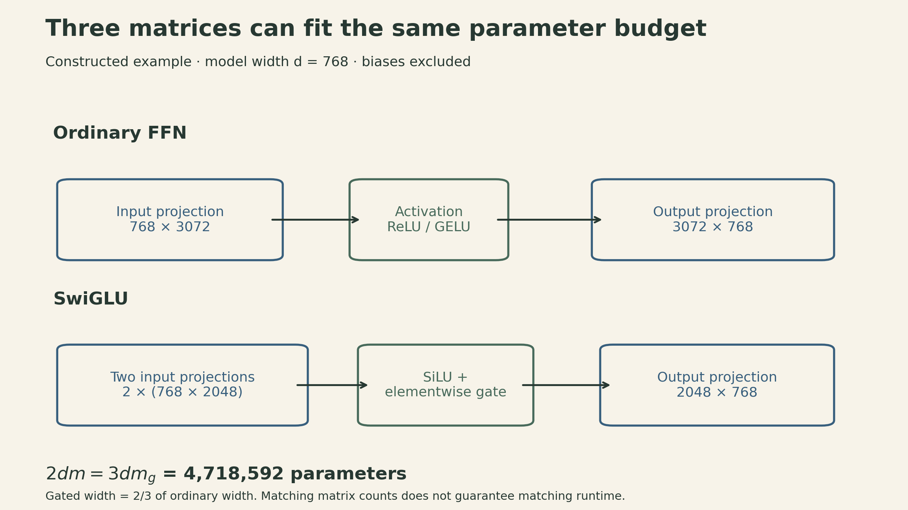
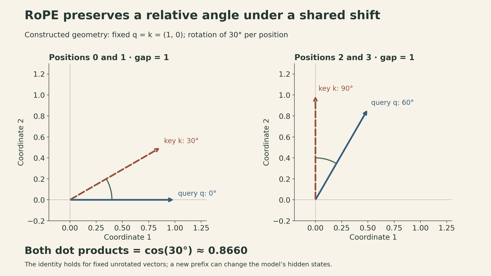
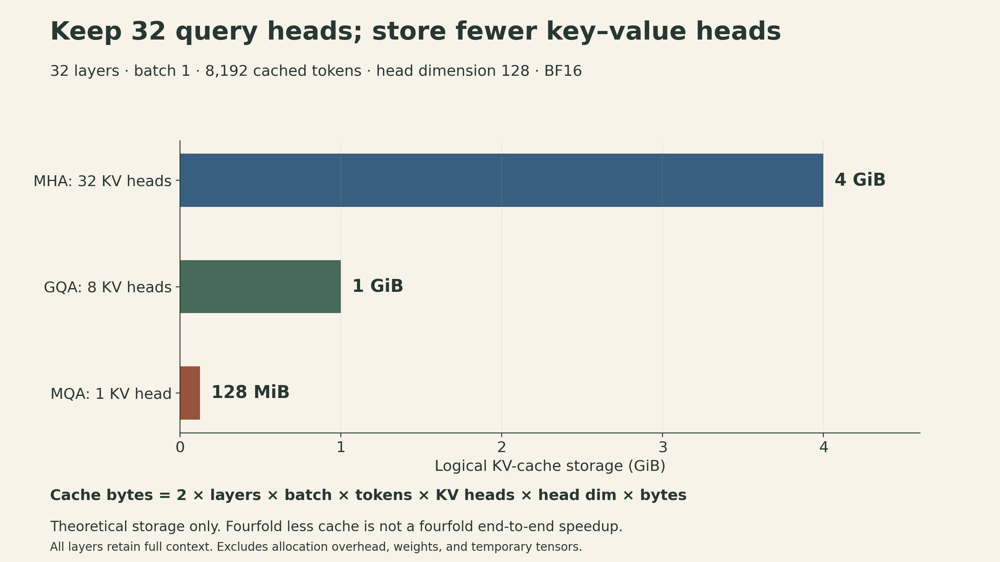

A Transformer can keep 32 query heads while cutting its key–value cache by a factor of four. It can replace a two-matrix feedforward network with a three-matrix gated network without increasing the matrix parameter count. Neither change is obvious from the instruction “make the model smaller.” They work by changing *which computation or representation gets the budget*.

[Tatsunori Hashimoto's third CS336 lecture](https://www.youtube.com/watch?v=lVynu4bo1rY) surveys the architecture and hyperparameter choices behind language models. Its useful organizing idea is that a model must learn, train stably, and run efficiently. A choice that looks minor in a diagram can matter because it changes gradient propagation or how often data move through memory.

The discussion below follows the Spring 2026 lecture. Common configurations are starting points supported by experience, not universal optima. The worked examples are calculations under explicit assumptions, not measured training or inference results.

[Official recording](https://www.youtube.com/watch?v=lVynu4bo1rY) · [Lecture slides](https://github.com/stanford-cs336/lectures/blob/main/lecture_03.pdf)

[▶ Watch the official lecture on YouTube](https://www.youtube.com/watch?v=lVynu4bo1rY){.btn .btn-outline-primary}

## Keep a direct path through the residual stream

Let $x\in\mathbb R^d$ be a token's hidden state, $F$ a sublayer such as attention or an MLP, and $N$ a normalization operation. Two familiar arrangements are

$$
\begin{aligned}
\text{post-norm:}\quad y&=N(x+F(x)),\\
\text{pre-norm:}\quad y&=x+F(N(x)).
\end{aligned}
$$

The important difference is where normalization sits relative to the addition. With pre-norm, the original $x$ has a direct identity route to the output. For a token-level derivative, hold other token inputs fixed. The same chain rule applies to the flattened full-sequence state when analyzing attention across tokens. Writing Jacobians as $J$ in the column-vector convention, the derivatives are

$$
\begin{aligned}
J_{\text{pre}}&=I+J_F(N(x))J_N(x),\\
J_{\text{post}}&=J_N(x+F(x))[I+J_F(x)].
\end{aligned}
$$

In the second expression, even the direct residual contribution passes through the normalization Jacobian. This explains why placement matters as blocks accumulate. An identity term is useful for signal propagation; it does **not** guarantee that an entire deep network's gradients remain bounded.

The lecture also discusses normalization after the sublayer but before addition, $y=x+N(F(x))$, and configurations that normalize both the input and output of the residual branch. These preserve the identity route too. Calling all of them “post-norm” would hide the relevant distinction: normalizing the branch output and normalizing the whole residual sum are different operations.

A typical serial pre-norm block applies attention and then an MLP:

$$
u=x+\operatorname{Attn}(N_1(x)),\qquad
y=u+\operatorname{MLP}(N_2(u)).
$$

A parallel variant instead adds both branch outputs computed from the original input. That can permit shared normalization or fused projections, but it changes the dependency graph: the MLP no longer consumes this block's attention update. The lecture treats this as an implementation and modeling tradeoff, not a universally faster equivalent computation.

## RMSNorm removes centering, not the need for careful arithmetic

For $x\in\mathbb R^d$, define $\mu=d^{-1}\sum_i x_i$. LayerNorm and a common bias-free RMSNorm formulation are

$$
\begin{aligned}
\operatorname{LN}(x)&=\gamma\odot
\frac{x-\mu}{\sqrt{d^{-1}\sum_i(x_i-\mu)^2+\epsilon}}+\beta,\\
\operatorname{RMSNorm}(x)&=\gamma\odot
\frac{x}{\sqrt{d^{-1}\sum_i x_i^2+\epsilon}}.
\end{aligned}
$$

Here $\gamma,\beta\in\mathbb R^d$ are learned featurewise parameters and $\epsilon>0$ stabilizes the denominator. RMS means **root mean square**: the $1/d$ factor belongs inside the square root. Dividing by the unscaled Euclidean norm is a different normalization.

For the constructed vector $(3,4)$, with unit scale and $\epsilon$ ignored for the illustration, RMSNorm returns approximately $(0.8485,1.1314)$. LayerNorm returns $(-1,1)$ before its affine transform. RMSNorm has not centered the features. Empirical success with RMSNorm is therefore not a claim that these functions are identical. [Zhang and Sennrich, §4](https://arxiv.org/html/1910.07467v1#S4)

Removing mean subtraction and the bias can simplify kernels and reduce memory traffic. The same motivation helps explain why many surveyed architectures omit linear-layer biases; the lecture also notes possible stability benefits. The benefit depends on fusion, tensor sizes, and hardware. In particular, a normalization operation's small share of FLOPs does not imply a small share of runtime—the distinction developed in [Lecture 2](lecture02-pytorch-resource-accounting.qmd).

## Gating changes how feedforward parameters are spent

Treat $x\in\mathbb R^{1\times d}$ as a row vector. An ordinary bias-free feedforward layer is

$$
\operatorname{FFN}(x)=\phi(xW_1)W_2,
\quad W_1\in\mathbb R^{d\times m},\quad W_2\in\mathbb R^{m\times d}.
$$

ReLU uses $\phi(t)=\max(0,t)$; GELU uses $t\Phi(t)$, with $\Phi$ the standard-normal CDF. A gated variant introduces a second projected branch. For SwiGLU,

$$
\operatorname{SwiGLU}(x)
=[\operatorname{SiLU}(xW_g)\odot(xW_u)]W_d,
\qquad \operatorname{SiLU}(t)=t\,\operatorname{sigmoid}(t).
$$

Both $W_g$ and $W_u$ have shape $d\times m_g$; $W_d$ has shape $m_g\times d$. The product is elementwise, so one learned projection modulates another before the output projection. This gate is not a probability constrained to $[0,1]$. GeGLU changes the SiLU branch to GELU.

Ignoring biases, the ordinary network has $2dm$ matrix parameters, whereas the gated network has $3dm_g$. To match those counts,

$$
3dm_g=2dm\quad\Rightarrow\quad m_g=\frac23m.
$$

Starting from the usual $m=4d$ gives $m_g=8d/3$. This is the origin of the familiar width adjustment; it is not a theorem that $8/3$ is the best expansion ratio.

For $d=768$, an ordinary hidden width of 3,072 and a gated width of 2,048 each use **4,718,592 matrix parameters**. Their projection multiply-add counts also match. The gated version still adds elementwise work and changes intermediate tensors, so this is not a promise of equal wall-clock time.

{fig-alt="Constructed parameter-matched example at model width 768. Ordinary FFN: 768 by 3072 and 3072 by 768, two matrices totaling 4,718,592 parameters. SwiGLU: two 768 by 2048 input projections, elementwise gating, then 2048 by 768 output projection, also 4,718,592 parameters. Equal matrix counts do not guarantee equal runtime."}

The lecture's cited comparisons support gated units as useful defaults, while also showing that ungated networks can work. A fair comparison needs to state what was held fixed—parameter count, training FLOPs, tokens, or elapsed time.

## RoPE makes a query–key dot product depend on relative position

Additive position vectors tell a network where a token sits. Rotary position embedding instead rotates pairs of coordinates in each query and key before taking their dot product.

For one coordinate pair, define

$$
R(\alpha)=\begin{pmatrix}\cos\alpha&-\sin\alpha\\\sin\alpha&\cos\alpha\end{pmatrix}.
$$

With unrotated column vectors $q,k\in\mathbb R^2$, positions $i,j$, and angular frequency $\theta$, the score becomes

$$
[R(i\theta)q]^\top[R(j\theta)k]
=q^\top R((j-i)\theta)k.
$$

These are scores before any attention mask; a causal mask separately excludes future keys. The position dependence is through $j-i$, because $R(i\theta)^\top R(j\theta)=R((j-i)\theta)$. Shifting both positions by the same amount leaves this score unchanged **when the unrotated vectors are held fixed**.

For a constructed example, take $q=k=(1,0)^\top$ and $\theta=30^\circ$ per position. Positions $(0,1)$ give a dot product $\cos30^\circ\approx0.8660$. Positions $(2,3)$ give the same result: both vectors rotate, and their relative angle remains $30^\circ$.

{fig-alt="Constructed two-dimensional RoPE example. Fixed q and k both start at (1,0), with 30 degrees rotation per position. At positions 0 and 1 their angles are 0 and 30 degrees; at positions 2 and 3 the angles are 60 and 90 degrees. Both relative angles are 30 degrees and both dot products are approximately 0.8660."}

For an even head dimension $d_h$, the usual construction applies separate two-dimensional rotations to $d_h/2$ coordinate pairs. A standard frequency schedule is $\theta_r=B^{-2r/d_h}$, $r=0,\ldots,d_h/2-1$, with a chosen base $B$. Different pairs rotate at different rates. Apply this operation to projected queries and keys at each attention layer; the standard construction does not require rotating values. [Su et al., §3.2](https://arxiv.org/html/2104.09864v5#S3.SS2)

The identity concerns the positional transformation inside a score. It does not say that adding a prefix leaves a whole language model's predictions unchanged: the prefix changes available context and usually changes the hidden states. Nor does a valid rotation formula guarantee accurate extrapolation to arbitrarily long contexts.

## Useful defaults are constraints to understand, not laws to copy

Several dimensions are often tied together by convention:

| Choice | Common starting point in the lecture | What remains a design decision |
|---|---|---|
| Ordinary FFN width | $m\approx4d$ | Capacity allocation and kernel shapes |
| Parameter-matched gated width | $m_g\approx8d/3$ | Rounding and intentional extra MLP capacity |
| Attention width | $h_qd_h\approx d$ | Query-head count and per-head dimension |
| Width-to-depth ratio | Often of order $10^2$ in the survey | Sequential latency, parallelism, and quality |
| Vocabulary | Tens of thousands to hundreds of thousands | Language coverage, sequence length, and output cost |

The head-width equality is convenient, not required. With total query width $a=h_qd_h$, one can use $W_Q\in\mathbb R^{d\times a}$ and an output projection $W_O\in\mathbb R^{a\times d}$. The residual addition still has width $d$. The implementation must respect the selected shapes; there is no mathematical requirement that $a=d$.

Depth creates a chain of sequential dependencies. Width creates larger matrix operations that can be split across devices, with communication costs of their own. A width-to-depth ratio alone does not identify the fastest model or the best use of a training budget. Likewise, the lecture's unusual T5 example illustrates that a large FFN ratio is possible; it does not establish that such a ratio is generally optimal.

Vocabulary size connects architecture back to [Lecture 1](lecture01-overview-tokenization.qmd). A vocabulary of size $V$ needs a $V\times d$ embedding table. At $d=4096$, increasing $V$ from 32,000 to 128,000 adds 393,216,000 embedding parameters. If output and input embeddings are untied, a separate output matrix adds the same amount again. More vocabulary can shorten sequences, but the output projection and softmax span more classes. The best tradeoff depends on the languages, tokenizer, data, and model budget.

Comparisons across tokenizers also need a common unit. Per-token perplexity uses different units when the tokenizer changes. Negative log probability per byte of the same unaltered text is a more useful common accounting basis, with the encoding and evaluation protocol fixed.

## Weight decay can change optimization even without a large generalization gap

Dropout randomly masks activations during training; weight decay shrinks parameters. They are often grouped under regularization, but their mechanisms and effects differ.

The lecture describes large-data, roughly single-pass pretraining settings in which many models use little or no dropout while retaining weight decay. It highlights experiments where the gain from weight decay interacts with a decaying learning rate rather than simply narrowing a train–validation gap. That is evidence about those settings, not a proof that language models cannot memorize data or overfit.

For a decoupled update written schematically as

$$
w_{t+1}=(1-\eta_t\lambda)w_t-\eta_t u_t,
$$

$\eta_t$ is the learning rate, $\lambda$ the decay coefficient, and $u_t$ the optimizer's update direction. Even the explicit shrinkage depends on the learning-rate schedule. With adaptive optimizers, decoupled weight decay is generally not equivalent to adding an L2 penalty to the loss. This helps explain why one coefficient cannot be evaluated independently of the rest of training. [Loshchilov and Hutter, Decoupled Weight Decay Regularization](https://arxiv.org/abs/1711.05101)

## Stable evaluation and stable training solve different problems

Attention scores and output logits both pass through softmax. For finite logits $z_i$, compute probabilities using a maximum shift,

$$
p_i=\frac{\exp(z_i-c)}{\sum_j\exp(z_j-c)},\qquad c=\max_j z_j,
$$

and compute cross-entropy through a stable log-sum-exp. This avoids unnecessary overflow in exponentiation. It does not control how the learned logits evolve during training.

The lecture discusses three further interventions:

- **Output z-loss:** add $\lambda_z[\log Z]^2$, where $Z=\sum_i\exp z_i$, to the usual loss. It encourages $\log Z$ toward zero. A common shift of all logits leaves softmax probabilities unchanged but shifts $\log Z$, so this penalty constrains a degree of freedom that cross-entropy alone does not. Compute $\log Z$ stably; z-loss is not a replacement for safe numerical evaluation.
- **QK normalization:** normalize projected queries and keys before their dot product. This controls their scale and can reduce attention-logit growth. The norm type, learned gains, and normalization axes matter; QK normalization does not make every attention logit equal to one or guarantee that all instability disappears.
- **Logit soft-capping:** replace a finite logit $z$ by $c\tanh(z/c)$ for $c>0$, bounding it within $(-c,c)$. The derivative $1-\tanh^2(z/c)$ becomes small at large magnitude. This changes probabilities and gradients, so stability can come with a quality or optimization tradeoff. For attention logits, preserve causal masking: applying this transform to a $-\infty$ mask would turn it into a finite value. Apply the mask afterward, or otherwise keep masked entries excluded.

As an illustration of shift invariance, logits $(0,0)$ and $(10,10)$ both give probabilities $(0.5,0.5)$. Their log normalizers are approximately 0.6931 and 10.6931. The z-loss distinguishes them even though ordinary classification probabilities do not. The lecture's PaLM reference is one example of using this auxiliary objective. [PaLM, §5](https://arxiv.org/abs/2204.02311)

## Grouped-query attention reduces the representation that decoding must reread

During prefill, many token positions can be processed together. During ordinary autoregressive decoding, the next token depends on previous generated tokens. Cached **keys and values** avoid recomputing their projections at every step. A KV cache does not normally store all prior attention-score matrices or all prior queries.

Let $h_q$ be the query-head count, $h_{kv}$ the key–value-head count, and $d_h$ the dimension of each key and value head. In conventional equal-group GQA, $h_q$ is divisible by $h_{kv}$:

- Multi-head attention (MHA) uses $h_{kv}=h_q$.
- Multi-query attention (MQA) shares one key head and one value head across all query heads, so $h_{kv}=1$.
- Grouped-query attention (GQA) uses an intermediate number of key–value heads, sharing each pair within a query group.

One shared head is still a vector of dimension $d_h$; it is not one scalar key or value. [Ainslie et al., §2.2](https://arxiv.org/html/2305.13245v3#S2.SS2)

For $L$ layers, batch size $b$, cached sequence length $n$, and $s$ bytes per cached element, the logical cache size is

$$
M_{KV}=2Lbnh_{kv}d_hs.
$$

The factor two counts keys and values. This assumes all layers retain the full context, equal key and value head dimensions, and no cache quantization metadata, allocator padding, or cross-layer sharing.

Take $L=32$, $b=1$, $n=8192$, $h_q=32$, $d_h=128$, and BF16 storage ($s=2$). The cache is 4 GiB for MHA, 1 GiB for GQA with eight key–value heads, and 128 MiB for MQA. All three retain 32 query heads.

{fig-alt="Theoretical KV-cache storage, not measured speed. With 32 layers, batch one, 8192 cached tokens, head dimension 128 and BF16, 32 KV heads need 4 GiB, 8 KV heads need 1 GiB, and 1 KV head needs 128 MiB. Query heads stay at 32. MHA, GQA and MQA differ in key-value sharing; quality and end-to-end speed still need measurement."}

That fourfold cache reduction is not a fourfold end-to-end speedup. Query–key and attention–value work still exists for each query head; weight reads, MLP work, kernels, and batching still matter. Under an illustrative dense layer with $h_qd_h=d$, one decoding step at context length $n$ has work of order $b(d^2+nd)$ and reads of order $d^2+bnd$ scalar elements for weights and the cache. When projection work dominates, their ratio is roughly proportional to

$$
\frac{bd^2}{d^2+bnd}=\frac{1}{1/b+n/d}.
$$

This simplified accounting illustrates growing cache traffic and small-batch inefficiency while projection work dominates. At very long contexts ($n\gg d$), the attention term in the numerator cannot be dropped; use the full work estimate instead. It is not a universal hardware performance model. With GQA, the cache-read term becomes roughly $bnd(h_{kv}/h_q)$ under these head-dimension assumptions, while the query-head attention work remains of order $bnd$. GQA reduces the cache term if the implementation reuses shared K/V instead of materializing full copies for every query head. It also changes the parameterization and must be trained or appropriately adapted and evaluated; deleting heads from an arbitrary checkpoint is not an equivalent inference optimization.

## Local attention changes which interactions are available

GQA reduces the number of distinct key–value representations. Sliding-window attention instead restricts which positions a query can attend to. For a causal window of at most $w$ positions, including the current position, attention work across $n$ positions scales as $O(nwd)$ rather than $O(n^2d)$ when the total head width is $d$.

The tradeoff is direct access to distant tokens. Stacking local layers expands the receptive field; interleaving full-attention layers adds direct long-range mixing. The lecture discusses hybrid designs with several local layers between global layers, sometimes using different positional schemes for the two kinds. This is a family of tradeoffs, not one mandatory ratio.

Windowed layers may keep bounded caches, while full-attention layers still need the history their computation uses. Savings depend on the actual layer mix and cache implementation. A causal decoder without explicit positional embeddings also retains ordering information through its mask and context; it should not automatically be described as an orderless model.

## Choose a baseline, then test a specific change

The lecture's survey makes the design space less arbitrary. Normalization placement affects the residual path; gating reallocates feedforward capacity; RoPE determines a positional relationship inside attention scores; head sharing and local attention change inference costs in different ways.

A useful baseline therefore includes more than layer count and width. Record the norm placement, activation, positional scheme, query and KV dimensions, tokenizer, precision, and optimizer schedule. Then compare a specific change under a stated budget, watching quality, training stability, and measured runtime together. Agreement across successful models supplies a starting point; it does not replace an experiment in the workload that matters.

## Sources

- [Stanford CS336, Spring 2026](https://cs336.stanford.edu/), Lecture 3 by Tatsunori Hashimoto; [67-page lecture deck](https://github.com/stanford-cs336/lectures/blob/main/lecture_03.pdf) and [official recording](https://www.youtube.com/watch?v=lVynu4bo1rY).
- Lecture guide: pp. 10–19 and 7:31–20:09 (normalization); pp. 20–29 and 20:15–31:02 (gating and block structure); pp. 30–35 and 31:04–38:58 (position); pp. 36–51 and 43:40–1:04:59 (hyperparameters); pp. 52–56 and 1:05:01–1:13:52 (stability); pp. 57–66 and 1:14:09–1:28:34 (attention costs and hybrids).
- [Root Mean Square Layer Normalization](https://arxiv.org/abs/1910.07467), §4; [RoFormer](https://arxiv.org/abs/2104.09864), §3.2; [GQA](https://arxiv.org/abs/2305.13245), §2; [PaLM](https://arxiv.org/abs/2204.02311), architecture and training setup.
- Parameter counts, rotation geometry, vocabulary arithmetic, and cache sizes above are worked calculations under the stated assumptions. They are not benchmark measurements.
