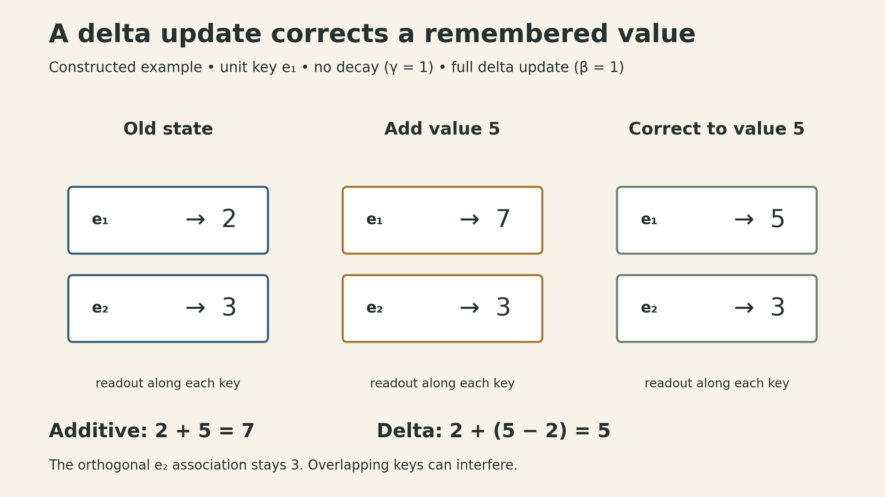
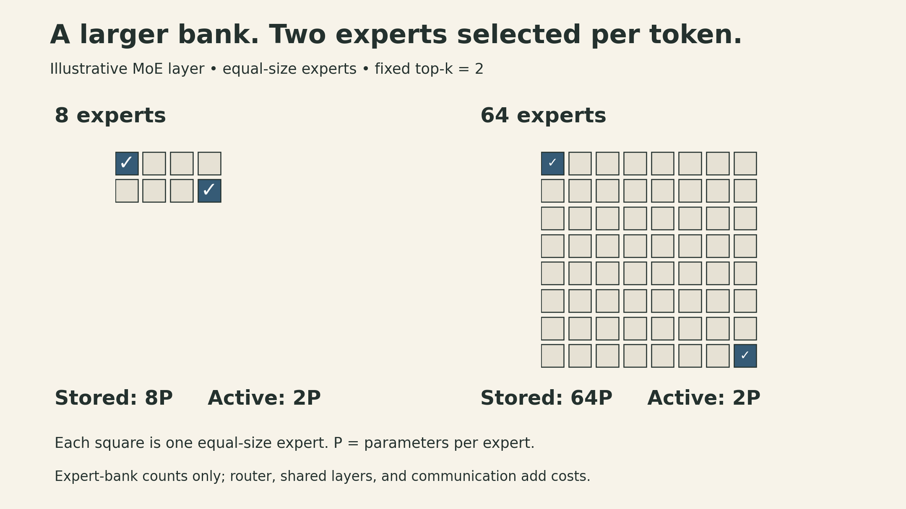
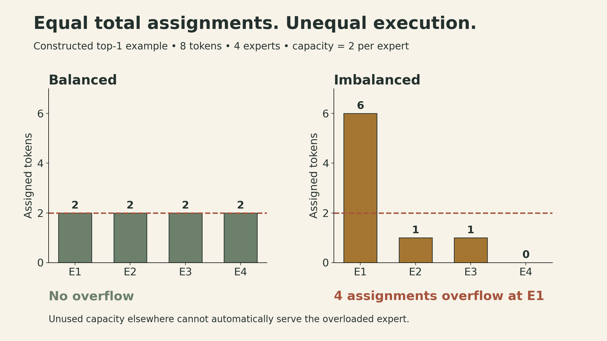

A language model can contain many more parameters than it evaluates for a single token. It can also summarize past tokens in a state whose size stays fixed as the sequence grows. These two ideas address different costs: the first changes how much feedforward computation a token receives; the second changes how the model carries information through time.

[Lecture 4 of Stanford CS336, Spring 2026](https://www.youtube.com/watch?v=cKSwj_qZ8Jg), taught by Tatsunori Hashimoto, connects attention alternatives with mixtures of experts. The common question is useful: **which work must happen for every token, and which information must remain available?** The answers determine both efficiency and what the architecture can represent.

The [previous lecture](lecture03-architectures-hyperparameters.qmd) covered the Transformer baseline, grouped-query attention, and local attention. This lecture goes further: changing the sequence-mixing operation itself, then replacing a dense feedforward layer with conditional computation. The numerical examples below are constructed calculations, not benchmark results.

[Official recording](https://www.youtube.com/watch?v=cKSwj_qZ8Jg) · [Lecture slides](https://github.com/stanford-cs336/lectures/blob/main/lecture_04.pdf)

[▶ Watch the official lecture on YouTube](https://www.youtube.com/watch?v=cKSwj_qZ8Jg){.btn .btn-outline-primary}

## Two growing bills: context and parameters

For one attention head, let $Q,K\in\mathbb R^{n\times d_k}$ and $V\in\mathbb R^{n\times d_v}$, where $n$ is sequence length. Ordinary attention computes

$$
Y=\operatorname{softmax}\!\left(\frac{QK^\top}{\sqrt{d_k}}+M\right)V,
$$

where the softmax acts row by row and a causal mask $M$ places $-\infty$ at future positions. The two attention matrix products cost $O(n^2d_k+n^2d_v)$. This counts sequence mixing, excluding the projections that produce $Q,K,V$.

During autoregressive decoding, one new query attends to the stored history, so its attention work grows with the number of cached tokens. Across a long generated sequence, that repeated work accumulates. Dense feedforward layers have a different cost: they apply the same large parameter matrices at every position, with work linear in sequence length for a fixed model width.

Systems improvements still matter. FlashAttention avoids materializing the full score matrix in high-bandwidth memory and reduces data movement while preserving the attention operation, up to floating-point effects. It does not remove the quadratic arithmetic dependence of full attention on sequence length. Architectural alternatives change the operation or the set of connections as well.

## A matrix identity becomes a recurrent memory

First remove softmax, the mask, and the scaling factor to study the unnormalized, noncausal operation

$$
Y=(QK^\top)V=Q(K^\top V).
$$

The left grouping constructs an $n\times n$ matrix. The right grouping first constructs a $d_k\times d_v$ matrix. Its two products cost $O(nd_kd_v)$ each, so the dependence on $n$ becomes linear when the head dimensions stay fixed.

This equality is exact for the operation written. It does **not** let us move parentheses through softmax. Replacing softmax attention with this operation changes the model. Kernel-based variants can add feature maps and a normalizer; the simple derivation here omits both.

For causal sequence modeling, use a prefix state instead of a single summary of the entire sequence. With column vectors $k_t,q_t\in\mathbb R^{d_k}$, $v_t\in\mathbb R^{d_v}$, and $S_0=0$,

$$
S_t=S_{t-1}+k_tv_t^\top,
\qquad y_t=S_t^\top q_t.
$$

Here $S_t\in\mathbb R^{d_k\times d_v}$ and $y_t\in\mathbb R^{d_v}$. Expanding the recurrence gives

$$
y_t=\sum_{i=1}^{t}v_i(k_i^\top q_t).
$$

This is exactly the causal, unnormalized linear-attention sum. The corresponding parallel expression is $(QK^\top\odot L)V$, where $L_{ti}=1$ for $i\le t$ and zero otherwise. Using the final $K^\top V$ for every position would leak future information.

At inference, the state contains $d_kd_v$ numbers regardless of history length. For a single head with $d_k=d_v=128$, that is 16,384 numbers: 32 KiB in BF16 or 64 KiB in FP32. A conventional single-head KV cache at 8,192 positions contains $8,192(128+128)$ numbers, or 4 MiB in BF16. These are storage calculations for two different mechanisms, not a quality-equivalent replacement or a speedup measurement. Practical recurrent models may accumulate the state in higher precision.

Training need not step through every token with a slow Python loop. Parallel formulations and chunked algorithms can combine matrix multiplications within chunks with state propagation between chunks. A fully materialized causal attention matrix remains quadratic; efficient implementations exploit more structure than simply writing that matrix down.

## Forgetting and updating are different operations

A running sum never removes an old association. A decay gate gives the model a way to control persistence:

$$
S_t=\gamma_t S_{t-1}+k_tv_t^\top.
$$

This is the simplified recurrent mechanism used to explain Mamba-2 in the lecture. The full architecture includes projections, discretization, local processing, and an output skip term. The scalar decay is input dependent; the update remains linear in the previous state. That structure supports efficient parallel and recurrent implementations. It is not an arbitrary nonlinear RNN.

A gated delta rule adds a more selective update:

$$
S_t=\gamma_t(I-\beta_t k_tk_t^\top)S_{t-1}
       +\beta_t k_tv_t^\top.
$$

This uses the transposed state convention relative to the [Gated DeltaNet paper](https://arxiv.org/abs/2412.06464). To see the mechanism, define the decayed state $\widetilde S_t=\gamma_t S_{t-1}$ and rearrange:

$$
S_t=\widetilde S_t+
\beta_t k_t\left(v_t-\widetilde S_t^\top k_t\right)^\top.
$$

The state first predicts the value associated with the current key. The update writes the prediction error back along that key. For a unit-length key,

$$
S_t^\top k_t=(1-\beta_t)\widetilde S_t^\top k_t+\beta_t v_t.
$$

Thus $\beta_t=1$ replaces the value recalled along that unit key, while $\beta_t=0$ suppresses the new write but still allows decay through $\gamma_t$. With a nonunit key, the amount removed also depends on $\lVert k_t\rVert^2$; calling $I-\beta_tk_tk_t^\top$ an exact orthogonal projector requires $\beta_t\lVert k_t\rVert^2=1$ for a nonzero key when removing its direction completely.

{fig-alt="Constructed two-dimensional state example. The old state maps key e1 to value 2 and e2 to value 3. Writing e1 with value 5 gives 7 under an additive update, but 5 under a delta update with gamma and beta equal to one. The e2 association remains 3 in both cases."}

For the example in the figure, $d_v=1$, $S_{t-1}=(2,3)^\top$, $k_t=(1,0)^\top$, and $v_t=5$. With no decay, an additive update produces $(7,3)^\top$. A full delta update produces $(5,3)^\top$: it corrects the first association while leaving the orthogonal direction intact. Real keys can overlap, so updating one association can affect others. The unit gates are idealized boundary values used to isolate the mechanism. The paper specifies a decay gate strictly between zero and one, so no decay is a limiting case. Its query and key paths use L2 normalization. The example does not claim that learned memories are perfectly separated.

## Why hybrid models keep some full attention

A fixed-size state is attractive because its storage does not grow with context length. It also has to compress the history. Full attention retains separate keys and values for individual positions, allowing a query to revisit them directly.

The lecture discusses hybrid designs that alternate recurrent layers with full-attention layers, including MiniMax's linear-attention hybrids, Mamba-based Nemotron models, and Gated DeltaNet-based Qwen models. The lecture notes that controlled ablations are limited, but presents evidence motivating a practical compromise: recurrent layers handle much of the sequence processing, while occasional attention layers retain direct access to the history. Results depend on the architecture, training, and task; a single benchmark, such as a retrieval test, is not a complete account of long-context quality.

A hybrid with a fixed positive fraction of full-attention layers still has a quadratic full-sequence attention term. Replacing seven of eight such layers reduces that term's coefficient; it does not make the whole model asymptotically linear. Its full-attention layers also keep growing KV caches.

### Sparse attention keeps selected token-level access

Another route is to keep attention but choose fewer positions for the expensive part. DeepSeek Sparse Attention, discussed in the lecture, uses a lightweight indexer to select positions, then performs attention over the selected set.

The selection cost belongs in the accounting. An indexer that scores every query against every key still has a quadratic component, even if its dimensions and precision make it much cheaper. For $m$ selected keys per query, the subsequent attention over those keys has work proportional to $nm$ times the relevant head dimensions. A small indexer and a bounded selection can substantially reduce cost without proving that the complete procedure is linear in $n$.

This also differs from recurrent compression: selected historical positions remain individually addressable. Which positions the indexer misses becomes part of the quality tradeoff. Adding the mechanism during continued training or context extension requires adaptation; it is not a free inference-time switch for an arbitrary dense model.

## Mixture of experts changes the feedforward budget

Now keep the sequence-mixing operation fixed and replace the dense FFN. A sparse mixture-of-experts layer contains $E$ expert networks $F_1,\ldots,F_E$ and a router that selects a small set $\mathcal T(x)$ for token representation $x$:

$$
\operatorname{MoE}(x)=\sum_{i\in\mathcal T(x)}g_i(x)F_i(x).
$$

An expert is typically an FFN, not a separate chatbot or a hand-assigned domain specialist. Specialization can emerge through training; the name alone does not tell us what an expert learns.

If each expert has $P$ parameters and $k$ experts are selected per token, the bank contains $EP$ parameters while each token uses $kP$ expert parameters. Holding $k$ and expert shape fixed keeps the main expert matrix-multiplication work approximately fixed as $E$ grows. Router computation, parameter storage, optimizer state, communication, and scheduling overhead do not disappear.

{fig-alt="Illustrative MoE budget comparison with equally sized experts. A bank of 8 experts holds 8P parameters and a bank of 64 holds 64P parameters. In each bank, 2 experts are selected for one token, using 2P expert parameters. Router, shared layers, storage, and communication costs are excluded from the active expert count."}

The figure's two banks differ by eightfold in expert parameter storage while activating the same number of expert matrices for one token. A large batch can collectively touch many or all experts. Sparse activation therefore does not mean that the unused weights can be ignored when provisioning the complete model.

The lecture surveys empirical reasons to use MoEs: quality gains at a given compute budget and useful ways to spread experts over devices. Those results motivate an architecture choice; they are not a theorem that adding experts always improves a model or reduces latency.

## Routing has two decisions: selection and weighting

In token-choice routing, every token selects its top-$k$ experts. Expert-choice routing reverses the allocation: experts choose tokens, potentially giving different tokens different amounts of computation. Global assignment methods optimize an allocation jointly. Token-choice top-$k$ is the main design developed here.

A router can produce logits $z=W_rx$. One common design first computes $p=\operatorname{softmax}(z)$, selects the top-$k$ entries, and retains their probabilities as gates. Another renormalizes over the selected set. These have the same selection in the absence of ties, but not generally the same output scale.

Take $p=(0.6,0.3,0.1)$ and $k=2$. Keeping the original weights gives $0.6F_1(x)+0.3F_2(x)$. Renormalizing gives $(2/3)F_1(x)+(1/3)F_2(x)$. With top-1 routing, renormalizing a single weight to one also removes that weight's ordinary task-gradient signal to the router. Switch Transformer instead retains the selected probability. “Use top-$k$” is therefore an incomplete specification.

The selection indices are discrete and change discontinuously at ranking boundaries. Within a fixed selected set, differentiable gate weights can still carry gradients. Training sparse models involves both that continuous path and mechanisms that prevent a few experts from taking nearly all the tokens.

The lecture also considers reinforcement learning for routing and stochastic perturbations of router scores or inputs. RL can optimize discrete choices but brings variance and implementation overhead. Noise can vary near-tied selections and encourage exploration, yet later ablations do not make it a universal requirement. The practical recipe emphasized here combines simple routing with explicit controls on load imbalance.

### Fine-grained and shared experts

Instead of a few wide experts, a model can use more narrow experts and activate more of them. This offers more combinations while controlling the active FFN width. The router and communication costs still have to be counted.

Shared experts are evaluated for every token in addition to the selected routed experts. They can learn broadly useful transformations while routed experts provide conditional capacity. The lecture contrasts DeepSeek ablations that favor sharing with OLMoE ablations that did not find the same benefit. A shared expert is an empirical design choice, not a universal requirement.

## Load balancing connects the objective to the machine

Suppose eight tokens use top-1 routing across four experts. Perfectly balanced routing gives two tokens per expert. The allocation $(6,1,1,0)$ has the same total number of assignments but a very different execution profile.

If each expert has capacity two, four assignments overflow at expert 1 while other experts have spare capacity. Raising capacity to three still leaves three overflows. A capacity-limited implementation may skip the overflowing expert computation while preserving the residual path; it does not necessarily delete the token from the sequence. Dropless implementations instead support uneven workloads, which brings different scheduling and kernel requirements.

{fig-alt="Constructed top-one routing example for 8 tokens and 4 experts. Balanced loads are 2, 2, 2, 2. Imbalanced loads are 6, 1, 1, 0. A dashed capacity line at 2 shows four overflowing assignments at expert 1 in the imbalanced case, despite unused capacity elsewhere."}

For the top-1 setting in Switch Transformer, define the fraction of tokens assigned to expert $i$ and its mean router probability over a batch of $T$ tokens:

$$
\begin{aligned}
f_i&=\frac1T\sum_{t=1}^{T}\mathbf1[\arg\max_j p_j(x_t)=i],\\
P_i&=\frac1T\sum_{t=1}^{T}p_i(x_t),\\
\mathcal L_{\mathrm{bal}}&=\alpha E\sum_{i=1}^{E}f_iP_i.
\end{aligned}
$$

During differentiation, the hard assignment fractions $f_i$ are treated as fixed. The direct derivative with respect to a probability coordinate is

$$
\frac{\partial\mathcal L_{\mathrm{bal}}}{\partial p_i(x_t)}
=\frac{\alpha E}{T}f_i.
$$

A more frequently selected expert receives a larger penalty on its probability, with the softmax Jacobian coupling the resulting logit gradients. This is a balancing heuristic. Under $f_i=P_i=1/E$, the loss equals $\alpha$; that calculation is not a general proof that every possible minimum corresponds to perfectly uniform routing. Too much balancing pressure can conflict with the language-model objective.

### Balance selection without adding the bias to the mixture

DeepSeek-V3 illustrates another approach. Its router forms sigmoid affinity scores $s_i=\operatorname{sigmoid}(z_i)$ and uses $s_i+b_i$ to select experts. The bias is adjusted according to observed load: decrease it for overloaded experts, increase it for underloaded ones. The selected experts' output weights come from the original $s_i$, normalized over the selected set, **without the balancing bias**.

This is normalized sigmoid weighting, not another softmax over the sigmoid values. Although the main balancing mechanism is called “auxiliary-loss-free,” the technical report also includes a small sequence-wise balancing loss. The name describes a particular mechanism, not the absence of every auxiliary objective.

## Sparse arithmetic still needs dense systems work

Balancing can also target devices rather than only individual experts. DeepSeek-V2 uses device and communication constraints; DeepSeek-V3 limits the number of destination nodes per token. These choices control traffic as well as expert utilization.

Expert parallelism places different experts on different devices. A layer must dispatch token activations to their selected experts, run the expert computations, return the outputs, and combine them. This introduces communication and load-distribution costs that a parameter count cannot reveal.

Several consequences follow:

- **Uneven loads create stragglers.** Average tokens per expert can hide a busy device that determines the step time.
- **Small expert batches can underuse hardware.** Many narrow experts need efficient grouping or sparse/block-sparse kernels; MegaBlocks is one example discussed in the lecture.
- **Capacity policies can affect outputs.** When tokens compete for finite expert slots, changing other tokens in the batch may change which expert computations execute. That is one possible source of batch-dependent behavior, not an intrinsic requirement of all MoEs.
- **Router precision matters.** Higher precision for routing and a router z-loss can help numerical stability. A z-loss penalizes the squared log-sum-exp of router logits; it addresses scale rather than directly measuring load balance.
- **Fine-tuning changes the regime.** Sparse capacity can overfit small datasets. The lecture discusses selective parameter updates and larger adaptation datasets as approaches whose usefulness must be tested in context.

Upcycling offers a separate initialization route: copy a pretrained dense model's FFNs into multiple experts, add a router, and continue training. Subsequent routing and learning let experts diverge. Copying weights alone does not produce specialized experts or establish a quality gain; the additional training is part of the method.

## Putting the pieces together: MoE, MLA, and prediction depth

The lecture ends with the evolution of DeepSeek architectures. Three mechanisms act on different parts of the cost:

| Mechanism | What changes | What still needs accounting |
|---|---|---|
| Sparse MoE | Which FFNs process a token | Stored weights, router, shared experts, communication |
| Multi-head latent attention (MLA) | How each token's keys and values are represented | History length, positional keys, attention arithmetic |
| Multi-token prediction (MTP) | Training targets and optional draft-token generation | Additional training modules; verification during speculative decoding |

For MLA, a compact latent vector $c_j$ produces content keys and values. Ignoring positional terms for a moment, if $k_j=W_Kc_j$, then

$$
q_t^\top k_j=q_t^\top W_Kc_j=(W_K^\top q_t)^\top c_j.
$$

The key up-projection can be absorbed into the query-side calculation. Similarly, a value projection can be applied after the weighted sum of latents. This permits caching a smaller representation per token. Applying RoPE indiscriminately to the content keys would introduce position-dependent rotations that obstruct a single fixed absorption. DeepSeek uses a separate positional branch; its cache contains **both** the compressed KV latent and the decoupled positional key.

MLA still keeps a representation for each historical token. It reduces cache width; it does not make the cache independent of sequence length. That distinction separates it from the recurrent state described earlier.

In MTP, additional modules learn to predict beyond the ordinary next-token target. DeepSeek-V3 uses one additional prediction depth, preserves the causal chain, and can discard these modules for ordinary inference or reuse them for speculative decoding. Extra predictions are not automatically accepted output tokens: speculative decoding requires verification.

## A practical way to read an efficiency claim

When a model is described as “linear,” “sparse,” or “37B active,” ask what the claim counts.

Does linearity concern one recurrent layer or the whole hybrid? Does sparsity remove historical tokens, select FFNs, or only reduce representation width? Does the active parameter count exclude the router and shared components? Are measurements taken during training, prompt processing, or single-token decoding—and at what batch size and context length?

The useful lesson is to trace the computation. A recurrent state compresses history. Sparse attention selects historical positions. MoE selects transformations. MLA compresses each token's cached representation. Each can reduce a different cost, and each leaves a different set of work and information constraints behind.

## Sources

- [Stanford CS336, Spring 2026](https://cs336.stanford.edu/), Lecture 4 by Tatsunori Hashimoto: [60-page slides](https://github.com/stanford-cs336/lectures/blob/main/lecture_04.pdf) and [official recording](https://www.youtube.com/watch?v=cKSwj_qZ8Jg). Attention alternatives: slides 2–13; MoE overview: 14–25; routing and balancing: 26–43; systems, stability, and upcycling: 44–53; DeepSeek architecture: 54–59; summary: 60.
- [Gated Delta Networks](https://arxiv.org/abs/2412.06464), §§2–3, for causal linear attention and the gated delta recurrence; [Transformers are SSMs](https://arxiv.org/abs/2405.21060), for Mamba-2 and structured state-space duality.
- [Switch Transformers](https://arxiv.org/abs/2101.03961), §2, for top-1 gating, expert capacity, and the load-balancing loss.
- [DeepSeek-V3 Technical Report](https://arxiv.org/abs/2412.19437), §§2.1–2.2 and §4.2, for normalized sigmoid routing, balancing biases, MLA, and MTP. The state, expert-bank, and capacity examples above are illustrative calculations under their stated assumptions.
