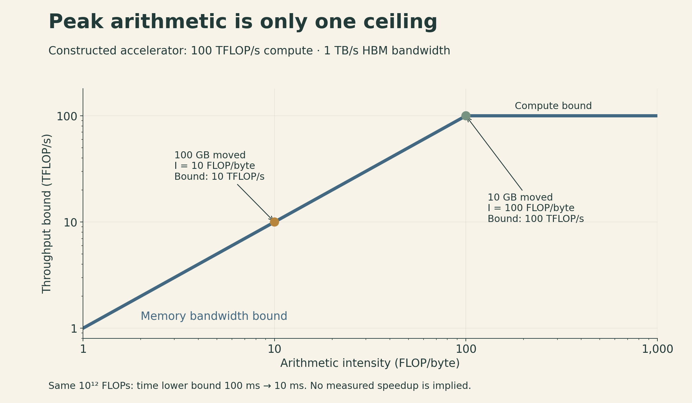
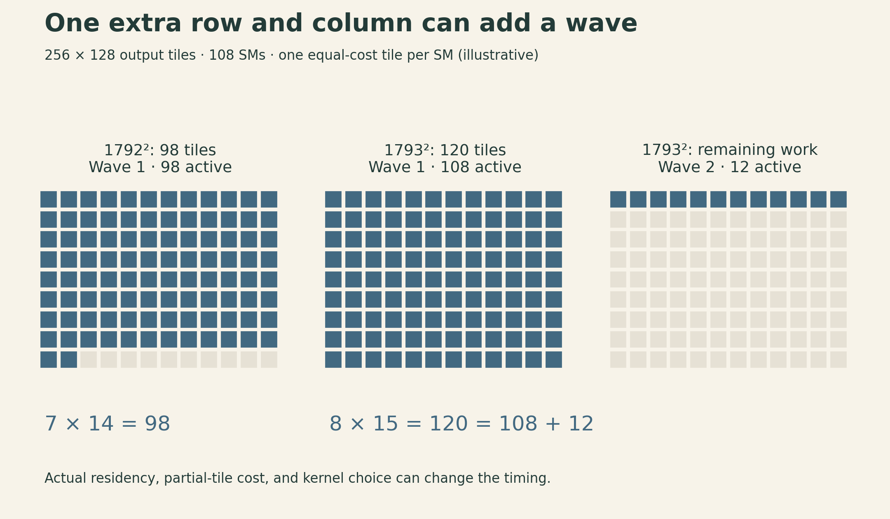
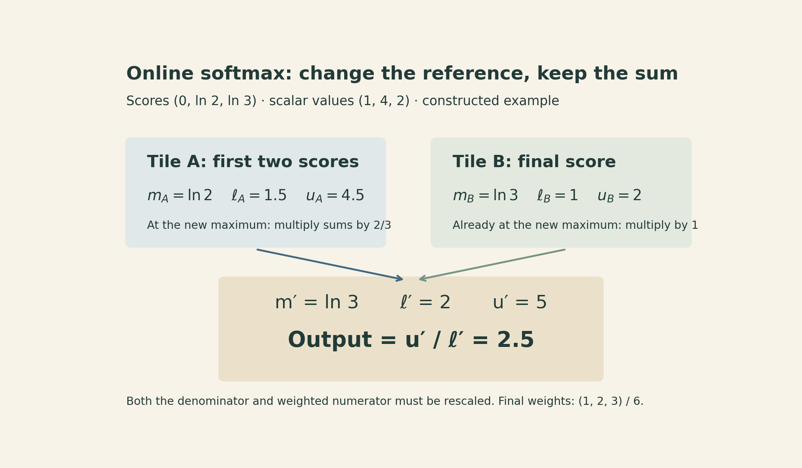

A GPU can have idle arithmetic units while a program is running as fast as its memory system allows. Making those arithmetic units twice as powerful would barely help that program. Changing which arrays it reads and writes might help much more.

That is the central idea of [Stanford CS336 Lecture 5](https://www.youtube.com/watch?v=izZba4UA7iY), taught by Tatsunori Hashimoto in Spring 2026. The lecture introduces GPU hardware, briefly compares TPUs, and develops the ingredients behind FlashAttention: reuse data near the compute units, avoid unnecessary trips through memory, and arrange work so the hardware can execute it efficiently.

The [previous lecture](lecture04-attention-alternatives-moe.qmd) changed model architectures to reduce work or storage. Here the question is how to execute a chosen operation efficiently. The numerical examples below are constructed calculations, not hardware benchmarks.

[Official recording](https://www.youtube.com/watch?v=izZba4UA7iY) · [Lecture slides](https://github.com/stanford-cs336/lectures/blob/main/lecture_05.pdf)

[▶ Watch the official lecture on YouTube](https://www.youtube.com/watch?v=izZba4UA7iY){.btn .btn-outline-primary}

## Start with two budgets

Suppose a kernel performs $F$ floating-point operations and transfers $D$ bytes between high-bandwidth memory (HBM) and the processor. Let $C$ be the relevant peak arithmetic throughput in FLOP/s and $B$ the HBM bandwidth in byte/s. Then

$$
t\geq \max\!\left(\frac{F}{C},\frac{D}{B}\right).
$$

This is an optimistic lower bound. Reaching it would require ideal resource use and sufficient overlap of computation with memory traffic. The bound itself remains valid when that overlap is absent. Launch overhead, dependencies, poor scheduling, and other memory levels can make the real time longer.

Define **arithmetic intensity** as work per byte:

$$
I=\frac{F}{D},\qquad
P=\frac{F}{t}\leq\min(C,BI).
$$

The sloping part of this roofline bound is set by memory bandwidth. The horizontal part is set by compute throughput. Their intersection is $I_*=C/B$. The byte count must refer to the same memory boundary as the bandwidth: HBM traffic and shared-memory traffic are different quantities.

Consider an imaginary accelerator with $C=100$ TFLOP/s and $B=1$ TB/s, using decimal units. Its ridge point is 100 FLOP/byte. A kernel doing $10^{12}$ FLOPs while moving 100 GB has intensity 10 FLOP/byte. Its compute lower bound is 10 ms, but its memory lower bound is 100 ms.

If an implementation could reduce traffic to 10 GB while preserving that work count, the memory lower bound would fall to 10 ms. This calculation identifies an opportunity; it does not promise a tenfold measured speedup.

{fig-alt="Constructed roofline for 100 TFLOP per second and 1 TB per second. At intensity 10 FLOPs per byte the bound is 10 TFLOP per second; at intensity 100 it reaches 100. These are bounds, not measured performance."}

There is no single peak $C$ for every operation. A tensor-core matrix-multiplication peak cannot be used as the peak rate for comparisons, exponentials, or arbitrary scalar code. Precision, accumulation format, and instruction type belong in the performance model.

## A GPU is many workers sharing a memory hierarchy

A CPU is designed to handle latency-sensitive work and complex control flow well. A GPU devotes much more of its design to throughput across many concurrent threads. Both can execute parallel work; their resource allocation and execution models differ.

For NVIDIA GPUs, a useful hierarchy is:

| Unit | What it organizes | Why it matters |
|---|---|---|
| Thread | One logical execution context | Holds private values in registers when possible |
| Warp | 32 threads | Executes instructions across active lanes; divergent paths can reduce utilization |
| Thread block | A group of warps assigned to one streaming multiprocessor (SM) | Threads can cooperate through block-level shared memory and synchronization |
| SM | Schedules resident warps and supplies compute resources | Register and shared-memory use limit how much work can reside at once |
| Device | Many SMs plus caches and HBM | Supplies large-scale parallelism and the memory capacity for model tensors |

Registers and shared memory are small, fast resources near execution units. L2 cache serves a broader part of the chip; HBM provides much larger storage. A value loaded from HBM becomes more useful if several operations can consume it before it leaves fast storage.

When one warp waits for data, an SM can issue work from another eligible warp. This hides latency only when enough independent work is available. A large register footprint or shared-memory allocation can reduce residency; adding more threads does not automatically solve the problem.

Tensor cores specialize in matrix operations. Their high throughput rewards suitable shapes and supported data formats. They do not accelerate every instruction in a neural network equally.

### The TPU comparison

A TPU organizes similar needs differently. Its matrix multiply units (MXUs) handle matrix arithmetic, vector units handle elementwise operations and reductions, and scalar units handle control. On-chip vector memory (VMEM) holds working data brought from HBM. Efficient execution pipelines transfers with arithmetic and reuses those working sets.

Google's term “TensorCore” names a TPU subsystem; it should not be equated with an NVIDIA tensor-core instruction unit. The CUDA warp/block model also does not transfer directly to TPU programming. The shared lesson is the hierarchy: abundant matrix arithmetic still needs a timely supply of data. See the [TPU architecture explanation](https://jax-ml.github.io/scaling-book/tpus/) for the device-specific details.

## Six ways to close the gap

### 1. Keep warp lanes doing useful work

If threads within a warp take different branches, the hardware may execute the paths with different lanes active. A branch that is uniform across the warp is a different case: it does not create that divergence.

The practical question is how data and work are grouped. If neighboring lanes repeatedly need different paths, some of the execution capacity may sit idle. This is a utilization problem, even when memory traffic is small.

### 2. Reduce precision where the computation permits it

An out-of-place ReLU on $n$ elements must read the input and write the output. Ignoring cache effects and other traffic, that is $8n$ bytes for FP32 and $4n$ bytes for FP16. The comparison work stays roughly the same while the transferred representation gets smaller. For this example, counting comparisons per byte is clearer than applying a tensor-core FLOP peak.

Matrix multiplication can gain both smaller transfers and access to faster arithmetic modes. Mixed precision separates input representation from accumulation: FP16 products with FP32 accumulation are one common pattern. The precision needed for accumulated sums, sensitive layers, and optimization state must be considered separately.

At still lower precision, scale factors become part of the representation. MXFP8 uses a scale for each block of 32 values; NVFP4 uses four-bit E2M1 values with finer-grained scaling. In NVIDIA's basic NVFP4 representation, a block of 16 values has an E4M3 scale, with an additional FP32 tensor scale. These are different named formats. Quantization also adds work, storage for scales, and numerical error. [NVIDIA's format documentation](https://docs.nvidia.com/deeplearning/transformer-engine/examples/fp8_primer.html) specifies the details.

### 3. Fuse operations to avoid intermediate arrays

Take the illustrative expression

$$
y=\sin^2(x)+\cos^2(x).
$$

A literal implementation with separate kernels for sine, cosine, two squares, and addition launches five kernels. Suppose each intermediate is written to and later read from HBM, with no cache reuse or algebraic simplification. The first four operations each read and write one array; the addition reads two and writes one. That is $11n$ element transfers, or $44n$ bytes in FP32.

A fused implementation can read each $x_i$, keep intermediate values in registers, and write each $y_i$: $2n$ transfers, or $8n$ bytes. The arithmetic identity equals one in real arithmetic, so this is a dataflow illustration, not a useful benchmark or an instruction to defeat compiler simplification. Floating-point evaluations can also differ slightly from the exact identity.

Fusion can reduce launch overhead too. Its limit is resource pressure: an oversized fused kernel may use too many registers, spill values, or reduce occupancy. Fewer kernels is a means to an efficient execution, not the objective by itself.

### 4. Recompute a cheap value instead of saving it

Backpropagation often needs information from the forward pass. Saving every intermediate can create substantial HBM traffic. If an intermediate is cheap to reconstruct, recomputing it from retained inputs can cost less than storing and reloading it.

This can increase FLOPs while decreasing runtime. The trade depends on the actual bottleneck and recomputation cost. Repeating a large, already compute-bound matrix multiplication is a different proposition from recreating a small elementwise expression inside a fused kernel.

### 5. Arrange neighboring accesses together

For a row-major matrix with $N$ columns and $s$ bytes per element,

$$
\operatorname{address}(A_{ij})=\operatorname{base}+s(iN+j).
$$

If consecutive warp lanes vary $j$ while holding $i$ fixed, their accesses are adjacent. If they vary $i$ instead, accesses are separated by a row stride. Adjacent accesses can use memory transactions more efficiently; this is coalescing.

Coalescing does not mean that a whole warp always performs one DRAM transaction. NVIDIA's [CUDA best-practices guide](https://docs.nvidia.com/cuda/cuda-c-best-practices-guide/index.html#coalesced-access-to-global-memory) gives a concrete modern case: 32 aligned consecutive four-byte loads are served by four 32-byte transactions. Alignment, access width, and architecture matter.

### 6. Tile the computation to reuse inputs

For a square product $C=AB$ of size $N$, imagine each output element independently reading an entire row of $A$ and column of $B$. Without cache reuse, this requires approximately $2N^3$ input-element loads.

Now compute a $T\times T$ output tile at a time. At each step through the reduction dimension, load two $T\times T$ input tiles and reuse them for $2T^3$ FLOPs. The ratio for that inner step is

$$
I_{\text{tile}}\approx\frac{2T^3}{2T^2s}=\frac{T}{s}.
$$

For FP32 and $T=32$, this is 8 FLOP/byte. It excludes output writes, boundary tiles, and reuse supplied by other cache levels. Across the full multiplication, the simplified input-load count becomes $2N^3/T$. This is a model of explicit tile reuse, not a prediction of real HBM counters.

Increasing $T$ improves reuse but consumes more fast storage. The two input tiles alone require $2T^2s$ bytes; accumulators and other values need space too. A tile that looks excellent in a byte-count formula can leave too few resident blocks to keep an SM busy.

## Why a slightly larger matrix can be awkward

Tile sizes also create discrete boundaries. Suppose an output is partitioned into $256\times128$ tiles. Then

$$
\begin{aligned}
1792\times1792 &: \quad 7\times14=98\text{ tiles},\\
1793\times1793 &: \quad 8\times15=120\text{ tiles}.
\end{aligned}
$$

The extra row and column create many partial tiles. Now use the lecture's 108-SM A100 example and an intentionally simplified scheduling model: one output-tile block can reside on each SM, and every tile takes the same time. The 98-tile case fits in one wave. The 120-tile case needs a second wave with only 12 active SMs.

{fig-alt="Illustrative scheduling on 108 SMs with one equal-cost tile per SM. A 1792 by 1792 output uses 98 tiles in one wave. A 1793 by 1793 output uses 120 tiles, split into 108 and 12 across two waves. Active cells are blue and idle cells are cream."}

This explains a possible performance discontinuity; it does not imply that the second multiplication actually takes twice as long. Real kernels can admit multiple blocks per SM, choose different tiles, and handle partial tiles at different costs. Padding or choosing different dimensions can help, but there is no universal rule that every dimension should be a power of two. Measure the relevant shape and kernel.

## FlashAttention brings the ideas together

For one head, with $Q,K,V\in\mathbb R^{L\times d}$, ordinary attention is

$$
S=\frac{QK^\top}{\sqrt d},\qquad
P=\operatorname{softmax}_{\text{row}}(S),\qquad O=PV.
$$

The attention core has two matrix multiplications. The projections that create $Q,K,V$ are outside this expression. A naive implementation materializes both the scores and probabilities as $L\times L$ arrays in HBM.

The original [FlashAttention paper](https://arxiv.org/abs/2205.14135) changes this dataflow. Blocks of queries, keys, and values are processed in fast on-chip storage; a score tile can be consumed without storing the complete score or probability matrix in HBM. The challenge is softmax: each output row must be normalized using all of its valid scores.

### Keep a running maximum, denominator, and weighted sum

For one query row, let $s_j$ be its score for key $j$, with value vector $v_j$. After processing a set $A$ of valid keys, keep

$$
m_A=\max_{j\in A}s_j,\qquad
\ell_A=\sum_{j\in A}e^{s_j-m_A},\qquad
u_A=\sum_{j\in A}e^{s_j-m_A}v_j.
$$

The current normalized output is $u_A/\ell_A$. A new tile $B$ supplies its own $(m_B,\ell_B,u_B)$. To combine them, use a shared maximum:

$$
m'=\max(m_A,m_B),\qquad
\alpha=e^{m_A-m'},\qquad\beta=e^{m_B-m'}.
$$

Then

$$
\ell'=\alpha\ell_A+\beta\ell_B,\qquad
u'=\alpha u_A+\beta u_B.
$$

Multiplying by $\alpha$ converts every old exponential from the reference $m_A$ to the new reference $m'$. Multiplying by $\beta$ does the same for the new tile. Both numerator and denominator therefore represent the union of the two sets with the same scale.

This is an extension of the [online softmax normalizer](https://arxiv.org/abs/1805.02867) to a weighted value sum. Initialize from the first nonempty valid tile. For a causal mask, exclude masked positions and skip tiles with no valid positions for that row; otherwise expressions such as $-\infty-(-\infty)$ can produce NaNs. Each output row needs at least one valid score for ordinary softmax to be defined.

### A three-score example

Let the scores be $(0,\ln 2,\ln 3)$ and the scalar values $(1,4,2)$. The complete softmax weights are $(1/6,2/6,3/6)$, so the output is

$$
O=\frac{1+8+6}{6}=2.5.
$$

Process the first two scores as one tile. Its state is $m_A=\ln 2$, $\ell_A=1.5$, and $u_A=4.5$. The final score gives $m_B=\ln 3$, $\ell_B=1$, and $u_B=2$. Thus $\alpha=2/3$, $\beta=1$, and

$$
\ell'=2,\qquad u'=5,\qquad O=5/2=2.5.
$$

{fig-alt="Online softmax example with scores zero, log two, log three and values one, four, two. Tile A has maximum log two, denominator 1.5 and weighted sum 4.5. Tile B has maximum log three, denominator one and sum two. Rescaling A by two thirds gives denominator two and sum five, so the output is 2.5."}

The derivation reproduces the original softmax-weighted sum in real arithmetic. Different floating-point evaluation orders need not be bitwise identical. Processing query blocks against key/value tiles this way avoids the quadratic intermediate matrices; it does not remove the $O(L^2d)$ arithmetic of dense attention. Saved normalization information also permits backward recomputation instead of retaining the full probability matrix.

The result is a useful combination: tiling provides reuse, fusion avoids intermediate memory trips, online normalization preserves the operation, and recomputation reduces what must be saved.

## A practical order for reasoning

Before changing a kernel, write down the operation and the shapes. Then count its arithmetic and the traffic across the memory boundary you care about. Use the relevant arithmetic peak, not the largest number on a specification sheet.

Next ask what prevents efficient execution: divergent work, unnecessary intermediate arrays, poorly arranged accesses, insufficient reuse, or too few useful tiles. A profiler can distinguish these possibilities; a FLOP count alone cannot.

Finally, compare equivalent results with an explicit numerical tolerance and measure the actual workload. A transformation can improve the resource bound while losing to overhead or resource pressure. The value of the model is that it gives you a concrete hypothesis to test.

Peak arithmetic throughput is useful information. The path from stored tensors to arithmetic units determines how much of it a program can use.

## Sources

- [Stanford CS336, Spring 2026](https://cs336.stanford.edu/), Lecture 5: [slides](https://github.com/stanford-cs336/lectures/blob/main/lecture_05.pdf) and [recording](https://www.youtube.com/watch?v=izZba4UA7iY).
- [NVIDIA CUDA C++ Best Practices Guide](https://docs.nvidia.com/cuda/cuda-c-best-practices-guide/index.html), memory access and execution guidance.
- [NVIDIA Transformer Engine: FP8 and FP4](https://docs.nvidia.com/deeplearning/transformer-engine/examples/fp8_primer.html), format definitions and scaling.
- [How to Scale Your Model: TPUs](https://jax-ml.github.io/scaling-book/tpus/), TPU compute units and memory hierarchy.
- [Milakov and Gimelshein, Online normalizer calculation for softmax](https://arxiv.org/abs/1805.02867), 2018.
- [Dao et al., FlashAttention](https://arxiv.org/abs/2205.14135), 2022, Sections 2–3 and Appendix B.
