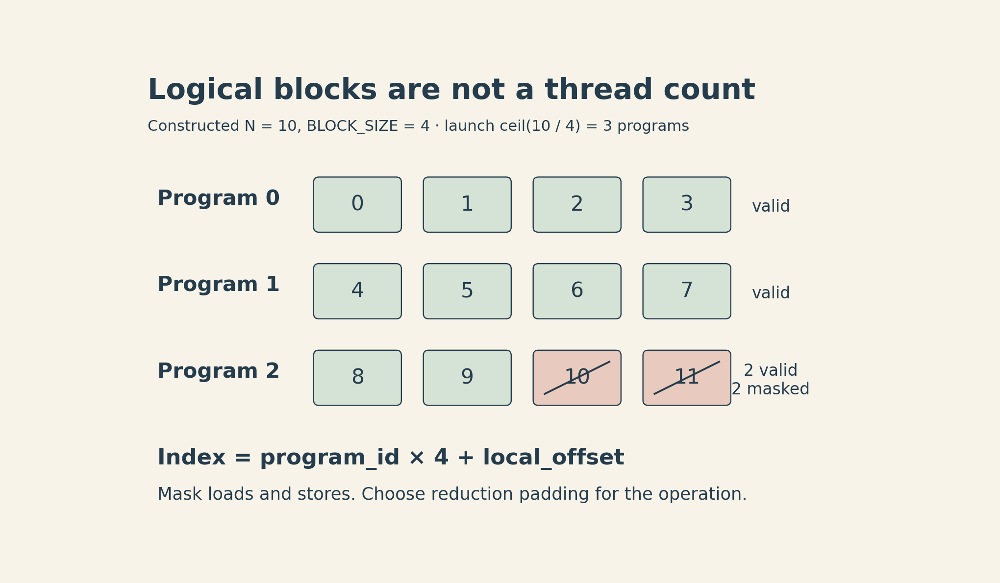
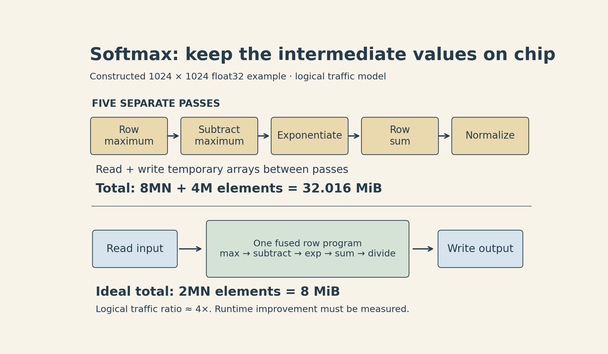
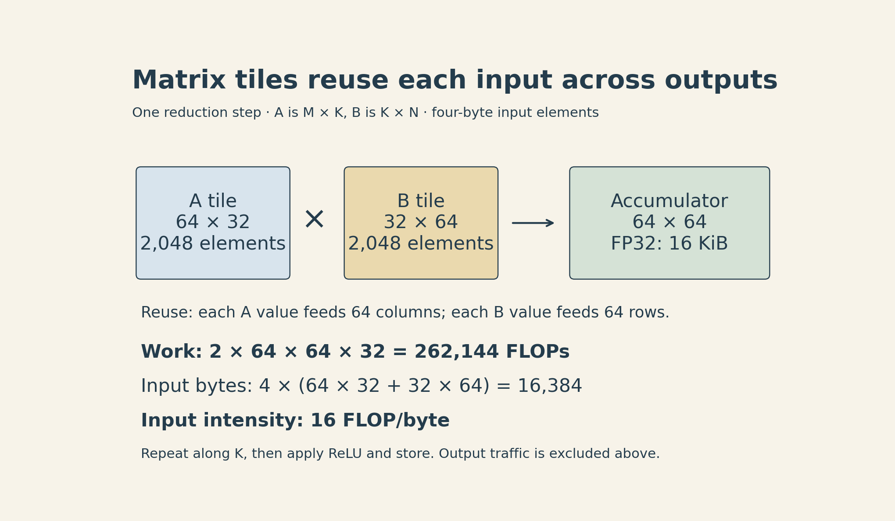

A tensor expression can be short and still send the same array through GPU memory several times. An intermediate result written by one kernel may immediately be read by the next. Removing those trips can matter more than reducing the number of multiplications.

[Stanford CS336 Lecture 6](https://cs336.stanford.edu/lectures/?trace=lecture_06), taught by Percy Liang in Spring 2026, turns that observation into a practical sequence: measure the work, inspect the kernels, fuse operations, and choose tiles that reuse data. The examples progress from GELU to softmax, a row reduction, and matrix multiplication with an activation.

The [previous lecture](lecture05-gpus-tpus.qmd) introduced the hardware budgets. This article connects those budgets to program structure. Its numerical examples are constructed calculations, not GPU benchmark results.

[Official recording](https://www.youtube.com/watch?v=xnDHaNUvHBg) · [Lecture code](https://github.com/stanford-cs336/lectures/blob/main/lecture_06.py)

[▶ Watch the official lecture on YouTube](https://www.youtube.com/watch?v=xnDHaNUvHBg){.btn .btn-outline-primary}

## Measure completed work before changing the kernel

CUDA launches are asynchronous: Python can return while the GPU is still working. A CPU timer around a launch can therefore measure mostly submission overhead. A useful benchmark must specify what interval it measures.

For a GPU interval on one CUDA stream, record a start event, enqueue the operation, record an end event, wait for completion, and read the elapsed event time. Warm up first so compilation and initial setup do not dominate a steady-state measurement. Keep input creation outside the measured interval unless allocating inputs is part of the workload you intend to measure.

A synchronized host wall-clock measurement answers a different question: how long the whole call takes from the application's perspective. CUDA event timing is not a complete application latency measurement, and gaps between submitted kernels can still affect an event interval. The [CUDA timing guidance](https://docs.nvidia.com/cuda/cuda-c-best-practices-guide/index.html#timing) explains why the synchronization boundary matters.

Repeat measurements across the actual shapes and dtypes of interest. Very small operations can be dominated by launch and scheduling overhead; larger matrix multiplications can spend much more of their time doing arithmetic. A single size does not establish a general ranking.

Then profile. A timer gives a duration; a profiler shows which kernels ran and where time went. Two calls to matrix multiplication can select different kernels at different shapes. A long kernel name can expose its architecture target, dtype, and tile sizes, but the name alone does not establish performance. PyTorch's [profiler recipe](https://docs.pytorch.org/tutorials/recipes/recipes/profiler_recipe.html) provides the practical interface.

## Hardware details become constraints on the program

A CUDA grid contains thread blocks; a block executes on one streaming multiprocessor (SM), and threads in a block can cooperate through shared memory. On NVIDIA GPUs, threads are grouped into warps of 32. Divergent paths within a warp can reduce the useful work performed together. [Independent thread scheduling](https://docs.nvidia.com/cuda/cuda-c-best-practices-guide/index.html#branching-and-divergence) on modern devices makes “every thread always executes in lockstep” too strong a correctness assumption.

Three other details affect the mapping:

- **Coalescing:** nearby addresses accessed by a warp can be served efficiently together. For modern CUDA devices, it is useful to reason in 32-byte sectors: 32 threads reading consecutive, aligned 4-byte values cover 128 bytes, or four such sectors. A strided pattern can touch many more sectors. A 128-byte span should not be treated as a universal single-transaction rule.
- **Shared-memory banks:** in the common 32-bank, 32-bit-word model, words at indices differing by 32 map to the same bank. Distinct-address accesses to that bank within a warp can serialize; reading the same word can broadcast. Padding or swizzling changes the address-to-bank mapping.
- **Occupancy:** registers and shared memory limit how many warps can reside on an SM. More resident warps can help hide latency, but maximizing occupancy is not the same as minimizing runtime.

For a simplified register budget, suppose an SM has 65,536 registers and supports 64 resident warps. A block of 128 threads using 160 registers each requires 20,480 registers. Ignoring allocation granularity and other limits, only

$$
\left\lfloor\frac{65{,}536}{128\times160}\right\rfloor=3
$$

such blocks fit. That gives 12 warps, or $12/64=18.75\%$ occupancy. The real residency limit also depends on the architecture, shared memory, and allocation rules.

There is a separate scheduling effect: a partially filled final wave can leave most SMs idle near the end of a launch. Under an idealized one-block-per-SM model with 148 SMs, 160 equal-duration blocks require two waves. The second wave contains only 12 blocks. More generally, the number of simultaneous block slots depends on residency; an exact multiple of the SM count is not a universal tuning rule.

These details are reasons to measure a proposed mapping, not reasons to choose the largest possible tile.

## Fusion keeps temporary values near the arithmetic

Consider the tanh approximation to GELU:

$$
\operatorname{GELU}_{\tanh}(x)
=\frac{x}{2}\left[1+\tanh\!\left(\sqrt{\frac{2}{\pi}}
\left(x+0.044715x^3\right)\right)\right].
$$

This is an approximation to $x\Phi(x)$, not the exact same mathematical function. A comparison should use the same approximation on both sides—for example, PyTorch's `approximate="tanh"` mode. See the [GELU definition](https://docs.pytorch.org/docs/stable/generated/torch.nn.GELU.html).

An eager implementation assembled from separate tensor operations can launch several kernels and materialize temporary arrays. A fused implementation can load each input, calculate the activation, and write the final output without storing every intermediate tensor in global memory. A built-in operator or `torch.compile` may already achieve this; inspect the generated execution before writing a custom kernel.

Fusion also changes resource use. More live intermediate values can raise register pressure and cause spills. The useful question is whether the saved traffic and launches outweigh those costs for the target workload.

Numerical behavior still needs attention. The identity

$$
\tanh(a)=\frac{e^{2a}-1}{e^{2a}+1}
$$

is valid over real numbers, but the direct exponential can overflow in floating point. For the GELU inner argument at $x=11$, $a\approx56.263$, so $e^{2a}\approx7.41\times10^{48}$ exceeds the finite float32 range. The resulting infinity-over-infinity can produce NaN. The lecture's illustrative GELU kernel uses this exponential identity. Use an appropriate stable implementation and test the input range; agreement on small random inputs does not establish numerical safety everywhere.

## A Triton program owns a block of values

Triton expresses work on arrays of values rather than requiring the programmer to assign each individual CUDA thread's operations. For the kernels here, one program instance is mapped to a thread block. The compiler distributes that program's values across threads and registers and inserts the communication needed for reductions. The lecture uses shared memory as an intuitive model; the distinction between logical values and their physical storage matters when interpreting the code.

For an elementwise operation, let $N$ be the number of elements and $B$ the number handled by one program. Launch $\lceil N/B\rceil$ programs. Program $p$ constructs indices

$$
i=pB+[0,1,\ldots,B-1]
$$

and loads or stores only indices satisfying $i<N$.

**`BLOCK_SIZE` counts logical values, not CUDA threads.** A thread can handle multiple values; the warp count and compiler layout determine the mapping. Likewise, `tl.load` does not mean “every value is necessarily stored in CUDA shared memory.” The physical storage can involve registers, shared memory, caches, and spills according to the generated kernel.

For a constructed $N=10$, $B=4$ example, the third program owns candidate indices 8, 9, 10, and 11. Only the first two are valid. A mask prevents out-of-bounds access. This idea appears in Triton's [vector-add tutorial](https://triton-lang.org/main/getting-started/tutorials/01-vector-add.html).

{fig-alt="Constructed example with ten elements and block size four. Program zero handles indices zero through three; program one handles four through seven; program two handles eight and nine, masking indices ten and eleven. Logical elements are not a count of CUDA threads."}

Here $N$ counts elements in the flattened input; in the matrix examples below, $N$ denotes the number of columns.

A masked load also needs a fill value appropriate to the next operation. Use zero for an additive reduction. For a maximum followed by softmax, negative infinity is the useful neutral padding value.

## Softmax makes the traffic savings explicit

For a row $x_1,\ldots,x_N$, subtract its maximum $m$ before exponentiating:

$$
m=\max_j x_j,\qquad
z_i=e^{x_i-m},\qquad
y_i=\frac{z_i}{\sum_j z_j}.
$$

The shared factor $e^{-m}$ cancels between numerator and denominator, leaving the mathematical softmax unchanged. For finite inputs, the largest exponential becomes one, avoiding overflow in this step. Underflow of much smaller terms can still occur.

Suppose an $M\times N$ matrix is processed in five separate passes. The following bookkeeping counts logical array elements moved, treating each row statistic as read once per consuming pass:

| Pass | Elements read | Elements written |
|---|---:|---:|
| Row maximum | $MN$ | $M$ |
| Subtract row maximum | $MN+M$ | $MN$ |
| Exponential | $MN$ | $MN$ |
| Row sum | $MN$ | $M$ |
| Divide by row sum | $MN+M$ | $MN$ |
| **Total** | $5MN+2M$ | $3MN+2M$ |

The final pass includes the $M$ denominator reads, which the lecture code's read-count comment omits. This is an algorithmic traffic model. Caches, broadcast behavior, compiler fusion, and spills determine actual HBM traffic. Multiply by bytes per element only when the arrays use the assumed common dtype.

A fused row kernel can ideally read $MN$ input elements and write $MN$ outputs while retaining intermediate values on chip. In this model the ratio is

$$
\frac{(5MN+2M)+(3MN+2M)}{2MN}
=4+\frac{2}{N}.
$$

At $M=1024$, $N=1024$, with four bytes per counted element, the separate passes move about **32.016 MiB**, versus **8 MiB** for the ideal fused path. The ratio is about 4.002. It is a traffic ratio, not a measured fourfold speedup or a promise to beat the native softmax operator.

{fig-alt="Softmax traffic comparison for a constructed 1024 by 1024 float32 matrix. Five separate passes total 32.016 MiB of logical reads and writes. An ideal fused row kernel reads the input and writes the output for 8 MiB. The approximately fourfold traffic ratio is not a measured speedup."}

The [official Triton softmax tutorial](https://triton-lang.org/main/getting-started/tutorials/02-fused-softmax.html) develops this fusion pattern. Its central condition is that the row's working set fits the chosen on-chip execution strategy. Large rows can require another algorithm or layout.

### Padding is part of the mathematics

For a five-column row, a basic Triton implementation can use an eight-value logical block. Load the first five entries and fill the remaining three with $-\infty$. Their exponentials become zero after subtracting a finite row maximum, so they contribute nothing to the normalization.

For the row $[0,0,\log 2,0,0]$, the unnormalized weights are proportional to $[1,1,2,1,1]$. The result is

$$
[1/6,\;1/6,\;1/3,\;1/6,\;1/6].
$$

Filling the three padding slots with zero would incorrectly include three extra terms. Masking only the final store would not repair that denominator.

The elementary kernel also assumes at least one finite entry per row, with other entries finite or $-\infty$. An all-$-\infty$ row produces $-\infty-(-\infty)$; NaN or positive-infinity inputs require a defined policy. Non-unit column strides must also be handled explicitly instead of silently assuming contiguous columns.

## Long rows need a loop, then a reduction

A row sum illustrates how to handle more values than one logical tile. The simple `row * N + column` addressing in the lecture assumes contiguous rows; other layouts need explicit strides. Keep a vector accumulator of length $B$. For each tile, add the valid values to the accumulator, substituting zero for positions beyond the row boundary. After the loop, reduce the accumulator to one scalar.

With the constructed row $[1,2,\ldots,10]$ and $B=4$, the updates are

$$
\begin{aligned}
\left[0,0,0,0\right]+[1,2,3,4]&=[1,2,3,4],\\
[1,2,3,4]+[5,6,7,8]&=[6,8,10,12],\\
[6,8,10,12]+[9,10,0,0]&=[15,18,10,12].
\end{aligned}
$$

The final sum is $15+18+10+12=55$. Logical accumulator positions need not correspond one-to-one to physical threads. A float32 accumulator is often useful for lower-precision inputs, but casting the result back to a smaller dtype can still overflow or lose precision.

This loop reduces the working-set size. It does not automatically parallelize a single row across multiple thread blocks. With very few rows, a one-program-per-row design may still leave much of the GPU idle. Parallel reductions across blocks need an additional combination strategy.

## Matrix tiles turn one load into several uses

Let $A\in\mathbb{R}^{M\times K}$ and $B\in\mathbb{R}^{K\times N}$. One program computes a $B_M\times B_N$ tile of $C=AB$. At each step along $K$, it loads an $A$ tile of shape $B_M\times B_K$ and a $B$ tile of shape $B_K\times B_N$, then updates the same output accumulator:

$$
C_{\mathrm{tile}}\mathrel{+}=A_{\mathrm{tile}}B_{\mathrm{tile}}.
$$

Each element of the $A$ tile can contribute to $B_N$ output entries, and each element of the $B$ tile to $B_M$ entries. This reuse is the reason tiling raises arithmetic intensity.

Counting a multiply-add as two FLOPs, one step performs approximately $2B_MB_NB_K$ FLOPs. With $s$ bytes per input element, input traffic for that step is $s(B_MB_K+B_KB_N)$. Ignoring output stores, inter-tile cache reuse, and other overhead, the local input-intensity model is

$$
I_{\mathrm{input}}
=\frac{2B_MB_N}{s(B_M+B_N)}.
$$

The reduction tile width $B_K$ cancels because it scales both work and input bytes. For square output tiles of side $T$, this is $T/s$ FLOP/byte. A $64\times64\times32$ step with four-byte inputs performs 262,144 FLOPs and loads 16,384 bytes, giving 16 FLOP/byte. An FP32 $64\times64$ accumulator represents another 16 KiB of logical state; that does not guarantee a particular physical register or shared-memory allocation.

{fig-alt="One output tile is 64 by 64. Each reduction step loads a 64 by 32 A tile and a 32 by 64 B tile, accumulating into the output tile. With four-byte inputs, this step has 262144 FLOPs and 16384 input bytes, or 16 FLOPs per byte before output traffic."}

Indexing uses strides: element $(i,j)$ is at `base + i * stride_row + j * stride_col`, in element units. Boundary masks cover partial $M$, $N$, and $K$ tiles. Masked input values in the contraction should be zero. The output mask prevents invalid stores.

After **all** $K$ tiles have been accumulated, a ReLU epilogue can apply $\max(C_{ij},0)$ before the final store. Applying ReLU separately to each partial sum would change the function: $\max(a+b,0)$ is generally not $\max(a,0)+\max(b,0)$.

Bigger tiles offer more reuse but consume more resources and can reduce parallelism. Input dtype, accumulation precision, and the chosen `tl.dot` precision mode also affect accuracy and throughput. For float32 inputs, `tl.dot` can use TF32 modes on supported NVIDIA hardware, so an FP32 accumulator alone does not imply full IEEE float32 multiplication precision; see the [precision parameter](https://triton-lang.org/main/python-api/generated/triton.language.dot.html). Triton's [matrix-multiplication tutorial](https://triton-lang.org/main/getting-started/tutorials/03-matrix-multiplication.html) shows how layouts, program ordering, and autotuning extend the basic tiled design.

## A useful optimization loop

Start with a correct reference and representative shapes. Check odd dimensions, masked tails, strides, dtypes, and extreme values before trusting a fast result. Compare within tolerances appropriate to the operation and precision; changing a reduction order can change floating-point answers.

Next, establish a timing boundary and profile the baseline. Try the built-in operator or compiler before taking ownership of a custom kernel. If a bottleneck remains, change one aspect of fusion or tiling, then check both correctness and performance again.

The common mechanism is data reuse: keep temporary values close enough to the arithmetic to avoid unnecessary global-memory traffic, while respecting the resources needed to keep the GPU busy. The best mapping depends on the operation and its shapes. The next lecture extends the resource problem beyond one GPU to parallel execution across devices.
