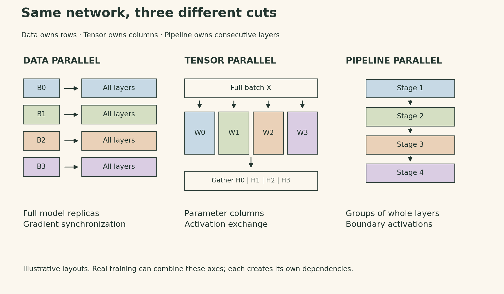
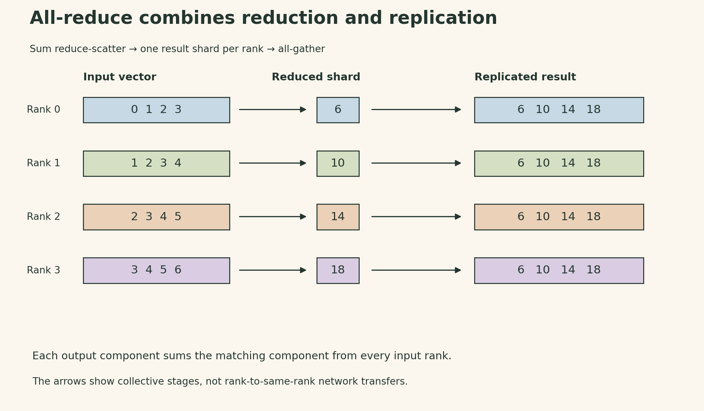
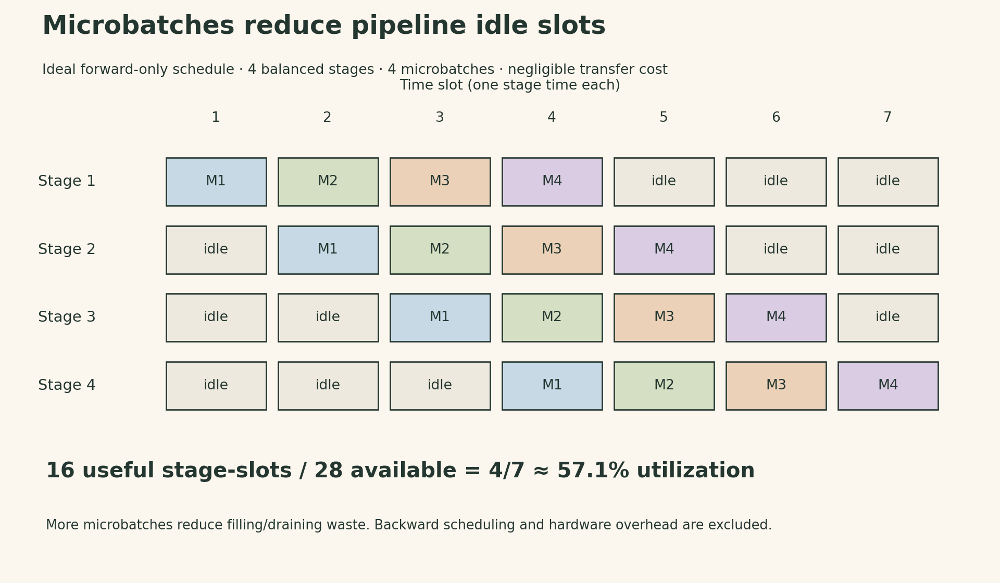

A second GPU adds compute and memory. It also introduces a new place where the values needed for the next operation might be waiting.

The useful question is therefore more specific than “How do we split the model?” We need to decide **what each device owns, what it must receive, and when the next operation can proceed**. In Percy Liang's seventh CS336 lecture, three cuts through a multilayer perceptron make those choices visible: split the batch, split a layer's width, or split the network's depth.

The connection to [kernel optimization in Lecture 6](lecture06-kernels-triton.html) is direct. Fusion and tiling keep values near arithmetic within a GPU. Distributed training decides which values to replicate, which to shard, and how much communication those decisions create across GPUs.

## Three cuts create three different dependencies

Let a batch be $X\in\mathbb{R}^{B\times d}$, with $B$ examples and hidden width $d$. A simple layer computes $H=\phi(XW)$ for $W\in\mathbb{R}^{d\times d}$ and an elementwise nonlinearity $\phi$. Let $P$ be the number of participating ranks. Here, each rank is one process assigned to one GPU; “rank” is the process identifier within a group, not a general synonym for a physical GPU.

| Strategy | What a rank owns | What crosses the boundary |
|---|---|---|
| Data parallelism | A batch slice and a full model replica | Gradients that must agree before the update |
| Tensor parallelism | A slice of the parameters within a layer | Activations or partial results needed by other slices |
| Pipeline parallelism | A consecutive group of whole layers | Activations forward and their gradients backward |

{fig-alt="Three parallelism strategies. Data parallelism splits batch rows and keeps a full model on each rank, synchronizing gradients. Tensor parallelism splits each layer's output columns and exchanges activation slices. Pipeline parallelism assigns consecutive layers to different ranks and sends activations between stages."}

These are different axes, so a large training run can combine them. But each cut must preserve the original computation. Merely distributing tensors does not establish that the resulting optimizer step is correct.

## Collectives describe where the result must end up

A collective operation specifies a communication pattern for a group of ranks. The backend chooses how to implement it on the available links. The four basic operations provide a useful vocabulary:

- **Broadcast:** a designated root distributes a copy of its tensor to every rank.
- **Scatter:** the root distributes different pieces to different ranks.
- **Gather:** the root receives and assembles the pieces.
- **Reduce:** the root receives a reduction, such as the elementwise sum of tensors from all ranks.

The three workhorses change who retains the result. **All-gather** assembles all pieces on every rank. **Reduce-scatter** reduces corresponding elements and leaves a different result shard on each rank. **All-reduce** leaves the complete reduction on every rank.

Consider four input vectors, one on each rank:

$$
\begin{aligned}
v_0&=[0,1,2,3],&v_1&=[1,2,3,4],\\
v_2&=[2,3,4,5],&v_3&=[3,4,5,6].
\end{aligned}
$$

Their elementwise sum is $[6,10,14,18]$. A sum reduce-scatter leaves rank 0 with $[6]$, rank 1 with $[10]$, and so on. An all-gather of those shards then gives every rank the full sum. Thus, at the level of the mathematical result,

$$
\begin{aligned}
&\operatorname{AllReduce}_{\rm sum}\\
&\quad=\operatorname{AllGather}\circ\operatorname{ReduceScatter}_{\rm sum}.
\end{aligned}
$$

This identity does not require an implementation to expose two separate calls. Nor does it promise bitwise equality between different floating-point reduction orders. Its value is that it separates **combining contributions** from **replicating the combined result**.

{fig-alt="Four ranks start with vectors 0 1 2 3; 1 2 3 4; 2 3 4 5; and 3 4 5 6. Sum reduce-scatter leaves one value per rank: 6, 10, 14, and 18. All-gather then places the full vector 6 10 14 18 on every rank."}

**All-to-all** is different: each rank sends a designated piece to each destination. With equal pieces, viewing ranks as rows makes the routing resemble a transpose. With mixture-of-experts models, token routing can produce unequal pieces; load balance becomes part of the problem. The operation routes data rather than summing it.

## The topology determines which dependencies are expensive

On one GPU, registers, shared memory, caches, and HBM form a hierarchy. Multiple GPUs add local interconnects such as PCIe or NVLink/NVSwitch, followed by network links between servers. A fast NVLink domain need not coincide with a single server: rack-scale systems can extend it across more GPUs.

The practical distinction is the communication cost between the devices selected for a group. A model split that works well inside a fast domain may spend most of its time waiting when the same group spans a slower or oversubscribed network.

RDMA lets a network interface access registered remote memory without CPU copies on the data path. GPU-direct communication additionally depends on compatible GPU, NIC, software, and topology support. InfiniBand and RoCE are relevant network technologies; ordinary TCP/IP over Ethernet and RDMA over Ethernet should not be treated as the same data path. “Ethernet” alone is not a performance diagnosis.

PyTorch's `torch.distributed` provides the collective interface; NCCL is a common backend for CUDA GPUs, while Gloo supports CPU-oriented communication. NCCL selects implementations using the topology and message characteristics. The rendezvous address used to initialize a process group is not a central server through which every tensor must flow.

Correctness comes before tuning: participants must use compatible operations, tensor sizes, dtypes, and ordering. A rank that skips a required collective can leave the others waiting indefinitely. Binding the process to the intended local GPU is also essential when several processes share a node.

## Measure completed communication, then interpret the units

There are two sources of asynchrony: different processes advance independently, and GPU work can outlive the host call that enqueued it. A useful benchmark warms up the operation, establishes the intended starting boundary, runs repeated measurements, and ensures device work is complete before stopping its timer. State whether a barrier's waiting time is inside the interval. Excess barriers can hide the overlap that a real training schedule is meant to achieve.

For a tensor of $S$ bytes and measured collective time $t$, the algorithm bandwidth is $S/t$. NCCL tests also report a normalized *bus bandwidth*. For all-reduce over $P$ ranks,

$$
\mathrm{busbw}_{\rm AR}=\frac{S}{t}\frac{2(P-1)}{P}.
$$

One way to derive the factor is a ring: reduce-scatter has $P-1$ steps, each sending a shard of $S/P$ bytes per rank. All-gather has another $P-1$ such steps. The per-rank sent volume is therefore $2(P-1)S/P$; each rank also receives the same volume. **The factor two here counts the two phases, not an extra doubling for send plus receive.**

For a constructed example with $P=4$, a 400 MiB tensor, and $t=2$ ms, the normalized sent volume is 600 MiB per rank. The algorithm bandwidth is about 209.7 GB/s and bus bandwidth about 314.6 GB/s. These use decimal GB/s; the input size uses binary MiB. They are calculations for an assumed duration, not measurements of a GPU system.

Reduce-scatter uses $(P-1)/P$ rather than $2(P-1)/P$, with $S$ defined as the full input tensor size per rank. All-gather uses the same factor when $S$ is the full assembled output size. Comparing the operations without fixing this size convention is misleading. See the [NCCL tests definitions](https://github.com/NVIDIA/nccl-tests/blob/master/doc/PERFORMANCE.md).

The normalization does not make real performance independent of topology or rank count. Small messages can be latency-bound; larger messages encounter bandwidth and contention limits. It is a reporting convention, not a direct measurement of every physical link's traffic.

## Data parallelism works because gradients add

Suppose every rank starts with the same parameters $\theta$, the same optimizer state, and an equal local batch size $b$, so $B=Pb$. For a loss that averages independent per-example terms, define

$$
L_r(\theta)=\frac{1}{b}\sum_{i\in\mathcal{B}_r}\ell_i(\theta).
$$

The full-batch objective and its gradient are

$$
\begin{aligned}
L(\theta)&=\frac{1}{P}\sum_{r=0}^{P-1}L_r(\theta),\\
\nabla L(\theta)&=\frac{1}{P}\sum_{r=0}^{P-1}\nabla L_r(\theta).
\end{aligned}
$$

Each GPU can therefore run its own forward and backward passes. Averaging the gradients recovers the full-batch gradient in exact arithmetic. The replicas then apply the same update. The local losses need not match; the reduced gradients and synchronized update are what keep the parameters aligned.

This is the core of the lecture's data-parallel MLP. Within each iteration of a repeated training loop, its essential ordering can be written as the following fragment, assuming an initialized process group, identical model replicas, and equal local loss normalization:

```python
world_size = dist.get_world_size()
# local_mean_loss denotes the chosen mean loss for this task.
optimizer.zero_grad(set_to_none=True)
loss = local_mean_loss(model(local_batch))
loss.backward()
for param in model.parameters():
    # Assumes every parameter has a dense gradient on every rank.
    dist.all_reduce(param.grad, op=dist.ReduceOp.SUM)
    param.grad.div_(world_size)
optimizer.step()
```

This illustrates synchronization; it is not a replacement for production DDP's handling of buckets, unused parameters, and communication overlap. Clearing gradients matters when moving beyond a one-step demonstration.

### Unequal batches need unequal weights

If rank $r$ averages $n_r$ examples, the correct combination is

$$
\nabla L=\sum_r\frac{n_r}{\sum_j n_j}\nabla L_r.
$$

As a constructed scalar example, suppose the per-example gradients are $[1,3,5,7]$. Rank 0 sees the first example and has local mean 1; rank 1 sees the other three and has local mean 5. Averaging the two local means gives 3. Weighting them by $1/4$ and $3/4$ gives 4, the full-batch mean.

For a token-averaged language-model loss, the relevant weights may instead be counts of valid tokens. Padding contributes no examples or tokens only if the loss masks it correctly. Batch-dependent operations, such as unsynchronized BatchNorm, also mean that splitting a batch can change the forward computation itself. The simple equivalence above assumes that splitting does not change each loss term.

DDP replicates model parameters, gradients, and optimizer state. It can reduce per-rank activation memory by dividing a fixed global batch, but it does not solve the problem of a full model replica being too large. Sharded data-parallel methods address that storage cost; they are the next lecture's subject.

## Tensor parallelism splits the arithmetic inside a layer

Now retain the same $B\times d$ input on every rank, but split $W$ by output columns:

$$
\begin{aligned}
W&=[W_0\;W_1\;\cdots\;W_{P-1}],\\
W_r&\in\mathbb{R}^{d\times(d/P)}.
\end{aligned}
$$

Assume $d$ is divisible by $P$. Each rank computes

$$
H_r=\phi(XW_r)\in\mathbb{R}^{B\times(d/P)}.
$$

Because $\phi$ is elementwise, concatenating those blocks gives the same $H$ as the unsplit layer. The lecture's simple implementation all-gathers $H_r$ after every layer so that each rank has the full input for the next column-sharded matrix multiplication.

For $B=128$, $d=1024$, and $P=4$, each rank owns a $1024\times256$ parameter block and produces $128\times256$ activation values. The assembled activation has shape $128\times1024$. With four-byte elements, those are 128 KiB locally and 512 KiB assembled. A ring all-gather makes each rank receive the other three blocks, 384 KiB, and send 384 KiB. These are logical forward-pass volumes for this layout; buffers and backward communication add further costs.

The key dependency is frequent: the next layer needs the gathered activation. Fast links are therefore especially valuable. More sophisticated paired column/row layouts can avoid this exact gather pattern; it is not a universal requirement that every tensor-parallel layer materialize a full activation on every GPU.

Backward propagation needs an explicit distributed layout too. If $D_r$ denotes the gradient with respect to the preactivation $XW_r$, then

$$
\nabla W_r=X^\top D_r,\qquad
\nabla X=\sum_r D_rW_r^\top.
$$

Each rank can compute its parameter gradient locally, but its contribution to $\nabla X$ is only a partial sum. An all-reduce can produce replicated $\nabla X$; a reduce-scatter can retain it sharded when the next backward operation accepts that layout. More generally, the backward counterpart of an all-gather accumulates contributions from its replicated consumers and returns the appropriate shards. Do not assume that inserting a raw communication call into a forward-only demonstration creates the required autograd behavior automatically.

## Pipeline parallelism trades layer storage for a schedule

A pipeline assigns consecutive layers to stages. Stage 1 computes the first group and sends its output to stage 2; later stages continue the same example's computation. In training, gradients travel back across those boundaries in reverse order.

Sending one whole batch through all stages leaves most stages idle most of the time. Splitting the batch into microbatches lets one stage work on microbatch 2 while the next works on microbatch 1.

Consider an idealized **forward-only** pipeline with $K$ equally fast stages, $m$ microbatches, stage time $\tau$ per microbatch, and negligible communication overhead. Filling, processing, and draining require

$$
T=(m+K-1)\tau.
$$

There are $Km$ useful stage-slots out of $K(m+K-1)$ available ones. The average utilization is

$$
\begin{aligned}
U&=\frac{m}{m+K-1},\\
1-U&=\frac{K-1}{m+K-1}.
\end{aligned}
$$

{fig-alt="Ideal forward-only pipeline with four balanced stages and four microbatches. Microbatch one uses slots one through four across successive stages; the other microbatches follow diagonally. Sixteen of twenty-eight stage slots are occupied, giving utilization four sevenths, or 57.1 percent. Communication overhead and backward passes are excluded."}

For $K=4$ and $m=4$, utilization is $4/7\approx57.1\%$. With $m=16$, the same ideal model gives $16/19\approx84.2\%$. This explains the filling and draining effect; it does not predict end-to-end training speed. At fixed global batch size, more microbatches are smaller, and $\tau$ need not scale linearly. Small matrix operations, communication, stage imbalance, activation storage, and the backward schedule can dominate.

The lecture's pipeline example establishes the forward dependency using blocking `send` and `recv`. A training implementation must add backward communication, retain or recompute needed activations, accumulate correctly normalized gradients, and choose an update schedule. An optimizer update per microbatch is not generally equivalent to one update after accumulating the full batch.

## Choose the cut that removes the actual constraint

If a full training replica fits and batch parallelism is useful, data parallelism offers a simple starting point. If an individual layer must be partitioned, tensor parallelism moves communication into the layer's critical path and benefits from a fast device group. If groups of layers can be distributed, a pipeline can cross fewer layer boundaries between groups, but its balance and schedule determine how much hardware sits idle. Communicating at stage boundaries can make a pipeline more tolerant of slower interconnects than frequent within-layer exchanges; this still depends on activation sizes and the work per stage.

Useful overlap follows real independence. In DDP, a completed gradient bucket can begin communicating while backward computation continues for earlier layers. In a pipeline, transfers can overlap independent work on other microbatches. Setting an asynchronous flag does not remove a data dependency; completion must still be established before consuming the result.

Finally, more data-parallel ranks can mean either smaller local batches at fixed global batch size or a larger global batch at fixed local batch size. The first can reduce per-device efficiency; the second can change optimization efficiency. Tokens per second and time to a target model quality answer different questions.

The recurring choice is between **replicating state, communicating it, and sometimes recomputing it**. A good parallel layout makes that choice explicit at every expensive boundary. The next step—FSDP and ZeRO—is to apply the same reasoning to the state that DDP keeps duplicated.

## Lecture and references

[▶ Watch the official Stanford lecture on YouTube](https://www.youtube.com/watch?v=SzpOcwdIL0Y){.btn .btn-outline-primary}

- [Stanford CS336 Spring 2026, Lecture 7: Parallelism](https://cs336.stanford.edu/lectures/?trace=lecture_07), Percy Liang.
- [Lecture implementation](https://github.com/stanford-cs336/lectures/blob/0be5c6121acb3ce2cef5ec1cad1a0b7ebc8d2012/lecture_07.py): collective examples, data parallelism, column tensor parallelism, and the forward pipeline.
- [NCCL collective operations](https://docs.nvidia.com/deeplearning/nccl/user-guide/docs/usage/collectives.html).
- [NCCL tests: bandwidth definitions](https://github.com/NVIDIA/nccl-tests/blob/master/doc/PERFORMANCE.md).
- [PyTorch DDP design](https://docs.pytorch.org/docs/stable/notes/ddp.html).
