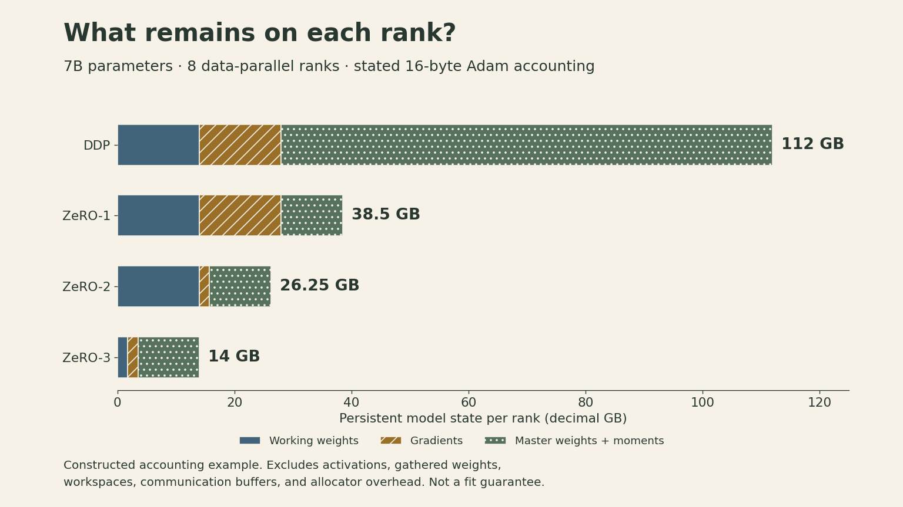
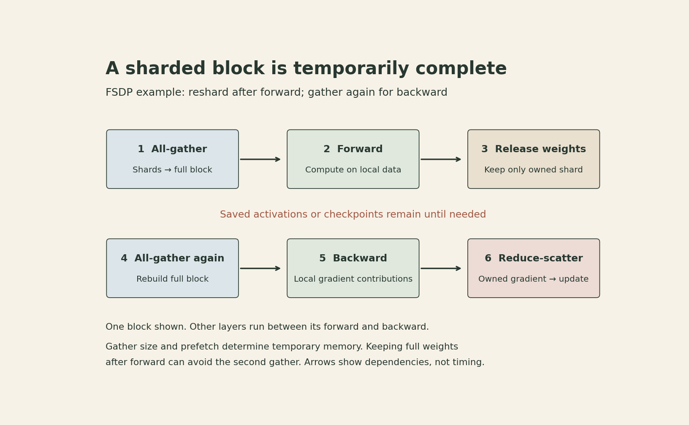
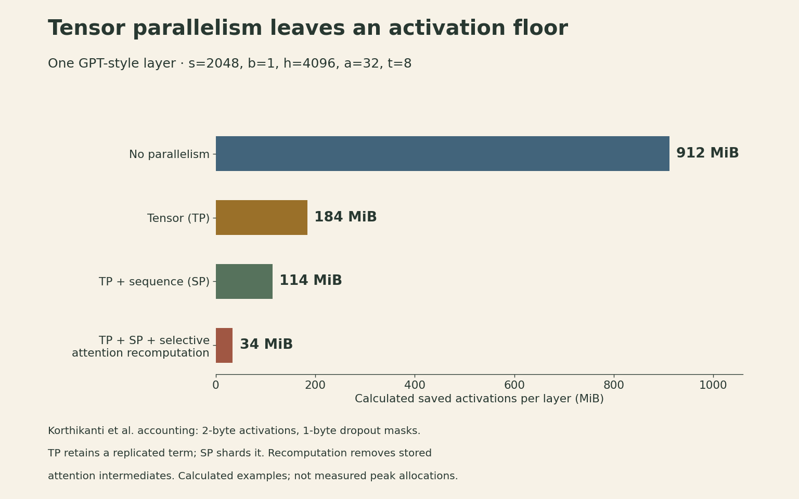

A seven-billion-parameter model needs about 14 GB for a two-byte copy of its weights. A particular mixed-precision Adam setup can need 112 GB just for its model states. Activations and temporary buffers come on top.

This gap explains why adding GPUs is also a storage problem. In [Lecture 7](lecture07-parallelism-i.html), data, tensor, and pipeline parallelism split different parts of a computation. Tatsunori Hashimoto's eighth CS336 lecture asks how those choices fit together when the model, its optimizer, and its intermediate values are all large.

The connecting idea is **ownership over time**. A rank may permanently own only a shard while temporarily needing a complete layer. Sharding saves memory only if the implementation controls when those temporary values appear and when they disappear.

## The network is part of the computation

A distributed layout creates dependencies between devices. An all-gather assembles shards on every participant. A reduce-scatter combines contributions and leaves each participant with a different result shard. Together, sum reduce-scatter followed by all-gather produces the result of a sum all-reduce.

That decomposition gives us a choice: **does every rank need the complete result, or only the part it owns?** A sharded optimizer can use a reduced gradient shard directly, update its parameter shard, and distribute the updated parameters afterward.

The physical network determines the cost of that choice. GPU systems often combine a fast local interconnect domain with a larger switched network. Several TPU generations use multidimensional meshes or tori; newer systems change the topology again. Hardware generation and group placement matter more than a universal “GPU versus TPU” rule.

For one collective, a rough communication model is

$$
T_{\rm comm}\approx n_{\rm rounds}\alpha+\frac{V}{\beta},
$$

where $\alpha$ is latency per sequential communication round, $V$ is the relevant byte volume, and $\beta$ is effective bandwidth. This is a reasoning model, not a device specification. Contention, routing, concurrent traffic, and software scheduling affect both terms.

The same total bytes split across many tiny collectives can take longer. Nor does launching communication asynchronously guarantee useful overlap: independent computation must exist while the transfer runs.

## First separate model state from peak memory

Let $N$ be the parameter count and $D$ the number of ranks in a data-parallel group. Each rank here is one process assigned to a GPU.

Use the following explicit mixed-precision Adam accounting, matching the classical ZeRO example:

| Object | Bytes per parameter | Purpose |
|---|---:|---|
| Working weights | 2 | Forward and backward computation |
| Gradients | 2 | Gradient storage in this accounting |
| Master weights | 4 | Higher-precision parameter updates |
| First moment | 4 | Adam's moving average of gradients |
| Second moment | 4 | Adam's moving average of squared gradients |
| **Total model state** | **16** | **Excludes activations and temporary storage** |

The optimizer-side state is 12 bytes per parameter here, including the master weights. This is a stated configuration, not a universal BF16 rule. Gradient accumulation precision, optimizer implementation, master-weight policy, and moment precision can change the count.

A more complete capacity question is

$$
\begin{aligned}
M_{\rm peak}=\max_\tau\big(&M_{\rm model}(\tau)+M_{\rm act}(\tau)\\
&+M_{\rm workspace}(\tau)+M_{\rm buffers}(\tau)\big).
\end{aligned}
$$

The allocator and runtime need headroom as well. Summing the separate maxima can be a conservative bound, but the actual peak depends on which allocations coexist. This is why dividing total parameter bytes by the number of GPUs is insufficient to decide whether training will fit.

## ZeRO progressively removes duplicated state

Ordinary distributed data parallelism keeps a full replica of the model and optimizer on every rank. Each rank processes its local data, and the ranks combine gradients before applying the same update. The normalization must match the global objective; unequal valid-token counts require the corresponding weights.

ZeRO changes who stores and updates the state while preserving the data-parallel computation.

### Stage 1: each rank updates only its own parameters

Partition the optimizer state into $D$ disjoint pieces. Every rank still has the working model and computes gradients from its own data. A reduce-scatter can aggregate the gradients into the matching ownership shards. Each owner applies its optimizer update, then an all-gather assembles the updated working weights on every rank.

The persistent model-state accounting becomes

$$
M_1=\left(4+\frac{12}{D}\right)N.
$$

The four unsharded bytes are the two-byte weights and two-byte gradient storage. Implementations can arrange the gradient communication differently; the essential stage-1 property is optimizer-state partitioning.

### Stage 2: release gradients as their shards are reduced

Backward computation still produces local contributions for all parameters, but those contributions need not remain together as a full-model gradient allocation. As a layer or bucket becomes ready, reduce its contributions to the owning ranks and release the unneeded local buffer when it is safe.

Now the persistent accounting is

$$
M_2=\left(2+\frac{14}{D}\right)N.
$$

Working weights remain replicated. Gradients, master weights, and moments are sharded. Temporary gradient buckets still exist; stage 2 does not make gradient computation disappear.

### Stage 3: assemble weights only when computation needs them

Stage 3 also shards working parameters. With ideal balanced sharding, the persistent model state is

$$
M_3=\frac{16N}{D}.
$$

Fully sharded data parallelism, or FSDP, implements this family of ideas. A rank gathers the parameters needed for a compute unit, runs that unit on its local data, and can then release the gathered copy.

For a constructed example with $N=7\times10^9$ and $D=8$, the model-state totals per rank are:

| Layout | Bytes per parameter per rank | Model state per rank |
|---|---:|---:|
| DDP | 16 | 112 GB |
| ZeRO-1 | 5.5 | 38.5 GB |
| ZeRO-2 | 3.75 | 26.25 GB |
| ZeRO-3 | 2 | 14 GB |

These are decimal GB and theoretical model-state totals under the table's precision assumptions. **The 14 GB entry is not a promise that the training job fits on a 16 GB GPU.**

{fig-alt="Constructed seven-billion-parameter example on eight data-parallel ranks, using two-byte weights and gradients plus twelve-byte optimizer-side state. Stacked bars show per-rank persistent model state: DDP 112 GB, ZeRO-1 38.5 GB, ZeRO-2 26.25 GB, and ZeRO-3 14 GB. Activations, gathered parameters, communication buffers, workspaces, and allocator overhead are excluded."}

The lecture also gives a lower-precision 12-byte variant. Its stage-1, stage-2, and stage-3 formulas change accordingly. The method is to count each stored object and divide only the objects that are actually sharded.

## FSDP trades storage lifetime for communication

Consider an FSDP unit that contains one block. A common schedule reshards after forward:

1. All-gather the block's parameter shards.
2. Compute the local forward pass.
3. Release the full parameters while retaining the activations required for backward, or a checkpoint that can recreate them.
4. All-gather the parameters again before the block's backward pass.
5. Compute local gradient contributions and reduce-scatter them.
6. Keep the owned gradient shard for the optimizer update.

{fig-alt="Illustrative FSDP lifecycle for one block with resharding after forward. Sharded weights are all-gathered for forward and then released. A second all-gather supplies backward; reduce-scatter leaves an owned gradient shard for the update. Saved activations or checkpoints remain between forward and backward. The diagram shows dependencies, not measured durations or exact allocation sizes."}

The all-gather unit matters. One huge unit can temporarily reconstruct most of the model. Smaller units reduce the gathered working set, but create more collectives. Prefetching the next unit can hide transfer time while increasing how many full units coexist in memory.

For simple bandwidth accounting, let parameters and communicated gradients both use $q$ bytes per element. A ring-style all-gather or reduce-scatter has per-rank sent volume $qN(D-1)/D$. Under the stated schedule, over one forward/backward/update cycle:

$$
\begin{aligned}
V_{\rm DDP}&\approx2qN\frac{D-1}{D},\\
V_{\rm ZeRO1/2}&\approx2qN\frac{D-1}{D},\\
V_{\rm ZeRO3}&\approx3qN\frac{D-1}{D}.
\end{aligned}
$$

Stage 3 has two parameter all-gathers and one gradient reduce-scatter. That explains the familiar **1.5 times** communication-volume comparison. These are per-rank sent bytes; receive volume is comparable and is not added a second time here. Different dtypes, retained parameters, accumulation schedules, and implementations change the comparison.

Equal volume does not imply equal runtime. Bucket sizes, latency, overlap, and collective ordering still matter. Conversely, keeping gathered parameters after forward can avoid the second all-gather at a memory cost. The Llama 3 report describes using that choice.

FSDP still computes a complete unit on each rank's local data. It does not by itself partition that unit's activation workload. Tensor, pipeline, and sequence/context parallelism address different parts of the remaining memory problem.

## Pipeline scheduling needs both a batch and a backward plan

Pipeline parallelism assigns consecutive layers to stages and moves activations forward and activation gradients backward. For a stage boundary, an activation tensor with local microbatch size $b$, sequence length $s$, and hidden width $h$ contains $bsh$ elements. Its transmitted bytes also depend on dtype.

Splitting a batch into $m$ microbatches lets different stages work concurrently. In an ideal balanced fill-and-drain model with $p$ stages and negligible communication overhead,

$$
\begin{aligned}
\frac{\text{bubble time}}{\text{useful time}}&=\frac{p-1}{m},\\
\text{idle fraction}&=\frac{p-1}{m+p-1}.
\end{aligned}
$$

The denominators differ. With four stages and eight microbatches, the bubble/useful ratio is $3/8=37.5\%$, while the idle fraction is $3/11\approx27.3\%$. In this model, utilization is $8/11\approx72.7\%$. These formulas describe a simplified schedule, not every pipeline implementation.

A fill-and-drain schedule may retain many forward activations before backward begins. A one-forward-one-backward schedule can reduce how many microbatches remain in flight. Interleaving stage chunks creates more scheduling flexibility and communication. Stage imbalance and small GEMMs can erase gains predicted by the ideal model.

“Zero-bubble” schedules use another dependency: for a linear layer $Y=XW$, backward has two distinct products,

$$
\nabla X=(\nabla Y)W^\top,\qquad
\nabla W=X^\top(\nabla Y).
$$

The preceding stage needs $\nabla X$ to continue its backward pass. The weight-gradient work can sometimes be delayed to fill an otherwise idle slot, provided its inputs remain available and it finishes before the relevant optimizer update. It cannot be postponed without memory and scheduling consequences.

With [DDP configured to synchronize gradients only after accumulation](https://docs.pytorch.org/docs/2.14/generated/torch.nn.parallel.DistributedDataParallel.html#torch.nn.parallel.DistributedDataParallel.no_sync), increasing the effective batch at fixed microbatch size and data-parallel degree amortizes one gradient synchronization over more tokens. At a fixed effective batch, smaller microbatches mainly reduce activation memory while requiring more sequential passes; accumulation does not inherently reduce communication per update. FSDP can repeat parameter gathers for each microbatch unless parameters are retained. The result depends on the synchronization and retention schedule, and layer-internal collectives still have to occur.

## Pair column and row partitions inside a transformer

Tensor parallelism can keep the large operations distributed without gathering every intermediate activation.

For an MLP, let $X\in\mathbb{R}^{bs\times h}$, $A\in\mathbb{R}^{h\times f}$, and $B\in\mathbb{R}^{f\times h}$. Here $f$ is the intermediate width. Split $A$ by output columns and $B$ by matching input rows across $t$ ranks:

$$
A=[A_0\;\cdots\;A_{t-1}],\qquad
B=\begin{bmatrix}B_0\\ \vdots\\ B_{t-1}\end{bmatrix}.
$$

With an elementwise activation $\phi$,

$$
Z=\phi(XA)B=\sum_{r=0}^{t-1}\phi(XA_r)B_r.
$$

Each rank forms its local intermediate $\phi(XA_r)$ and a partial output. An all-reduce can sum those partial outputs. The nonlinearity is applied before the row-partitioned second projection; applying it to an incomplete sum would generally change the function.

This paired layout explains column partitioning for QKV or MLP up-projections and row partitioning for attention-output or MLP down-projections. Particular attention designs and head counts constrain the valid partitions.

In a conventional transformer tensor-parallel layout with two all-reduces in forward and two in backward, each operating on $bsh$ elements, the ring sent volume is approximately

$$
V_{\rm TP}=8q\,bsh\,\frac{t-1}{t}
$$

per layer per microbatch across forward and backward. The coefficient comes from four collectives, each with two ring phases. It is a layout-specific count, not a law for every transformer.

Frequent activation-sized collectives favor fast, low-latency device groups. Eight-way tensor parallelism appears often in studies built around eight-GPU servers; it is not a timeless hardware limit or a universally optimal degree.

## Sequence parallelism removes a replicated activation floor

Sharding matrix multiplications does not automatically shard every saved activation. In a common tensor-parallel transformer, LayerNorm and dropout around the attention and MLP blocks still operate on replicated tensors.

Korthikanti and colleagues derive a useful accounting model for a particular GPT-style transformer. The analyzed block uses standard multi-head attention and a GeLU MLP with intermediate width $f=4h$. The accounting assumes two-byte stored activations, one-byte dropout masks, and neglects small buffers. Let $a$ be the attention-head count, with $s,b,h$ and $t$ defined above. Per-layer saved activation bytes are approximately

$$
\begin{aligned}
M_{\rm base}&=sbh\left(34+\frac{5as}{h}\right),\\
M_{\rm TP}&=sbh\left(10+\frac{24}{t}+\frac{5as}{ht}\right).
\end{aligned}
$$

The $5as^2b$ contribution comes from stored attention-related tensors. The $10sbh$ term in the tensor-parallel expression remains replicated. As $t$ grows, that unsharded term prevents the modeled memory from decreasing as $1/t$.

**Sequence parallelism** in this construction distributes token positions for the surrounding operations. LayerNorm couples hidden coordinates within one token, but does not need other tokens. Dropout can likewise be computed on token shards with an appropriate random-number scheme. These operations can retain a full hidden vector locally while sharding the sequence axis.

All-gather connects sequence-sharded regions to the tensor-parallel matrix multiplications; reduce-scatter returns summed partial outputs to sequence shards. The backward collectives reverse these roles. The resulting accounting is

$$
M_{\rm TP+SP}=\frac{sbh}{t}\left(34+\frac{5as}{h}\right).
$$

Splitting all-reduce into its two phases helps explain the bandwidth reuse, but equal modeled bytes do not guarantee identical latency. Saving only a shard of a linear layer's input can also require another all-gather during backward; implementations try to overlap it.

Selective activation recomputation avoids retaining the memory-heavy attention intermediates and reconstructs them when needed. In the paper's combined accounting,

$$
M_{\rm TP+SP+recompute}=\frac{34sbh}{t}.
$$

Memory-efficient attention kernels also avoid materializing the full attention matrix. Neither statement makes dense attention's quadratic arithmetic disappear. Modern attention variants, fused kernels, dropout choices, and MLP architectures require their own accounting; the constants above are specific to the analyzed transformer.

{fig-alt="Analytical saved-activation example for one transformer layer: sequence length 2048, microbatch size 1, hidden width 4096, 32 heads, and tensor degree 8. The cited GPT-style accounting gives 912 MiB without parallelism, 184 MiB with tensor parallelism, 114 MiB with tensor plus sequence parallelism, and 34 MiB when selective attention recomputation is also used. These are calculated saved activations, not measured peak memory."}

For the constructed figure, $s=2048$, $b=1$, $h=4096$, $a=32$, and $t=8$. The resulting 912, 184, 114, and 34 MiB values isolate the accounting change. They exclude weights, communication buffers, and other layers.

Context parallelism addresses a related but broader problem: distributing long contexts through attention itself. A query shard still needs information from the relevant key/value positions. Ring-based methods circulate blocks and combine attention statistics correctly. Running independent attention on each chunk would change which tokens can interact.

## Expert parallelism changes the routing problem

A mixture-of-experts layer assigns different expert networks to different devices. The router dispatches token activations to their selected experts, often using all-to-all communication, and returns expert outputs for combination.

Compared with splitting each expert's matrix across many devices, routing whole experts can preserve larger local GEMMs. The price is traffic that depends on token assignments: imbalance, small per-expert token batches, capacity limits, padding, and dispatch/return overhead can dominate. Sparse activation per token does not mean the unselected expert weights cease to occupy memory.

Attention and expert MLPs need not use the same partition. The [Megatron Core MoE documentation](https://docs.nvidia.com/megatron-core/developer-guide/latest/user-guide/features/moe.html) describes *parallel folding*: attention uses TP/CP/DP groups, while MoE layers use expert tensor, expert, and expert data-parallel groups. Consequently, multiplying every acronym in a configuration table can double-count the same GPUs. The constraint in prior frameworks that expert parallelism must be a subgroup of data parallelism is an implementation restriction, not a general mathematical requirement.

## Real runs combine layouts, and change them during training

For independent dense-model axes, a device mesh can satisfy

$$
G=D\,t\,p\,c,
$$

where $c$ is context-parallel degree and $G$ the total GPU count. Sequence parallelism is often paired with the same tensor-parallel group, rather than introducing another independent multiplier. For MoE parallel folding, expert-layer groups remap the same devices; do not append EP as another independent factor.

The [Llama 3 report, Table 4](https://arxiv.org/html/2407.21783v3), gives a concrete comparison:

| 405B training configuration | TP | CP | PP | DP | GPUs |
|---|---:|---:|---:|---:|---:|
| 8,192-token context | 8 | 1 | 16 | 128 | 16,384 |
| 131,072-token context | 8 | 16 | 16 | 8 | 16,384 |

Longer contexts shift the allocation from data parallelism toward context parallelism. The same report states that gathered parameters are retained after forward to avoid another backward all-gather. This is a practical example of trading memory lifetime for communication.

The lecture's other cases span FSDP-heavy training, tensor/pipeline combinations, and large expert-parallel groups. They support a decision process rather than one permanent recipe:

1. **Identify the limiting allocation.** Optimizer states, a gathered block, activations, and workspaces need different remedies.
2. **Make each compute unit fit.** Combine state sharding, tensor or expert partitions, pipeline stages, and activation recomputation as appropriate.
3. **Place frequent communication on suitable links.** Use the actual fast interconnect domain, which may extend beyond one server.
4. **Use remaining devices for useful data parallelism.** Check both local kernel efficiency and the effect of global batch size on optimization.
5. **Measure the complete step.** Include exposed communication, pipeline bubbles, imbalance, and peak allocations. At large scale, checkpointing and recovery also affect delivered throughput.

Recomputation can improve throughput if the memory it frees permits a more efficient microbatch or parallel layout. It can also slow a job that was already compute-bound. A faster step at a larger batch does not necessarily reduce time to a target model quality.

The useful design question is therefore: **which values should remain local, which should move, and which should be reconstructed later?** A memory formula describes a set of objects. A training system must also schedule their lifetimes.

## Lecture and references

[Watch the official Stanford lecture on YouTube](https://www.youtube.com/watch?v=6-cXp-aOmdg){.btn .btn-outline-primary}

- [Stanford CS336, Spring 2026](https://cs336.stanford.edu/), Lecture 8: Parallelism, Tatsunori Hashimoto.
- [Official Lecture 8 slides](https://github.com/stanford-cs336/lectures/blob/de53a9f979a6ee35f7d13a5e1aadee5ea1afc58e/lecture_08.pdf), especially pp. 17–28, 34–49, and 53–72.
- Rajbhandari et al., [ZeRO: Memory Optimizations Toward Training Trillion Parameter Models](https://arxiv.org/abs/1910.02054), model-state accounting and communication analysis.
- Zhao et al., [PyTorch FSDP: Experiences on Scaling Fully Sharded Data Parallel](https://arxiv.org/abs/2304.11277), sharding units, scheduling, and memory/communication tradeoffs.
- Korthikanti et al., [Reducing Activation Recomputation in Large Transformer Models](https://arxiv.org/abs/2205.05198), Sections 4–5 and Table 2.
- Narayanan et al., [Efficient Large-Scale Language Model Training on GPU Clusters Using Megatron-LM](https://arxiv.org/abs/2104.04473), pipeline schedules and combined parallelism.
- Grattafiori et al., [The Llama 3 Herd of Models](https://arxiv.org/html/2407.21783v3), Section 3.3 and Table 4.
- [Megatron Core MoE documentation](https://docs.nvidia.com/megatron-core/developer-guide/latest/user-guide/features/moe.html), MoE Parallel Folding.
