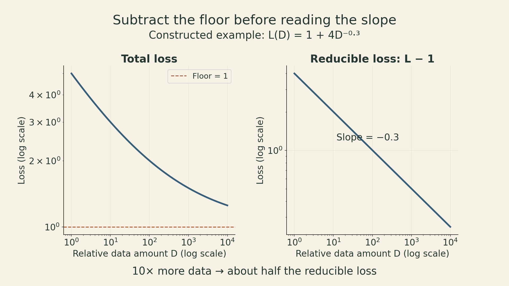
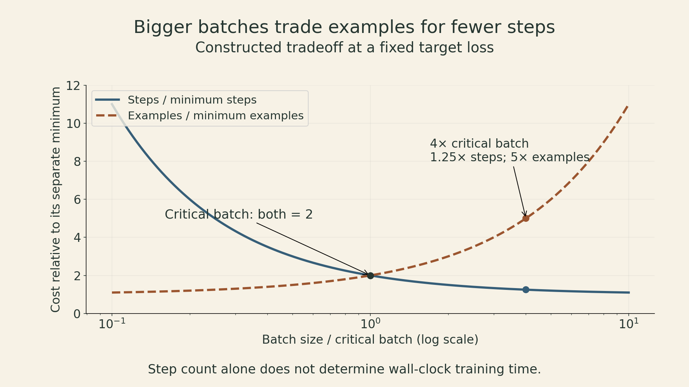
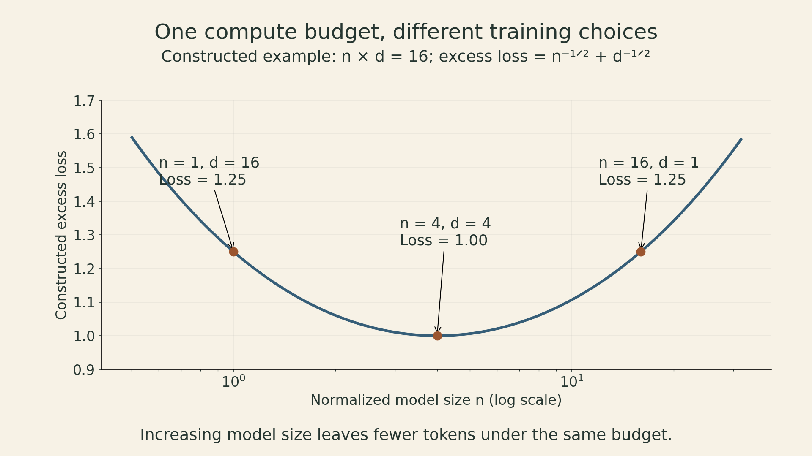

Suppose a training budget can support either a larger language model for fewer tokens or a smaller model for more tokens. Both runs may use the same number of floating-point operations. They need not reach the same loss.

The previous two lectures explained how to distribute the work across devices. Lecture 9, taught by Tatsunori Hashimoto, asks which work is worth distributing. **Scaling laws turn small experiments into predictions about larger training decisions.** Their usefulness depends on the measurement protocol, the range of the experiments, and the objective being optimized.

The central question is concrete: at a fixed budget, how much capacity should we buy, and how much training should we give it?

## What a power law actually predicts

A useful starting model for data scaling is

$$
L(D)=L_\infty + A D^{-\alpha},\qquad A>0,\ \alpha>0.
$$

Here $D$ is the amount of training data under a specified sampling protocol, $L$ is a fixed evaluation loss, and $L_\infty$ is an asymptotic floor within the model. The constants depend on the task, data, architecture, optimizer, and evaluation procedure.

The straight line appears after subtracting the floor:

$$
\log\big(L(D)-L_\infty\big)=\log A-\alpha\log D.
$$

A log-log plot of raw loss can bend as it approaches a nonzero floor. Fitting a line to raw loss and fitting a power law with an offset are different statistical choices. The fitted floor also need not equal the true entropy of language; it is estimated from finite experiments.

The exponent describes a relative return. Multiplying data by $k$ multiplies the reducible term by $k^{-\alpha}$. With $\alpha=0.3$, doubling data leaves about $2^{-0.3}=0.812$ of that term. Halving it requires roughly $2^{1/0.3}=10.1$ times as much data. This is a constructed illustration, not a measured exponent for this course's models.

{fig-alt="Two log-log panels for a constructed scaling function. Total loss bends toward a floor of one, while loss minus the floor is a straight line with slope minus 0.3. Ten times more data approximately halves the reducible loss."}

Historical studies moved from data scaling in specific tasks to neural scaling across language, translation, and speech. The important methodological change is that small runs can help choose a large run. It does not make every extrapolation reliable.

## Why polynomial rates are plausible—and insufficient

For independent observations with mean $\mu$ and finite variance $\sigma^2$, the sample mean is unbiased and

$$
\mathbb E[(\hat\mu-\mu)^2]
=\operatorname{Var}\left(\frac1n\sum_{i=1}^n X_i\right)
=\frac{\sigma^2}{n}.
$$

This is an exact power law for mean squared estimation error. Gaussian observations are one example; normality is unnecessary for this calculation. Root mean squared error instead scales as $n^{-1/2}$. The error definition matters.

Flexible function estimation adds approximation error. Consider a pedagogical regression model on a $d$-dimensional unit cube: observations have independent, mean-zero noise with bounded variance, and the target function is Lipschitz. A regular histogram with cell width $h$ has approximately $nh^d$ samples per cell under uniform sampling. Away from sparse-cell complications, its integrated mean squared error has the order

$$
\underbrace{h^2}_{\text{squared approximation error}}
+\underbrace{\frac{1}{nh^d}}_{\text{estimation variance}}.
$$

Balancing these terms gives

$$
h\asymp n^{-1/(d+2)},\qquad
\mathrm{MSE}\asymp n^{-2/(d+2)}.
$$

For $d=2$, the rate is $n^{-1/2}$ and the cell width is $n^{-1/4}$. Smoothness assumptions and the loss definition change the rate. There is no universal rule that a neural scaling exponent is exactly the reciprocal of a data dimension.

This example explains why different polynomial rates are plausible. It does not derive a Transformer exponent. Connections between intrinsic dimension and neural scaling remain hypotheses with additional assumptions, rather than a way to read a unique dimension off any fitted slope.

## Data quantity is not the whole data budget

A token count hides several choices: which domains are included, how examples are filtered, and whether the same text is repeated. A scaling fit transfers only as far as those choices allow.

The lecture discusses studies where a distribution change mainly shifts the scaling curve's offset. That observation belongs to the studied setting. It is not a guarantee that every change in data composition leaves the exponent unchanged. A mixture that works best for a small model can also become a poor choice at larger scale or on a different evaluation distribution.

Repeated tokens deserve separate accounting. Let $U$ be unique tokens and $r$ the number of additional passes beyond the first. Then total processed tokens are $D=U(1+r)$. A model used by [Muennighoff et al.](https://arxiv.org/abs/2305.16264) assigns an effective data amount of the form

$$
D_{\rm eff}=U\left[1+R\left(1-e^{-r/R}\right)\right],\qquad R>0.
$$

The fitted constant $R$ controls how quickly the benefit of repetition decays. At $r=0$, effective data equals $U$. For small $r/R$, the first-order expansion gives $D_{\rm eff}\approx U(1+r)$. As repetition grows, the expression approaches $U(1+R)$ even though compute continues to increase.

This is an empirical modeling choice, not a proof that repeated data has exactly this value. Nor is repetition automatically useless: a model can learn more from another pass while still obtaining less benefit than from equally many useful new tokens. Crucially, FLOPs must be charged for the actual processed tokens $D$, not for the discounted quantity $D_{\rm eff}$.

## Architecture comparisons need a consistent accounting unit

Small experiments can compare architectures, optimizers, or depth-to-width ratios. A useful comparison measures several scales under matched constraints instead of declaring a winner from one small model.

There are several traps:

- **Parameter count is not compute.** Different architectures can have different training costs per parameter. A mixture-of-experts model has both total and active parameters; a dense-model fit cannot be transferred by substituting total MoE parameters.
- **The parameter definition must stay fixed.** Embeddings and the output projection can be a large share of small models. Using non-embedding counts at small scale can produce a different apparent exponent from total-parameter accounting. Keep the parameter and compute definitions explicit and consistent.
- **Hyperparameters can change with scale.** An unsuitable learning rate or warmup schedule can make a model family appear worse. Scale-aware parameterizations such as muP are approaches to transferring tuning across width under specified scaling rules, not a guarantee that every hyperparameter transfers unchanged.
- **Loss is not every downstream objective.** Predictable pretraining loss does not imply equally smooth benchmark accuracy, latency, or reliability.

The experiment is a comparison of training recipes, including their tuning, rather than a ranking of architecture names in isolation.

## Critical batch size separates steps from examples

Increasing batch size can reduce the number of optimization steps needed to reach a target loss. It can also increase the total examples processed. These are different costs.

Let $b$ be batch size, $S$ the steps needed for a fixed target, and $E=bS$ the examples processed. In the approximate tradeoff model of [McCandlish et al.](https://arxiv.org/abs/1812.06162),

$$
\left(\frac{S}{S_{\min}}-1\right)
\left(\frac{E}{E_{\min}}-1\right)\approx1,
\qquad b_{\rm crit}=\frac{E_{\min}}{S_{\min}}.
$$

The limiting quantities $S_{\min}$ and $E_{\min}$ describe different ends of the tradeoff; one run generally cannot attain both. Writing $x=b/b_{\rm crit}$ gives

$$
\frac{S}{S_{\min}}\approx1+\frac1x,
\qquad
\frac{E}{E_{\min}}\approx1+x.
$$

At $x=1$, both ratios are two. At $x=4$, the step ratio improves to 1.25, while the example ratio rises to five. These numbers follow from the model, not a measured speedup on a GPU cluster.

{fig-alt="Constructed tradeoff curves show normalized optimization steps falling as batch size increases, while normalized examples processed rise. At one critical batch, both ratios are two; at four critical batches, the ratios are 1.25 and five."}

A related noise-scale approximation compares gradient variance with squared mean gradient. It depends on the loss target, training stage, optimizer, and assumptions about curvature. It is not an immutable property of a parameter count. Actual wall-clock time additionally depends on step time, utilization, and communication—the systems issues from Lectures 7 and 8.

## Fit model size and tokens together

A common joint form is

$$
\hat L(N,D)=L_\infty+\frac{A}{N^\alpha}+\frac{B}{D^\beta},
$$

where $N$ is a consistently defined model parameter count and $D$ is processed training tokens under the fitted data regime. The positive coefficients and exponents are estimated from runs spanning both axes. This decomposition is a useful model of finite capacity and finite training, not an exact separation of all sources of error.

For a dense Transformer in a regime where parameter-matrix operations dominate, use the rough training-compute approximation

$$
C\approx6ND.
$$

The factor six counts forward and backward matrix operations approximately. Attention at long context, vocabulary operations, architecture details, and recomputation can alter the cost. FLOPs also do not directly equal money or elapsed time.

Write the approximate budget in parameter-token units as $K=C/6=ND$. The constraint gives $D=K/N$. Substitute into the fitted loss:

$$
\hat L(N,K/N)-L_\infty
=A N^{-\alpha}+B(N/K)^\beta.
$$

Differentiating with respect to $\log N$ and setting the derivative to zero gives

$$
\alpha A N^{-\alpha}=\beta B(N/K)^\beta.
$$

The optimum balances the **weighted marginal returns**, rather than necessarily making the two loss terms equal. Therefore,

$$
\begin{aligned}
N_* &= \left(\frac{\alpha A}{\beta B}\right)^{1/(\alpha+\beta)}
K^{\beta/(\alpha+\beta)},\\
D_* &= K/N_*.
\end{aligned}
$$

When $\alpha=\beta$, both optimal model size and tokens scale with $C^{1/2}$. A fourfold compute increase supports approximately twice the parameters and twice the tokens under this model. Equal scaling rates do not mean equal numerical counts, and the coefficients determine the tokens-per-parameter ratio.

### A small allocation example

Use normalized quantities $n=N/N_0$ and $d=D/D_0$. Let the constructed excess loss be $n^{-1/2}+d^{-1/2}$ and the normalized budget satisfy $nd=16$.

| Model size $n$ | Tokens $d$ | Excess loss |
|---:|---:|---:|
| 1 | 16 | 1.25 |
| 4 | 4 | 1.00 |
| 16 | 1 | 1.25 |

All three choices use the same approximate compute. The middle choice is best within this symmetric model. The first has too little capacity; the last receives too little training for its size. This example explains the mechanism without asserting an optimal size for a real model.

{fig-alt="A constructed equal-compute curve with normalized model size times tokens equal to sixteen. Total excess loss is minimized at model size four and token count four. The alternatives one by sixteen and sixteen by one both have higher excess loss, 1.25 instead of one."}

## Three ways to estimate the frontier

The [Chinchilla paper](https://arxiv.org/abs/2203.15556) uses three complementary procedures:

1. **Training-curve envelope.** Train several model sizes for several horizons, then identify the lowest observed loss at each compute level. Fit how the winning model size and token count change with budget.
2. **IsoFLOP profiles.** Fix a compute budget, vary model size, and allocate the corresponding tokens. Locate the valley, then repeat at other budgets. A sweep must bracket the minimum; a best point at the edge is not convincing evidence of an interior optimum.
3. **Parametric joint fit.** Fit the two-variable loss surface and optimize it under a compute constraint. The original paper uses a Huber objective on log loss with multiple initializations—not ordinary unweighted least squares on raw loss.

These procedures estimate an empirical frontier for the explored recipes. They do not establish a universal lower bound on attainable loss. Better data, training, or architectures can move the frontier. Fitting noise can also produce optimistic predictions below future observations.

Kaplan et al. reported approximate compute-allocation exponents of 0.73 for parameters and 0.27 for tokens. Chinchilla's three approaches all suggested near-equal growth rates; the first two agreed most closely, while the third predicted smaller optimal models at large budgets. The disagreement is a lesson in experimental design: parameter accounting, small-model regimes, tuning, and schedule choices affect the answer.

[Pearce and Song](https://arxiv.org/abs/2406.12907) show how non-embedding parameter accounting at small scale can explain much of that difference in their analysis. Separately, [Besiroglu et al.](https://arxiv.org/abs/2404.10102) reconstructed points from Chinchilla's published figure and challenged its third fit. Their refit was more consistent with the first two methods; it did not reject the general recommendation to scale data and model size together. Figure reconstruction has its own precision limits.

The famous ratio of roughly 20 training tokens per parameter describes Chinchilla's training allocation. It is not a universal constant to use without a new fit.

## Training optimality is only one objective

The preceding optimization minimizes loss for a fixed **training** budget. A deployed model may process far more tokens after training. In a deliberately simplified dense-model accounting, lifetime compute could be written

$$
C_{\rm life}\approx6ND+2NT,
$$

where $T$ is an inference-token workload measured under the approximation, using about $2N$ forward-pass FLOPs per token. Real serving also depends on context length, prefill versus decode, caching, batching, memory bandwidth, and latency requirements.

For a target quality, a smaller model trained longer can cost more upfront and less each time it is used. The extra training becomes worthwhile when expected serving savings exceed it. This is why training beyond a training-compute optimum need not mean statistical overfitting: the economic objective has changed.

Before extrapolating a large run, define the target metric, keep tokenization and data composition comparable, sweep enough model sizes to expose the allocation tradeoff, and reserve larger runs to test the prediction. Inspect residuals and sensitivity to the fitted floor, parameter definition, and fitting range. If those choices substantially change the recommended model, the uncertainty belongs in the decision.

A scaling law earns its value by predicting a decision well enough to justify the next experiment. The large budget should follow that evidence.

## Lecture and sources

Stanford CS336, Spring 2026, Lecture 9: Scaling Laws, Tatsunori Hashimoto. [Course schedule](https://cs336.stanford.edu/) · [Lecture slides](https://github.com/stanford-cs336/lectures/blob/main/lecture_09.pdf) · [Lecture video](https://www.youtube.com/watch?v=Q15rhEWZPQ4).



Further reading: [Kaplan et al., Scaling Laws for Neural Language Models](https://arxiv.org/abs/2001.08361); [Hoffmann et al., Training Compute-Optimal Large Language Models](https://arxiv.org/abs/2203.15556); [McCandlish et al., An Empirical Model of Large-Batch Training](https://arxiv.org/abs/1812.06162); [Muennighoff et al., Scaling Data-Constrained Language Models](https://arxiv.org/abs/2305.16264).

Previous: [Lecture 8 — Parallelism II](lecture08-parallelism-ii.html).
