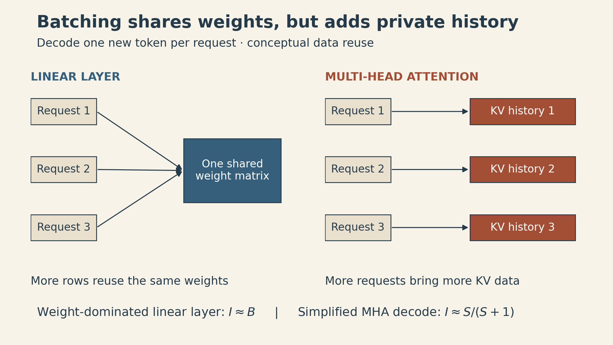
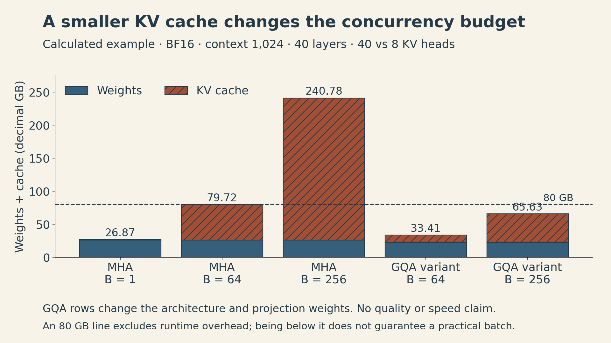
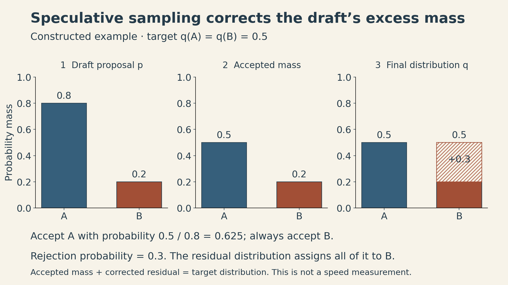

A language model can process a long prompt efficiently and then generate its answer surprisingly slowly. The parameters have not changed. The work presented to the accelerator has.

During prompt processing, many known tokens can use the same weights at once. During ordinary autoregressive decoding, each request contributes only one new token per step. Batching more requests helps reuse the weights, but each additional request also brings its own attention history.

That distinction connects the main ideas in **Stanford CS336, Spring 2026, Lecture 10: Inference**, taught by Percy Liang. Fast inference depends on what can be reused, how much state must move, and which changes preserve the model's output distribution.

## 1. First decide which kind of speed matters

Three measurements answer different questions:

| Measurement | What it measures | Why it matters |
|---|---|---|
| Time to first token (TTFT) | Time from request arrival to the first generated token | The initial wait in an interactive application |
| Inter-token latency | Time between successive generated tokens for one request | How smoothly a response streams |
| Output throughput | Generated tokens per second across requests | How much total work a server completes |

TTFT includes waiting in the scheduler as well as prompt processing and other overheads. A low prefill time does not guarantee a low TTFT under load. Likewise, an aggregate throughput number does not tell us how long an individual user waits.

Inference also occurs inside evaluation and reinforcement learning: a training loop may spend substantial time generating the outputs it will later score. For these workloads, aggregate throughput can matter more than the streaming experience of any one request.

## 2. The KV cache trades repeated computation for stored history

Consider a causal Transformer. Appending a token does not change the hidden states of earlier tokens, because those states cannot attend to the future. Their keys and values can therefore be reused.

**Prefill** processes the known prompt, constructs the per-layer key/value cache, and produces the distribution used to sample the first response token. **Decode** then feeds in a newly sampled token, appends its keys and values, and computes the next distribution.

Without caching, recomputing full dense attention at every step costs a sum of growing squares. For a generated length $n$, ignoring a fixed initial prompt and holding model dimensions fixed,

$$
\sum_{s=1}^{n} O(s^2)=O(n^3).
$$

With a cache, the new query attends to the stored history, costing $O(s)$ attention work at step $s$ and $O(n^2)$ over the generation. This statement concerns the dense attention component; it does not count all model operations as cubic or quadratic.

Let:

- $B$ be the number of concurrent sequences;
- $S$ the cached tokens per sequence;
- $L$ the number of layers;
- $K$ the number of key/value heads;
- $H$ the head dimension;
- $b$ the bytes stored per cache element.

For equal sequence lengths and ordinary separate key/value tensors,

$$
M_{\mathrm{KV}}=2bBSLKH.
$$

The leading $2$ counts keys and values. With BF16 storage, $b=2$. For unequal lengths, replace $BS$ by $\sum_i S_i$. Allocator overhead, padding, temporary tensors, and cache sharing are separate considerations.

The cache saves work, but its size grows with both context length and concurrency.

## 3. Batching reuses weights more easily than attention history

For one linear layer, take $X\in\mathbb{R}^{B\times D}$ and $W\in\mathbb{R}^{D\times F}$. Count a multiply-add as two FLOPs. A simple BF16 accounting model reads each input and weight once and writes each output once:

$$
\mathrm{FLOPs}=2BDF,\qquad
\mathrm{bytes}=2(BD+DF+BF).
$$

The arithmetic intensity is therefore

$$
I=\frac{BDF}{BD+DF+BF}
\approx B\quad\text{when }B\ll D,F.
$$

This is the benefit of batching: the same weight matrix supports more arithmetic per transfer. During prefill, the independent token dimension also contributes rows, so the corresponding weight-dominated approximation is $I\approx BT$ while $BT\ll D,F$. Here $T$ is the number of known query positions processed together. For larger $BT$, the exact ratio under this accounting approaches $DF/(D+F)$ rather than growing without bound. During ordinary decode, $T=1$.

Attention has a different reuse pattern. For standard multi-head attention with $N$ query heads, $D=NH$, and $K=N$, consider queries of length $T$ and keys/values of length $S$. A simplified dense accounting model gives

$$
\mathrm{FLOPs}\approx4BST D,\qquad
\mathrm{bytes}\approx4B(S+T)D,
$$

and hence

$$
I_{\mathrm{attn}}\approx\frac{ST}{S+T}.
$$

This model counts the two attention matrix products and avoids materializing the full score matrix in HBM. It is an optimistic traffic model, not an exact description of every tiled kernel. Causal masking, repeated tile reads, softmax, and fusion affect the constants and realized performance.

For a square prefill, the formula gives $S/2$. For one-token decode, it gives $S/(S+1)$, approaching one FLOP per byte. **The batch size cancels:** adding unrelated requests adds both attention computation and their private KV data.

{fig-alt="Two panels show three requests using one shared weight matrix, while each request reads its own separate key/value cache. Weight-dominated linear-layer intensity grows approximately as batch size B; the simplified multi-head decode attention intensity is S divided by S plus one, independent of B."}

A roofline estimate compares this intensity with peak compute divided by memory bandwidth. Using the lecture's dense-BF16 H100 example, $989\times10^{12}/(3.35\times10^{12})\approx295$ FLOPs/byte. That is a reference crossover for a particular precision and hardware configuration, not a universal batch-size threshold. A real kernel must achieve enough utilization, and a real server has other operations and communication to pay for.

The useful conclusion is conditional: small-batch decoding is often bandwidth limited; sufficient token reuse can move linear layers toward a compute limit. “All inference is memory-bound” is too broad.

## 4. A larger batch improves aggregate throughput until another limit intervenes

Suppose $W_b$ bytes of weights and $C_b$ bytes of cache per sequence must be read each decode step. Under an idealized bandwidth-only model with bandwidth $\beta$,

$$
\tau_{\mathrm{bw}}(B)=\frac{W_b+BC_b}{\beta},\qquad
R_{\mathrm{bw}}(B)=\frac{B\beta}{W_b+BC_b}.
$$

Here $\tau_{\mathrm{bw}}$ is the time for a batch step and thus the interval between tokens for a request participating in every step. $R_{\mathrm{bw}}$ counts all $B$ generated tokens. The weight cost is amortized across requests, but cache traffic remains proportional to $B$.

Within this model, step time grows with $B$, while throughput approaches $\beta/C_b$. Actual throughput may hit compute, capacity, communication, or scheduling limits earlier. These formulas omit cache writes and other traffic; they are cost estimates under the stated accounting assumptions, not measured server timings.

### A concrete memory calculation

Use the lecture's Llama 2 13B configuration: $D=5120$, feed-forward width $F=13824$, $L=40$, $N=K=40$, $H=128$, vocabulary $V=32000$, and context $S=1024$. With separate input/output embeddings, the simplified parameter count is

$$
P=2VD+3DFL+(2DNH+2DKH)L
=13{,}015{,}449{,}600.
$$

This omits small normalization parameters. The timing proxy below also charges a read of every parameter, although input-embedding lookup only accesses selected rows; it is not a strict bound on actual device time. BF16 weights occupy about $26.03$ GB, and one sequence's cache occupies $0.839$ GB, using decimal GB.

| KV heads $K$ | Batch $B$ | Weights (GB) | Total KV cache (GB) | Weights + cache (GB) |
|---|---:|---:|---:|---:|
| 40 | 1 | 26.03 | 0.84 | 26.87 |
| 40 | 64 | 26.03 | 53.69 | 79.72 |
| 40 | 256 | 26.03 | 214.75 | 240.78 |
| 8, hypothetical GQA variant | 64 | 22.68 | 10.74 | 33.41 |
| 8, hypothetical GQA variant | 256 | 22.68 | 42.95 | 65.63 |

Values are rounded independently; displayed components can differ from the displayed total by $0.01$ GB.

Using $\beta=3.35\times10^{12}$ bytes/s from the lecture's H100 example, at $B=1$ the bandwidth-only estimate is $8.02$ ms per step. At $B=64$, it is $23.80$ ms, while aggregate throughput increases from about $125$ to $2{,}689$ tokens/s. These are calculations from a simplified model. The $79.72$ GB row leaves effectively no operating headroom under an $80$ GB budget, so it is not evidence that this batch is practical on one device.

The hypothetical GQA rows change the model architecture and its projection parameter count. They are not a claim that the original Llama 2 13B checkpoint can simply switch to eight KV heads without training or quality checks.

{fig-alt="Stacked memory bars show weights and key/value cache for five configurations. With 40 KV heads, batches 1, 64, and 256 require 26.87, 79.72, and 240.78 decimal GB. A hypothetical eight-head GQA architecture requires 33.41 GB at batch 64 and 65.63 GB at batch 256. A dashed 80 GB line is a capacity reference, not a practical deployment guarantee."}

## 5. Reduce the cache along the dimension that costs you most

Several architectural choices target different factors in the cache formula.

**Grouped-query attention (GQA)** keeps $N$ query heads but uses fewer than $N$ KV heads. Each KV head serves a group of queries. MHA has $K=N$; multi-query attention has $K=1$. Holding everything else fixed, changing $K=40$ to $K=8$ reduces cache storage fivefold. Quality and speed still require evaluation for the trained model and its kernels. The [GQA paper](https://arxiv.org/abs/2305.13245) describes uptraining existing multi-head checkpoints as well as the grouping mechanism.

**Multi-head latent attention (MLA)** stores a joint compressed representation of keys and values. In DeepSeek-V2, the cache contains a latent vector plus a separate positional key. Its configuration uses $512+64=576$ elements per token per layer. The positional part matters: ordinary RoPE interferes with absorbing the key up-projection into the query projection, so the architecture decouples positional information. Efficient inference can absorb projection matrices rather than repeatedly materializing the full keys and values. These details come from [DeepSeek-V2, Sections 2.1.2–2.1.3](https://arxiv.org/html/2405.04434v5).

**Cross-layer attention (CLA)** shares KV representations across layers, reducing another dimension of the cache. Its [original study](https://arxiv.org/abs/2405.12981) evaluates particular layer-sharing patterns; the resulting quality/memory tradeoff is empirical, not a guarantee for any pretrained model.

**Sliding-window attention** retains only a recent window in the affected layers. A bounded window permits bounded cache storage there, but global-attention layers still retain growing history. Information can propagate across layers, yet this does not give each query unrestricted direct access to every distant token. Hybrid architectures trade local detail against longer-range access.

The lecture also discusses compressed and selected token representations, and points toward recurrent state or linear-attention architectures. These change how history is represented or retrieved. They should be judged on long-context tasks as well as storage: compressing a history can discard a rare detail that a later query needs.

## 6. Fewer bits and fewer parameters introduce a quality question

Quantization reduces the bytes used to represent weights, activations, or cached values. A basic affine integer quantizer is

$$
z=\operatorname{clip}\!\left(\operatorname{round}(x/s)+z_0,\ z_{\min},z_{\max}\right),\qquad
\hat{x}=s(z-z_0),
$$

where $s>0$ is a scale and $z_0$ is an integer zero point. With $x=5.2342$, $s=0.1$, $z_0=4$, and no clipping, $z=56$ and $\hat{x}=5.2$. The absolute error is $0.0342$.

Quantization-aware training exposes the model to simulated quantization during training. Post-training quantization instead converts an existing model, often using calibration examples to choose scales or compensate for errors. Lower nominal bit width does not automatically produce proportional speedup: scales, packing, dequantization, and available kernels matter.

[GPTQ](https://arxiv.org/abs/2210.17323) uses approximate second-order information to compensate for quantization error in remaining weights. [AWQ](https://arxiv.org/html/2306.00978v5) searches per-input-channel scales using activation information. Scaling weights and inversely scaling their corresponding inputs preserves the unquantized linear operation while reducing quantization error on salient channels. Its final mechanism protects salient channels through scaling; keeping selected weights in FP16 is a motivating experiment, not the defining AWQ implementation.

Structured pruning removes whole layers, heads, or channels so that the resulting model has smaller dense operations. Pruning alone can damage predictions; the [Minitron study](https://arxiv.org/abs/2407.14679) combines it with retraining and knowledge distillation. A smaller model obtained this way is a new model to evaluate, not an exact implementation of the original distribution.

## 7. Speculative sampling changes the execution while preserving the target distribution

There is another option: use a cheap model to propose several tokens and let the target model check the proposed continuation in parallel. The proposals are known inputs during verification, so the target can process multiple positions in one causal forward pass.

Let $p(x)$ be the draft distribution and $q(x)$ the target distribution at the same prefix. This follows the lecture's notation; Leviathan et al. use the opposite letter assignment. Draw $x\sim p$, and accept it with probability

$$
a(x)=\min\!\left(1,\frac{q(x)}{p(x)}\right).
$$

The ratio only needs to be evaluated for sampled candidates, which have $p(x)>0$. If rejected, draw a replacement from

$$
r(x)=\frac{[q(x)-p(x)]_+}{Z},\qquad
Z=\sum_y[q(y)-p(y)]_+.
$$

Why does this work? Accepted probability mass at $x$ is $\min(p(x),q(x))$. The total rejection probability equals $Z$, because both distributions sum to one. The replacement contributes $Zr(x)=[q(x)-p(x)]_+$. Thus

$$
\Pr(\text{output}=x)=\min(p(x),q(x))+[q(x)-p(x)]_+=q(x).
$$

If $Z=0$, the distributions agree and rejection never occurs; the residual distribution is not needed.

For a constructed two-token example, let $p=(0.8,0.2)$ and $q=(0.5,0.5)$. Candidate A is accepted with probability $0.5/0.8=0.625$; candidate B is always accepted. Accepted mass is $(0.5,0.2)$, and the rejected mass $0.3$ is reassigned to B. The final distribution is exactly $(0.5,0.5)$.

{fig-alt="Three probability bars compare draft, accepted mass, and final output for tokens A and B. The draft assigns 0.8 to A and 0.2 to B. Acceptance retains 0.5 for A and 0.2 for B. The rejected 0.3 mass is drawn from a residual supported only on B, yielding the target probabilities 0.5 and 0.5."}

For a block of proposed tokens, verification proceeds in prefix order. At the first rejection, output a corrected token and discard the later proposals; their conditioning prefix is no longer valid. If every proposal is accepted, the target can supply one additional token. The [speculative decoding algorithm](https://arxiv.org/html/2211.17192v2) applies the single-step argument repeatedly.

“Exact” refers to the target sampling distribution under correct acceptance and correction rules, using the intended sampling transformations and consistent prefixes. It does not promise the same sampled sentence for the same random seed or eliminate finite-precision effects. Speedup depends on acceptance rate, proposal cost, verification cost, and the existing batch workload. More draft tokens can waste more work when they are rejected.

## 8. Live traffic needs scheduling and memory management together

Real requests arrive and finish at different times. A static batch can leave empty slots while waiting for its longest response.

**Continuous batching** updates the active set at iteration boundaries: completed requests leave, and eligible new work enters. The original Orca design also separates operations that can share a packed token batch from sequence-specific attention. Packing tokens for an MLP does not permit attention to cross request boundaries. Scheduling must still control how prefill work competes with ongoing decoding.

**PagedAttention** addresses the storage problem. A request sees a logically ordered KV cache, while its physical blocks can live at different locations. New blocks are allocated as the sequence grows, avoiding a large contiguous reservation for every possible future token. The final block can still have unused slots; paging does not eliminate all overhead.

Identical prefixes can share physical cache blocks when the model, token prefix, positions, and other relevant cache settings match. A reference count tracks sharing. Before a shared partial block is modified, copy-on-write gives the writer private storage. This protects other requests' state as their continuations diverge. These mechanisms are described in [the original vLLM/PagedAttention paper, Sections 4.1–4.5](https://arxiv.org/abs/2309.06180).

Paging changes placement and allocation, not the mathematical requirement that dense attention consider its relevant history. Prefix sharing saves storage and repeated prefill computation; it does not by itself prove that all subsequent decode reads are shared across requests.

## 9. Match the intervention to the expensive state

A practical diagnosis starts with the workload rather than a favorite optimization:

| Observed pressure | Candidate intervention | What must also be checked |
|---|---|---|
| Repeated weight traffic at small decode batches | Batching, weight quantization | Per-request latency, precision, kernels |
| Large per-request KV state | GQA/MLA, KV quantization, windowed or compressed history | Model compatibility and task quality |
| Too many serial target-model passes | Speculative sampling | Exact correction, acceptance, verification cost |
| Idle batch slots and uneven arrivals | Continuous batching | Queueing and prefill/decode interference |
| Wasted KV reservations and repeated prefixes | Paged allocation and prefix caching | Block overhead and cache correctness |

Replicating a model across devices can increase throughput when traffic distributes well. Sharding the model or cache introduces communication costs, connecting inference to the [parallelism discussion in Lecture 8](lecture08-parallelism-ii.html).

The common question is: **which bytes are shared, which bytes are private, and which bytes can be avoided without changing the result we need?** That makes the tradeoff concrete. A smaller cache can enable a larger batch; a larger batch can improve total throughput while slowing each stream. The right operating point depends on both quality and the latency the application can tolerate.

## Sources and lecture

- [Stanford CS336 Spring 2026 course](https://cs336.stanford.edu/) and [Lecture 10 materials](https://cs336.stanford.edu/lectures/?trace=lecture_10), Percy Liang.
- [How To Scale Your Model: Transformer Inference](https://jax-ml.github.io/scaling-book/inference/), for resource accounting and serving tradeoffs.
- GQA, DeepSeek-V2, CLA, GPTQ, AWQ, Minitron, speculative decoding, and PagedAttention are linked beside their relevant explanations.
- [Orca: A Distributed Serving System for Transformer-Based Generative Models](https://www.usenix.org/conference/osdi22/presentation/yu).

[Watch the official Lecture 10 recording](https://www.youtube.com/watch?v=EfM546A79aM).


