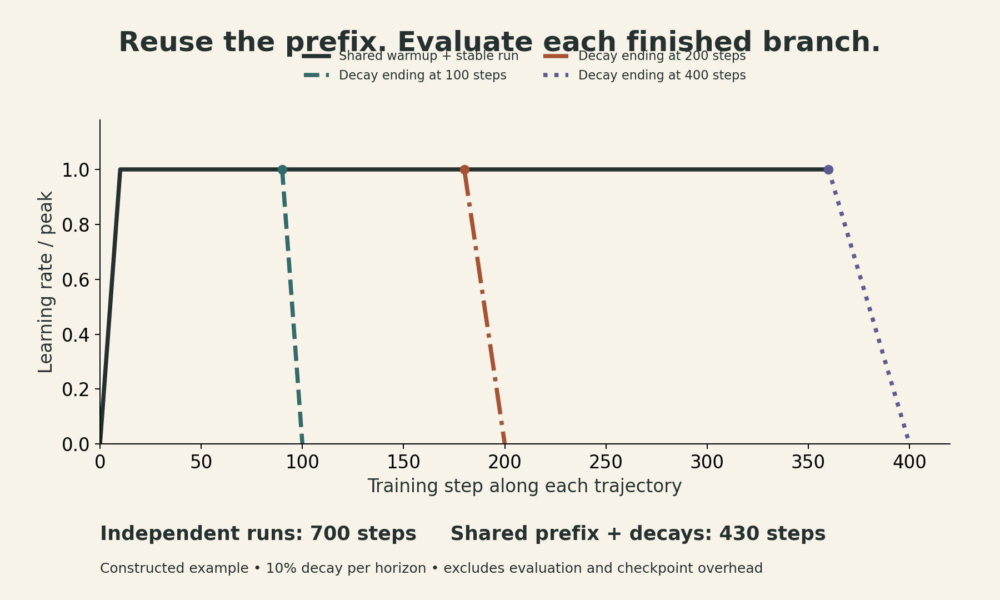
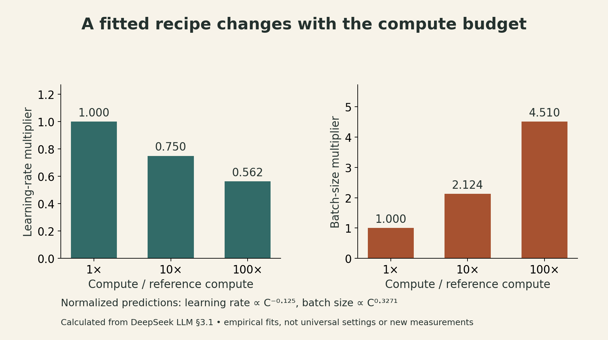
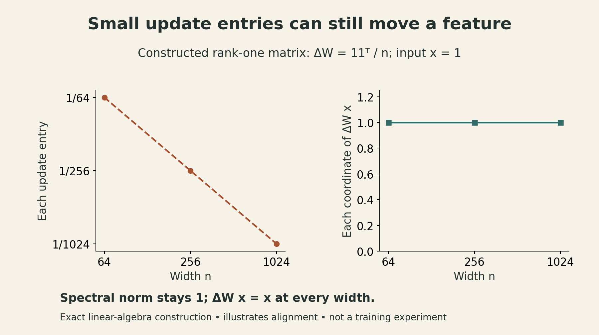

A small language model trains smoothly. You make it wider, keep the same learning rate, and the larger run becomes unstable. Or it stays stable but learns less efficiently. Either outcome can spoil a scaling-law experiment before the curve is fitted.

The central problem in **Stanford CS336, Spring 2026, Lecture 11**, taught by Tatsunori Hashimoto, is how to make small experiments informative about large ones. Model size and token count matter, but so do initialization, learning rate, batch size, the optimizer, and the point at which training slows down.

[Lecture 9](lecture09-scaling-laws-i.html) introduced the model–data allocation problem. This lecture adds the experimental machinery needed to measure that allocation credibly.

## 1. A scaling curve belongs to a training recipe

A familiar model writes validation loss as

$$
L(N,D)=E+A N^{-\alpha}+B D^{-\beta},
$$

where $N$ counts parameters and $D$ counts training tokens. The coefficients summarize an experimental family. They also depend on choices suppressed by this notation: data mixture, architecture, optimizer, schedule, and tuning quality.

If the largest runs use a poor learning rate, their losses can make model scaling look less effective than it is. If short runs are evaluated before their learning rate has decayed, their losses can distort the apparent value of extra data.

Two practical approaches recur in the lecture:

| Approach | What transfers from small experiments? | What still needs measurement? |
|---|---|---|
| MiniCPM | A parametrization designed to keep useful base hyperparameters approximately stable | Batch size, training horizon, and the model–data tradeoff |
| DeepSeek LLM | Empirical fits predicting learning rate and batch size as compute grows | The fits' range of validity and the best model–data allocation |

Both need a controlled family of runs and checks beyond the fitting range. Neither gives a universal tokens-per-parameter constant.

## 2. MiniCPM: stabilize the recipe before fitting the curve

MiniCPM combines width and depth scaling rules with experiments on smaller models. Its changes include embedding and output scaling, residual scaling, initialization, and learning rates for matrix parameters. This is a coordinated parametrization; changing just one global learning-rate number does not reproduce it.

The paper found an approximately stable best **base** learning rate across the tested sizes. The distinction matters: a shared base value can still produce different actual learning rates for different parameter tensors and widths.

Batch size remains a separate question. MiniCPM sweeps it on several small models, relates favorable batch sizes to achieved loss, and finds that larger batches become useful as loss decreases. This empirical relationship is tied to its data and training setup.

Its subsequent joint model–data fit favored substantially more data per parameter than the original Chinchilla prescription. That result is evidence about this recipe and its fitted range, rather than a replacement constant every model should adopt. [MiniCPM, §§3–4](https://arxiv.org/abs/2404.06395)

## 3. WSD makes training prefixes reusable

Suppose we want terminal losses at three different training horizons. A cosine schedule selected for the longest horizon is still at a relatively high learning rate when it passes an earlier horizon. That checkpoint is not equivalent to a shorter run whose schedule has already finished decaying.

**Warmup–Stable–Decay (WSD)** separates these concerns:

1. Warm up to a chosen learning rate.
2. Continue at a stable rate, saving checkpoints.
3. Branch from a saved checkpoint and decay the learning rate for a terminal evaluation.

For a target horizon $T$, a simplified schedule is

$$
\eta_T(t)=\begin{cases}
\eta_{\max}t/w, & 0\le t<w,\\
\eta_{\max}, & w\le t<s_T,\\
\eta_{\max}g_T(t), & s_T\le t\le T,
\end{cases}
$$

where $w$ is the warmup duration, $s_T$ is the branch point, and $g_T$ decreases during the final segment. Different horizons can share the same prefix up to their respective branch points.

The continuing run retains its stable learning rate. The decayed branch supplies the terminal loss. Resuming the already-decayed weights and increasing the learning rate is a different experiment.

### A small compute-accounting example

Consider one fixed model, a fixed batch size, and horizons of 100, 200, and 400 steps. Give each branch a final decay lasting 10% of its horizon. The branch points are 90, 180, and 360.

Three independent runs require

$$100+200+400=700\text{ training steps}.$$

A shared stable trajectory through step 360, plus the three decays, requires

$$360+10+20+40=430\text{ training steps}.$$

This constructed example saves about **38.6% of training steps**. It excludes checkpointing and evaluation overhead and assumes the same per-step cost. It is a schedule-accounting illustration, not a measured speedup or a claim that WSD always matches cosine quality.

{fig-alt="Constructed WSD schedule example. Decay branches begin at steps 90, 180, and 360 and end at 100, 200, and 400. A shared prefix costs 360 steps and the decays cost 70, versus 700 steps for independent runs."}

MiniCPM reports that relatively short decays worked well in its experiments. Their duration and shape are still hyperparameters. WSD removes repeated prefix work; it does not eliminate the need for enough terminal evaluations to identify a scaling law. [MiniCPM, §4](https://arxiv.org/abs/2404.06395)

## 4. DeepSeek: fit the hyperparameters, then fit model size

The original **DeepSeek LLM** report takes a more empirical route. It searches learning-rate/batch-size combinations at small compute budgets, identifies a broad region of near-optimal settings, and fits trends with compute.

Its fitted exponents imply

$$
\frac{\eta(C_2)}{\eta(C_1)}=\left(\frac{C_2}{C_1}\right)^{-0.1250},\qquad
\frac{b(C_2)}{b(C_1)}=\left(\frac{C_2}{C_1}\right)^{0.3271},
$$

where $b$ is batch size and $C$ is the report's training-compute measure. Using ratios avoids treating unit-dependent prefactors as portable constants.

For a tenfold compute increase, these formulas predict a learning rate about **0.750×** as large and a batch about **2.124×** as large. These are calculations from the fitted equations, not new training observations. The decimal places describe the calculation, not predictive certainty: the report notes that even equal-compute runs can favor slightly different settings when their model–data allocation changes.

{fig-alt="Calculated values of DeepSeek LLM's empirical power laws. At compute multipliers 1, 10, and 100, learning rate scales to 1, 0.750, and 0.562; batch size scales to 1, 2.124, and 4.510. These are normalized fit predictions, not observations."}

DeepSeek then compares models at equal compute—an **IsoFLOP** experiment—to find a favorable model–data split. It also makes the accounting more explicit: its model-scale variable $M$ is non-embedding FLOPs per token, including attention computation, and its budget is $C=MD$. This differs from silently identifying compute with $6ND$ in every setting.

The study's multi-step schedule also permits prefix reuse. However, a numerical learning rate fitted under that schedule should not be copied unchanged into a different optimizer or parametrization. [DeepSeek LLM, §3](https://arxiv.org/abs/2401.02954)

## 5. There is more than one variable to scale

The lecture's later examples broaden the experimental question:

- **Qwen:** predict training hyperparameters as model and data scale change.
- **Kimi K2 and Hunyuan:** include sparsity or activated parameters when studying mixture-of-experts models.
- **Llama 3:** connect compute, validation loss, and downstream performance through additional fitted relationships.
- **MiniMax-01:** compare architecture families, rather than assuming the architecture is fixed.

These examples use different quantities and objectives. In particular, total MoE parameters and activated parameters cannot be substituted for one another in a ratio without changing its meaning. See the [lecture's case studies, slides 25–30](https://github.com/stanford-cs336/lectures/blob/main/lecture_11.pdf).

StepFun's **Step Law** studies learning rate and batch size jointly across model and data scales. Its fitted form is

$$\eta(N,D)=cN^{a_N}D^{a_D},\qquad b_{\mathrm{batch}}(D)=dD^\gamma.$$

In that experimental setup, optimal batch size depended mainly on token budget. The study found broad, bowl-shaped hyperparameter regions, which is encouraging for tuning. It does **not** mean that a neural network's loss is globally convex in its weights.

The schedule is part of the result: this study used cosine decay with a fixed final learning rate, and changing the final-rate rule shifted the favorable region. A relationship measured while holding data fixed is also a different comparison from one measured while jointly increasing model and data sizes. [Step Law, §§3.2–3.4](https://arxiv.org/abs/2503.04715)

## 6. Why optimizer rankings can change with scale

An optimizer can look better because its update rule is better suited to the workload. It can also look better because it received a stronger tuning budget, a more suitable learning rate, or a more favorable token budget.

A useful comparison therefore checks several model sizes, comparable data exposure, separately tuned hyperparameters, and both quality and cost. Equal steps alone do not establish equal wall-clock cost.

Muon illustrates the importance of matrix structure. For a matrix-valued momentum buffer with singular value decomposition

$$B_t=U\Sigma V^\top,$$

its idealized orthogonalization step points toward $UV^\top$. Practical implementations use a short Newton–Schulz iteration to approximate this operation, along with implementation-specific scaling and treatment of other parameters. For full-rank rectangular matrices this is a semi-orthogonal direction; using only the nonzero singular directions in a rank-deficient matrix instead gives a partial isometry. In either case, finite iterations need not produce exact unit singular values.

The lecture presents evidence that Muon can work beyond tiny experiments, while warning that an advantage measured at one scale need not remain constant at another. This is a reason to test scaling, not to assign one optimizer a universal speedup. [Lecture, slides 38–43](https://github.com/stanford-cs336/lectures/blob/main/lecture_11.pdf)

## 7. μP: preserve the scale of feature learning

**Maximal update parametrization (μP)** addresses a related question: as a network gets wider, how should initialization and updates change so that hidden features still move by a meaningful amount?

For a hidden vector $h_\ell$ of width $n_\ell$, order-one typical coordinate size corresponds to

$$\|h_\ell\|_2=\Theta(\sqrt{n_\ell}).$$

The feature-learning target also asks for

$$\|\Delta h_\ell\|_2=\Theta(\sqrt{n_\ell}).$$

Here $\Theta$ describes scaling with width; constants may depend on the base learning rate and other fixed choices. It does not mean that every coordinate changes by exactly one.

### The spectral-norm viewpoint

For $W_\ell\in\mathbb R^{n_\ell\times n_{\ell-1}}$, the spectral norm measures the largest amplification of a unit input vector. Write it as $\|W_\ell\|_{\mathrm{op}}$ to distinguish it from the Frobenius norm.

The spectral condition suggests scaling both weights and updates as

$$
\|W_\ell\|_{\mathrm{op}},\ \|\Delta W_\ell\|_{\mathrm{op}}
=\Theta\!\left(\sqrt{\frac{n_\ell}{n_{\ell-1}}}\right).
$$

For an equal-width hidden layer, that target stays order one. Multiplying it by an input norm of order $\sqrt n$ gives the desired output scale.

But the basic inequality

$$\|Wh\|_2\le\|W\|_{\mathrm{op}}\|h\|_2$$

is only an upper bound. The derivation also needs suitable matrix–vector alignment and no leading-order cancellation between update terms. A simple proof begins with a deep linear network, random initialization, and one SGD step on one example; it is not an unrestricted theorem about every Transformer implementation. [Yang, Simon and Bernstein, §3](https://arxiv.org/abs/2310.17813)

### Why an update can have much smaller entries than a weight matrix

For one example in a linear layer, let $g=\nabla_h\ell$ and $x$ be the input activation. Then

$$\Delta W=-\eta gx^\top,\qquad \Delta W x=-\eta g\|x\|_2^2.$$

This rank-one update is aligned with the very input that generated it. Its entries can be smaller than independent random weights while still producing a substantial feature change.

For a square $n\times n$ hidden matrix, the spectral analysis gives these orders:

| Quantity | Random initial weights | Aligned rank-one update |
|---|---|---|
| Typical entry size | $n^{-1/2}$ | $n^{-1}$ |
| Frobenius norm | $\sqrt n$ | $1$ |
| Spectral norm | $1$ | $1$ |

A concrete construction makes the update column easy to check. Let $x$ be an all-ones vector and $\Delta W=\mathbf1\mathbf1^\top/n$. Each entry is $1/n$, yet $\Delta Wx=x$. The per-coordinate feature change remains one for every width, so the update vector has norm $\sqrt n$, matching the intended feature-update scale. This is a linear-algebra example, not an optimizer benchmark.

{fig-alt="Constructed rank-one example: delta W equals the all-ones outer product divided by width n. Its entries shrink from 1/64 to 1/256 to 1/1024, but delta W times an all-ones vector remains that vector, with coordinate change one."}

### Base learning rate versus tensor learning rate

In the simple spectral parametrization, the derived SGD learning-rate scale is $\Theta(n_\ell/n_{\ell-1})$. For Adam-like updates, the corresponding scale is $\Theta(1/n_{\ell-1})$, under the analysis's assumptions. Initialization standard deviation scales as

$$
\sigma_\ell=\Theta\!\left(\frac{1}{\sqrt{n_{\ell-1}}}
\min\left\{1,\sqrt{\frac{n_\ell}{n_{\ell-1}}}\right\}\right).
$$

These expressions describe one parametrization convention. Equivalent implementations can place factors in the forward pass instead. Embeddings, hidden matrices, and the output readout also need distinct treatment.

Thus, “transfer the learning rate” usually means transfer the tuned **base** setting while applying the appropriate width-dependent tensor rules. It does not mean keep every actual tensor learning rate unchanged. [Spectral condition, §§3.3–4](https://arxiv.org/abs/2310.17813), and [lecture slide 50](https://github.com/stanford-cs336/lectures/blob/main/lecture_11.pdf)

## 8. Transfer still needs a small empirical test

The lecture uses Cerebras-GPT as an example of μP improving predictability, then examines a more detailed replication study. The latter tests modern Transformer components individually rather than assuming the whole architecture inherits the theory.

The results are encouraging but conditional:

- Several changes, including tested nonlinearities and schedules, retained useful learning-rate transfer.
- Trainable RMSNorm gains interfered with transfer in the tested configurations.
- With library-style AdamW decay at $\lambda=0.1$, the smallest proxy's preferred learning rate shifted while larger models matched the no-decay optimum; the paper suggests omitting decay on the proxy. For independent decay, it instead motivates tuning base learning rate and decay strength jointly.
- A single-seed Lion result looked unfavorable, but the paper (v6) reports restored transfer after averaging three proxy seeds. That is a warning against turning one noisy optimum into a general impossibility claim.

These findings do not establish that RMSNorm gains or weight decay are always harmful. They identify parts of the recipe that deserve a fresh proxy test. [Lingle, §§4.2–4.4, revision v6](https://arxiv.org/abs/2404.05728v6)

## 9. A practical order of operations

Drawing on these ideas, one practical sequence for planning a larger run is:

1. **Define the objective and budget.** State the validation distribution, compute convention, and whether training cost or total lifetime cost is being optimized.
2. **Choose a consistent model family.** Record width, depth, attention, normalization, and parametrization rules.
3. **Tune small proxies.** Search learning rate and batch size; use multiple seeds when differences are small.
4. **Test transfer at an intermediate scale.** Check feature magnitudes, loss, and stability before a much larger extrapolation.
5. **Measure terminal losses consistently.** Shared WSD prefixes can reduce redundant work, provided each terminal branch has its own decay.
6. **Fit and challenge the scaling prediction.** Reserve a scale or budget for validation, and revisit the fit if the data or architecture changes.

The useful output is a recipe whose behavior has been tested across scales. A smooth fitted line becomes much more valuable when the training runs behind it are comparable.

## Lecture and further reading



[Watch the official lecture on YouTube](https://www.youtube.com/watch?v=vTfEyOyzV9E).

- [Stanford CS336 Spring 2026](https://cs336.stanford.edu/) and [Lecture 11 slides](https://github.com/stanford-cs336/lectures/blob/main/lecture_11.pdf).
- [MiniCPM](https://arxiv.org/abs/2404.06395): model scaling and WSD experiments.
- [DeepSeek LLM](https://arxiv.org/abs/2401.02954): hyperparameter fits and IsoFLOP allocation.
- [Step Law](https://arxiv.org/abs/2503.04715): joint hyperparameter scaling.
- [A Spectral Condition for Feature Learning](https://arxiv.org/abs/2310.17813): the norm-based derivation.
- [A Large-Scale Exploration of μ-Transfer](https://arxiv.org/abs/2404.05728v6): empirical transfer and its limitations.
