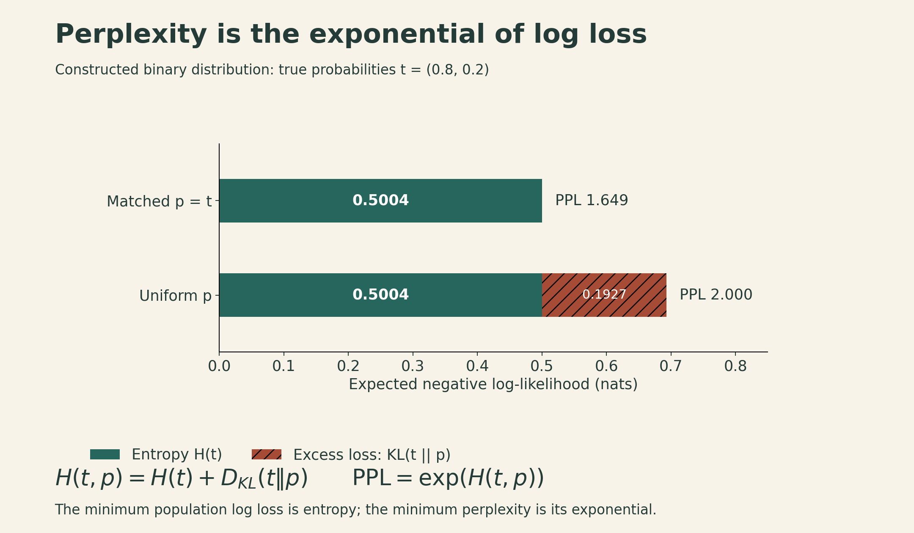

Two systems receive scores of 74% and 70%. Before choosing between them, I want to know what was counted: correct answers, preferred responses, or completed tasks? Did they receive the same prompts and tools? How many attempts were allowed? Would the difference survive another sample of tasks?

Those questions are the substance of evaluation. In Stanford CS336's Spring 2026 Lecture 12, Percy Liang frames the problem as translating an abstract property—usefulness, reasoning, safety—into a concrete measurement. That translation determines which improvements an experiment rewards.

A score belongs to a system **under an evaluation protocol**. Understanding the protocol helps us decide whether the result answers our question.

## 1. Start with the decision the evaluation should support

A researcher comparing training algorithms, a developer debugging a model, and a team selecting an assistant need different evidence.

For a training-method comparison, declare which variables are controlled and which may change. An optimizer study might fix data, architecture, and hardware, then compare time or compute to a target validation loss. An architecture study would allow the architecture to vary. For product selection, we may allow each system its best configuration and compare completed work, latency, cost, and failure severity. Both comparisons can be useful, but they support different conclusions.

A compact specification includes:

| Part | What needs to be fixed or reported |
|---|---|
| Target | The behavior or decision being measured |
| Tasks | Source, sampling process, language, domain, and version |
| System | Model checkpoint, prompts, tools, memory, and orchestration |
| Budget | Tokens, wall time, money, tool calls, and attempts |
| Scoring | Correctness rule, tests or rubric, judge, and tie handling |
| Analysis | Aggregation, uncertainty, subgroup results, and failure inspection |

As a schematic, let tasks $x$ come from a distribution $\mathcal D$, let the complete system $S$ produce an output or trajectory $y$, and let $g$ be the scoring rule. The target is

$$
\mu=\mathbb E_{x\sim\mathcal D,\,y\sim S(\cdot\mid x)}[g(x,y)].
$$

A benchmark estimates a particular $\mu$. Changing the task distribution, the system, or the score changes what is being estimated. A leaderboard's average can therefore be informative without being the right average for a particular deployment.

## 2. Perplexity measures how well a model predicts specified text

For a token sequence $x_{1:N}$, an autoregressive model assigns

$$
p(x_{1:N})=\prod_{t=1}^{N}p(x_t\mid x_{<t}).
$$

Using natural logarithms, the mean negative log-likelihood and perplexity are

$$
L=-\frac1N\sum_{t=1}^{N}\log p(x_t\mid x_{<t}),
\qquad \mathrm{PPL}=e^L=p(x_{1:N})^{-1/N}.
$$

The inverse matters: assigning more probability to the observed text makes perplexity smaller. Across multiple documents, sum the token losses and divide by the number of scored tokens. An unweighted mean of document perplexities generally gives a different quantity.

For example, if a model assigns probabilities $0.5,0.25,0.125$ to three observed tokens, their joint probability is $1/64$. The mean loss is $\log 4$ and perplexity is $4$. Perplexity is often described as an effective branching factor; it does not mean the model literally considered four equally likely words at every position.

### Why entropy appears—and where the exponent belongs

For a finite discrete prediction problem with true distribution $t$ and predicted distribution $p$,

$$
H(t,p)=-\sum_x t(x)\log p(x)
=H(t)+D_{\mathrm{KL}}(t\|p).
$$

The expected log loss is minimized at $p=t$. If $p$ assigns zero probability to an outcome with positive probability under $t$, the loss is infinite. The minimum **cross-entropy** is $H(t)$; the corresponding population perplexity is $e^{H(t)}$. For a language model, the same decomposition applies to next-token distributions and is averaged over contexts. It is not a claim that every finite test set will be minimized by the true distribution.

In a constructed binary example, $t=(0.8,0.2)$. Predicting $p=t$ gives loss about $0.5004$ nats and perplexity $1.649$. Predicting $p=(0.5,0.5)$ gives loss $0.6931$ and perplexity $2$. The excess loss, $0.1927$ nats, is the KL divergence.

{fig-alt="Constructed binary example: cross-entropy equals entropy plus KL. Matching the 0.8/0.2 distribution gives 0.5004 nats and perplexity 1.649; uniform predictions give 0.6931 nats and perplexity 2."}

A lower average language-model loss is valuable feedback, especially for scaling experiments. It does not by itself prove reliable reasoning, harmless behavior, or usefulness on every task. The text distribution can include errors, and an average can hide failures on rare but important cases.

### Conditional scoring focuses the target

For a response $r_{1:M}$ given prompt $q$, score only response tokens:

$$
L_{\mathrm{response}}
=-\frac1M\sum_{t=1}^{M}\log p(r_t\mid q,r_{<t}),
\qquad \mathrm{PPL}_{\mathrm{response}}=e^{L_{\mathrm{response}}}.
$$

This avoids charging the model for predicting the prompt. It still measures the likelihood of a particular reference response; several other responses might be equally useful.

Tokenization is part of the measurement. The same string split into a different number of tokens changes the normalization, so token perplexities from different tokenizers are not directly comparable. Context length, document boundaries, truncation, and which tokens are masked also need to be specified. A common unit such as bits per byte can help when preprocessing and probability accounting are compatible.

There is also a trust issue: a black-box interface returning log probabilities must return values from a valid normalized distribution. Returning zero log loss for every possible continuation would produce an impressive number without defining a legitimate model.

## 3. Exams offer clear answers to selected questions

Multiple-choice and short-answer benchmarks make broad comparisons easier because answers can often be checked cheaply. The lecture traces a progression:

- **[MMLU](https://arxiv.org/abs/2009.03300)** covers 57 subjects spanning academic and professional areas and tests substantial factual knowledge as well as reasoning.
- **[MMLU-Pro](https://arxiv.org/abs/2406.01574)** revises question quality and expands answer choices, changing both difficulty and protocol.
- **[GPQA](https://arxiv.org/abs/2311.12022)** uses expert-written, reviewed questions intended to resist easy lookup by non-experts.
- **[Humanity's Last Exam](https://arxiv.org/abs/2501.14249)** extends difficult assessment across subjects and modalities, using both multiple-choice and short-answer formats.

Difficulty and realism are separate properties. A very hard exam can reveal a capability gap while saying little about whether a system will reliably finish an everyday workflow. An older benchmark can also remain useful for smaller models after stronger models approach its ceiling.

Prompting and answer extraction matter. Selecting the highest-likelihood option, sampling an answer letter, and allowing a long reasoning response before extracting a letter are different procedures. Length-normalized and unnormalized option likelihoods can also disagree. Report the procedure before attributing a score change entirely to model capability.

The same caution applies to cloze and sentence-completion tasks such as LAMBADA and HellaSwag. They connect next-token prediction to a more focused behavior, but an accuracy metric is not numerically equivalent to perplexity.

## 4. Preference evaluation introduces a judge

Open-ended responses often have no single reference answer. Chatbot Arena collects comparisons between anonymized model responses; a person chooses the preferred response. This produces preference evidence under the sampled users and prompts.

A simple Elo-scaled Bradley–Terry model represents pairwise preference as

$$
P(A\text{ beats }B)
=\frac{1}{1+10^{(R_B-R_A)/400}}.
$$

Equal ratings give probability $0.5$. A 400-point advantage gives $10/11\approx0.909$. The scale factor 400 is a convention, and ratings are meaningful through their differences. This binary illustration omits ties; real evaluations must define how ties and other judgments enter the fit.

A preference ranking can combine correctness, clarity, style, verbosity, and agreement with the user. A user may recognize a satisfying answer without being able to verify a subtle factual error. It is therefore useful to inspect preferences alongside more specific judgments.

**AlpacaEval** automates comparisons using a model judge and a reference system. Its length-controlled variant fits a regression involving model identity, output-length differences, and instruction-related features, then estimates preferences with the length-difference contribution set to zero. This reduces a measured source of bias; it neither truncates the answers nor guarantees that all judge biases disappear. The result depends on the adjustment model. [Length-controlled AlpacaEval](https://arxiv.org/abs/2404.04475).

**WildBench** makes criteria more explicit through task-specific checklists. A rubric can ask whether an answer follows constraints, contains supported facts, and provides the requested result. This makes the evaluation more reproducible, but a rubric can still omit something important and a judge can still apply it incorrectly.

Agreement with human rankings is a useful validation signal. It is not a universal guarantee for new models, new domains, or much stronger systems. Human and model judges can also share biases.

## 5. Agent benchmarks evaluate a model plus its operating setup

An agent includes the model and the logic that manages prompts, tools, state, and repeated interaction with an environment. Planning, file-based memory, delegation, and context management can change outcomes even when model weights remain fixed.

| Benchmark family | What the system must do | What the score needs to specify |
|---|---|---|
| SWE-bench | Modify a repository to address an issue | Dataset subset, environment, patch tests, and regression checks |
| Terminal-Bench | Complete tasks in terminal environments | Task version, tools, resource limits, and validators |
| [CyBench](https://arxiv.org/abs/2408.08926) | Solve controlled capture-the-flag tasks | Task set, assistance, time limits, and success conditions |
| [MLE-bench](https://arxiv.org/abs/2410.07095) | Carry out machine-learning competition workflows | Data access, training compute, submissions, and evaluation rules |

These tasks make longer workflows measurable. They also introduce more ways for a score to depend on implementation details. For example, the original SWE-bench paper describes 2,294 tasks across 12 Python repositories; its full set must not be confused with a curated subset such as SWE-bench Verified. Terminal-Bench 2.0's paper describes 89 tasks. Neither count says which configuration a later leaderboard used. [SWE-bench](https://arxiv.org/abs/2310.06770), [Terminal-Bench 2.0](https://arxiv.org/abs/2601.11868).

### Attempts change the success event

Suppose a fixed task has an independent success probability $q=0.2$ on each attempt. In a **theoretical illustration**, the probability of at least one success within $k$ attempts is

$$
P(\text{at least one success in }k)=1-(1-q)^k.
$$

That gives $20\%$ for one attempt, $59.04\%$ for four, and $83.22\%$ for eight. The model's per-attempt probability has not improved.

{fig-alt="Theoretical curve for at least one success across independent attempts, q=0.2: 20 percent at one attempt, 59.04 percent at four, and 83.22 percent at eight. More attempts change both budget and success event."}

This event does not tell us whether a deployed system can identify the successful attempt. A benchmark with a reliable checker may detect it; a user choosing among plausible answers may not. Real retries can also be correlated, adapt to feedback, and have task-dependent success probabilities, so the curve is not a forecast for an actual agent.

Report attempts, selection or verification rules, and total cost together. A single-attempt score and an “at least one success” score answer different questions.

## 6. Reasoning and safety need their own definitions

The ARC-AGI series aims to test learning and applying unfamiliar rules with relatively limited reliance on language-specific factual knowledge. Its progression from static grid problems to ARC-AGI-3's interactive environments changes what the system must infer and how it can act. This is a useful attempt to isolate adaptation, but it does not eliminate all prior knowledge or define every form of intelligence. Input representation, interaction budget, and permitted training remain relevant. [ARC-AGI series](https://arcprize.org/arc-agi).

Safety evaluation asks another set of questions. [HarmBench](https://arxiv.org/abs/2402.04249) evaluates harmful behavior and robustness to adversarial elicitation; [AIR-Bench](https://arxiv.org/abs/2407.17436) organizes risks using policy and regulatory frameworks. A meaningful result specifies the behaviors, contexts, attacks, and judging rules covered.

A refusal score alone can reward an assistant that refuses everything. Pair it with appropriate behavior on benign requests and the intended use case. Likewise, a low observed harmful-response rate on a chosen prompt set does not certify all future interactions. This is a measurement issue: the tested distribution and threat model bound the claim.

Security capability can support both authorized defense and misuse. Capability tests and safety tests therefore need to be interpreted together, without assuming that a higher capability score always implies a safer system.

## 7. Realistic tasks and valid measurements are separate requirements

The lecture uses [GDPVal](https://arxiv.org/abs/2510.04374)'s professional tasks, [MedHELM](https://arxiv.org/abs/2505.23802)'s clinically motivated tasks, and [Clio](https://arxiv.org/abs/2412.13678)'s analysis of aggregate usage patterns to illustrate ecological validity: does the evaluation resemble the work people actually want done?

Real user prompts are valuable, but the people who volunteer for a public website need not represent a target organization. Professional tasks can be more relevant than exam questions while still omitting collaboration, changing requirements, and accountability. Using a model to summarize usage also does not by itself guarantee privacy; access controls and the aggregation process matter.

Validity also depends on whether the test is measuring generalization rather than exposure. The lecture discusses four complementary approaches to train–test contamination:

1. **Statistical audits.** Look for evidence of dependence between the model and benchmark. One method compares likelihoods of the canonical example order and shuffled orders, under an exchangeability assumption and a null of model–dataset independence.
2. **Provider reporting.** Document training overlap checks and their limits.
3. **Fresh evaluations.** Use new tasks, while checking whether they copy older material. A recent timestamp alone does not establish novelty.
4. **Private evaluations.** Keep a relevant test set separate from training and development, with appropriate access and retention controls.

The exchangeability method is a statistical test with assumptions, rather than a test that labels every high likelihood as memorization. A failure to detect contamination does not prove its absence: some forms of exposure leave little detectable order information. [Oren et al.](https://arxiv.org/abs/2310.17623).

Dataset errors create another failure mode. An ambiguous answer key or incomplete test suite can reward the wrong behavior. A patch that passes the supplied tests may still violate the issue's requirements. Inspect actual responses and agent traces, including unexpected successes, and audit a sample of labels and validators. A scoring script is an implementation of a criterion; it is not automatically a complete definition of success.

## 8. A difference needs uncertainty and paired evidence

Consider a **constructed** comparison on the same 500 independently sampled tasks, with one scored output per system per task:

| Outcome | Number of tasks |
|---|---:|
| Both correct | 300 |
| Only A correct | 70 |
| Only B correct | 50 |
| Neither correct | 80 |

A answers $370/500=74\%$ correctly; B answers $350/500=70\%$. Their difference is four percentage points. Because both systems saw the same tasks, the uncertainty calculation should use the pairing.

Let $d_i=a_i-b_i\in\{-1,0,1\}$, where $a_i$ and $b_i$ indicate correctness. Then

$$
\widehat\Delta=\frac1n\sum_i d_i,
\quad
s_d^2=\frac{1}{n-1}\sum_i(d_i-\widehat\Delta)^2,
\quad
\widehat{\mathrm{SE}}=\frac{s_d}{\sqrt n}.
$$

Here $\sum_i d_i=20$ and $\sum_i d_i^2=120$, giving

$$
\widehat{\mathrm{SE}}
=\sqrt{\frac{120-500(0.04)^2}{500\cdot499}}
\approx0.02186.
$$

An approximate 95% normal interval is $0.04\pm1.96(0.02186)$, or **−0.28 to 8.28 percentage points**. Under these assumptions, this sample does not tightly resolve the direction or size of the population difference.

{fig-alt="Constructed paired comparison, n=500 tasks. Counts: both correct 300, only A 70, only B 50, neither 80. A 74 percent versus B 70 percent. Paired difference 4 percentage points, approximate 95 percent normal interval −0.28 to 8.28 points."}

This interval describes sampling uncertainty under the stated task model. It does not account for test contamination, biased labels, an unrepresentative task set, or repeated selection of the best prompt on the same test set. Related tasks may require grouped resampling; stochastic generation may require repeated runs to study output variability. Those sources of uncertainty should be addressed explicitly rather than hidden inside a single error bar.

## 9. Use evaluations to explain a choice

A useful evaluation report connects the result to a decision:

- Specify the intended workload and unacceptable failure modes.
- Identify the exact system and budget being compared.
- Show the relevant metrics and uncertainty, including important subgroups.
- Inspect examples that explain failures, disagreements, and unexpected successes.
- State what the evidence supports and what it leaves unresolved.

Perplexity helps track distributional prediction. Exams offer controlled questions. Preference tests capture judged usefulness. Agent tasks expose longer workflows. Reasoning and safety tests probe particular capabilities and risks. Their value comes from the questions they answer and the care with which those questions are operationalized.

## Lecture and sources

This article follows Stanford CS336, Spring 2026, Lecture 12, taught by Percy Liang. The numerical examples above are constructed teaching examples, not measurements of released models.

[Watch the official lecture on YouTube](https://www.youtube.com/watch?v=JpAxdTWQJxM){.btn .btn-primary target="_blank" rel="noopener"}

- [Official lecture](https://www.youtube.com/watch?v=JpAxdTWQJxM) and [interactive lecture notes](https://cs336.stanford.edu/lectures/?trace=lecture_12).
- [Lecture source snapshot](https://github.com/stanford-cs336/lectures/blob/de53a9f979a6ee35f7d13a5e1aadee5ea1afc58e/lecture_12.py).
- [Chatbot Arena](https://arxiv.org/abs/2403.04132), [Length-Controlled AlpacaEval](https://arxiv.org/abs/2404.04475), and [WildBench](https://arxiv.org/abs/2406.04770).
- [SWE-bench](https://arxiv.org/abs/2310.06770) and [Terminal-Bench 2.0](https://arxiv.org/abs/2601.11868).
- [Proving Test Set Contamination in Black Box Language Models](https://arxiv.org/abs/2310.17623).
