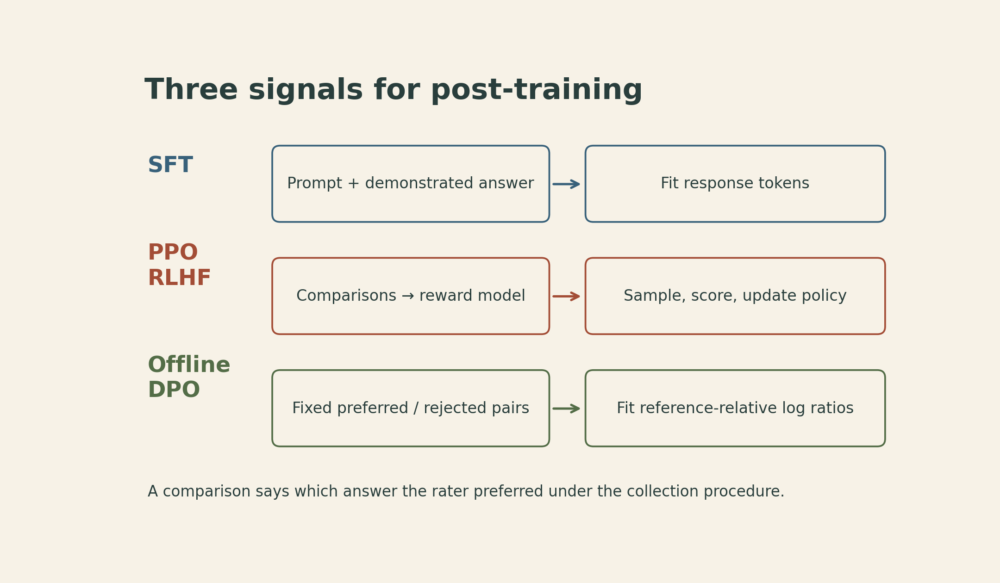
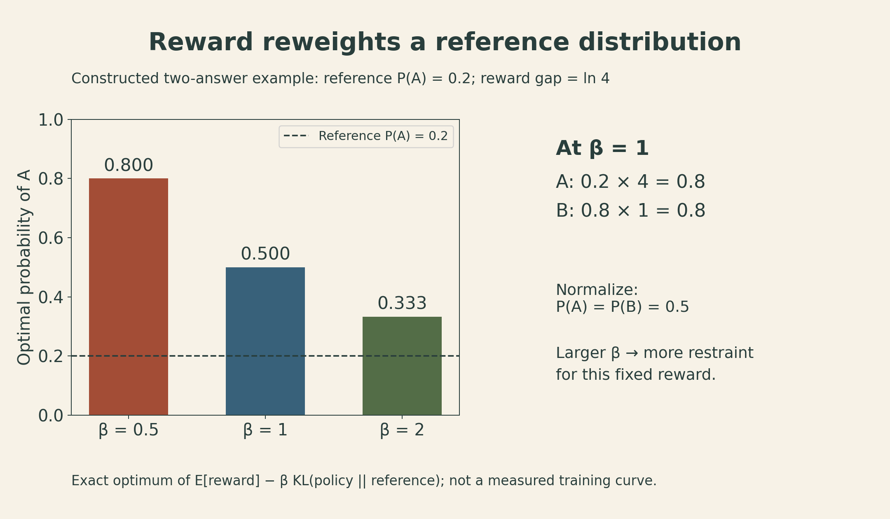
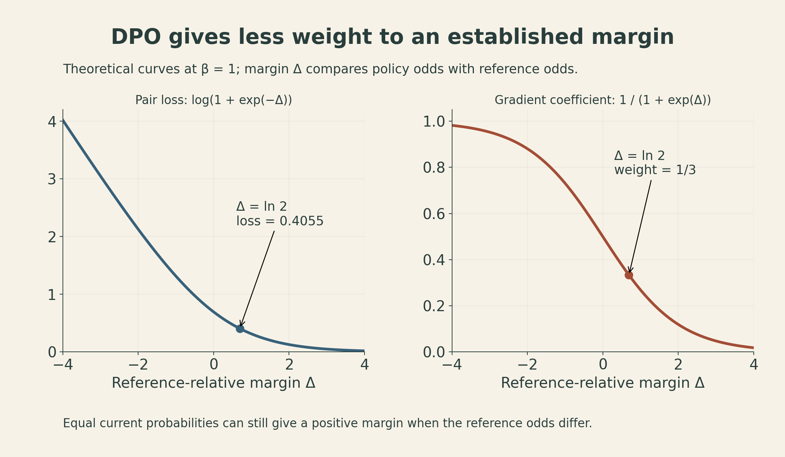

A model can produce a plausible continuation without answering the question it was asked. Post-training changes that behavior by changing the examples it learns from and, later, the criterion it optimizes.

The distinction running through Tatsunori Hashimoto's [CS336 Lecture 15](https://www.youtube.com/watch?v=2oH6PWPrYFo) is between **imitating a response distribution** and **favoring responses that receive higher reward**. Supervised fine-tuning, or SFT, teaches the model to reproduce demonstrations. Preference optimization teaches it to favor one answer over another. Both can improve an assistant, but neither turns a convincing answer into evidence that its content is true.

This distinction also explains why the data deserve as much attention as the optimizer. A preference label can reward correctness, formatting, length, or a mixture of all three. An optimizer sees the label; it does not automatically separate those reasons.

## Demonstrations teach content and behavior at the same time

For a prompt $x$ and demonstrated response $y=(y_1,\ldots,y_T)$, a response-only SFT objective is

$$
\mathcal L_{\mathrm{SFT}}(\theta)
=-\mathbb E_{(x,y)\sim\mathcal D_{\mathrm{SFT}}}
\left[\sum_{t=1}^{T}\log\pi_\theta(y_t\mid x,y_{<t})\right].
$$

Here $\pi_\theta$ is the model's conditional token distribution. Teacher forcing supplies the demonstration's preceding tokens. The sum makes this expression a sequence-level loss; implementations can use different token or example normalizations. Response-only masking is a choice, not a definition of all SFT: the lecture explicitly notes that some recipes also train on prompt tokens.

The loss is familiar next-token prediction. What changes is the target distribution. A terse classification label, a careful explanation, a refusal, and a structured tool call teach different output behavior even when all are reasonable targets for their tasks.

The lecture traces that change through several families of data:

| Data family | What the examples emphasize | What the label alone cannot establish |
| --- | --- | --- |
| FLAN-style instruction mixtures | Existing NLP tasks expressed as instructions | That benchmark response formats match a conversational user's needs |
| Self-Instruct, Alpaca, ShareGPT/Vicuna | Model-generated instructions in Self-Instruct and Alpaca; user-shared chats with model responses in ShareGPT | That plausible teacher outputs are correct |
| OpenAssistant | Human-written, often detailed responses | That the student can reliably recover every factual detail at inference |
| WizardLM and Tülu-style mixtures | More elaborate generated tasks and curated combinations | That one recipe transfers unchanged to every base model |
| Tool-use SFT, including the lecture's Nemotron examples | Structured assistant messages and tool-call arguments | That a generated call is authorized, executable, or successful |

These are differences in supervision, not a ranking of the datasets. A benchmark-style answer can be exactly right for a classification system. A chat assistant may need a different response shape.

{fig-alt="Three training signals: SFT fits demonstrated response tokens; PPO-based RLHF fits a reward model to comparisons and samples policy responses; basic offline DPO directly fits reference-relative policy log ratios to comparison labels."}

### A citation teaches more than a citation

Suppose a demonstration ends with a detailed reference. SFT rewards both the particular bibliographic tokens and the behavior of supplying a reference when asked. Those two things can generalize differently: the model may learn the citation format more readily than the facts needed to fill it correctly.

The lecture uses this example to discuss why adding factually correct but unfamiliar information can sometimes increase hallucination. That is a conditional empirical concern, not a theorem that SFT cannot teach knowledge. At roughly 34:26, Hashimoto also cautions that identifying which behaviors are already present after pretraining is not straightforward. The useful distinction is between eliciting a behavior and reliably acquiring new knowledge; fluent output does not tell us which occurred.

Style creates a related measurement problem. Longer, more detailed responses can win preference comparisons without improving a separate factual or task benchmark. A preference win rate and a capability score therefore answer different questions.

### Safety tuning has two directions of error

Refusing a harmful request and refusing a harmless request are different outcomes. The lecture's example of an overly cautious assistant rejecting a request to stop a Python process makes the tradeoff concrete: reducing harmful compliance is not enough if benign tasks become unusable.

The slides show substantial changes from a small safety dataset in a particular experimental setting. They also emphasize the long tail: a few hundred examples shifting measured behavior does not establish broad safety coverage. The Tülu discussion illustrates a data pipeline that mines user scenarios and jailbreak attempts, then constructs desired responses. The scenario distribution and the refusal policy remain part of what is being learned.

## Midtraining blurs the boundary with pretraining

The lecture describes a three-stage recipe: broad pretraining, a later mixture that includes higher-quality and instruction-style data, then a shorter instruction-tuning stage. The MiniCPM example changes the data mixture during the later phase, including more question-answer and chat material.

This connects directly to [Lecture 14's data-mixture accounting](lecture14-data-filtering-mixing.qmd). A dataset's influence depends on when it appears, how often it is sampled, and how much training remains. “Base model” by itself does not specify whether instruction-style data were already included.

There is no universally optimal boundary or mixture in this discussion. Hashimoto describes substantial trial and error, including ablations in a shorter decay phase. Mixing broad data with targeted data can help retain capabilities while changing behavior; it does not guarantee that forgetting disappears.

## A preference label includes a judgment process

People need not write the answer they would prefer when comparing alternatives. This gap between generation and judgment is one motivation for collecting comparisons rather than only more demonstrations.

Let $(x,y_w,y_l)$ denote a prompt, a preferred response, and a less-preferred response. The labels mean preferred **under the collection procedure**. They do not mean universally correct and incorrect.

Under a Bradley–Terry preference model, a scalar reward $r_\phi$ induces

$$
P_\phi(y_w\succ y_l\mid x)
=\sigma\!\left(r_\phi(x,y_w)-r_\phi(x,y_l)\right),
\qquad \sigma(z)=\frac{1}{1+e^{-z}}.
$$

Fitting comparisons amounts to minimizing

$$
\mathcal L_{\mathrm{RM}}(\phi)
=-\mathbb E_{\mathcal D_{\mathrm{pref}}}
\log\sigma\!\left(r_\phi(x,y_w)-r_\phi(x,y_l)\right).
$$

Only reward differences appear. Adding the same prompt-dependent constant to both rewards leaves the predicted preference unchanged. A scalar Bradley–Terry model also imposes structure on preferences; it cannot represent every pattern of disagreement or cyclic aggregate preference.

A dataset of pairs need not contain independent judgments. InstructGPT collected rankings of several responses to one prompt, producing correlated pairs. Its training grouped comparisons from the same prompt and averaged their losses, rather than treating repeated appearances of a completion as unrelated training examples. The expression above describes the pairwise loss; grouping and weighting are additional training decisions.

The label collection process matters here. The lecture discusses annotation guidelines, factual checking, worker expertise, time pressure, labor conditions, and demographic coverage. High agreement among raters can coexist with shared bias. Expert judgments can also differ from crowd judgments in which errors receive attention.

Model-generated feedback changes the cost and scale of collection, but it still has a judgment process. The lecture discusses strong system-level agreement in a particular GPT-4 evaluation study, synthetic feedback such as UltraFeedback, and Constitutional AI's use of principles and model-generated critique. Agreement in one setting does not certify individual judgments in another. Length and presentation can influence model judges too.

## PPO optimizes a reward while limiting drift

Here the episode is a prompt followed by one complete response and its reward: a contextual-bandit view. The derivation treats that complete response as the action. It does not model a multi-turn environment in which actions change future observations.

For a fixed prompt, consider the regularized objective

$$
J(\pi)=\sum_y\pi(y\mid x)r(x,y)
-\beta\sum_y\pi(y\mid x)
\log\frac{\pi(y\mid x)}{\pi_{\mathrm{ref}}(y\mid x)},
\qquad \beta>0.
$$

The reference is frozen, commonly an SFT policy in this setting. The first term favors high-reward answers; the second penalizes KL divergence from the reference. This is the standard core objective used for the following derivation. InstructGPT's PPO-ptx variant additionally mixes in a pretraining likelihood term; that term is not included here.

For a fixed reward and suitable differentiability conditions, the unregularized part has the policy-gradient identity

$$
\nabla_\theta\mathbb E_{y\sim\pi_\theta(\cdot\mid x)}[r(x,y)]
=\mathbb E_{y\sim\pi_\theta(\cdot\mid x)}
\left[r(x,y)\nabla_\theta\log\pi_\theta(y\mid x)\right].
$$

PPO-based RLHF obtains responses from the policy, scores them, estimates advantages, and updates the policy. PPO's clipped importance-ratio surrogate limits the incentive for some large updates relative to the rollout policy; it is not a hard guarantee on the actual KL distance. That local update control also differs from the KL penalty to a fixed reference model above. The lecture gives a conceptual introduction and leaves a fuller treatment of RL algorithms to the next session.

The engineering burden includes sampling, reward scoring, and coordinating changing policies. The next section derives DPO from this regularized objective; the finite-data training loss it produces differs from a PPO update.

## DPO replaces the explicit reward with a policy ratio

First solve the regularized problem over all distributions, rather than a particular neural-network family. Assume a finite response space for the derivation, with positive reference probabilities on that space. More generally, the normalizing sum must be finite and the policy must stay within the reference's support.

Introduce a multiplier $\lambda$ for $\sum_y\pi(y\mid x)=1$. The stationary condition is

$$
r(x,y)-\beta\left(\log\frac{\pi(y\mid x)}{\pi_{\mathrm{ref}}(y\mid x)}+1\right)+\lambda=0.
$$

For this finite response space and positive reference probabilities, the objective is strictly concave in the policy probabilities when $\beta>0$. The normalized stationary solution is therefore the unique maximizer. Normalization gives

$$
\pi_r(y\mid x)=\frac{\pi_{\mathrm{ref}}(y\mid x)e^{r(x,y)/\beta}}{Z(x)},
\qquad
Z(x)=\sum_y\pi_{\mathrm{ref}}(y\mid x)e^{r(x,y)/\beta}.
$$

The reward exponentially reweights the reference distribution. For a fixed reward, increasing $\beta$ keeps the optimum closer to the reference. This statement about the exact optimum should not be confused with a universal prediction about how changing $\beta$ affects a finite DPO training run.

{fig-alt="Constructed two-response example: a reference puts 0.2 probability on A and 0.8 on B. With reward advantage log 4 for A, the exact regularized optimum assigns A probabilities 0.800, 0.500, and 0.333 at beta 0.5, 1, and 2 respectively."}

### A two-answer calculation

Take the constructed response space $\{A,B\}$ with reference probabilities $0.2$ and $0.8$. Set $r(A)=\log 4$ and $r(B)=0$. At $\beta=1$, the unnormalized weights are $0.2\times4=0.8$ and $0.8\times1=0.8$, so the optimum is $0.5$ for each answer.

At $\beta=0.5$, A's multiplier becomes $16$, giving $3.2/(3.2+0.8)=0.8$. At $\beta=2$, it is $2$, giving $0.4/(0.4+0.8)=1/3$. These are exact calculations for this toy objective, not measured changes in a trained language model.

### The normalizing constant cancels in a comparison

Rearranging the optimal-policy equation yields

$$
r(x,y)=\beta\log\frac{\pi_r(y\mid x)}{\pi_{\mathrm{ref}}(y\mid x)}+\beta\log Z(x).
$$

For two responses to the same prompt, the $\beta\log Z(x)$ terms cancel. DPO parameterizes this reward difference through a trainable policy. Define

$$
\Delta_\theta=
\log\frac{\pi_\theta(y_w\mid x)}{\pi_{\mathrm{ref}}(y_w\mid x)}
-\log\frac{\pi_\theta(y_l\mid x)}{\pi_{\mathrm{ref}}(y_l\mid x)}.
$$

Substituting into the Bradley–Terry likelihood gives

$$
\mathcal L_{\mathrm{DPO}}(\theta)
=-\mathbb E_{\mathcal D_{\mathrm{pref}}}\log\sigma(\beta\Delta_\theta).
$$

This is the central change of variables in [Rafailov et al., Section 4 and Appendix A](https://arxiv.org/html/2305.18290v2). The basic offline algorithm trains on fixed preferred/rejected pairs without fitting a separate reward network or generating fresh on-policy responses during each update. The pairs still had to be generated and labeled. An outer pipeline can also generate new pairs between training rounds, as in the lecture's discussion of DPO with expert iteration.

The closed-form derivation assumes unrestricted policies. A finite neural network trained on finite, noisy comparisons is not guaranteed to attain that optimum or recover a uniquely correct human reward.

## The gradient responds to a relative margin

For one pair, write $z=\beta\Delta_\theta$ and $\ell(\theta)=-\log\sigma(z)$. Here $\Delta_\theta$ is the reference-relative margin, and $z$ is its scaled value. With the reference frozen,

$$
\nabla_\theta\ell
=-\beta\sigma(-z)
\left[\nabla_\theta\log\pi_\theta(y_w\mid x)
-\nabla_\theta\log\pi_\theta(y_l\mid x)\right].
$$

The coefficient $\beta\sigma(-z)$ weights the difference of log-probability gradients. At fixed $\beta$, an already large positive margin receives less weight. A negative margin receives more. With shared neural-network parameters, this direction does not guarantee that every preferred response's absolute probability increases after an update; what the loss directly targets is the reference-relative pair margin.

For a concrete pair, suppose the reference probabilities are $0.2$ for the preferred response and $0.4$ for the rejected response. Suppose the current policy assigns $0.3$ and $0.3$. Other responses carry the remaining mass in each distribution. Then

$$
\Delta_\theta=\log(0.3/0.2)-\log(0.3/0.4)=\log 2.
$$

At $\beta=1$, the implied preference probability is $\sigma(\log2)=2/3$, the loss is $\log(3/2)\approx0.4055$, and the gradient coefficient is $1/3$.

The two current response probabilities are equal, yet the DPO margin is positive. Relative to the reference, the preferred answer gained ground and the rejected answer lost ground. That is why raw current-policy odds alone are insufficient to interpret this loss.

{fig-alt="Theoretical DPO curves at beta one: loss softplus of minus the margin and gradient coefficient sigmoid of minus the margin both decrease as the reference-relative preference margin grows. At margin log 2, loss is 0.4055 and the coefficient is one third."}

Sequence probabilities also matter. In vanilla DPO,

$$
\log\pi_\theta(y\mid x)=\sum_{t=1}^{T}\log\pi_\theta(y_t\mid x,y_{<t}).
$$

Dividing by response length changes the score and therefore the objective. The lecture separately discusses length-normalized DPO and SimPO. SimPO removes the explicit reference term and uses an average log-probability score with a target margin; it is not just the vanilla formula with a bookkeeping change.

## Better preference optimization still needs an independent check

The lecture closes with reward overoptimization, reduced diversity, and calibration. A learned preference reward is a proxy. Increasing it can eventually stop improving the quality measured by an independent evaluator. KL regularization discourages drift, but does not prove that the proxy captures everything the user values.

Likewise, a reward-optimized policy remains a probability distribution. What changes is its training purpose: it is being pushed toward high-reward answers rather than simply fitting the diversity of demonstrated text. Its probabilities are not automatically calibrated estimates of factual correctness, and concentrating on a narrow set of outputs can reduce diversity.

This is why a DPO-versus-PPO comparison needs the data, reference model, reward or judge, optimization budget, and evaluation protocol attached. The lecture shows that rankings can change with the recipe. A smaller training loop is an engineering benefit; it is not evidence that one algorithm is universally more truthful or more capable.

The next lecture turns to verifiable rewards. The question carries forward: what exactly is rewarded, what does the feedback fail to measure, and how does optimizing it change the answers the model explores?

## Lecture and further reading

- [Stanford CS336 Spring 2026 course schedule](https://cs336.stanford.edu/).
- [Lecture 15 slides, fixed repository snapshot](https://github.com/stanford-cs336/lectures/blob/de53a9f979a6ee35f7d13a5e1aadee5ea1afc58e/lecture_15.pdf): SFT and data, pp. 6–30; feedback collection, pp. 31–48; PPO and DPO, pp. 49–61; limitations, pp. 62–65.
- [Ouyang et al., Training language models to follow instructions with human feedback](https://arxiv.org/abs/2203.02155), Sections 3.1–3.5.
- [Rafailov et al., Direct Preference Optimization](https://arxiv.org/html/2305.18290v2), Sections 3–4 and Appendix A.

[Watch the official Lecture 15 recording on YouTube](https://www.youtube.com/watch?v=2oH6PWPrYFo){.btn .btn-outline-primary}
