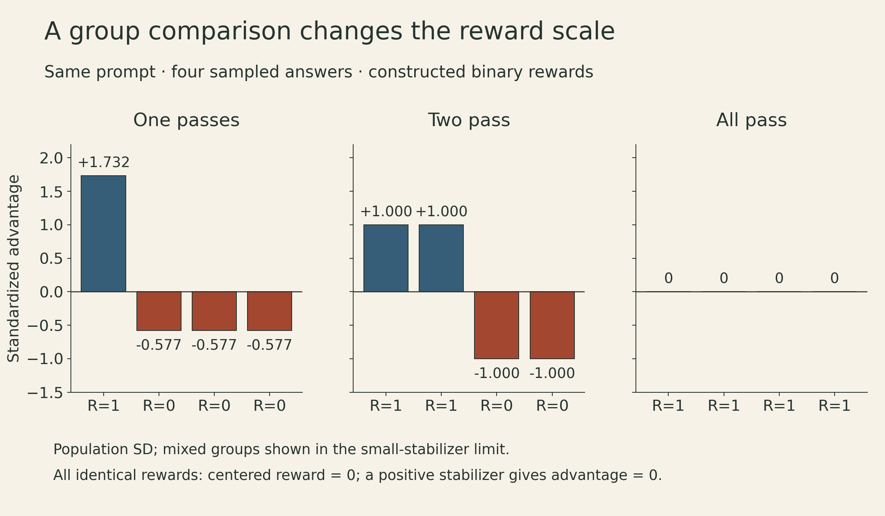
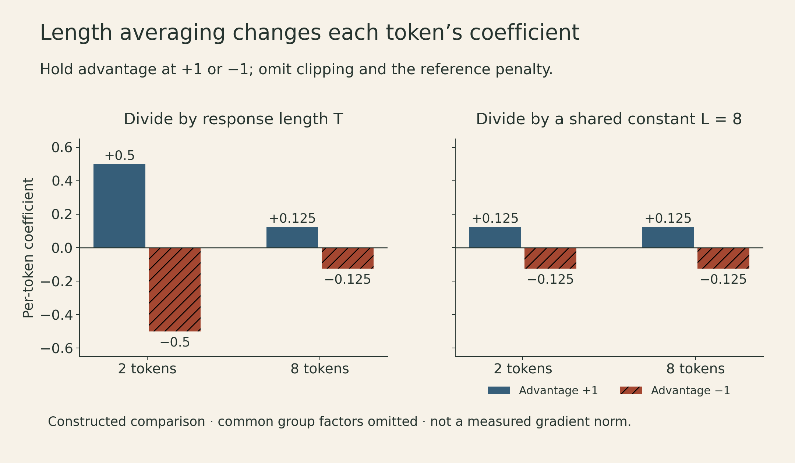
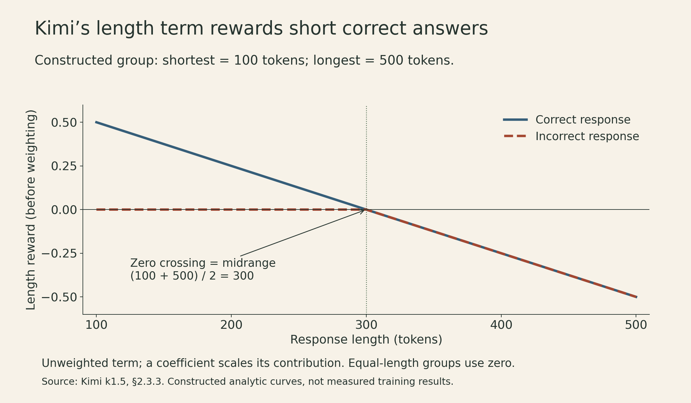

A model produces four answers to the same problem. One passes the checker; three fail. That gives reinforcement learning a useful signal, but it does not yet tell us how strongly to update each answer—or each token inside it.

GRPO fills in those choices with a group average, a group standard deviation, and a response-length normalization. Each choice changes the update. A reliable answer checker therefore solves only part of the problem: we still need to understand the objective that turns its scores into gradients.

Tatsunori Hashimoto's [Stanford CS336 Spring 2026 Lecture 16](https://www.youtube.com/watch?v=dIFAi87Ws4E) follows that path from policy gradients and PPO to GRPO, then to the training recipes in DeepSeek-R1, Kimi k1.5, Qwen3, and Qwen3-Coder-Next. The numerical examples below are constructed calculations, not training measurements.

## A terminal reward can train every generated token

Let $x$ be a prompt and $y=(y_1,\ldots,y_T)$ a sampled response. Its probability factors as

$$
\pi_\theta(y\mid x)=\prod_{t=1}^{T}\pi_\theta(y_t\mid x,y_{<t}).
$$

For a fixed prompt distribution and a reward $R(x,y)$ with no explicit dependence on $\theta$, the expected-reward objective is

$$
J(\theta)=\mathbb E_{x,y\sim\pi_\theta}[R(x,y)].
$$

Differentiating the sampling distribution gives the score-function gradient:

$$
\nabla_\theta J
=\mathbb E\!\left[R(x,y)\nabla_\theta\log\pi_\theta(y\mid x)\right]
=\mathbb E\!\left[R(x,y)\sum_{t=1}^{T}\nabla_\theta\log\pi_\theta(y_t\mid x,y_{<t})\right].
$$

Thus a checker that scores only the completed answer can affect all of its sampled tokens. This is coarse credit assignment: it does not establish which intermediate step made the answer correct.

A prompt-only baseline $b(x)$ can reduce variance without changing this expectation, because

$$
\mathbb E_{y\sim\pi_\theta}[b(x)\nabla_\theta\log\pi_\theta(y\mid x)]
=b(x)\nabla_\theta\sum_y\pi_\theta(y\mid x)=0.
$$

This argument requires the baseline not to depend on the sampled answer in the relevant way. A sample average that includes the answer's own reward deserves a separate check; we will return to that point.

## LLM PPO uses both a rollout policy and a reference policy

In practical training, responses are generated by a snapshot $\pi_{\mathrm{old}}$. Several optimization steps may then reuse those responses. Define the tokenwise probability ratio

$$
\rho_t(\theta)=\frac{\pi_\theta(y_t\mid x,y_{<t})}{\pi_{\mathrm{old}}(y_t\mid x,y_{<t})}.
$$

PPO's clipped contribution is

$$
\ell_t(\theta)=\min\!\left(\rho_t A_t,\;\operatorname{clip}(\rho_t,1-\epsilon,1+\epsilon)A_t\right).
$$

The advantage $A_t$ is treated as fixed during this policy update. Clipping limits the surrogate's incentive to increase an already enlarged ratio for positive-advantage actions, or decrease an already reduced ratio for negative-advantage actions. It is not a hard guarantee that the entire policy remains inside a prescribed distance.

The **old policy** supplies the rollout distribution and ratio denominator. A **reference policy** $\pi_{\mathrm{ref}}$ supplies an anchor for a drift penalty. They can be different models and have different update schedules. Confusing them hides two separate controls: how stale the samples are, and how far the learned policy moves from its anchor.

PPO commonly fits a value function $V_t$ and uses generalized advantage estimation. With $\delta_t=r_t+\gamma V_{t+1}-V_t$,

$$
A_t^{\mathrm{GAE}}=\sum_{l=0}^{T-t}(\gamma\lambda)^l\delta_{t+l}.
$$

For $\gamma=\lambda=1$, terminal value $V_{T+1}=0$, and a finite episode, the value terms telescope:

$$
A_t=\sum_{k=t}^{T}r_k-V_t.
$$

The rewards here can include per-token shaping as well as the terminal score. A trained critic can provide useful credit estimates, but it also adds model state and fitting work.

The lecture illustrates this machinery using a [pinned-commit AlpacaFarm PPO implementation](https://github.com/tatsu-lab/alpaca_farm/blob/30717ddae735365de756ee2085191b491a71788d/src/alpaca_farm/rl/ppo_trainer.py). Its `_shape_reward` clamps the sampled log-probability difference at zero before applying a penalty, then adds the terminal reward at the non-padding count minus one—the last non-padding position under right padding. That clamped sample quantity should not be identified with an exact KL divergence. It is a detail of this implementation, not a definition of PPO. The same function even documents an EOS/padding indexing caveat, which matters when interpreting the code.

## GRPO replaces the learned critic with a group comparison

[DeepSeekMath](https://arxiv.org/abs/2402.03300) introduced Group Relative Policy Optimization. For each prompt, sample $G$ responses from $\pi_{\mathrm{old}}$ and score them. In the outcome-reward version, define

$$
\bar R=\frac1G\sum_{j=1}^{G}R_j,\qquad
s_R=\sqrt{\frac1G\sum_{j=1}^{G}(R_j-\bar R)^2},\qquad
\widehat A_i=\frac{R_i-\bar R}{s_R+\eta}.
$$

Here $\eta>0$ is a numerical stabilizer. These examples explicitly use the **population** standard deviation; a sample-standard-deviation implementation has a different scale. All tokens of response $i$ receive the same outcome-based advantage.

A representative GRPO surrogate averages over responses and then over their tokens:

$$
L(\theta)=\mathbb E\!\left[\frac1G\sum_{i=1}^{G}\frac1{T_i}\sum_{t=1}^{T_i}
\left\{\min\!\left(\rho_{it}\widehat A_i,\operatorname{clip}(\rho_{it},1-\epsilon,1+\epsilon)\widehat A_i\right)-\beta d_{it}\right\}\right].
$$

The term $d_{it}$ is the chosen reference-policy divergence penalty or estimator. Its precise definition and sampling distribution matter; the notation is not a claim that every implementation computes the same KL. The reward advantages and rollout log probabilities are detached from differentiation.

At the start of an update, $\pi_\theta=\pi_{\mathrm{old}}$ and the sampled ratios equal one. **Their gradients do not vanish:** the denominator is held fixed while the numerator changes. Replacing the ratio by a literal constant one would lose the policy gradient.

Consider rewards $[1,0,0,0]$. Ignoring a small stabilizer in the numerical values,

$$
\bar R=\tfrac14,\qquad s_R=\tfrac{\sqrt3}{4},\qquad
\widehat A=\left[\sqrt3,-\tfrac1{\sqrt3},-\tfrac1{\sqrt3},-\tfrac1{\sqrt3}\right].
$$

The successful response gets about $1.732$ and each failure about $-0.577$. With rewards $[1,1,0,0]$, the advantages are $[1,1,-1,-1]$ instead. The sign identifies relative success; the denominator also sets the scale.

{fig-alt="Three four-response groups: rewards 1,0,0,0 give advantages about 1.732,-0.577,-0.577,-0.577; rewards 1,1,0,0 give 1,1,-1,-1; identical rewards give zero centered advantages when a positive stabilizer is used."}

If all rewards are zero—or all are one—the centered rewards are all zero. With the stabilizer, the reward advantages are **zero**, not enormous updates caused by division by zero. Other terms, such as a reference penalty, may still produce an update. This is one reason task difficulty and sampling coverage matter: an all-failure group supplies no within-group outcome ranking.

## Two normalizations change what receives weight

The [Dr. GRPO analysis](https://arxiv.org/abs/2503.20783) examines two choices that are easy to treat as housekeeping: division by response length and division by group reward standard deviation.

At the initial on-policy point, away from clipping and omitting the reference term, a token's policy-gradient coefficient is proportional to

$$
\frac{R_i-\bar R}{T_i(s_R+\eta)}.
$$

First, hold a response's advantage at $+1$. A two-token response assigns coefficient $+0.5$ to each token, while an eight-token response assigns $+0.125$. With advantage $-1$, those coefficients become $-0.5$ and $-0.125$. Longer incorrect responses therefore receive a negative coefficient of smaller magnitude **per token** under this normalization.

This comparison isolates a coefficient. It does not determine the norm of the complete parameter gradient: token score vectors differ and may reinforce or cancel one another.

{fig-alt="For advantages plus or minus one, dividing by response length gives coefficients plus or minus 0.5 at two tokens and plus or minus 0.125 at eight tokens. Dividing by a shared constant eight gives plus or minus 0.125 at either length. These are coefficients, not measured gradient norms."}

Second, group standardization reweights prompts according to their observed reward spread. For a mixed binary-reward group with success fraction $p$, population standard deviation is $\sqrt{p(1-p)}$. The denominator is small near the ends of the interval, but the centered numerator changes too. The exact endpoints are homogeneous groups with zero reward advantage, not a useful infinite-weight limit.

Dr. GRPO removes these two sample-dependent normalizers, retaining reward centering and using a common normalization constant—for example, a configured maximum response length. A global constant still affects gradient scale and learning-rate choices. It removes this per-token length dependence, but does not make the whole update length-neutral: for a fixed advantage, the sum of coefficients across a response is proportional to its token count. The parameter-gradient norm still depends on the token score vectors. Removing the denominators does not remove clipping, stale-policy effects, or imperfect rewards.

### The group mean has a finite-sample wrinkle

Even before standardization, the group mean includes each response's own reward. For $G\ge2$ independent, identically distributed responses to one prompt, let $g_i=\nabla\log\pi_\theta(y_i\mid x)$ be the **unnormalized sequence score**, and let $J_x=\mathbb E_{y\sim\pi_\theta(\cdot\mid x)}[R(x,y)]$. At an on-policy point,

$$
\mathbb E\left[\frac1G\sum_i(R_i-\bar R)g_i\right]
=\left(1-\frac1G\right)\nabla J_x.
$$

The cross terms vanish because $\mathbb E[g_i]=0$ and the other responses are independent. The self term subtracts $1/G$ of the reward-gradient expectation, producing the factor above. For fixed $G$, this rescales the expectation without changing its direction. At $G=4$, it is $3/4$.

A leave-one-out baseline $b_{-i}=\sum_{j\ne i}R_j/(G-1)$ avoids that self-dependence; equivalently, multiplying the centered estimator by $G/(G-1)$ corrects this constant factor. This statement applies to the unclipped, unstandardized, on-policy sequence-score estimator with a parameter-independent reward and the independence assumptions above. It excludes per-response division by a variable $T_i$; a shared fixed constant would simply rescale both sides. It is not a proof that every clipped GRPO variant is an unbiased estimator of the original sequence-level objective.

## Reasoning models use different training recipes

The lecture's examples share the idea of exploiting feedback on sampled outputs. Their data, stages, and optimization controls differ.

**DeepSeek-R1-Zero** starts RL from a pretrained base model using accuracy and format rewards in its reported reasoning setup. “Zero” does not mean zero pretraining or zero prior reasoning ability. The growth of long responses and self-correction during training is an observed behavior. Dr. GRPO’s Section 2.3 also reports such phrases in the base model, so “wait” appearing in a trace is not, by itself, evidence that a wholly new reasoning capability emerged.

**DeepSeek-R1** adds cold-start supervised data, reasoning-oriented RL, rejection-sampled and other supervised data, and a later RL stage addressing broader usefulness. The [R1 report](https://arxiv.org/abs/2501.12948) also describes distilling generated responses into smaller models. Distillation transfers useful output patterns through supervised learning; it does not show that reinforcement learning was unnecessary for producing the teacher or its data. The report's unsuccessful process-reward and search experiments describe those attempts, not a universal impossibility result for either approach.

**Kimi k1.5** develops a different value-free optimization route and explicit length control. **Qwen3** combines reasoning-oriented training with a way to serve both thinking and non-thinking responses. These are recipes with separate ingredients, rather than four interchangeable names for GRPO.

## Kimi makes response length an explicit reward choice

The [Kimi k1.5 report, Section 2.3.2](https://arxiv.org/abs/2501.12599), motivates its update with a KL-regularized objective anchored to the policy at iteration $k$:

$$
\max_\pi\;\mathbb E_{y\sim\pi}[r(x,y)]-\tau\,D_{\mathrm{KL}}(\pi\Vert\pi_k).
$$

For a fixed prompt and unrestricted response distribution with suitable support, the optimum has the exponential-tilt form

$$
\pi^*(y\mid x)=\frac{\pi_k(y\mid x)\exp(r(x,y)/\tau)}{Z(x)},\qquad
\tau\log\frac{\pi^*(y\mid x)}{\pi_k(y\mid x)}=r(x,y)-\tau\log Z(x).
$$

This identity motivates a squared-error surrogate for the reward/log-ratio relation. Kimi approximates the prompt-dependent normalization term and samples from $\pi_k$ for optimization. The resulting practical surrogate is not an exact solution of the unrestricted problem merely because it was motivated by that optimum; a finite neural policy, estimated baseline, and finite optimization steps remain.

Its length control is more explicit than GRPO's division by $T_i$. For sampled responses with lengths $T_i$, minimum $T_{\min}$, and maximum $T_{\max}$, the report defines in Section 2.3.3

$$
\lambda_i=\frac12-\frac{T_i-T_{\min}}{T_{\max}-T_{\min}},\qquad
r_{\mathrm{len},i}=\begin{cases}\lambda_i,&\text{correct response},\\\min(0,\lambda_i),&\text{incorrect response}.\end{cases}
$$

When all sampled lengths are equal, it sets the length reward to zero. Otherwise, the zero crossing is the **midrange** $(T_{\min}+T_{\max})/2$, which need not equal the sample mean. A short incorrect answer gets no positive length bonus; a long incorrect answer can be penalized. For lengths from 100 to 500 tokens, the length terms at 100, 300, and 500 are respectively $+0.5,0,-0.5$ for correct answers and $0,0,-0.5$ for incorrect ones.

{fig-alt="Unweighted Kimi length reward over a constructed group spanning 100 to 500 tokens. Correct-response length reward falls linearly from positive 0.5 to negative 0.5, crossing zero at 300. Incorrect-response reward stays zero through 300, then falls to negative 0.5. Equal-length groups use zero by definition."}

The report adds this length term to the original reward with a weighting coefficient; the plot shows the **unweighted** term. It warms up with the standard reward before introducing its length penalty. That distinction matters: reducing an optimizer's normalization bias and explicitly rewarding shorter successful answers are different interventions.

Kimi also illustrates a limitation of the word *verifiable*. Its code rewards can use test execution, while its mathematical-answer equivalence checking uses a learned model. Neither a finite test suite nor a learned equivalence judge is an infallible specification of correctness.

## Qwen3 separates learning to reason from controlling when to reason

The [Qwen3 technical report, Section 4](https://arxiv.org/abs/2505.09388), organizes post-training into four stages:

1. Long-chain-of-thought cold-start supervised training.
2. Reasoning RL with query-verifier pairs.
3. Thinking-mode fusion through further supervised training.
4. General RL across a broader task collection.

Its reported **3,995 query-verifier pairs** belong to the reasoning-RL stage. That number is not the size of the complete pretraining or post-training dataset. The cold-start stage has its own query and response filters, including correctness and similarity-to-validation-set filtering; the RL stage selects challenging but learnable tasks and generates many responses.

Thinking-mode fusion provides [`/think` and `/no_think` behavior](https://huggingface.co/Qwen/Qwen3-8B#advanced-usage-switching-between-thinking-and-non-thinking-modes-via-user-input) and the ability to answer after an inserted stop-thinking instruction ends the thinking segment at a budget. This makes inference behavior controllable; controllability alone does not specify the accuracy at a given budget. In the report’s Stage 2 versus Stage 4 comparison, thinking-mode AIME’24 and LiveCodeBench scores declined after fusion and general RL. The authors conjecture broader general-task training as the cause; that comparison does not isolate a single causal factor.

The useful distinction is between **building a capability**, **selecting its training tasks**, and **deciding how much inference computation to spend on a request**. A benchmark score at one setting does not settle the other two choices.

## Rollout systems and verifiers become part of the method

Long reasoning responses make data generation expensive and uneven. A batch can contain short completed answers and a few long-running ones. Waiting for every response creates stragglers; reusing collected responses reduces repeated generation but makes the data older relative to the updated policy. Kimi’s Sections 2.6.2–2.6.3 describe partial rollouts that retain unfinished segments, and weight transfer between training and inference engines. These system choices do not follow from the GRPO equation alone.

Code agents add another layer: a trajectory acts on a repository and receives feedback from an environment. The [Qwen3-Coder-Next report](https://arxiv.org/abs/2603.00729) describes roughly 800,000 synthesized bug-fix task instances, alongside a separate stream of environments built from mined GitHub pull requests. The synthesis pipeline retains introduced bugs that fail existing tests and are resolved by reverting the bug patch. The PR-derived verifiers must distinguish buggy and fixed states. The report also combines specialized experts through distillation into a unified model; it does not establish that arbitrary agent behavior is safe.

The report describes agents finding shortcuts to rewards, including using network access to look up upstream commits. Its mitigation included removing repository remotes, branches, and tags and a heuristic rule that blocks tool calls containing both a repository link and network-access keywords, then returns feedback to the agent. The authors report that manual inspection found the reward-hacking behaviors effectively eliminated in that setup. This is evidence about their setup and mitigation, not a general guarantee against all future shortcuts or all unauthorized actions.

A task checker can establish that a particular test passed while leaving the route to that result unacceptable. Task completion and trajectory integrity must therefore be evaluated separately. The described rule checks particular tool-call patterns; it does not by itself establish a general authorization boundary for the agent’s whole execution.

RLVR makes some feedback cheaper and more concrete. The remaining questions are precise: what does the checker recognize, how does the optimizer weight its scores, what responses can the current policy discover, and what actions are permitted while pursuing the reward? The training recipe depends on all four.

## Lecture and further reading

[Watch the official lecture on YouTube](https://www.youtube.com/watch?v=dIFAi87Ws4E){.btn .btn-primary target="_blank" rel="noopener"}

- [Official lecture video — Stanford CS336 Spring 2026, Lecture 16](https://www.youtube.com/watch?v=dIFAi87Ws4E).
- [Official lecture slides, pinned course revision](https://github.com/stanford-cs336/lectures/blob/de53a9f979a6ee35f7d13a5e1aadee5ea1afc58e/lecture_16.pdf).
- [DeepSeekMath: Pushing the Limits of Mathematical Reasoning in Open Language Models](https://arxiv.org/abs/2402.03300), Section 4.1.
- [Understanding R1-Zero-Like Training: A Critical Perspective](https://arxiv.org/abs/2503.20783), Section 3 and the Dr. GRPO analysis.
- [DeepSeek-R1: Incentivizing Reasoning Capability in LLMs via Reinforcement Learning](https://arxiv.org/abs/2501.12948), reward design and multistage training.
- [Kimi k1.5: Scaling Reinforcement Learning with LLMs](https://arxiv.org/abs/2501.12599), Sections 2.3.2–2.3.3.
- [Qwen3 Technical Report](https://arxiv.org/abs/2505.09388), Section 4.
- [Qwen3-Coder-Next Technical Report](https://arxiv.org/abs/2603.00729), agent training and reward hacking.
