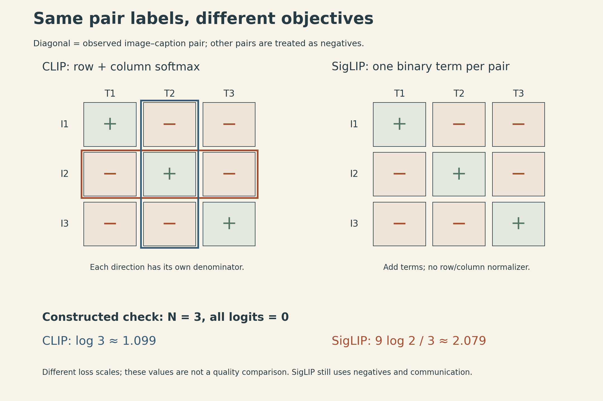
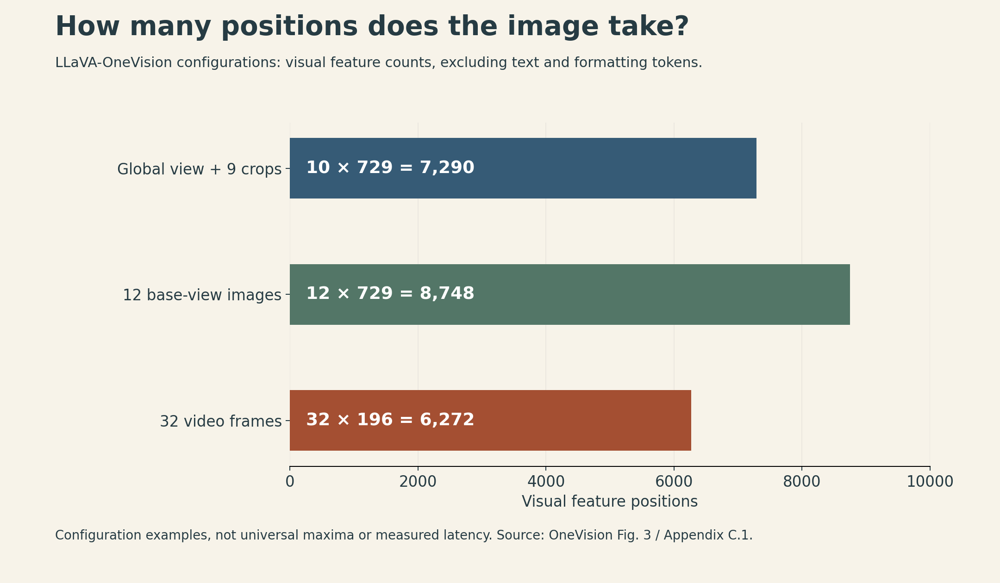
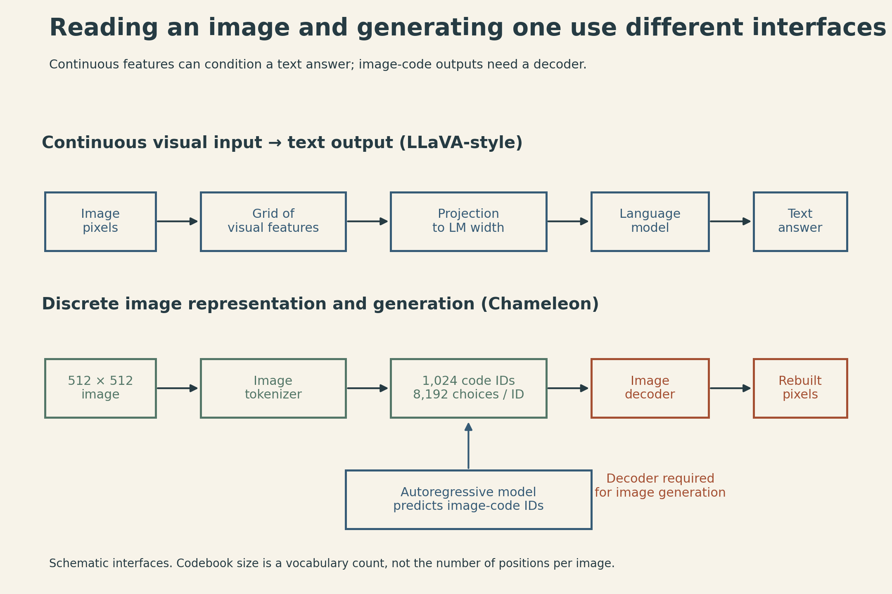

A photograph contains enough information to recognize a restaurant, read a price on its menu, or reconstruct the lettering and lighting. Those tasks do not need the same representation.

An image embedding trained to match a caption can retain the scene's meaning without retaining every character. A language model answering a question about the menu needs access to finer spatial features. A model generating the image needs a representation that a decoder can turn back into pixels.

Stanford CS336 Lecture 17 connects these choices through CLIP, SigLIP, the LLaVA and Qwen-VL families, and Chameleon. The useful question throughout is: **what information reaches the language model, in how many positions, and under which training objective?**

## CLIP learns which image and text belong together

Start with a batch of $N$ paired images and captions. Let $u_i$ and $v_i$ be their image and text embeddings, each normalized to unit length. With a learned positive scale $\alpha$, the similarity matrix is

$$
s_{ij}=\alpha u_i^\top v_j.
$$

The diagonal contains the observed pairs. CLIP trains each image to identify its paired caption among the batch's captions, and each caption to identify its paired image:

$$
\mathcal L_{\mathrm{CLIP}}=-\frac{1}{2N}\sum_{i=1}^N
\left[\log\frac{e^{s_{ii}}}{\sum_{j=1}^N e^{s_{ij}}}
+\log\frac{e^{s_{ii}}}{\sum_{j=1}^N e^{s_{ji}}}\right].
$$

There are two normalization directions. An image-to-text probability depends on the other captions in its row; a text-to-image probability depends on the other images in its column. An off-diagonal pair is treated as a negative by the training setup, even when its caption could also describe the image. The pairing labels are imperfect supervision, not a guarantee that every negative is semantically wrong.

This objective gives a direct route to zero-shot classification. Encode candidate descriptions such as “a photo of a dog” and “a photo of a cat,” compare them with the image embedding, and choose the highest-scoring candidate. The model selects among supplied descriptions; this operation does not generate an unrestricted answer. [CLIP, §3.1.2–3.1.4](https://arxiv.org/abs/2103.00020).

CLIP's image encoder also needs to be specified. The original paper studies both modified ResNets and Vision Transformers. Its attention pooling with an average-pooled query belongs to the ResNet branch. These are not interchangeable descriptions of every CLIP encoder. The reported ViT-L/14@336px model uses 336-pixel resolution; that is a particular checkpoint, not the input resolution of all CLIP models. The text encoder produces its representation from the end-of-text position. [CLIP, §2.3–2.5](https://arxiv.org/abs/2103.00020).

## SigLIP changes the loss, not the need for negative examples

SigLIP uses a binary decision for each image–text pair. Define the label $y_{ij}=+1$ for an observed pair and $-1$ otherwise, and include a learned bias $b$:

$$
z_{ij}=\alpha u_i^\top v_j+b,\qquad
\mathcal L_{\mathrm{sig}}=\frac1N\sum_{i=1}^N\sum_{j=1}^N
\log\left(1+e^{-y_{ij}z_{ij}}\right).
$$

The $1/N$ normalization follows the paper's Algorithm 1; averaging over all $N^2$ pairs would give a different loss scale. The positive scale and bias are learned. The bias matters because a batch has $N$ positives and $N(N-1)$ negatives.

Each pair contributes a logistic loss without a row or column softmax denominator. For one unnormalized pair term, its logit derivative is

$$
\frac{\partial \ell_{ij}}{\partial z_{ij}}
=-y_{ij}\,\sigma(-y_{ij}z_{ij}),
$$

where $\sigma$ is the sigmoid function. Positive pairs push their logits upward; negative pairs push them downward. Shared encoder parameters still couple the training updates, even though the loss can be accumulated pair by pair.

{fig-alt="Two three-by-three image-caption grids have positive diagonal cells and negative off-diagonal cells. The CLIP panel highlights an entire row and column as separate softmax groups. The SigLIP panel labels each cell as an individual logistic-loss term. A lower calculation shows all logits equal to zero giving CLIP loss log 3 and SigLIP loss 3 log 2 with the paper's one-over-N normalization."}

A constructed example makes the normalization visible. Set all logits to zero in a batch of three pairs. CLIP gives each candidate probability $1/3$, so its average loss is $\log 3\approx1.099$. SigLIP has nine terms of $\log2$, divided by three, giving $3\log2\approx2.079$. The larger number does not mean the model is worse: these are different objectives with different scales.

The systems advantage is that SigLIP can accumulate blocks of pair losses. Its distributed scheme circulates text representations among devices and sums the resulting contributions, rather than needing a global softmax normalization. **It still communicates representations and evaluates negatives.** Changing batch size also changes the number and composition of negatives; the method does not make batch size irrelevant. Speed and memory claims depend on the implementation and workload. [SigLIP, Algorithm 1 and §3](https://arxiv.org/abs/2303.15343v4).

## LLaVA passes visual features into a language model

A contrastive image encoder and a language model do not automatically speak the same internal language. LLaVA connects them with a trainable projection.

Using row-vector notation, suppose the vision encoder returns $M$ grid features of width $d_v$. A linear projection maps them to the language model's embedding width $d$:

$$
Z\in\mathbb R^{M\times d_v},\quad W\in\mathbb R^{d_v\times d},\quad H_v=ZW\in\mathbb R^{M\times d}.
$$

The $M$ projected vectors become visual positions in the language model's input. They have the same width as text embeddings, but they are continuous features, not entries from the model's word-token vocabulary. In particular, LLaVA uses a sequence of CLIP grid features, rather than the single pooled embedding used for image–text retrieval.

The original LLaVA training recipe separates two stages:

- **Feature alignment:** freeze the vision encoder and language model; train the projection on image–caption pairs.
- **Instruction tuning:** keep the vision encoder frozen, but update the projection and language model using instruction data.

Its initial visual instruction dataset was constructed by giving a text-only GPT-4 model captions and bounding-box descriptions, then pairing the resulting instructions with the images. That method supplies a training signal; it does not make the generated descriptions infallible. [LLaVA, §3–4](https://arxiv.org/abs/2304.08485).

“Alignment” here includes making visual features usable by the language model. This interface alignment is not evidence that the resulting assistant has passed a safety evaluation.

## Higher resolution has to fit into a sequence

LLaVA-OneVision retains the encoder–projector–language-model structure, using SigLIP, a two-layer MLP, and Qwen2. Its representation strategy changes with the input: one detailed image, several images, or video frames.

A high-resolution single image can supply both a resized global view and a set of crops. The global view preserves broad layout; the crops expose smaller details. But every retained feature position also occupies part of the language model's context. OneVision therefore uses bilinear interpolation to reduce feature-grid size when needed.

For a base grid containing $T$ features and $C$ crops, the count before that reduction is

$$
L_{\mathrm{visual}}=(C+1)T.
$$

The extra one is the global view. The paper's illustrated configurations use 729 positions per base image and fewer positions per video frame. Appendix C.1 gives the following upper bounds for those settings; actual counts can be lower with fewer crops or after resizing, feature reduction, or removal of padding:

| Input configuration in OneVision | Maximum visual feature count in this setting |
|---|---:|
| One global view plus 9 crops | $10\times729=7{,}290$ |
| 12 images, one base view each | $12\times729=8{,}748$ |
| 32 video frames, reduced to 196 positions each | $32\times196=6{,}272$ |

These are configured upper bounds in the cited setup, not universal architectural limits or the complete text-plus-image sequence length. They exclude surrounding prompt text and formatting tokens. Nor are they speed measurements: encoder work, attention, sequence packing, and implementation details still matter. [LLaVA-OneVision, Figure 3 and Appendix C.1](https://arxiv.org/abs/2408.03326).

{fig-alt="Horizontal bars start at zero and compare three OneVision configurations: a global view plus nine crops, 7290 visual features; twelve base-resolution images, 8748; and thirty-two video frames with 196 features per frame, 6272. Each bar includes its multiplication. The counts are upper bounds for these cited settings; actual counts can be lower after preprocessing. The chart excludes text and formatting tokens and does not represent measured latency."}

This budget explains why video is more than repeating a high-resolution image prompt. Keeping many frames at full feature density may exhaust the context before the model sees much time. Reducing positions per frame trades spatial detail for temporal coverage. Whether that trade helps depends on the question: reading a small timestamp and recognizing an action across several seconds put different demands on the representation.

OneVision's training progression also matters. It first trains the projector for alignment, then trains the full model on high-quality knowledge data, and finally uses visual instruction data spanning these input types. Its cross-scenario demonstrations show useful transfer in the reported tasks; they do not prove that any image-trained model understands arbitrary videos. [LLaVA-OneVision, §5 and Table 1](https://arxiv.org/abs/2408.03326).

## Qwen-VL makes compression and position explicit

The original Qwen-VL uses an OpenCLIP ViT-bigG encoder and a cross-attention adapter. A fixed set of learned queries compresses the encoder's features into **256 visual vectors**, with two-dimensional position information included in the adapter. This differs from simply passing every patch feature through a linear projection. The 256-vector figure describes the compressed visual sequence; image boundary tokens are additional positions.

Qwen-VL can also express bounding boxes as structured text. Generating coordinates that identify a region is a visual grounding capability, not the same operation as generating the region's pixels. Its training progresses from visual pretraining with the language model frozen, through joint training, to instruction tuning with the vision encoder frozen. [Qwen-VL, §2–3](https://arxiv.org/abs/2308.12966).

Qwen2-VL replaces a fixed input size with a dynamic-resolution approach. After the ViT, a merger compresses each adjacent $2\times2$ block of visual features into one vector. For the paper's $224\times224$ example and patch size 14,

$$
N_{\mathrm{patch}}=(224/14)^2=256,\qquad
N_{\mathrm{visual}}=256/4=64.
$$

With a start marker and an end marker, the image occupies **66 sequence positions**. Calling all 66 positions visual patch features would hide the distinction between content and delimiters. For other image sizes, the count depends on the actual resized dimensions and preprocessing rules.

Position also has more structure than a single token index. Qwen2-VL's Multimodal Rotary Position Embedding, or M-RoPE, divides rotary dimensions among time, height, and width. Text uses the same position IDs across those components; a still image has a constant temporal coordinate and varying spatial coordinates; video adds progression through time. These coordinates help describe where a feature came from. They do not recover pixels that preprocessing discarded. [Qwen2-VL, §2.1](https://arxiv.org/abs/2409.12191).

## Qwen3-VL adds visual information at several depths

Qwen3-VL continues the encoder–merger–language-model design, with a SigLIP2-based vision encoder and a Qwen3 backbone. Three changes in its report make the interface more specific:

1. **Interleaved M-RoPE:** distribute temporal and spatial components across rotary frequency bands, rather than assigning each axis a separate contiguous frequency range.
2. **DeepStack:** extract intermediate vision features at three levels, project them with dedicated mergers, and add them to corresponding hidden states in the first three language-model layers. The input embedding is no longer the only entry point for visual information.
3. **Textual video timestamps:** place formatted time strings before video temporal patches, to encode absolute time explicitly in text rather than tying temporal position IDs directly to absolute time. Interleaved M-RoPE still provides temporal and spatial positional components.

These additions have different purposes: position encoding, feature access, and explicit timing. Treating all of them as “more visual tokens” would miss what changed.

The training recipe first trains the merger while the other modules are frozen, then trains all components and expands context from 8,192 to 32,768 and finally 262,144 positions. The mixture includes text-only material as well as vision–language data; adding vision still leaves the problem of retaining language capabilities. The report describes square-root loss reweighting to balance text-only and multimodal learning objectives. Its post-training recipe uses instruction tuning, distillation, and reinforcement learning. [Qwen3-VL, abstract and §2–4](https://arxiv.org/abs/2511.21631).

A larger context window is a capacity in positions, not a guarantee of accurate reasoning over every frame or document page that fits inside it.

## Chameleon needs tokens that can become pixels again

The previous interfaces mainly pass continuous visual features into a language model that answers in text. Chameleon instead learns an autoregressive sequence containing both text and **discrete image codes**.

Its image tokenizer maps a $512\times512$ image to 1,024 code positions, each chosen from a codebook with 8,192 entries. These two numbers play different roles:

- **1,024** is the number of positions needed to represent one image.
- **8,192** is the number of possible image codes at each position.

A simplified vector-quantization step selects the nearest codebook vector:

$$
k_r=\arg\min_k\|h_r-e_k\|_2^2,
$$

where $h_r$ is an encoder feature at location $r$ and $e_k$ is a codebook entry. This equation describes the quantization step, not the tokenizer's full training loss. The image decoder reconstructs pixels from the selected code vectors.

During generation, the autoregressive model predicts image-code IDs as part of its output sequence. A decoder must then turn those IDs into an image. Expanding a text vocabulary with image codes alone would not supply that reconstruction mechanism.

{fig-alt="The upper route shows image pixels becoming a grid of continuous features, then projected language-model inputs, then a text answer. The lower Chameleon route shows a 512-by-512 image encoded into 1024 code IDs drawn from an 8192-entry codebook. An autoregressive model can predict image IDs; a separate image decoder converts the IDs back to pixels. The image decoder is marked as required for image generation."}

The reconstruction requirement exposes a limitation that caption matching can conceal. Chameleon's authors report that their image tokenizer struggles to reconstruct images containing substantial text, limiting heavy OCR tasks. This is evidence about that tokenizer; it does not establish a universal ranking of all discrete and continuous representations. [Chameleon, §2.1](https://arxiv.org/abs/2405.09818).

Mixed-modal training also introduced stability problems in Chameleon. The paper reports norm growth and logit drift, and uses query–key normalization and output z-loss regularization, along with additional changes that depend on model scale. These are measured design choices in its training setup, not a proof that one normalization rule stabilizes every multimodal model. Its pretraining uses text-only, paired image–text, and interleaved documents, then changes the mixture toward higher-quality data. The data distribution and optimization recipe remain part of the model, even when the token interface looks uniform. [Chameleon, §2.2–2.3](https://arxiv.org/abs/2405.09818).

## The representation sets the evidence available to the answer

The menu example now has three different failure points. Contrastive matching may identify the scene without preserving the price. A crop-and-projector interface may provide the price, but only if resizing, feature selection, and the context budget retain it. A generative image codec may produce a plausible menu while reconstructing its lettering poorly.

A multimodal architecture therefore needs a more precise description than “it accepts images.” The important details are the representation's training objective, its spatial and temporal resolution, where its features enter the language model, and whether its output includes a decoder-backed image representation. Those choices determine what evidence the model can use; they do not by themselves establish that an answer is correct.

## Lecture and sources

[Watch the official Stanford Lecture 17 on YouTube](https://www.youtube.com/watch?v=26FtD08ZpOU){.btn .btn-outline-primary}

- [Stanford CS336 Spring 2026 course](https://cs336.stanford.edu/) and [Lecture 17 notes](https://cs336.stanford.edu/lectures/?trace=lecture_17).
- [CLIP](https://arxiv.org/abs/2103.00020), [SigLIP](https://arxiv.org/abs/2303.15343v4), [LLaVA](https://arxiv.org/abs/2304.08485), and [LLaVA-OneVision](https://arxiv.org/abs/2408.03326).
- [Qwen-VL](https://arxiv.org/abs/2308.12966), [Qwen2-VL](https://arxiv.org/abs/2409.12191), and [Qwen3-VL](https://arxiv.org/abs/2511.21631).
- [Chameleon](https://arxiv.org/abs/2405.09818).

