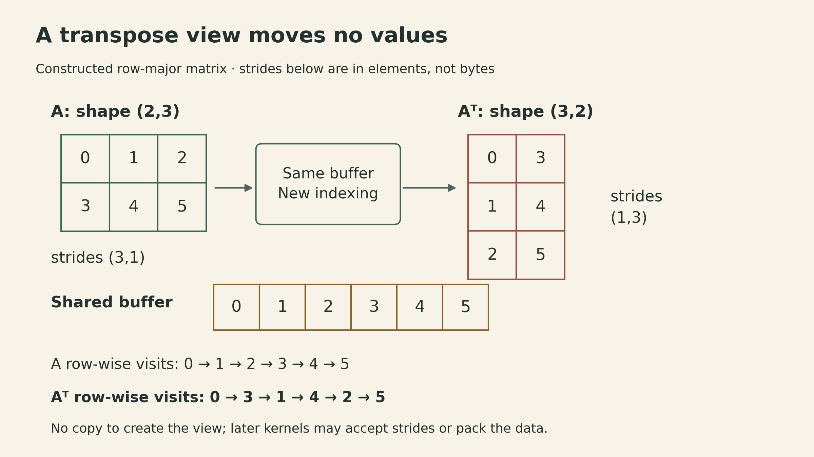

Two matrix multiplication routines can perform the same number of multiplications and finish at very different speeds. One repeatedly fetches operands. The other keeps a small output block close to the processor and reuses each input across several products.

Tianqi Chen's hardware acceleration lecture connects that difference to the tensor library underneath a deep learning framework. An automatic differentiation engine decides which operations to run; their kernels decide how values move through memory and arithmetic units. The same computation graph can therefore have very different execution costs.

The [Fall 2026 course schedule](https://dlsyscourse.org/lectures/) lists this topic as **Lecture 10: Hardware Acceleration for Linear Algebra**. The linked public recording is **Lecture 11: Hardware Acceleration** from the 2022 course. The analysis here follows the CPU techniques in the [lecture slides](https://dlsyscourse.org/slides/11-hardware-acceleration.pdf).

<div style="position:relative;padding-bottom:56.25%;height:0;overflow:hidden;margin:1.5rem 0">
<iframe src="https://www.youtube-nocookie.com/embed/es6s6T1bTtI" title="CMU Hardware Acceleration — 2022 recording, Lecture 11" style="position:absolute;inset:0;width:100%;height:100%;border:0" loading="lazy" allow="accelerometer; autoplay; clipboard-write; encrypted-media; gyroscope; picture-in-picture; web-share" allowfullscreen></iframe>
</div>

## A tensor view changes indexing, not the stored values

A matrix has two-dimensional indices, but its storage is a sequence of memory locations. For a view with element offset $o$ and element strides $s_0,s_1$, the storage index of entry $(i,j)$ is

$$
\operatorname{index}(i,j)=o+i s_0+j s_1.
$$

Here strides are measured in **elements**. An API that reports byte strides multiplies them by the element size.

Consider the row-major matrix

$$
A=\begin{bmatrix}0&1&2\\3&4&5\end{bmatrix}.
$$

Its shape is $(2,3)$, its element strides are $(3,1)$, and its buffer is $[0,1,2,3,4,5]$. The transpose can share that buffer with shape $(3,2)$ and strides $(1,3)$. Traversing the transpose row by row now visits storage indices $0,3,1,4,2,5$.

{fig-alt="A row-major 2 by 3 matrix and its 3 by 2 transpose share the same buffer. Original strides are 3 and 1; transposed strides are 1 and 3. Row-wise traversal of the transpose visits buffer indices 0, 3, 1, 4, 2, 5."}

*Constructed indexing example. Transposing the view moves no elements; the traversal order changes.*

The same idea supports basic slicing through changes to offset, shape, and stride. Broadcasting can use a zero stride on an expanded axis: advancing that index reads the same stored element. These are properties of strided views; indexing operations that gather arbitrary elements may instead allocate a copy.

The tradeoff appears in the next operation. Consecutive logical elements need not occupy consecutive addresses. A kernel may accept that layout, or it may pack the data into a layout suited to its inner loop. The useful comparison includes both the packing cost and the subsequent computation. A view that is cheap to create can still be expensive to consume.

## Vectorization and parallelization operate at different scales

The lecture's vector-add example processes 256 float32 elements four at a time. Each iteration loads four values from each input, adds corresponding lanes, and stores four results. There are 64 vector iterations, with the same 256 element additions.

The illustrative aligned load requires a 16-byte boundary because four float32 values occupy 128 bits. The exact rules depend on the instruction: some support unaligned accesses, and a length that is not divisible by the vector width needs a tail strategy. Contiguous access makes this particular vector-load pattern straightforward; arbitrary strides complicate it.

Parallelization assigns independent work to multiple threads. In vector addition, different chunks can write disjoint output elements. In matrix multiplication, different output tiles can also be assigned independently. Splitting the reduction for the **same** output among workers needs a reduction or another coordination mechanism.

Both techniques can accompany tiling. SIMD uses multiple lanes within a thread; multiple threads use additional processor resources. Their benefit still depends on memory access, available bandwidth, and the amount of work relative to overhead.

## Count input loads as well as arithmetic

The lecture uses a useful storage convention:

$$
\begin{aligned}
A,B&\in\mathbb R^{n\times n},\quad C=AB^\mathsf T,\\
C_{ij}&=\sum_{k=0}^{n-1}A_{ik}B_{jk}.
\end{aligned}
$$

The transpose is intentional. For row-major $A$ and $B$, both inner-loop operand sequences traverse rows. If the desired operation is $AD$, then $B=D^\mathsf T$ in this notation; constructing or packing that representation may have a cost.

A scalar implementation computes one output at a time:

```text
for i in 0..n-1:
    for j in 0..n-1:
        c = 0
        for k in 0..n-1:
            c += A[i,k] * B[j,k]
        C[i,j] = c
```

It performs $n^3$ products and approximately $2n^3$ floating-point operations under the convention that a multiply and an add count separately. Its arithmetic complexity is $\Theta(n^3)$.

To isolate reuse, first consider an idealized two-level model: input storage and a small fast working area. Charge one input load for every fetch into that area. The scalar loop makes $n^3$ loads from each input, or $2n^3$ in total. It keeps one accumulator and the two current operands live.

Those are **modeled input-element loads**, not measured DRAM transactions. A real CPU has caches, cache-line transfers, prefetching, and overlapping execution. Output stores, instructions, packing, and other costs are outside this first count. The lecture's latency diagram motivates the hierarchy; its illustrative nanosecond values should not be treated as specifications for a current processor.

## Keep an output tile live to reuse both inputs

Compute a $v_1\times v_2$ output tile, and process a reduction chunk of length $v_3$. The input chunks have shapes $v_1\times v_3$ and $v_2\times v_3$; their product contributes to the same output tile:

$$
C_{\rm tile}\mathrel{+}=A_{\rm tile}B_{\rm tile}^\mathsf T.
$$

Assume $n$ is divisible by all three tile dimensions. There are

$$
\frac{n}{v_1}\frac{n}{v_2}\frac{n}{v_3}
$$

input-chunk pairs. Multiplying that count by the size of each loaded chunk gives

$$
\begin{aligned}
N_A&=\frac{n}{v_1}\frac{n}{v_2}\frac{n}{v_3}(v_1v_3)
=\frac{n^3}{v_2},\\
N_B&=\frac{n^3}{v_1}.
\end{aligned}
$$

An $A$ value is used across $v_2$ output columns; a $B$ value is used across $v_1$ output rows. The multiplication count remains $n^3$.

### A 2×2 example makes the reuse visible

Take the constructed example

$$
A=\begin{bmatrix}1&2\\3&4\end{bmatrix},\qquad
B=\begin{bmatrix}5&6\\7&8\end{bmatrix}.
$$

With $v_1=v_2=2$ and $v_3=1$, each reduction step loads two values from $A$ and two from $B$. Their outer product updates all four accumulators:

$$
k=0:\quad
\begin{bmatrix}1\\3\end{bmatrix}
\begin{bmatrix}5&7\end{bmatrix}
=\begin{bmatrix}5&7\\15&21\end{bmatrix},
$$

$$
k=1:\quad
\begin{bmatrix}2\\4\end{bmatrix}
\begin{bmatrix}6&8\end{bmatrix}
=\begin{bmatrix}12&16\\24&32\end{bmatrix}.
$$

The result is $C=\begin{bmatrix}17&23\\39&53\end{bmatrix}$. Computing four dot products separately makes 16 input loads in the model. Keeping the four accumulators together makes 8. Both perform 8 multiplications.

{fig-alt="For one reduction step of a 2 by 2 output tile, A supplies values 1 and 3, B supplies values 5 and 7, and four accumulators receive 5, 7, 15, and 21. Four input values serve four products. Over two steps, modeled input loads fall from 16 to 8 while eight multiplications remain."}

*Constructed arithmetic example. The factor of two concerns modeled input loads, not elapsed time.*

For a larger $n=8$ example with the same tile dimensions, the load count changes from $2(8^3)=1024$ to $8^3/2+8^3/2=512$.

### Larger tiles need more live storage

The lecture's element-storage budget is

$$
R=v_1v_3+v_2v_3+v_1v_2.
$$

The last term holds the output accumulators. This counts live scalar elements in the model, not a literal count of physical registers: vector registers hold multiple lanes, while addresses, loop state, and instruction temporaries consume additional resources. An oversized tile can cause spilling and lose the intended reuse.

$v_3$ cancels from the modeled input-load total. Choosing $v_3=1$ reduces the storage budget and exposes an outer-product update. That is a useful analytical choice, rather than a universally optimal kernel shape. Instruction scheduling, SIMD width, layout, and the reduction length also influence a real implementation. Edge tiles need separate handling when dimensions are not divisible.

For unpacked row-major inputs, the values across several rows at a fixed $k$ are separated by a row stride of $n$. The outer-product update therefore does not automatically give contiguous vector loads. Packing into a microkernel layout can make these values adjacent; scalar or gather-based implementations can also handle the strided accesses.

## Cache tiling adds another level of reuse

Register tiling reduces transfers into the smallest working area. Cache tiling aims to keep larger input panels nearby while several register tiles consume them.

In the lecture's loop order, an outer iteration retains $b_1$ complete rows of $A$. The inner loop cycles through panels of $b_2$ complete rows of $B$. Each pair computes a $b_1\times b_2$ output panel, using register tiles internally.

Assume $n$ is divisible by $b_1$ and $b_2$, and each input panel is retained as described. Under those idealized assumptions, the input loads from DRAM to L1 are

$$
N_{A,\mathrm{DRAM}\to\mathrm{L1}}
=\frac{n}{b_1}(b_1n)=n^2,
$$

$$
N_{B,\mathrm{DRAM}\to\mathrm{L1}}
=\frac{n}{b_1}\frac{n}{b_2}(b_2n)
=\frac{n^3}{b_1}.
$$

The asymmetry comes from the loop order: the $A$ panel stays available while the loop visits all $B$ panels. Reversing which input panel is retained would exchange the roles. A panel is a collection of rows here, not a single hardware cache line.

{fig-alt="Two nested working sets: DRAM supplies A panels of b1 by n and B panels of b2 by n to L1; each panel pair feeds v1 by v2 output microtiles in registers. Modeled DRAM-to-L1 input loads are n squared plus n cubed over b1; L1-to-register loads are n cubed over v2 plus n cubed over v1."}

*Conceptual hierarchy for the lecture's loop order. CPU caches are hardware-managed; the arrows describe the analysis, not explicit cache-allocation commands.*

With an element size of $e$ bytes, a necessary input-panel capacity condition is

$$
e\,n(b_1+b_2)<S_{\rm L1},
$$

where $S_{\rm L1}$ is the modeled cache capacity in bytes. This is not sufficient to guarantee residency: output traffic, other live data, cache associativity, and concurrent work also need room. To nest complete register tiles, the lecture additionally assumes $b_1\bmod v_1=0$ and $b_2\bmod v_2=0$.

As a constructed capacity example, let $n=256$, $b_1=b_2=8$, and $e=4$. The two input panels occupy $4\cdot256\cdot16=16{,}384$ bytes, or 16 KiB. They are smaller than a hypothetical 32 KiB L1 cache, but that inequality alone does not establish a cache hit rate.

Combining the two levels gives the lecture's input-load model:

| Transfer | Modeled input-element loads |
|---|---:|
| DRAM → L1 | $n^2+n^3/b_1$ |
| L1 → registers | $n^3/v_2+n^3/v_1$ |

Weighting each count by a cost per transferred element makes memory hierarchy explicit. Adding those weighted terms is a rough model, not a runtime prediction: transfers and computation can overlap, and additional cache levels can change the traffic.

The slide's combined kernel also uses a packed layout, such as $A[n/b_1][b_1/v_1][n][v_1]$, so the $v_1$ values needed at a fixed reduction index are contiguous. Packing can connect the desired reuse to SIMD-friendly loads, but its work and temporary memory belong in an end-to-end cost comparison. Full-row panels also become too large for a fixed cache as $n$ grows; practical kernels can tile the reduction dimension as well.

## Look for an index an operand does not depend on

The reuse pattern can be read directly from

$$
C_{ij}=\sum_k A_{ik}B_{jk}.
$$

$A_{ik}$ does not depend on $j$. Keeping several $j$ outputs live creates opportunities to reuse an $A$ load. $B_{jk}$ does not depend on $i$, so a tile spanning several $i$ values can reuse a $B$ load.

The lecture closes by asking the same question for convolution. In an unpadded, unit-stride indexing example,

$$
Y_{b,o,y,x}=\sum_{c,r,s}X_{b,c,y+r,x+s}W_{o,c,r,s},
$$

let the input spatial size be $H\times W$ and the square kernel size be $K\times K$, with $1\le K\le\min(H,W)$. Use $0\le r,s<K$, $0\le y\le H-K$, and $0\le x\le W-K$, giving output spatial size $(H-K+1)\times(W-K+1)$. Batch, input-channel and output-channel indices range over their respective dimensions.

The weight does not depend on batch or output spatial position, and the input access does not depend on output channel. These indicate possible reuse across spatial outputs and output channels. Neighboring windows also overlap, creating another reuse pattern. Turning any of these opportunities into fewer transfers still requires a suitable schedule, layout, and working-set size.

That is the connection to the neural network library: its operators define the mathematical work, while their implementation chooses which values remain available across that work. Arithmetic complexity, access order, live storage, and transfers at each memory level together explain why two implementations of the same operation can behave differently.

## Sources

- CMU 10-414/714, [Fall 2026 lecture schedule](https://dlsyscourse.org/lectures/).
- Tianqi Chen, [Hardware Acceleration slides](https://dlsyscourse.org/slides/11-hardware-acceleration.pdf), especially pp. 5–8 on vectorization and layout, pp. 10–18 on matrix multiplication, and pp. 19–20 on reuse patterns.
- [2022 public recording: Lecture 11 — Hardware Acceleration](https://www.youtube.com/watch?v=es6s6T1bTtI).
- Previous note: [Neural Network Library Implementation](cmu-dlsys-lecture-9-neural-network-library-implementation.qmd).
