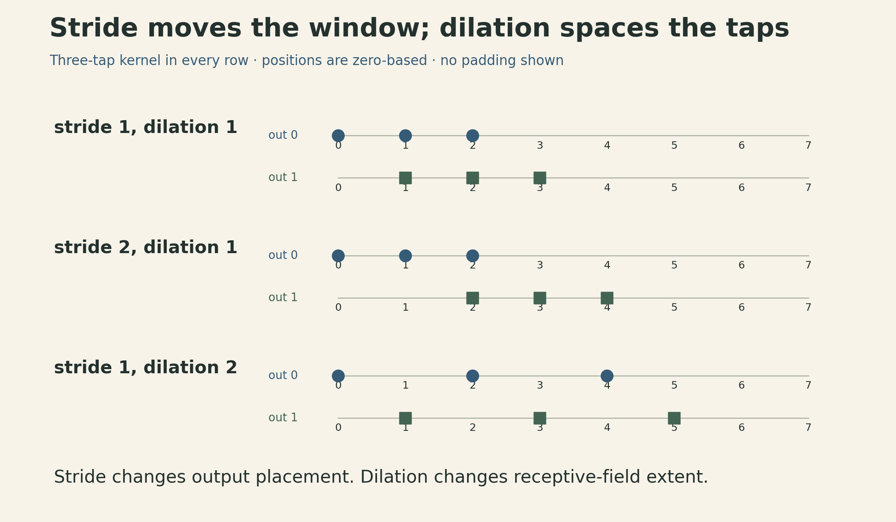
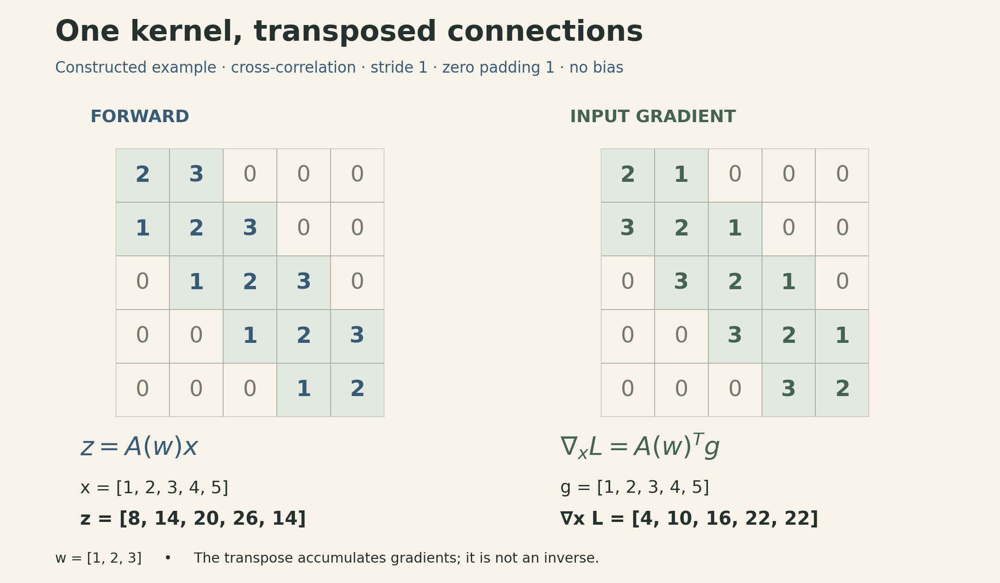
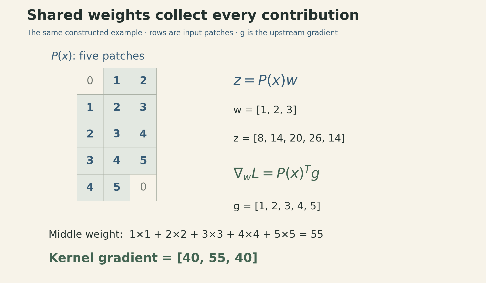

A convolutional layer reuses a small collection of weights across an image. That reuse explains its parameter efficiency. It also determines how gradients must accumulate during training.

Two matrix representations make the connection precise. Hold the weights fixed, and convolution is a linear map from the input to the output. Hold the input fixed, and it is a different linear map from the weights to the output. The first gives the input gradient; the second gives the weight gradient and leads naturally to an implementation using matrix multiplication.

This is Lecture 11 in the current [CMU Deep Learning Systems course schedule](https://dlsyscourse.org/lectures/). The linked slides are labeled Fall 2022, and the public recording is titled *Lecture 10 — Convolutional Networks*. The numbering here follows the current schedule; the lecture material is the 2022 version.

## Local connections and shared weights

Flattening a $256\times256$ RGB image produces $196{,}608$ input values. Connecting all of them to a dense layer with $1{,}000$ outputs requires

$$
256\cdot256\cdot3\cdot1000=196{,}608{,}000
$$

weights, before biases. Each output can mix information from anywhere in the image, with a separate parameter for every input–output pair.

A convolution imposes two constraints. An output looks at a small spatial neighborhood, and the same kernel is reused at every location. For a single input and output channel, a $3\times3$ kernel has only nine weights, regardless of image size.

To compare equal input and output spatial dimensions, consider a grayscale $256\times256$ image mapped to another grayscale image of that size. A dense map has $65{,}536^2=4{,}294{,}967{,}296$ weights. A $3\times3$ convolution with suitable padding has nine. These layers have very different expressive freedom: the small parameter count comes from locality and tying weights across locations.

Fixed kernels can blur an image or respond to intensity changes. A CNN learns its kernels from data. Nonlinearities between layers then let the network build functions that a composition of purely linear filters could not represent.

### What moves when the input moves?

Sharing weights gives convolution a translation **equivariance** property: shifting an input shifts its response. It does not generally leave the response unchanged, which would be translation invariance.

The exact statement requires a compatible domain and boundary convention. It holds on an infinite grid, for example. On a finite image, padding and cropping can break the correspondence near the edges. With stride greater than one, arbitrary one-pixel shifts also change the sampling alignment; shifts by multiples of the stride are the compatible case, subject to the same boundary caveats. Pooling and later aggregation can encourage robustness to translations, but a convolution alone is not an invariant classifier.

## The operation, with channels included

Deep learning libraries commonly call the following operation convolution, although the forward calculation uses **cross-correlation**: the kernel is applied without reversing its spatial order.

Let $X\in\mathbb{R}^{N\times H\times W\times C_{\mathrm{in}}}$ be a batch of images in channels-last notation. Let the kernel be $F\in\mathbb{R}^{k_h\times k_w\times C_{\mathrm{in}}\times C_{\mathrm{out}}}$, with bias $\beta_o$ for output channel $o$. Write $\widetilde X$ for the spatially zero-padded input. Then

$$
Z_{n,i,j,o}=\beta_o+
\sum_{a=0}^{k_h-1}\sum_{b=0}^{k_w-1}\sum_{c=0}^{C_{\mathrm{in}}-1}
\widetilde X_{n,\,is_h+ad_h,\,js_w+bd_w,\,c}\,F_{a,b,c,o}.
$$

Here $s_h,s_w$ are strides and $d_h,d_w$ are dilation factors; $d=1$ means contiguous kernel taps. Frameworks may store these tensors in different orders. The operation is the same after the corresponding axis permutation.

At each spatial offset $(a,b)$, the kernel is a matrix from the input-channel vector to the output-channel vector. The output sums these channel transformations over the local neighborhood. Thus a normal convolution both filters spatially and mixes channels.

Its weight count is

$$
k_hk_wC_{\mathrm{in}}C_{\mathrm{out}},
$$

plus $C_{\mathrm{out}}$ biases if used. The channel counts matter just as much as the spatial kernel size.

## Padding, stride, dilation, and groups

For symmetric zero padding $p$ on each side of one spatial axis, input length $H$, kernel size $k$, stride $s$, and dilation $d$, the output length is

$$
H_{\mathrm{out}}=
\left\lfloor\frac{H+2p-d(k-1)-1}{s}\right\rfloor+1,
$$

assuming the padded input is large enough for at least one placement. Apply the same formula independently to width.

The effective kernel extent is $d(k-1)+1$. A three-tap kernel with dilation two spans five input positions, but still has three learned weights. In two dimensions, a $3\times3$ kernel with dilation two covers a $5\times5$ region but still has nine spatial weights per channel pair.

With an odd kernel, stride one, and dilation one, padding $(k-1)/2$ preserves spatial size. For odd $k$ and general dilation, the corresponding symmetric padding is $d(k-1)/2$. These statements do not extend unchanged to arbitrary strides or even-sized effective kernels.

For example, $H=32$, $k=3$, $d=2$, $p=2$ gives $H_{\mathrm{out}}=32$ at stride one and $16$ at stride two.

{fig-alt="Three one-dimensional examples use three kernel taps. With stride 1 and dilation 1, successive outputs use input positions 0,1,2 and 1,2,3. Stride 2 uses 0,1,2 and 2,3,4. Dilation 2 with stride 1 uses 0,2,4 and 1,3,5. No padding is shown."}

Pooling provides another way to aggregate local neighborhoods. A $2\times2$ window containing $1,4,2,3$ has maximum $4$ and average $2.5$. With stride two, such pooling halves each even spatial dimension. Average pooling distributes its backward contribution across the window; max pooling routes it to a selected maximum, with a tie convention needed when several entries attain that maximum. Pooling has no learned kernel, while a strided convolution does.

**Grouped convolution** restricts channel connectivity. With $G$ groups dividing both channel counts, each output channel sees only $C_{\mathrm{in}}/G$ inputs. The weight count becomes

$$
k_hk_w\frac{C_{\mathrm{in}}C_{\mathrm{out}}}{G}.
$$

For $32$ inputs, $64$ outputs, and a $3\times3$ kernel, this is $18{,}432$ weights without grouping and $2{,}304$ with eight groups, excluding biases. Depthwise convolution is the case $G=C_{\mathrm{in}}$, with one or more output filters per input channel. It removes mixing across input channels within that operation; a later pointwise convolution can provide that mixing. Reduced arithmetic does not guarantee a proportional speedup on a particular accelerator.

## First matrix view: fix the kernel

To see the backward pass without distracting tensor indices, use a constructed one-dimensional example. Let

$$
x=(1,2,3,4,5)^T,\qquad w=(1,2,3)^T.
$$

The two-dimensional formula above uses zero-based spatial indices; the entries $x_1,\ldots,x_5$ and $w_1,w_2,w_3$ here are numbered from one. Use stride one, one zero on each side, no bias, and the cross-correlation convention above. For a general three-tap kernel,

$$
z=A(w)x,\qquad
A(w)=\begin{pmatrix}
w_2&w_3&0&0&0\\
w_1&w_2&w_3&0&0\\
0&w_1&w_2&w_3&0\\
0&0&w_1&w_2&w_3\\
0&0&0&w_1&w_2
\end{pmatrix}.
$$

The zeros encode locality. Repeated entries encode weight sharing. Substitution gives

$$
z=(8,14,20,26,14)^T.
$$

From the padded sliding-window view, the first output is $0\cdot1+1\cdot2+2\cdot3=8$. The first row of $A(w)$ expresses the same result using the unpadded input: $w_2x_1+w_3x_2=8$. The last is $4\cdot1+5\cdot2+0\cdot3=14$. Padding makes the boundary rows different from the interior rows.

For a scalar loss $L$, write the upstream gradient as $g=\nabla_zL$. Holding the kernel fixed,

$$
dL=g^Tdz=g^TA(w)\,dx
=\big(A(w)^Tg\big)^Tdx,
$$

so

$$
\boxed{\nabla_xL=A(w)^Tg.}
$$

Every output influenced by an input contributes to that input's gradient. Transposing the matrix reverses the direction of those connections and sums the contributions.

{fig-alt="For x equal to 1,2,3,4,5 and kernel 1,2,3, the forward matrix has diagonal 2, upper diagonal 3, lower diagonal 1 and produces 8,14,20,26,14. Its transpose has upper diagonal 1 and lower diagonal 3. Multiplying it by upstream gradient 1,2,3,4,5 gives input gradient 4,10,16,22,22. The transpose propagates gradients; it does not invert the forward map."}

For $g=(1,2,3,4,5)^T$, the input gradient is

$$
\nabla_xL=(4,10,16,22,22)^T.
$$

A useful check is the adjoint identity:

$$
g^T(Ax)=(A^Tg)^Tx=270.
$$

### Why “flip the kernel” needs conditions

In this single-channel, unit-stride example with symmetric one-element zero padding, applying $A^T$ is equivalent to cross-correlating $g$ with the reversed kernel $(w_3,w_2,w_1)$. That convenient recipe depends on the setup.

For more general convolutions, the input and output channel roles also exchange, the padding and cropping must match, and stride changes how contributions are placed. Conceptually, write a forward operator as $A=RCE$: $E$ extends the input with zeros, $C$ computes the unstrided filtering operation, and $R$ selects the strided outputs. Then

$$
A^T=E^TC^TR^T.
$$

The transpose of selection places gradients back at the selected locations, inserting zeros at the omitted positions. The transpose of zero extension crops back to the original input domain. This decomposition keeps the bookkeeping visible.

A **transposed convolution** implements the transpose of the corresponding convolution operator. It is not generally an inverse. Striding can map several input sizes to the same output size, so a transposed-convolution API may need extra shape information, such as `output_padding`, to select the intended output shape. Matching a shape does not reconstruct information discarded by the forward map.

## Second matrix view: fix the input

The same example can be written with the input patches as rows:

$$
z=P(x)w,\qquad
P(x)=\begin{pmatrix}
0&1&2\\
1&2&3\\
2&3&4\\
3&4&5\\
4&5&0
\end{pmatrix}.
$$

Now hold $x$ fixed and vary the kernel. The differential is $dz=P(x)\,dw$, giving

$$
\boxed{\nabla_wL=P(x)^Tg.}
$$

For the same upstream gradient,

$$
\nabla_wL=(40,55,40)^T.
$$

For example, the middle weight appears in every output, multiplying the corresponding input element. Its gradient therefore sums all five contributions:

$$
\frac{\partial L}{\partial w_2}
=1\cdot1+2\cdot2+3\cdot3+4\cdot4+5\cdot5=55.
$$

{fig-alt="Five padded input patches form a 5 by 3 matrix: rows 0,1,2; 1,2,3; 2,3,4; 3,4,5; and 4,5,0. Multiplication by kernel 1,2,3 gives outputs 8,14,20,26,14. Transposing the patch matrix and multiplying by upstream gradient 1,2,3,4,5 gives kernel gradient 40,55,40. The middle gradient is the sum 1 plus 4 plus 9 plus 16 plus 25, equal to 55."}

These are two views of the same bilinear operation:

$$
\operatorname{conv}(x,w)=A(w)x=P(x)w.
$$

It is linear in either argument when the other is fixed. The two different transposes arise because the differentiated argument is different. Bias, if included, adds an affine term; its gradient sums $g$ over batch and output spatial positions for each output channel.

## From patches to matrix multiplication

For a batch of two-dimensional images, flatten every receptive field into a row. Define

$$
M=NH_{\mathrm{out}}W_{\mathrm{out}},\qquad
K=k_hk_wC_{\mathrm{in}}.
$$

The patch matrix $P$ has shape $M\times K$. Flatten the ungrouped kernel to $F_{\mathrm{mat}}\in\mathbb{R}^{K\times C_{\mathrm{out}}}$. Use the same order of spatial offsets and input channels when flattening each patch and the kernel. Ignoring bias,

$$
Z_{\mathrm{mat}}=PF_{\mathrm{mat}}
\in\mathbb{R}^{M\times C_{\mathrm{out}}}.
$$

This is the idea behind **im2col**: expose patches in a form that can use an optimized matrix multiplication. Some APIs store patches as columns instead; the orientation is a convention as long as the multiplications agree.

For upstream gradient $G=\nabla_{Z_{\mathrm{mat}}}L$, matrix calculus gives

$$
\nabla_{F_{\mathrm{mat}}}L=P^TG,
\qquad
\nabla_PL=GF_{\mathrm{mat}}^T.
$$

The second result is a gradient for the *patch representation*. It is not yet the gradient for the original image. An input pixel can appear in several overlapping patches, so the corresponding entries must be added back to that pixel. This scatter-and-sum operation, often called **col2im**, is the adjoint of patch extraction. A reshape alone cannot perform it, and averaging the overlapping contributions would give the wrong gradient.

This also explains why extracting overlapping patches and folding them back does not generally reproduce the original image unchanged: every covered pixel is multiplied by its coverage count. Dividing by a nonzero coverage count can undo that duplication when reconstruction is the goal. Backpropagation instead requires the sum itself.

### The workspace tradeoff

A materialized patch matrix repeats input values. With stride one and spatial size preserved, its element count is exactly $k_hk_w$ times that of the original input tensor under this layout, including entries representing padded zeros. A $3\times3$ layer therefore stores nine times as many patch entries as input entries. It still has the much smaller shared kernel; parameter savings and temporary workspace are different quantities.

The benefit is access to efficient matrix multiplication. Whether that tradeoff is worthwhile depends on tensor shapes, data movement, and the available kernels. Direct convolution, implicit patch generation, and other algorithms avoid or reorganize this explicit workspace. Treating convolution as a single automatic-differentiation operator simplifies the graph and permits specialized implementations; it does not by itself make all temporary storage disappear.

The previous [hardware acceleration lecture](cmu-dlsys-lecture-10-hardware-acceleration.qmd) emphasized reuse and memory movement. Convolution adds a concrete case: shared parameters reduce model size, while an implementation still has to manage the repeated use of activations. The two matrix views explain the gradients; the implementation decides how much of either matrix should ever exist in memory.

## Lecture and references



- [CMU DLSys course schedule](https://dlsyscourse.org/lectures/): current Lecture 11, with a link to the 2022 public recording.
- [Convolutional Networks slides, Fall 2022](https://dlsyscourse.org/slides/ConvNets.pdf): local connectivity and sharing, slides 4–6; channels and variants, 16–22; the two matrix forms and backward pass, 24–28.
- [Public lecture recording: Lecture 10 — Convolutional Networks](https://www.youtube.com/watch?v=-5RPPjn0hPg): input gradients from about 45:47; patch-matrix view from about 1:00:58.
- PyTorch documentation: [Conv2d](https://docs.pytorch.org/docs/2.14/generated/torch.nn.Conv2d.html), [ConvTranspose2d](https://docs.pytorch.org/docs/2.14/generated/torch.nn.ConvTranspose2d.html), [Unfold](https://docs.pytorch.org/docs/2.14/generated/torch.nn.Unfold.html), and [Fold](https://docs.pytorch.org/docs/2.14/generated/torch.nn.Fold.html), for operation conventions, shape rules, and overlap behavior.
