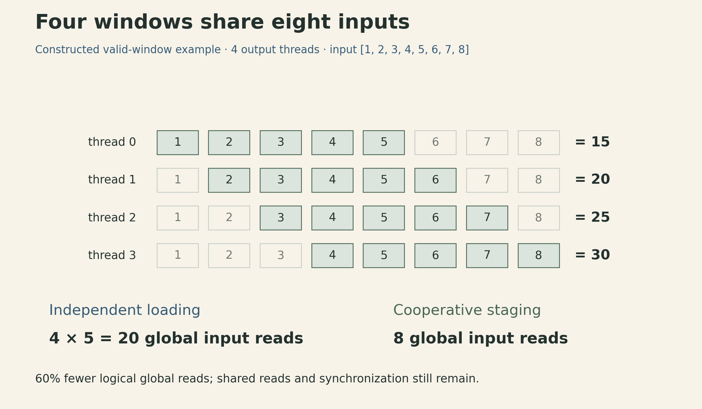
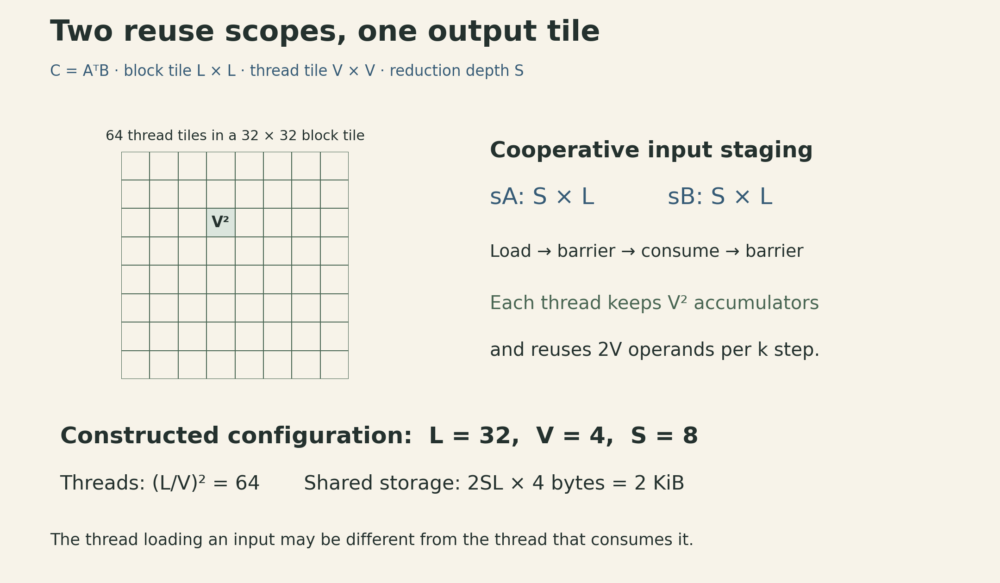
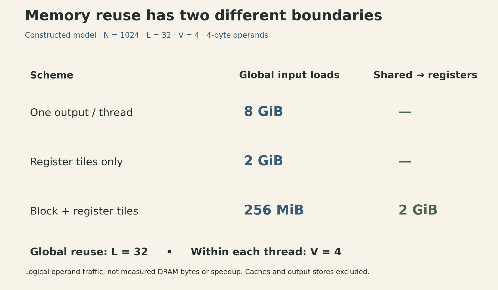

A GPU can run many threads while repeatedly asking memory for the same numbers. Parallel work alone does not fix that waste. A useful kernel design answers two questions together: **which outputs does each thread own, and where can their inputs be reused?**

Consider a constructed matrix example with $N=1024$. Computing one output per thread requires $2N^3$ scalar input reads in a simple uncached counting model. Giving each thread a $4\times4$ output tile reduces that count by four. Adding a $32\times32$ block tile reduces global input loads by 32 relative to the original scheme. With both tiling levels present, the thread tile reduces shared-to-register reads while the block tile reduces global input reads. The 32-fold global reduction already includes the register tiling; multiplying the two comparisons into a claimed $128\times$ speedup would be wrong.

This article follows Lecture 12 of [CMU 10-414/714 Deep Learning Systems](https://dlsyscourse.org/lectures/). The official slide deck is labeled Fall 2026; the linked public recording is the 2022 version. Its core progression is GPU programming, cooperative memory access, and matrix multiplication. The calculations below make that progression concrete, with additional CUDA references for execution and synchronization rules.

## 1. Thread indices assign responsibility

For vector addition, output $c_i=a_i+b_i$ depends only on input pair $i$. A one-dimensional launch can assign one thread to each output through

$$
i=bT+t,
$$

where $b$ is the block index, $T$ the threads per block, and $t$ the thread's index inside the block. With $n>0$ elements, launching $\lceil n/T\rceil$ blocks covers the array. A bounds check excludes extra threads in the last block.

For example, $n=10$ and $T=4$ create three blocks. Threads with global indices 0–9 write outputs; indices 10–11 do no array access. This tiny launch illustrates indexing, not a recommended performance configuration.

```cpp
// Kernel fragment: a, b and c are valid device arrays of n floats.
__global__ void add(const float* a, const float* b, float* c, int n) {
    int i = blockIdx.x * blockDim.x + threadIdx.x;
    if (i < n) c[i] = a[i] + b[i];
}
// Host launch for n > 0, with a supported block size T:
// add<<<(n + T - 1) / T, T>>>(a, b, c, n);
```

The indexing works because outputs are independent. Replacing the addition with a recurrence that reads a preceding output introduces an ordering requirement. It needs a different parallel algorithm; changing the loop index to a thread ID is insufficient.

CUDA groups threads into blocks and blocks into a grid. Within a block, threads execute in warps of 32 on NVIDIA GPUs. They may take different branches; divergence can leave some lanes inactive. An ordinary block runs on one streaming multiprocessor (SM), which can host multiple blocks subject to resource limits. A software thread is not permanently assigned its own physical arithmetic unit. These distinctions matter when reasoning about parallelism. [CUDA programming model](https://docs.nvidia.com/cuda/cuda-programming-guide/01-introduction/programming-model.html)

## 2. Keep the pipeline on the device

In a conventional explicit-memory CUDA program, the host allocates device buffers, transfers inputs, launches kernels, retrieves results when needed, and frees buffers. A kernel launch is generally asynchronous with respect to the host; dependency and completion rules come from the chosen streams and synchronization operations. Production code also checks API and launch errors. [CUDA C++ introduction](https://docs.nvidia.com/cuda/cuda-programming-guide/02-basics/intro-to-cuda-cpp.html)

Copying an intermediate tensor back to the CPU between every layer adds transfers that the next GPU layer immediately reverses. For a constructed chain of $K$ shape-preserving stages with $B$ bytes per tensor, that approach transfers $2KB$ bytes. Keeping intermediates on the GPU requires $2B$ bytes for the initial input and final result, assuming no other host reads. The removed traffic is $2(K-1)B$; its effect on elapsed time depends on transfer bandwidth, overlap and computation.

This is a boundary outside the kernel. The next two boundaries are inside the GPU: global memory to block-local shared memory, and shared memory to thread-local registers. CUDA's terminology has counterparts in other GPU APIs, but synchronization rules and efficient layouts still need to be checked for each API.

## 3. A sliding window reveals cooperative loading

Define the operation before discussing its implementation. Let $n$ be the **number of outputs** and let the input have $n+4$ valid elements:

$$
y_i=\sum_{d=0}^{4}x_{i+d},\qquad 0\leq i<n.
$$

This is a valid five-element window sum. A centered radius-two interpretation would use an explicitly padded input; it is a different boundary convention.

Four adjacent outputs require 20 scalar input reads when each thread loads its own five values. Their union contains just eight input positions. The block can load those eight values once into shared memory, synchronize, then let each thread read its window there.

{fig-alt="Four windows over input values 1 through 8 produce sums 15, 20, 25 and 30. Independent threads request twenty input values in total; cooperative staging loads eight distinct values into shared memory."}

The ratio is $8/20=0.4$: 40% of the original global input load count remains, a 60% reduction. There are still shared-memory reads, additions, stores and synchronization. Caches may already satisfy repeated global accesses, so this logical count is not a DRAM-traffic measurement or a runtime prediction.

For a window of width $W=2R+1$ and a full block of $T$ outputs, independent loading uses $T(2R+1)$ input reads; cooperative staging needs $T+2R$ values. The ratio of independent to cooperative input loads is

$$
\frac{T(2R+1)}{T+2R}.
$$

The following fragment expresses the five-element case with explicit tail handling. For $n>0$, launch $\lceil n/T\rceil$ blocks with exactly $T$ threads per block. The input must contain $n+4$ elements and must not overlap the output array. It is illustrative kernel code, not a complete CUDA application.

```cpp
template<int T>
__global__ void window5(const float* x, float* y, int n) {
    __shared__ float tile[T + 4];
    int t = threadIdx.x;
    int base = blockIdx.x * T;

    for (int q = t; q < T + 4; q += T) {
        int g = base + q;
        tile[q] = (g < n + 4) ? x[g] : 0.0f;
    }
    __syncthreads();

    if (base + t < n) {
        float sum = 0.0f;
        for (int d = 0; d < 5; ++d) sum += tile[t + d];
        y[base + t] = sum;
    }
}
```

Every thread reaches the barrier, including threads without valid outputs. The guard belongs around the output computation, not around the block-wide synchronization. The test for an input load uses $n+4$, because $n$ counts outputs. A guard against $n$ would omit valid halo values near the right edge.

More generally, `__syncthreads()` orders participating threads' accesses within a block; it is not a grid-wide barrier. When the same shared buffer is reused in a loop, synchronize after filling it and before overwriting values other threads may still read. Do not infer memory safety merely from threads belonging to the same warp. [Writing SIMT kernels](https://docs.nvidia.com/cuda/cuda-programming-guide/02-basics/writing-cuda-kernels.html)

## 4. One thread can own a small output matrix

Use the lecture's layout explicitly:

$$
\begin{aligned}
C&=A^{\mathsf T}B,\\
C_{ij}&=\sum_{k=0}^{N-1}A_{ki}B_{kj},\\
A,B,C&\in\mathbb R^{N\times N}.
\end{aligned}
$$

For a fixed $k$, a thread holding a $V\times V$ output tile loads $V$ values from each input and forms their outer product. Its $2V$ scalar operands support $V^2$ multiply-accumulate updates. The output accumulators remain live across all $N$ reduction steps.

An independently constructed $V=2$ example is enough to see the reuse. If the input strips are $a=[2,3]$ and $b=[5,7]$, this reduction step adds

$$
ab^{\mathsf T}=\begin{bmatrix}10&14\\15&21\end{bmatrix}
$$

to four output accumulators. Four loaded numbers serve four updates; computing the four outputs independently would request eight operands at this step.

Assume $N$ is divisible by $V$, each output tile has a single owner, and values remain in registers without spilling. There are $(N/V)^2$ tiles. Multiplying tiles, reduction steps and operands per step gives

$$
Q_{\mathrm{input\to reg}}
=\left(\frac NV\right)^2 N(2V)
=\frac{2N^3}{V}.
$$

Without shared staging, these are global input loads. With staging, the same reuse calculation counts shared-to-register loads. The $V^2$ output accumulators, $2V$ temporary operands and indexing variables consume resources; an oversized tile may spill to device-backed local memory.

## 5. A block tile supplies many thread tiles

Let a block own an $L\times L$ output region, partitioned into $V\times V$ thread tiles. Assume $V$ divides $L$, and $L$ and reduction depth $S$ divide $N$. The block has $(L/V)^2$ threads in this mapping. Each reduction stage loads two $S\times L$ input slabs into shared memory. All its thread tiles consume those slabs before the next stage replaces them.

For output-block coordinates $(b_y,b_x)$, the staged entries are

$$
\begin{aligned}
s_A[r,u]&=A_{k_0+r,\,b_yL+u},\\
s_B[r,u]&=B_{k_0+r,\,b_xL+u}.
\end{aligned}
$$

Here $0\leq r<S$, $0\leq u<L$, and $k_0$ advances by $S$. A thread at coordinates $(t_y,t_x)$ reads $V$ values starting at $u=t_yV$ from $s_A$ and $u=t_xV$ from $s_B$. It updates its private $V\times V$ accumulator.

{fig-alt="A block owns an L by L output tile made of V by V thread tiles. Two S by L shared-memory slabs supply it. For L equal to 32, V equal to 4 and S equal to 8, the block has 64 threads and stages 512 floats, or 2 KiB."}

A cooperative copy distributes **loads**, which need not match output ownership. Flatten the block's thread coordinates into `tid`, with `nt` total threads. For each slab, assign positions `q = tid, tid + nt, ...` while `q < S*L`; map them to row `q/L` and column `q%L`. Each valid slab position has exactly one loader. This strided-loop formulation also handles a slab size that is not divisible by `nt`.

The single-buffer schedule is:

1. Cooperatively load both slabs, using zero-filled masked loads for out-of-range matrix elements when dimensions are not tile-aligned.
2. All threads reach a barrier before consuming shared values.
3. Each thread performs its $S$ outer-product updates.
4. All threads reach a barrier before the next stage overwrites the slabs.
5. After the final stage, store valid output entries.

The neat counts below assume full tiles. Tail masks preserve correctness for other dimensions, but padded work changes the accounting.

### Count each memory boundary separately

There are $(N/L)^2$ blocks, $N/S$ stages per block, and $2SL$ scalar input loads per stage. Therefore

$$
Q_{\mathrm{global\to shared}}
=\left(\frac NL\right)^2\frac NS(2SL)
=\frac{2N^3}{L}.
$$

Within those blocks, each of $(L/V)^2$ threads loads $2V$ shared values per reduction step. Across all blocks:

$$
\begin{aligned}
Q_{\mathrm{shared\to reg}}
&=\left(\frac NL\right)^2\left(\frac LV\right)^2N(2V)\\
&=\frac{2N^3}{V}.
\end{aligned}
$$

Both counts omit the final $N^2$ output stores and assume zero-initialized accumulators, with no initial read of $C$. They count scalar values, not memory transactions. The cancellation of $S$ means reduction depth does not change these ideal totals. It does change staging capacity and the number of synchronization rounds.

{fig-alt="For N equal to 1024, L equal to 32 and V equal to 4, the untiled kernel requests 8 GiB of global input operands. Register tiling alone requests 2 GiB. Two-level tiling requests 256 MiB globally and 2 GiB from shared memory into registers. These logical operand counts exclude caches and output stores and are not measured speedups."}

For $N=1024$, $L=32$, $V=4$, $S=8$, using four-byte values:

| Scheme | Global input operands | Shared-to-register operands |
|---|---:|---:|
| One output per thread | $2{,}147{,}483{,}648$ values = 8 GiB | Not used |
| $4\times4$ register tile only | $536{,}870{,}912$ values = 2 GiB | Not used |
| $32\times32$ block tile plus register tiles | $67{,}108{,}864$ values = 256 MiB | $536{,}870{,}912$ values = 2 GiB |

All three perform the same $N^3$ multiply-accumulate updates. Counting each as two FLOPs gives $2N^3$ FLOPs. The final output write is 4 MiB in every row. For the third row, arithmetic divided by global input bytes is $L/4=8$ FLOPs/byte; including that output write gives $512/65\approx7.88$ FLOPs/byte. This is a logical traffic model without cache reuse, not a hardware roofline measurement.

## 6. Larger tiles spend the resources that hide latency

In the constructed configuration, a block has $(32/4)^2=64$ threads. Its single shared buffer uses $2SL=512$ floats, or 2 KiB. Each thread has 16 output accumulators and eight input temporaries before compiler decisions and indexing overhead.

Increasing $V$ can reduce repeated shared reads while increasing per-thread register demand. Increasing $L$ can reduce global loads while increasing the block's footprint. Increasing $S$ reduces stage count while increasing shared storage. Register and shared-memory allocations can limit resident work on an SM; fewer ready warps can reduce opportunities to hide stalls. High occupancy alone does not guarantee high throughput. [CUDA Best Practices Guide](https://docs.nvidia.com/cuda/cuda-c-best-practices-guide/index.html)

Other details determine whether the logical reuse becomes useful performance: global accesses should be coalesced where possible; shared layouts can incur bank conflicts; pipelining can overlap loading and computation; warp-level operations and tensor instructions can change the implementation substantially. The general resource trade-off remains, but this scalar model is not a model of a modern tensor-core kernel's full execution.

The connection to [hardware acceleration for linear algebra](https://ickma2311.github.io/ML/DLSys/cmu-dlsys-lecture-10-hardware-acceleration.html) is direct: keep an output tile live and reuse its inputs. The GPU adds a cooperative layer between the device's memory and each thread's registers. The most useful design question is therefore specific: **which group will reuse this value, and what storage and synchronization make that reuse safe?**

## Lecture and references



- [CMU course schedule](https://dlsyscourse.org/lectures/) and [GPU Acceleration slides, Fall 2026](https://dlsyscourse.org/slides/12-gpu-acceleration.pdf), especially pp. 5–12 and 15–19.
- [Public lecture recording, 2022 version](https://www.youtube.com/watch?v=jYCxVirq4d0): thread mapping around 7–15 min, transfers around 15–21 min, shared memory around 22–29 min, and tiling around 29–41 min.
- NVIDIA CUDA references linked beside the relevant execution, memory and synchronization discussions.
