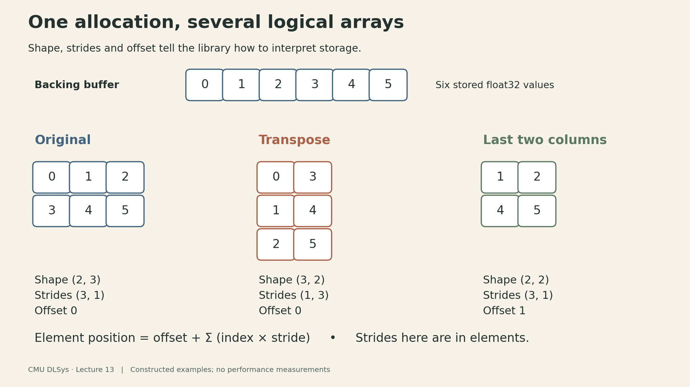
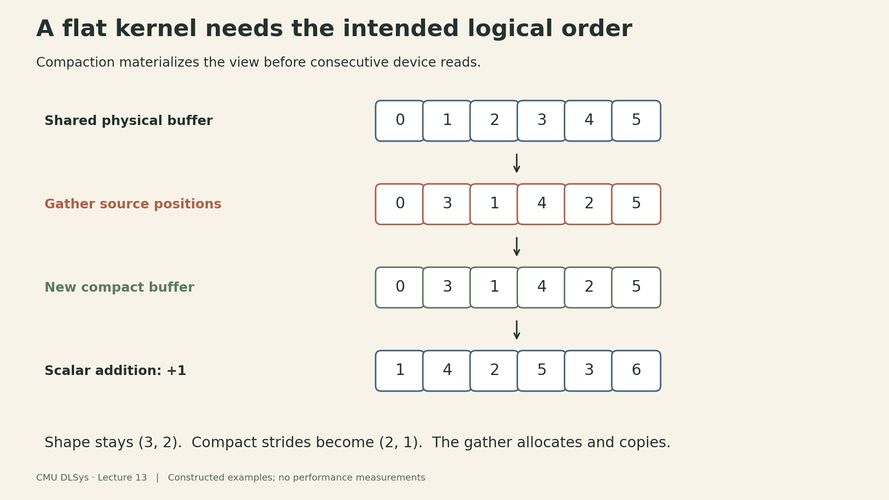
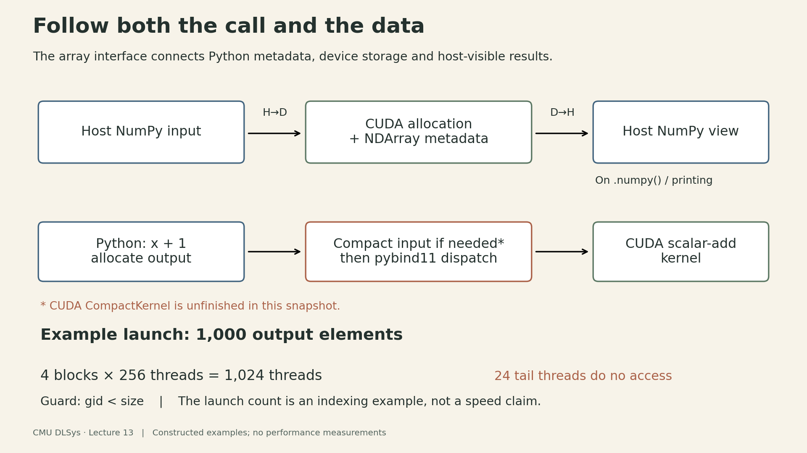

A transpose can create a new array view without moving a single value. A CUDA kernel that reads `a[i]`, however, sees only the buffer's physical order. **The library must reconcile those two interpretations before or inside the kernel.**

That is the central implementation problem in this lecture. Arithmetic is only one part of a tensor backend. The surrounding code must preserve the meaning of shape, strides, offsets, device placement and memory ownership as an operation crosses from Python into compiled code.

This article follows the public notebook and starter repository linked from [CMU 10-414/714 Deep Learning Systems, Lecture 13](https://dlsyscourse.org/lectures/). The linked notebook retains an older “Lecture 14” title and saved 2023 outputs. The repository is teaching infrastructure: several backend routines are deliberately unfinished. The examples below distinguish implemented paths from the contracts those unfinished routines are meant to satisfy.

## 1. Separate an array's values from its gradient graph

Needle has two useful layers. A `Tensor` represents a value in an automatic differentiation graph. With `NEEDLE_BACKEND=nd` and an NDArray device such as `nd.cuda()`, its cached numerical value is a Needle `NDArray`, which describes storage and provides numerical operations. The NDArray backend can therefore be tested before connecting an operation to automatic differentiation.

The path to a CUDA operation is:

```text
Tensor / operation in the gradient graph
    → NDArray: shape, strides, offset, device, allocation handle
    → BackendDevice: dispatch to the selected backend module
    → pybind11 binding: call compiled C++ / CUDA code
    → device allocation and kernel
```

`BackendDevice` delegates attribute lookup to its module. Thus `device.scalar_add` can select the NumPy reference implementation, the compiled CPU implementation, or the CUDA implementation. The Python operation can share an interface across these backends while each backend owns its storage and execution details.

This interface does not guarantee identical capabilities. In the pinned starter code, `cpu_numpy()` is the default device; CUDA must be selected explicitly and its extension must be available. The backend uses `float32`. A production library needs broader dtype rules, device checks and error handling than this scaffold provides. [Backend dispatch and NDArray implementation](https://github.com/dlsyscourse/lecture13/blob/4dc3485524b9997ab671b4c1f5fe1902c76b558b/python/needle/backend_ndarray/ndarray.py)

## 2. One buffer can describe several arrays

For a rank-$d$ view, let its shape be $(n_0,\ldots,n_{d-1})$, strides be $(s_0,\ldots,s_{d-1})$, and offset be $o$. For a valid logical index, the element position in the backing allocation is

$$
p(i_0,\ldots,i_{d-1})=o+\sum_{k=0}^{d-1}i_k s_k.
$$

Each index satisfies $0\leq i_k<n_k$. Here strides and offset are measured in **elements**. They are not byte counts. The view must also refer to positions inside its allocation; shape metadata alone does not establish that safety condition.

Take the six-element buffer `[0, 1, 2, 3, 4, 5]`. A row-major $2\times3$ array has shape `(2, 3)`, strides `(3, 1)`, and offset `0`. Moving one row changes the position by three elements; moving one column changes it by one.

::: {.table-scroll}

| View | Shape | Strides | Offset | Values in logical row-major order |
|---|---|---|---|---|
| Original | `(2, 3)` | `(3, 1)` | `0` | `0, 1, 2, 3, 4, 5` |
| Transpose | `(3, 2)` | `(1, 3)` | `0` | `0, 3, 1, 4, 2, 5` |
| Last two columns | `(2, 2)` | `(3, 1)` | `1` | `1, 2, 4, 5` |
| Second row | `(1, 3)` | `(3, 1)` | `3` | `3, 4, 5` |

:::

Each row in this table describes the same backing buffer. For the last-two-columns view, logical index `(1, 0)` addresses position $1+1\cdot3+0\cdot1=4$. For the transpose, logical index `(1, 0)` addresses position $0+1\cdot1+0\cdot3=1$.

{fig-alt="A backing buffer contains 0, 1, 2, 3, 4, 5. The original view has rows 0 1 2 and 3 4 5, shape 2 by 3, strides 3 and 1. Its transpose has rows 0 3, 1 4, 2 5, shape 3 by 2, strides 1 and 3. A slice with offset 1 and strides 3 and 1 has rows 1 2 and 4 5. All three share one allocation."}

The lecture constructs these views live through `NDArray.make(..., handle=existing_handle, strides=..., offset=...)`. The saved notebook retains the original and broadcast examples. Supplying a handle reuses its allocation; omitting it allocates storage. This low-level constructor is not a general bounds validator. The higher-level `reshape`, `permute`, `broadcast_to` and indexing methods are still stubs in this repository snapshot, so the metadata examples should not be mistaken for a complete slicing API.

## 3. Broadcasting makes aliasing explicit

Extend the original array to shape `(2, 3, 4)` with strides `(3, 1, 0)`. Its address rule is

$$
p(i,j,k)=3i+j+0k.
$$

All four positions along the last dimension read the same stored value. There are 24 logical elements but only six backing elements. Zero stride expresses repetition without duplicating the data.

This is convenient for reads. Writes require a separate policy: four logical positions alias one physical location, so assigning independent GPU threads to those positions can create conflicting writes. A library may reject a write, require explicit reduction semantics, or materialize separate storage. Read broadcasting alone does not define which write should win.

More generally, “this view did not copy data” says what happened when the view was created. It does not promise that every later operation can consume that layout without a copy.

## 4. Compaction gives a simple kernel the layout it expects

Consider the transposed view. Its first two logical values are `0` and `3`, but the first two physical values in its shared buffer are `0` and `1`. A kernel that receives only the raw handle and reads consecutive positions cannot infer the transpose.

One solution is a strided kernel that receives and interprets metadata. Needle's elementwise wrapper takes another approach: **compact each input before calling a flat kernel**. Compaction copies values in logical row-major order into a fresh contiguous allocation when required.

For the transpose:

```text
Shared physical buffer:    [0, 1, 2, 3, 4, 5]
Transpose's logical order: [0, 3, 1, 4, 2, 5]
Compacted buffer:          [0, 3, 1, 4, 2, 5]
After scalar addition +1:  [1, 4, 2, 5, 3, 6]
```

The compact result still has shape `(3, 2)`, now with strides `(2, 1)`. Its values have not changed; their physical arrangement has.

{fig-alt="For a transpose of a two by three array, source positions 0, 3, 1, 4, 2, 5 are gathered in that order into a new six-element buffer. The compact buffer values are 0, 3, 1, 4, 2, 5. Adding one gives 1, 4, 2, 5, 3, 6. The shape remains 3 by 2 and compact strides become 2 and 1."}

For a general view with positive dimensions, a gather routine can convert an output flat index $q$ into logical coordinates by repeated division and remainder, then compute the corresponding source position with the stride formula. Here is conceptual pseudocode for one output element:

```python
remaining = q
source_position = offset
for axis in reversed(range(rank)):
    coordinate = remaining % shape[axis]
    remaining //= shape[axis]
    source_position += coordinate * strides[axis]
out[q] = source[source_position]
```

Assume $0\leq q<\prod_k n_k$, positive dimensions, valid source positions, sufficient integer range, and a separate output allocation. Empty arrays need their own handling. The CUDA starter passes shape, strides and offset to `CompactKernel`, but its body is empty. The NumPy backend supplies an executable reference for the intended semantics. The pseudocode explains that contract; it is not a claim that the starter CUDA implementation already fulfills it.

The scaffold's `is_compact()` checks whether strides equal its row-major strides and whether the logical element count equals the backing handle's size. That second check matters: the second-row view has contiguous logical values, yet only three of its backing allocation's six elements belong to the view. The wrapper compacts it under this definition. The predicate does not explicitly check offset and is not a substitute for validating arbitrary metadata.

For an already compact input, `.compact()` returns the same array. For a view that needs materialization, this path adds a read and a write per logical element before the arithmetic kernel's own accesses. Whether a strided kernel would be faster depends on the layout and operation; the presence of a metadata-only transpose does not establish a runtime speedup.

## 5. Trace `x + 1` all the way through

For an explicitly selected, already compact CUDA array, the implemented scalar-add path proceeds as follows:

1. `NDArray.__add__` selects `ewise_add` and `scalar_add` from the array's device.
2. `ewise_or_scalar` allocates an output with the same shape and device.
3. Because the second operand is a scalar, it compacts the input when necessary and calls `scalar_add` with the resulting compact handle, scalar value and output handle.
4. The pybind11 binding reaches the CUDA host wrapper, which computes launch dimensions and launches `ScalarAddKernel`.
5. Each valid thread reads one input float and writes one output float.

For a noncompact CUDA view, this snapshot is incomplete: `.compact()` allocates a new buffer and launches the empty `CompactKernel`. The subsequent addition can then read uninitialized values. The path becomes correct for such views only after compaction is implemented; the reference results above use the NumPy backend.

The kernel's essential indexing is:

```cpp
size_t gid = blockIdx.x * blockDim.x + threadIdx.x;
if (gid < size) {
    out[gid] = a[gid] + val;
}
```

The starter uses 256 threads per block. For a constructed 1,000-element example, four blocks launch 1,024 threads. The final 24 threads fail the guard and do no array access. This calculation shows coverage, not an optimal launch configuration or measured throughput. Zero-element arrays require separate launch handling.

For `x + y`, the wrapper compacts both operands and calls `ewise_add`. In this code, it asserts equal shapes but does not enforce cross-device compatibility. Treat compatible devices and storage types as preconditions; a production interface should validate them rather than passing an incompatible handle into the selected backend.

{fig-alt="Host input is copied to a CUDA allocation. Python NDArray metadata describes that allocation. A scalar-add operation allocates output, compacts its input if necessary, and dispatches through pybind11 to a CUDA kernel. For 1000 elements, four blocks of 256 threads launch and 24 tail threads are guarded out. CUDA compaction is unfinished in this snapshot. Calling numpy copies device storage back to a host buffer and applies the view metadata."}

The CUDA allocation object owns a pointer allocated with `cudaMalloc` and releases it with `cudaFree`. The Python NDArray keeps a reference to that allocation handle. Views can therefore share storage without each owning and freeing a separate device pointer. This ownership arrangement is as necessary to correctness as the addition itself. [CUDA backend and bindings](https://github.com/dlsyscourse/lecture13/blob/4dc3485524b9997ab671b4c1f5fe1902c76b558b/src/ndarray_backend_cuda.cu)

## 6. Printing is a data-movement operation

In this implementation, `NDArray.__repr__` and `__str__` call `.numpy()`. For a CUDA array, `to_numpy` allocates a host buffer, copies the **entire backing allocation** from device to host, and constructs a NumPy view over that buffer using the original shape, strides and offset. A capsule arranges for the host buffer to be freed when its owner is released.

If the four-element last-two-columns view lives on CUDA, its backing allocation still contains six floats. This implementation copies 24 bytes, then presents a four-element view whose logical data occupies 16 bytes. Those are counts for this small example, not timing measurements.

There is also a unit conversion at the boundary. Needle stores element strides, whereas NumPy's view constructor receives byte strides. For `float32`, `(3, 1)` becomes `(12, 4)` bytes; the transposed `(1, 3)` becomes `(4, 12)` bytes. Forgetting this conversion changes which memory locations the view addresses.

The reverse boundary is explicit too. Construction from a NumPy input makes a contiguous host representation and calls the backend's `from_numpy`, which copies it to device storage. In this scaffold, moving an array to a different backend goes through `.numpy()` and a new NDArray, so the host acts as a bridge. Do not infer direct device-to-device transfer from the name `.to(device)`.

The NumPy reference backend instead returns a host view sharing its original storage; its conversion does not perform that CUDA copy. Also, a broadcast view can have more logical elements than stored ones: the 24-element broadcast above would still transfer only six floats from CUDA.

The practical consequence is simple: debugging prints can introduce transfers that an otherwise device-resident computation would not perform. Time the computation and any required result transfer according to the question being measured, and avoid treating a notebook's historical profiler output as a current benchmark.

## 7. Add an operator across all the boundaries

Extending the library requires more than writing an arithmetic expression in a kernel. The lecture's division example illustrates a useful checklist:

1. Define the numerical contract, including shapes, dtypes, scalar versus array operands, devices and edge cases.
2. Add or verify the Python dispatch path and corresponding backend entry points.
3. Implement the CPU or CUDA routine and expose the correct function through pybind11.
4. Rebuild the extension and test it in a fresh Python process. Recompiling a shared library does not guarantee an already-running notebook has loaded the new code.
5. Compare values against the NumPy reference, including views that require compaction and lengths that leave a partially used CUDA block.
6. If the operation will be used through `Tensor`, implement and test its differentiation rule separately.

A copied multiplication kernel whose name is changed to “division” still multiplies if its expression is unchanged. Likewise, a correct low-level forward result does not establish a correct gradient. Test the mathematical behavior at each layer, not just whether the code builds and the function can be called.

In the pinned CUDA backend, fill and scalar/elementwise addition are implemented. Compaction, setitem, matrix multiplication and reductions contain unfinished bodies, and several arithmetic bindings are commented out. The notebook is a guide to extending this scaffold, not evidence of a finished general-purpose tensor library.

## 8. A small correctness ledger

The repository's NumPy reference module can be loaded directly to check layout semantics without CUDA. These checks call backend functions directly; they do not exercise the `NDArray` wrapper, whose module also imports the compiled CPU extension. For the six-element example, its actual `to_numpy`, `compact` and `scalar_add` functions produce these results:

::: {.table-scroll}

| Check | Reference-backend result |
|---|---|
| Transpose view | `[[0, 3], [1, 4], [2, 5]]` |
| Last-two-columns view | `[[1, 2], [4, 5]]` |
| Broadcast along a new length-four axis | Each original value repeats four times; 24 logical positions share six stored values |
| Compact the transpose | New buffer `[0, 3, 1, 4, 2, 5]`; no shared memory with the source |
| Add one to that compact buffer | `[1, 4, 2, 5, 3, 6]` |

:::

These checks were run against the pinned NumPy reference implementation. CUDA index coverage was also enumerated in Python for lengths 1, 255, 256, 257 and 1,000. They establish the listed reference values and indexing examples; they do not validate execution of the unfinished CUDA routines, establish end-to-end autograd correctness, or measure GPU performance.

The larger lesson is that a tensor operation spans several contracts. **A view defines logical positions. Compaction or a strided kernel must honor them. Dispatch chooses the implementation. Ownership keeps the storage alive. Transfers determine when the host can inspect it.** A fast arithmetic kernel is useful only after those pieces agree.

## Lecture and source code



- [Official course schedule, Lecture 13](https://dlsyscourse.org/lectures/).
- [Linked implementation notebook](https://github.com/dlsyscourse/lecture13/blob/4dc3485524b9997ab671b4c1f5fe1902c76b558b/14_hardware_acceleration_architecture_overview.ipynb): storage, views, compaction, operator extension and the Tensor connection. Its saved environment is historical and its Colab badge and setup cell refer to a different repository, `lecture14` (the clone command is commented out); the code analysis here refers specifically to the pinned `lecture13` snapshot below.
- [Pinned starter repository](https://github.com/dlsyscourse/lecture13/tree/4dc3485524b9997ab671b4c1f5fe1902c76b558b), Apache 2.0 licensed. The descriptions above refer to this snapshot.
- [NumPy reference backend](https://github.com/dlsyscourse/lecture13/blob/4dc3485524b9997ab671b4c1f5fe1902c76b558b/python/needle/backend_ndarray/ndarray_backend_numpy.py).
- [Backend selection](https://github.com/dlsyscourse/lecture13/blob/4dc3485524b9997ab671b4c1f5fe1902c76b558b/python/needle/backend_selection.py) and [automatic differentiation layer](https://github.com/dlsyscourse/lecture13/blob/4dc3485524b9997ab671b4c1f5fe1902c76b558b/python/needle/autograd.py).
