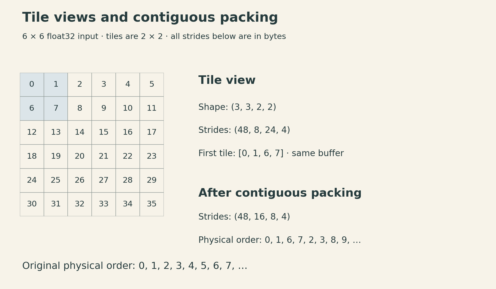
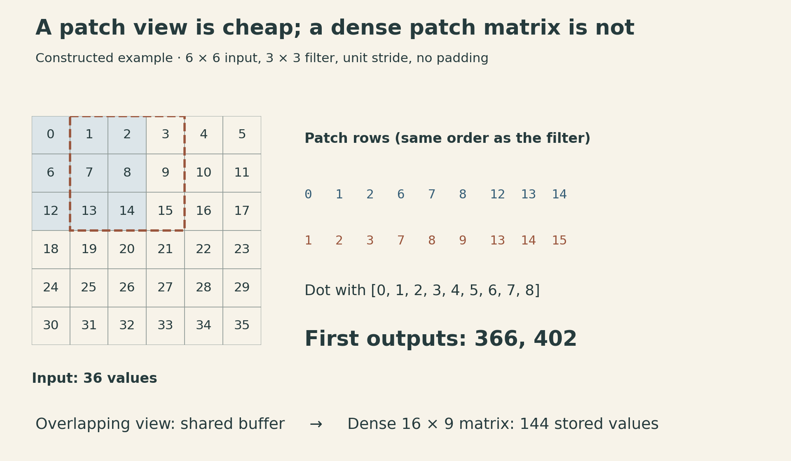
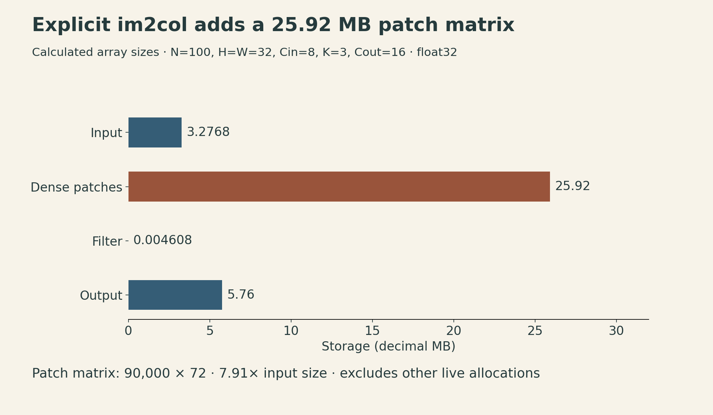

A convolution can be expressed as one matrix multiplication. The interesting implementation question is how its input becomes a matrix—and what that transformation costs.

A sliding-window view can describe every overlapping image patch without copying the pixels. Flattening those patches into the dense matrix expected by a conventional matrix multiplication usually requires new storage. **The arithmetic becomes familiar, while the memory bill moves into the reshape.**

[CMU 10-414/714 Deep Learning Systems, Lecture 14](https://dlsyscourse.org/lectures/) develops this connection through three implementations: scalar loops, a sum of channel matrix products, and explicit `im2col`. The public recording is the course's 2022 version. The examples here use the accompanying NumPy notebook's NHWC convention and a restricted forward operator: square kernels, unit spatial stride, no padding, no dilation, no groups, and no bias.

## 1. Fix the index contract before optimizing it

Let the input be $X\in\mathbb{R}^{N\times H\times W\times C_{\mathrm{in}}}$ and the filter be $F\in\mathbb{R}^{K\times K\times C_{\mathrm{in}}\times C_{\mathrm{out}}}$. Assume positive dimensions and $K\leq\min(H,W)$. Then

$$
H_o=H-K+1,\qquad W_o=W-K+1,
$$

and the output has shape $N\times H_o\times W_o\times C_{\mathrm{out}}$. One output element is

$$
Y_{n,y,x,o}=\sum_{i=0}^{K-1}\sum_{j=0}^{K-1}\sum_{c=0}^{C_{\mathrm{in}}-1}
X_{n,y+i,x+j,c}F_{i,j,c,o}.
$$

The filter is used without reversing its spatial axes. This is the **cross-correlation** convention commonly called convolution in neural-network libraries.

NHWC names the logical axis order: batch, height, width, channel. For a C-contiguous NumPy input, channels are adjacent in memory. PyTorch's `conv2d` interface instead uses NCHW inputs and output/input/spatial filter axes. A reference comparison therefore converts inputs with `transpose(0, 3, 1, 2)` and filters with `transpose(3, 2, 0, 1)`, then converts the output back. Changing these axes changes their interpretation; a reshape alone does not perform that conversion.

Logical axis order and physical memory format are separate choices. In particular, PyTorch's channels-last memory format retains NCHW logical dimensions. Neither layout is universally fastest: the operators, shapes, dtype and backend determine the useful arrangement.

A seven-loop implementation follows the formula directly. It is valuable as a small correctness oracle because every index has a visible meaning. Its scalar Python loop overhead makes it a poor performance target. The optimization must preserve the indexed sum, not merely produce an array of the right shape.

## 2. Move the channel contraction into matrix multiplication

For $K=1$, each pixel's channel vector is multiplied by the same matrix $F_{0,0}$:

```python
Y = X @ F[0, 0]
```

Here NumPy's batched matrix multiplication contracts the final input dimension with the first (input-channel) axis of the matrix `F[0, 0]`. Equivalently, flatten the batch and spatial positions to $NHW$ rows, multiply by a $C_{\mathrm{in}}\times C_{\mathrm{out}}$ matrix, and restore the output shape.

For larger kernels, keep only the spatial filter loops:

```python
Y = np.zeros((N, H_o, W_o, C_out), dtype=X.dtype)
for i in range(K):
    for j in range(K):
        Y += X[:, i:i+H_o, j:j+W_o, :] @ F[i, j]
```

Assume matching `float32` or `float64` input and filter dtypes. Each slice has shape $N\times H_o\times W_o\times C_{\mathrm{in}}$. Each filter position supplies one channel-mixing matrix. The slices shift the input so their results accumulate at the correct output positions.

The scalar products have not disappeared. They have moved into compiled matrix operations. There are $K^2$ batched matrix-multiplication expressions and repeated output accumulations; NumPy and its backend determine the actual kernel calls. This is already a useful implementation without constructing the full patch matrix.

## 3. A view changes the address calculation

NumPy stores strides in **bytes**. For an array with strides $(s_0,\ldots,s_{d-1})$, the byte offset from its logical origin is $\sum_k i_k s_k$.

Start with `A = np.arange(36, dtype=np.float32).reshape(6, 6)`. Its strides are `(24, 4)`: moving down one row advances six four-byte values.

To describe $2\times2$ tiles, use a view with shape `(3, 3, 2, 2)` and strides `(48, 8, 24, 4)`. Its element is

$$
T_{a,b,i,j}=A_{2a+i,\,2b+j}.
$$

The first tile contains `0, 1, 6, 7`. A plain `A.reshape(3, 3, 2, 2)` would group `0, 1, 2, 3` first instead. Both have the requested shape; only one describes the intended tiles.

{fig-alt="A 6 by 6 float32 array starts with rows 0 through 5 and 6 through 11. A 2 by 2 tile view has shape 3,3,2,2 and byte strides 48,8,24,4; the first tile contains 0,1,6,7. It shares the original buffer. Packing yields the physical sequence 0,1,6,7,2,3,8,9 and byte strides 48,16,8,4 in a new array."}

Calling `np.ascontiguousarray(T)` packs the tiles in their logical order. For this example it creates new storage with strides `(48, 16, 8, 4)`. Its physical sequence begins `0, 1, 6, 7, 2, 3, 8, 9`. A different stride tuple describes the original buffer; a packing operation actually rearranges values.

This distinction connects the tensor views and strides from earlier lectures to convolution.

## 4. Repeated strides describe overlapping patches

For the same $6\times6$ array and a $3\times3$ filter, the output has $4\times4$ positions. Define

$$
P_{y,x,i,j}=A_{y+i,x+j}.
$$

The patch tensor has shape `(4, 4, 3, 3)` and byte strides `(24, 4, 24, 4)`. Moving the window down or moving within a window down advances the same underlying row stride. That is why the strides repeat.

```python
P = np.lib.stride_tricks.as_strided(
    A,
    shape=(4, 4, 3, 3),
    strides=A.strides + A.strides,
    writeable=False,
)
```

Overlapping windows alias: `P[0, 0, 0, 1]` and `P[0, 1, 0, 0]` both refer to `A[0, 1]`. Treat the view as read-only. `writeable=False` prevents accidental writes through it; it does not validate arbitrary shape/stride combinations or prevent changes through the original array.

For this construction, the index equation proves the bounds: the largest row index is $(4-1)+(3-1)=5$, and similarly for the column. When a high-level sliding-window API expresses the operation, prefer it to hand-built strides. The low-level form is useful here because it exposes the address calculation. [NumPy `as_strided` notes](https://numpy.org/doc/stable/reference/generated/numpy.lib.stride_tricks.as_strided.html)

{fig-alt="Two neighboring 3 by 3 windows in a 6 by 6 array overlap. Their flattened rows are 0,1,2,6,7,8,12,13,14 and 1,2,3,7,8,9,13,14,15. Dotting these rows with filter values 0 through 8 gives output values 366 and 402. All 16 windows form a 16 by 9 matrix. The patch view shares storage; the dense patch matrix copies values in this example."}

Flatten each patch to one row and flatten the filter in the same order. For the notebook's filter `np.arange(9).reshape(3, 3)`, the first row gives

$$
0\cdot0+1\cdot1+2\cdot2+6\cdot3+7\cdot4+8\cdot5
+12\cdot6+13\cdot7+14\cdot8=366.
$$

The next window gives $402$. The complete output is

$$
\begin{bmatrix}
366&402&438&474\\
582&618&654&690\\
798&834&870&906\\
1014&1050&1086&1122
\end{bmatrix}.
$$

These are exact arithmetic examples, not speed measurements.

## 5. Generalize the patch matrix to channels and batches

For an NHWC input with byte strides $(s_N,s_H,s_W,s_C)$, the six-dimensional patch view has

$$
\begin{aligned}
\text{shape}&=(N,H_o,W_o,K,K,C_{\mathrm{in}}),\\
\text{strides}&=(s_N,s_H,s_W,s_H,s_W,s_C).
\end{aligned}
$$

Flatten the last three axes in the order $(i,j,c)$. Then

$$
\underbrace{A_{\mathrm{col}}}_{(NH_oW_o)\times(K^2C_{\mathrm{in}})}
\;\underbrace{F_{\mathrm{mat}}}_{(K^2C_{\mathrm{in}})\times C_{\mathrm{out}}}
=\underbrace{Y_{\mathrm{mat}}}_{(NH_oW_o)\times C_{\mathrm{out}}}.
$$

The traditional name is `im2col`, although this orientation puts image patches in **rows**. The orientation matters less than matching each flattened input coordinate to the corresponding weight.

Here is a bounded teaching implementation. It accepts NumPy arrays with positive dimensions and matching `float32` or `float64` dtype. It implements only the forward operator defined above.

```python
import numpy as np


def conv_im2col(X, F):
    if X.ndim != 4 or F.ndim != 4:
        raise ValueError("Expected NHWC input and KKIO filter")
    N, H, W, C = X.shape
    K, K2, C2, O = F.shape
    if min(N, H, W, C, K, K2, C2, O) <= 0:
        raise ValueError("Dimensions must be positive")
    if K != K2 or C != C2 or K > min(H, W):
        raise ValueError("Incompatible input and square filter")
    if X.dtype != F.dtype or X.dtype not in (np.float32, np.float64):
        raise ValueError("Use matching float32 or float64 arrays")
    Ho, Wo = H - K + 1, W - K + 1
    sn, sh, sw, sc = X.strides
    patches = np.lib.stride_tricks.as_strided(
        X, shape=(N, Ho, Wo, K, K, C),
        strides=(sn, sh, sw, sh, sw, sc), writeable=False,
    )
    # Packing is explicit: do not hide its storage cost in reshape.
    cols = np.ascontiguousarray(patches).reshape(N * Ho * Wo, K * K * C)
    # A non-contiguous filter may also need a copy here.
    weights = F.reshape(K * K * C, O)
    return (cols @ weights).reshape(N, Ho, Wo, O)
```

The view uses the actual input strides, so valid sliced or transposed NumPy inputs retain their logical meaning. A non-contiguous filter may also require a copy during its reshape. Even when a particular shape permits sharing, the implementation should budget for the general case rather than assume every reshape is free.

A shape-only test will miss flattening mistakes. Compare small non-square inputs and distinct channel values against the indexed definition; include $K=1$, a separate square-input case whose filter spans the full image, and non-contiguous inputs. Floating-point accumulation order can differ, so compare with appropriate absolute and relative tolerances.

## 6. The dense matrix has a measurable storage bill

The input holds $NHWC_{\mathrm{in}}$ values. The explicit patch matrix holds

$$
NH_oW_oK^2C_{\mathrm{in}}
$$

values, for an expansion ratio

$$
\rho=\frac{H_oW_oK^2}{HW}.
$$

For large images and small valid kernels, this approaches $K^2$. It is not exactly $K^2$ for finite images: the $6\times6$ example becomes $16\times9$, or $144/36=4$ times as many values.

The notebook's larger shape makes the cost concrete. With $N=100$, $H=W=32$, $C_{\mathrm{in}}=8$, $K=3$ and $C_{\mathrm{out}}=16$, the patch matrix is $90{,}000\times72$ and $\rho=7.91015625$.

::: {.table-scroll}

| Array | Number of values | Storage at float32 |
|---|---:|---:|
| Input | 819,200 | 3.2768 MB |
| Dense patch matrix | 6,480,000 | 25.9200 MB |
| Filter | 1,152 | 0.004608 MB |
| Output | 1,440,000 | 5.7600 MB |

:::

MB here means $10^6$ bytes. These are array-size calculations; peak process memory can be higher because allocations coexist, a backend may pack operands, and other runtime state remains live. The notebook's default `np.random.randn` arrays use `float64`, which doubles these byte counts.

{fig-alt="For a constructed float32 case N100 H32 W32 C8 K3 O16, bars starting at zero show input 3.2768 MB, dense patches 25.92 MB, filter 0.004608 MB, and output 5.76 MB. The patch matrix is 90000 by 72, 7.91 times the input size. These are array sizes, not peak process memory or measured runtime."}

For the $6\times6$ example, `np.shares_memory(P, A)` is true, while `np.shares_memory(P.reshape(16, 9), A)` is false. Within each window, moving from the last element of one window row to the first element of the next advances 16 bytes, while moving along a window row advances 4 bytes. No single stride describes the flattened nine-element patch. NumPy therefore copies that arrangement. Its `reshape` contract permits a view when possible and a copy otherwise. [NumPy `reshape`](https://numpy.org/doc/stable/reference/generated/numpy.reshape.html)

Explicit `im2col` exchanges extra storage and copying for access to a well-optimized matrix multiplication. Other implementations can generate patch fragments as needed instead of materializing the entire matrix. The lecture's small NumPy program explains the transformation; it does not establish that explicit `im2col` is the fastest strategy on every CPU or GPU.

## 7. Optimize the whole transformation

All three formulations compute the same cross-correlation and the same direct-convolution multiply-add count, $NH_oW_oC_{\mathrm{out}}K^2C_{\mathrm{in}}$. Their execution costs differ because the work is grouped differently and the data moves differently.

A useful timing experiment must include patch construction or packing, matrix multiplication, and required layout conversions. Report shape, dtype, device, thread settings, warmup and repetitions. Timing only the final `@` expression can hide the operation that consumed the extra memory.

The lesson extends beyond convolution: when a tensor expression becomes a familiar primitive, follow its inputs all the way to physical storage. A compact formula can expose a fast kernel while concealing the copy needed to feed it.

## Sources and lecture

- [Official lecture schedule](https://dlsyscourse.org/lectures/), Lecture 14, with the public 2022 recording.
- [Implementing convolutions notebook](https://github.com/dlsyscourse/public_notebooks/blob/1d3653adcbb8ef004a552aa71427de6819c1f8f7/convolution_implementation.ipynb): storage order, loop and matrix formulations, tiling, and `im2col`.
- [NumPy `as_strided`](https://numpy.org/doc/stable/reference/generated/numpy.lib.stride_tricks.as_strided.html) and [`reshape`](https://numpy.org/doc/stable/reference/generated/numpy.reshape.html).
- [PyTorch `Conv2d`](https://docs.pytorch.org/docs/stable/generated/torch.nn.Conv2d.html) and [channels-last memory format](https://docs.pytorch.org/tutorials/intermediate/memory_format_tutorial.html).



[Watch the official lecture on YouTube](https://www.youtube.com/watch?v=7kclgMIcMq0).
