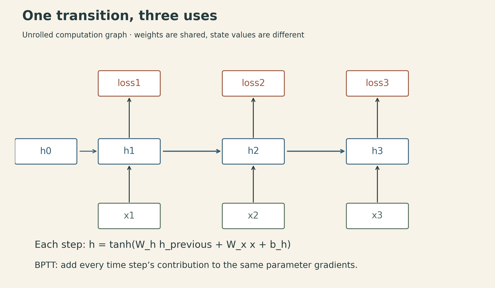

A recurrent network can make its next prediction with one hidden vector. Training that same network over a long sequence requires remembering how that vector was produced. This difference between the state needed to continue a computation and the graph needed to differentiate it explains much of the engineering around RNNs.

The current CMU Deep Learning Systems schedule calls this Lecture 15. Its linked slides are labeled **Fall 2022**, by J. Zico Kolter and Tianqi Chen; the accompanying public recording is titled Lecture 18. The ideas here follow those materials: sequence prediction, shared recurrent updates, backpropagation through time, LSTMs, and ways to use context beyond a forward pass.

## 1. Decide which context the prediction may use

Sequence modeling begins with the prediction task. A word can take different grammatical roles in different sentences. An audio segment can be ambiguous until neighboring speech provides context. These tasks need more than an isolated input-output pair, but they do not all impose the same information restrictions.

For next-token prediction, a model consumes a prefix and predicts the next token:

$$
p_\theta(x_{1:T})=\prod_{t=1}^{T}p_\theta(x_t\mid x_{1:t-1}).
$$

The first factor uses an empty prefix or a designated start symbol. If a hidden state has already consumed $x_t$, its prediction can target $x_{t+1}$. Confusing those two indexing conventions can accidentally feed the answer into the model.

Offline part-of-speech tagging may use the whole input sentence. Streaming recognition may be restricted to past observations, or permit a declared amount of lookahead. The model should implement the information available when the prediction will actually be used.

Sequence dependence also does not imply that all training examples must form one uninterrupted stream. A dataset can contain independent sequences with dependence *within* each sequence. Shuffling whole independent sequences is different from shuffling their time steps.

## 2. Reuse parameters while evolving the state

For column-vector inputs $x_t\in\mathbb R^D$ and hidden states $h_t\in\mathbb R^H$, a simple tanh RNN is

$$
a_t=W_hh_{t-1}+W_xx_t+b_h,\qquad h_t=\tanh(a_t),
$$

$$
z_t=W_yh_t+b_y.
$$

For classification, a softmax turns logits $z_t$ into class probabilities. Regression can use a different output map and loss. The dimensions are

| Quantity | Shape |
|---|---|
| $W_h$ | $H\times H$ |
| $W_x$ | $H\times D$ |
| $b_h$, $h_t$ | $H$ |
| $W_y$ | $K\times H$ |
| $b_y$, $z_t$ | $K$ |

These parameters are shared across time. A longer input creates more applications of the same transition; it does not create a separate learned matrix for every position. With one bias per affine map, the parameter count is

$$
H^2+HD+H+KH+K,
$$

independent of the sequence length $T$.

The state $h_t$ is a learned summary of the prefix, not a guarantee that every detail is recoverable. A path from an early input to a later prediction establishes potential dependence. It does not establish that optimization will learn to preserve the useful information along that path.

A zero initial state is a common choice. For independent examples, reset the state between sequences. A streaming application may carry it across chunks of the same stream. Carrying state between unrelated examples silently changes the model's context.

## 3. Unrolling turns recurrence into an ordinary graph

For a sequence with targets $y_t^\star$, consider

$$
L=\sum_{t=1}^{T}\ell(z_t,y_t^\star).
$$

A conceptual training step is straightforward:

```text
clear parameter gradients
h = initial_state
loss = 0
for each valid time step t:
    h = tanh(W_h @ h + W_x @ x[t] + b_h)
    logits = W_y @ h + b_y
    loss += loss_for(logits, target[t])
backpropagate(loss)
update parameters
```

Backpropagation through time (BPTT) is reverse-mode differentiation through this unrolled graph. Every use of a shared parameter contributes to its gradient. The state at a late time depends on the earlier uses of that parameter as well as the current one.

For a more explicit view, let $r_t=W_y^\top(\partial\ell_t/\partial z_t)$ be the gradient arriving from the output at time $t$, and let $\delta_t=\partial L/\partial a_t$. Then

$$
\delta_t=\left(r_t+W_h^\top\delta_{t+1}\right)\odot(1-h_t^2),
\qquad \delta_{T+1}=0,
$$

$$
\frac{\partial L}{\partial W_h}=\sum_{t=1}^{T}\delta_t h_{t-1}^\top,
\qquad
\frac{\partial L}{\partial W_x}=\sum_{t=1}^{T}\delta_t x_t^\top.
$$

Here $h_0$ is fixed, and the loss has no extra direct dependence on these recurrent weights. An autodiff engine accumulates these paths for us; the equations explain what its graph must retain.

{fig-alt="Inputs x1, x2, x3 feed a chain of state boxes h1, h2, h3, each pointing to a loss box; output maps are omitted. The footer gives the transition using shared W_h and W_x and states that BPTT sums contributions across time."}

For a single-layer network and one sequence, continuing inference needs $O(H)$ recurrent state, excluding parameters and stored outputs. Ordinary BPTT typically retains $O(TH)$ hidden activations and related intermediates; batch size and layer count multiply the relevant terms. Checkpointing can trade recomputation for storage. A short inference state therefore does not imply a short training graph.

The lecture introduces full BPTT and leaves truncated BPTT to the implementation lecture. The key distinction is useful already: **carrying a state value across a chunk boundary and carrying a derivative graph across it are separate choices**. Detaching a state preserves its numerical value while stopping gradients through its earlier history. Resetting it discards the value as well. Truncation changes the gradient estimate, not merely the memory allocation.

## 4. Long paths multiply local sensitivities

Holding the input at each step fixed, the tanh RNN's state-to-state Jacobian is

$$
J_t=\frac{\partial h_t}{\partial h_{t-1}}
=\operatorname{diag}(1-h_t^2)W_h.
$$

A perturbation propagated from state $h_s$ to $h_T$ follows

$$
\frac{\partial h_T}{\partial h_s}=J_TJ_{T-1}\cdots J_{s+1}.
$$

Repeated contraction can make an early input's influence tiny. Repeated expansion can make it enormous. The behavior depends on the actual Jacobians, including activation derivatives and the state trajectory, rather than just one weight statistic.

A scalar linear recurrence makes the multiplication visible. For $h_t=ah_{t-1}$,

$$
\frac{\partial h_T}{\partial h_0}=a^T.
$$

After 100 steps, $0.8^{100}\approx2.04\times10^{-10}$, whereas $1.2^{100}\approx8.28\times10^7$. These are constructed sensitivity calculations, not measurements from a trained network.

The lecture's ReLU examples show growing states under one initialization and decaying influence from an input impulse under another. Their lesson is sensitivity to repeated transitions. The feedforward ReLU variance heuristic $2/H$ is not a universal stability guarantee for a recurrent matrix reused along a changing trajectory.

### Bounded activations do not bound every gradient

Tanh bounds each hidden component between $-1$ and $1$. That prevents an unbounded hidden activation, but not every possible exploding derivative. Consider the scalar system $h_t=\tanh(2h_{t-1})$ along the zero trajectory. Every state stays zero, yet each local state derivative is 2, so $\partial h_T/\partial h_0=2^T$. This concerns sensitivity to the initial state along an exact, unstable zero trajectory, not a typical training trajectory. The recurrent-weight gradient in this particular construction is zero because every preceding state is zero; the example does not say that every parameter gradient explodes.

At the opposite extreme, a saturated tanh has a small derivative and can contribute to vanishing sensitivity. Activation magnitude and derivative magnitude need separate checks.

Gradient clipping caps the norm of an update-driving gradient, for example

$$
g_{\mathrm{clip}}=g\min\left(1,\frac{\tau}{\lVert g\rVert_2}\right)
$$

for a threshold $\tau>0$ and nonzero $g$, leaving a zero gradient unchanged. It can limit large updates. It does not restore information already attenuated along the graph, and it is not a substitute for finite-value checks.

## 5. An LSTM adds a controlled additive state path

An LSTM maintains a pair $(h_t,c_t)$. Both are internal state; the customary name “hidden state” for $h_t$ can obscure the fact that $c_t$ is state too.

For a standard cell without peephole connections or projections, form one packed affine result:

$$
u_t=W_hh_{t-1}+W_xx_t+b\in\mathbb R^{4H}.
$$

Here $W_h\in\mathbb R^{4H\times H}$, $W_x\in\mathbb R^{4H\times D}$, and $b\in\mathbb R^{4H}$. Split $u_t$ into four $H$-vectors in a declared order, then apply

$$
i_t=\sigma(u_t^{(i)}),\quad
f_t=\sigma(u_t^{(f)}),\quad
q_t=\tanh(u_t^{(q)}),\quad
o_t=\sigma(u_t^{(o)}).
$$

I use $q_t$ for the candidate update to keep it distinct from a generic gradient $g$. The state update is

$$
c_t=f_t\odot c_{t-1}+i_t\odot q_t,
\qquad h_t=o_t\odot\tanh(c_t).
$$

The packed calculation is four distinct affine maps organized into a larger matrix operation. Each gate receives its own H-dimensional preactivation slice. Implementations must agree on gate order; switching two slices can leave every tensor shape valid while changing the model.

A one-dimensional constructed example uses $c_{t-1}=2$, $f_t=0.9$, $i_t=0.2$, $q_t=-0.5$, and $o_t=0.8$. Then

$$
c_t=0.9(2)+0.2(-0.5)=1.7,
\qquad h_t=0.8\tanh(1.7)\approx0.7483.
$$

The previous memory is scaled, a bounded update is added, and the output gate controls the exposed state. The cell state itself need not be bounded by 1. Even though each added term has magnitude below 1 per component, additions can accumulate over time.

## 6. What the forget-gate product does—and does not—prove

The direct cell-to-cell edge, holding the gate values and other incoming branches fixed, has derivative

$$
\left.\frac{\partial c_t}{\partial c_{t-1}}\right|_{\text{direct edge}}
=\operatorname{diag}(f_t).
$$

Along that path across several steps, component $j$ has multiplier

$$
\prod_{t=s+1}^{T} f_{t,j}.
$$

A forget gate near 1 provides a route for a memory perturbation to persist without repeatedly passing through a tanh derivative on that route. This is the central advantage emphasized in the lecture.

“Near 1” still needs a time scale. If the forget gate is fixed at 0.99 for 100 transitions, the direct-path multiplier is about 0.366. At 0.95 it is about 0.00592; at 0.90 it is about $2.66\times10^{-5}$. With a constant gate $f\in(0,1)$, the half-life of this isolated path is $\log(0.5)/\log(f)$: about 69 steps for 0.99 and 13.5 for 0.95.

{fig-alt="Fixed-gate direct cell-path multipliers f to the k on a log scale. At k = 100: f = 0.99 gives 0.366, f = 0.95 gives 0.00592, f = 0.90 gives 0.0000266. Constructed update: previous c = 2, f = 0.9, i = 0.2, candidate = minus 0.5, and o = 0.8 yield c = 1.7 and h = 0.7483. Not the total LSTM gradient."}

This product is **not the full derivative of the recurrent system**. Earlier cell states also affect exposed hidden states, which affect later gates. A loss receives contributions through multiple paths, and those contributions may reinforce or cancel. The output tanh, output gate, gate learning, and chosen loss all matter. LSTMs improve the architecture's available paths; they do not guarantee that every long dependency will be learned or that gradients cannot vanish or explode.

In exact arithmetic, sigmoid gates are strictly between 0 and 1 for finite real logits; floating-point implementations can round to an endpoint. Gate values 0 and 1 are useful idealized limits. Saturation near 1 helps the direct retention path while making the sigmoid's own logit derivative small. Preserving a stored value and learning how to change the gate are different derivative questions.

## 7. Depth, encoder-decoder models, and future context

Stacking RNN layers introduces a second depth axis. Layer $\ell$ receives the lower layer's state at the current time and its own previous-time state:

$$
h_t^{(\ell)}=F_\ell\left(h_{t-1}^{(\ell)},h_t^{(\ell-1)}\right),
\qquad h_t^{(0)}=x_t.
$$

If all layers run forward, stacking preserves the prefix-only dependency. The temporal dependency within a layer also remains: later recurrent states depend on earlier ones. Matrix operations can parallelize across examples and hidden features, and input-side work can sometimes be batched across time, but a vanilla recurrent chain is not a set of independent time steps.

An encoder-decoder model changes the layout. The encoder processes the source sequence into a final state; the decoder uses that state to generate a target sequence, often autoregressively until an end token. Input and output lengths can differ. The encoder need not have a prediction loss at every source position to receive gradients: decoder loss can propagate through its final state. In an LSTM design, specify whether both $h$ and $c$ initialize the decoder and how differing dimensions are mapped.

A bidirectional model changes the information set. A common construction runs a forward and a backward recurrence on the input and combines their states at each position. The lecture illustrates a related stacked forward-then-backward construction. Both can let a position depend on future input positions; they are not the same wiring diagram.

{fig-alt="Two 3 by 3 context diagrams. Forward prefix prediction allows x1 for output1, x1x2 for output2, and x1x2x3 for output3. Offline bidirectional tagging allows all inputs for each output. Future context must not leak into next-token prediction."}

Using a whole source sentence in an offline translation encoder is compatible with an autoregressive target decoder. Using the future target tokens to predict the next target token is leakage. These are different axes of context, so the word “bidirectional” is not enough to determine whether a model respects the task.

## 8. Generation quality needs its own evidence

The lecture revisits Andrej Karpathy's 2015 character-level LSTM examples, including text resembling source code and LaTeX. They illustrate that local next-character predictions can produce longer recognizable structures. Resembling a program does not demonstrate that the program runs; resembling a proof does not establish mathematical validity. The [original post](https://karpathy.github.io/2015/05/21/rnn-effectiveness/) provides the historical examples.

The useful systems habit is to ask three questions separately:

1. **State:** what values must persist to make the next prediction?
2. **Graph:** which earlier computations must remain connected to learn from a later loss?
3. **Context:** which observations are available at prediction time?

An RNN supplies a reusable state transition. BPTT differentiates its uses across time. An LSTM supplies an additive route whose retention can be controlled. A reliable implementation has to preserve all three contracts, including the boundaries between independent sequences.

## Lecture and sources

- [CMU Deep Learning Systems schedule](https://dlsyscourse.org/lectures/): current Lecture 15, Sequence Modeling + RNNs.
- [Sequence Modeling and Recurrent Networks slides](https://dlsyscourse.org/slides/rnns.pdf), Fall 2022, especially pp. 9–18 and 22–23.
- [Official public recording](https://www.youtube.com/watch?v=aI47BqLYahc), titled Lecture 18 in the older recording sequence.
- [Karpathy's character-level RNN examples](https://karpathy.github.io/2015/05/21/rnn-effectiveness/), 2015.


