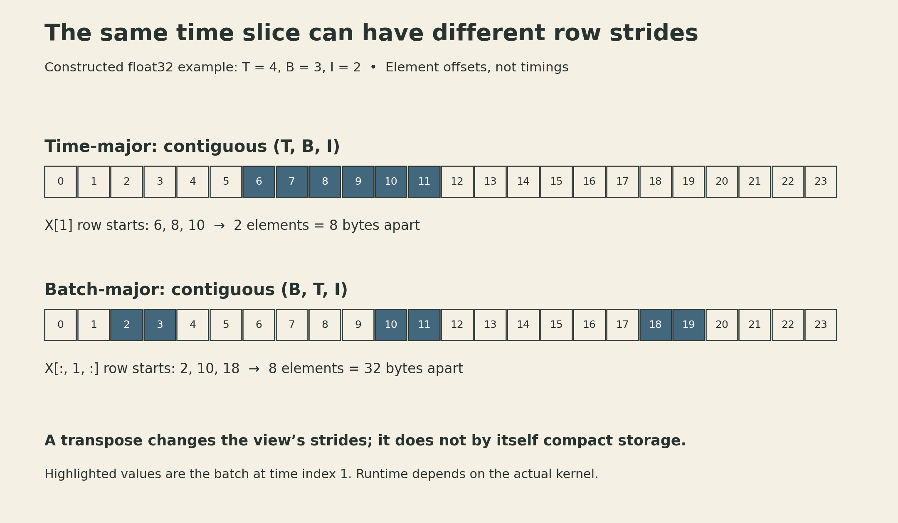

Three sequences with lengths five, three, and one contain nine valid positions. A rectangular batch has fifteen. Processing those six padding positions, avoiding them, and carrying state into the next training chunk are different decisions. They affect the execution schedule and which final states are returned. Detaching a carried state also changes which derivatives are retained.

The [previous lecture](cmu-dlsys-lecture-15-sequence-modeling-rnns.qmd) explained recurrent states and backpropagation through time. This implementation lecture turns those equations into array operations. It is Lecture 16 in the current CMU 10-414/714 schedule; the linked public recording is the 2022 Lecture 19, “RNN Implementation.” The accompanying notebook develops a NumPy forward implementation and then discusses training separately.

## Four gates fit into two matrix products

Consider a single-layer, unidirectional LSTM without projections. Let the input width be $I$, hidden width $H$, and batch size $B$. At one time step,

$$
X_t\in\mathbb R^{B\times I},\qquad
h_{t-1},c_{t-1}\in\mathbb R^{B\times H}.
$$

Using PyTorch's stored weight orientation, the combined preactivation is

$$
A_t=X_tW_{ih}^{\mathsf T}+h_{t-1}W_{hh}^{\mathsf T}+b,
\qquad A_t\in\mathbb R^{B\times4H},
$$

where $W_{ih}\in\mathbb R^{4H\times I}$, $W_{hh}\in\mathbb R^{4H\times H}$, and $b=b_{ih}+b_{hh}\in\mathbb R^{4H}$. Bias broadcasts across the batch.

Split the **feature axis**, not the batch axis, into four consecutive blocks:

$$
A_t=[A_t^i\mid A_t^f\mid A_t^g\mid A_t^o].
$$

Apply sigmoid to the input, forget, and output blocks, and tanh to the candidate block:

$$
i_t=\sigma(A_t^i),\quad f_t=\sigma(A_t^f),\quad
 g_t=\tanh(A_t^g),\quad o_t=\sigma(A_t^o).
$$

Then update the two states:

$$
c_t=f_t\odot c_{t-1}+i_t\odot g_t,
\qquad h_t=o_t\odot\tanh(c_t).
$$

For the notebook's $I=20,H=100$, the stored weight shapes are $(400,20)$ and $(400,100)$. Packing the gate rows changes how the work is expressed; it does not tie the four gates' weights to one another. Each block still has its own parameters.

The following is a small forward reference, adapted to accept batched rows and PyTorch-oriented weights:

```python
import numpy as np

def sigmoid(z):
    return 0.5 * (1.0 + np.tanh(0.5 * z))

def lstm_cell(x, h, c, W_ih, W_hh, b):
    a = x @ W_ih.T + h @ W_hh.T + b
    ai, af, ag, ao = np.split(a, 4, axis=1)
    i, f, g, o = sigmoid(ai), sigmoid(af), np.tanh(ag), sigmoid(ao)
    c_next = f * c + i * g
    h_next = o * np.tanh(c_next)
    return h_next, c_next
```

The sigmoid identity used here avoids evaluating an overflowing `exp(-z)` when `z` is a large negative number. This is still a NumPy forward calculation, not an implementation of automatic differentiation.

### Forward equivalence does not settle the training parameterization

Adding PyTorch's two bias vectors reproduces the cell's forward function. Replacing two independently trained biases with one parameter is a separate change. For ordinary SGD without regularization, if both original biases receive gradient $g$, their sum changes by $-2\eta g$. A single summed bias trained at the same learning rate changes by $-\eta g$. Equal forward values do not automatically give equal optimization trajectories.

The pinned notebook also contains two small pitfalls: its shape-printing cell creates `model` but refers to `cell`, and its first scalar cell assigns `c_out = f*c + i*g,` with a trailing comma. That comma constructs a tuple. NumPy conversion and broadcasting can hide the extra dimension in a norm comparison. Reusing that malformed hidden state in the scalar sequence loop then fails at the next matrix multiplication. The later batched implementation removes the comma. A useful comparison checks types and shapes before checking numerical closeness.

## Batch across sequences; advance along time

A cell for time $t+1$ needs the state produced at time $t$. Batching several independent sequences makes each step a matrix–matrix operation, but it does not remove that dependency inside each sequence.

For time-major input $X\in\mathbb R^{T\times B\times I}$, a forward loop can keep a batch of states and collect the outputs:

```python
def lstm_sequence(X, h, c, W_ih, W_hh, b):
    outputs = []
    for x_t in X:
        h, c = lstm_cell(x_t, h, c, W_ih, W_hh, b)
        outputs.append(h)
    return np.stack(outputs, axis=0), (h, c)
```

This reference assumes at least one time step and a common compatible floating-point dtype. Its output has shape $(T,B,H)$; its final state pair has shape $(B,H)$ each. Appending states is safe here because the cell constructs new arrays rather than modifying earlier states in place.

The same weight objects are reused at every time step. In an autodiff implementation, all their uses contribute to the same parameter gradient. Recreating a separately parameterized cell at each step would define a different model.

Not every operation must wait for the recurrent state. If the whole input is already available, the input contribution $X_tW_{ih}^{\mathsf T}$ can be computed across time in advance. The hidden-to-hidden contribution and state updates remain sequential. Materializing all input preactivations also costs storage proportional to $4TBH$ values; whether it helps depends on the implementation and workload.

## The time slice must match the memory layout

The notebook motivates time-major layout using the Needle/HW3 matrix-multiplication path, which requires compact operands. Its NumPy demonstration is not itself restricted to compact arrays. With row-major storage, a contiguous $(T,B,I)$ array has element strides

$$
(BI,\ I,\ 1).
$$

The slice `X[t]` is then a contiguous $(B,I)$ matrix. By contrast, a contiguous batch-major $(B,T,I)$ array has strides

$$
(TI,\ I,\ 1),
$$

and `X[:, t, :]` has row stride $TI$ rather than $I$. Each sequence's feature vector is contiguous, but adjacent batch rows are separated by the rest of that sequence's time axis.

For a constructed $T=4,B=3,I=2$ float32 array, a fixed-time batch uses row strides of 2 elements in time-major storage and 8 elements in batch-major storage: 8 versus 32 bytes between row starts. This describes addresses, not a measured runtime difference.

{fig-alt="Two physical address strips compare the same time-index-1 batch in T=4, B=3, I=2 arrays. Time-major highlights offsets 6 through 11 consecutively. Batch-major highlights three separated pairs, 2–3, 10–11, and 18–19. Row-start strides are 8 and 32 bytes respectively; no timing is shown."}

Changing the axis labels is not enough. Transposing a batch-major array usually produces a view with new strides, not a newly compact time-major allocation. If the next kernel requires compact storage, materialization must occur somewhere.

This is a constraint of that execution path, not a claim that `batch_first=True` is universally slow. PyTorch supports both input conventions; backend kernels, internal rearrangement, sequence lengths, and batch size determine the actual cost. The API's logical shape and the kernel's physical layout are separate facts.

### Final-state axes have their own meaning

For a batched PyTorch LSTM, hidden and cell states retain a leading layer-and-direction axis even when `batch_first=True`. Without projections, their shape is

$$
(\text{num\_layers}\times\text{num\_directions},\ B,\ H).
$$

For one unidirectional layer, this is $(1,B,H)$, not an extra sequence-length dimension. The full output contains the last layer's hidden states at every time step; the returned final-state pair includes every layer. A multi-layer continuation therefore needs all of that pair, not just the last element of the top layer's output.

## Packing changes the active batch at each step

Variable-length inputs can be padded to a rectangle. For a forward unidirectional model, the output at a sequence's last valid position is available before its padding begins. But zero input does not freeze an LSTM: recurrent weights and biases can still change both states. A loss mask can exclude padded losses without making the final padded state equal to the last valid state.

Packed sequences avoid processing those absent positions. Sort the example sequences by length: $A$ has five elements, $B$ has three, and $C$ has one. Their time-major packed order is

$$
[A_0,B_0,C_0,\ A_1,B_1,\ A_2,B_2,\ A_3,\ A_4].
$$

The active batch sizes are $[3,2,2,1,1]$. Cumulative offsets $[0,3,5,7,8,9]$ delimit each time step's segment in the packed array. The final offset is the total number of valid positions.

{fig-alt="A three-by-five sequence grid labels A0–A4, B0–B2, and C0, with six hatched padding cells. A strip below lists A0,B0,C0,A1,B1,A2,B2,A3,A4 in time groups of sizes 3,2,2,1,1. Nine valid positions replace fifteen padded positions, without a runtime claim."}

At the next step, a simple sorted implementation keeps the states of the sequences still active. Before dropping a finished row, it must preserve that sequence's final state if the caller needs it. Outputs and final states must also map back to the caller's sequence order. The bookkeeping identifies which state belongs to which sequence; the flattened data alone does not provide that information.

The notebook explains packing but does not implement it. PyTorch's `PackedSequence` exposes active `batch_sizes` plus sorting and inverse-sorting information. Its batch sizes are not the original length vector. Standard packing helpers construct this structure rather than requiring callers to assemble it manually.

In this example, packing removes $6/15=40\%$ of logical cell evaluations. That does not establish a 40% time reduction. Smaller late-time matrix products may use hardware less efficiently, and packing adds indexing and data movement. A timing claim needs a specified backend, shapes, dtype, and measurement protocol.

## A deep LSTM still obeys a dependency graph

At layer $\ell$ and time $t$, the cell depends on its own previous-time state and the current-time output of the layer below. One valid evaluation order runs an entire layer across time, then feeds those outputs to the next layer. Another advances time and evaluates all layers at each step. Both must preserve the same dependencies.

For deterministic cells with the same inputs, parameters, and state, changing a valid evaluation order does not change the mathematical function. Stochastic operations require matching their random choices before that comparison is meaningful. The layer-by-layer notebook sketch is a convenient composition of the sequence routine, not proof that every backend uses that schedule.

Training additionally needs differentiable split, concatenation, matrix multiplication, activations, and state operations. Small forward differences against a reference library do not test backward rules or parameter-gradient accumulation.

## Carry the state value; choose the derivative horizon

Full backpropagation through time connects the loss to the entire unrolled history. Splitting a long stream into chunks bounds the graph retained for one backward pass. There are two different ways to begin the next chunk:

- Reset the state, which discards the previous chunk's context.
- Reuse the final state values while stopping gradients at that boundary.

The second is the notebook's hidden repackaging. Writing the combined hidden-and-cell state as $s_t$, a boundary at time $k$ uses

$$
\widetilde{s}_k=\operatorname{stopgrad}(s_k).
$$

Its numerical value equals $s_k$, but its derivative with respect to earlier computation is zero. For the next chunk's loss, truncation removes the chain-rule contribution through that incoming state:

$$
\frac{dL}{d\theta}
=\left.\frac{\partial L}{\partial\theta}\right|_{s_k\ \mathrm{fixed}}
 +\frac{\partial L}{\partial s_k}\frac{\partial s_k}{\partial\theta}.
$$

The truncated calculation keeps the first term and omits the second. It can use earlier information without assigning the next chunk's credit through the earlier state construction.

### The same forward result can have a different gradient

A constructed scalar recurrence makes the distinction visible:

$$
h_t=a h_{t-1}+x_t,\quad h_0=0,\quad
 a=0.5,\quad (x_1,x_2,x_3,x_4)=(1,2,3,4).
$$

Keep $a$ fixed during this comparison; no optimizer update occurs between chunks. The states are $1,2.5,4.25,6.125$. For $L=\tfrac12h_4^2$, full differentiation gives

$$
\frac{dh_4}{da}=5.75,\qquad \frac{dL}{da}=35.21875.
$$

Detaching after $h_2$ preserves $h_4=6.125$, but treats the incoming value $2.5$ as constant. The derivatives become

$$
\left.\frac{dh_4}{da}\right|_{h_2\ \mathrm{fixed}}=5.5,
\qquad \left.\frac{dL}{da}\right|_{h_2\ \mathrm{fixed}}=33.6875.
$$

Resetting the state to zero before $x_3$ instead changes the forward result to $h_4=5.5$, with $dh_4/da=3$ and $dL/da=16.5$. These are three different computations. The example is not an LSTM benchmark; it isolates the effect of the boundary.

{fig-alt="Two chunks contain x1=1,x2=2 and x3=3,x4=4. A solid forward arrow carries h2=2.5 across the boundary; a barred reverse arrow marks stop-gradient. The comparison table shows full and detached h4 both 6.125 with gradients 35.21875 and 33.6875, while reset gives h4=5.5 and gradient 16.5. Parameter a remains 0.5 throughout."}

A PyTorch-style training template makes the boundary explicit. It assumes consecutive chunks preserve the same sequence identity in each batch lane, `model` returns LSTM outputs and all layer states, and the loss handles the task's projection and valid-position mask:

```python
state = None
for x_chunk, y_chunk in stream:
    if state is not None:
        state = tuple(s.detach() for s in state)
    optimizer.zero_grad(set_to_none=True)
    output, state = model(x_chunk, state)
    loss = loss_fn(output, y_chunk)
    loss.backward()
    optimizer.step()
```

If a lane begins a different sequence, its state must be reset or replaced appropriately. Shuffling chunks while silently carrying the previous batch's states mixes unrelated histories. In multi-layer LSTMs, both returned state tensors must be carried for every layer.

`detach()` severs graph history; it does not copy storage. If later code needs an independent mutable buffer, detaching and cloning are separate operations. Avoid in-place changes that silently alter shared state storage.

There is also a parameter-time distinction. After an optimizer step, the carried state was produced by the previous parameters. Continuing from it is not the same as recomputing the entire prefix under the updated parameters. Truncated BPTT is an approximation to the full-history training calculation, even when the forward state carries useful long-range context.

The implementation therefore has three contracts to preserve: which time slice is contiguous, which sequence owns each state row, and where the gradient graph stops. Matching the gate equations is only the beginning.

## Lecture and references

- [CMU Deep Learning Systems schedule, Lecture 16](https://dlsyscourse.org/lectures/).
- [Pinned implementation notebook](https://github.com/dlsyscourse/public_notebooks/blob/5bdfa992c25189e2188042b85f9013748831ded2/rnn_implementation.ipynb), cells 0–24.
- [PyTorch LSTM](https://docs.pytorch.org/docs/2.14/generated/torch.nn.LSTM.html): weight layout and state conventions.
- [PyTorch PackedSequence](https://docs.pytorch.org/docs/2.14/generated/torch.nn.utils.rnn.PackedSequence.html): packed data and batch sizes.
- [PyTorch Tensor.detach](https://docs.pytorch.org/docs/2.14/generated/torch.Tensor.detach.html): graph and storage semantics.


