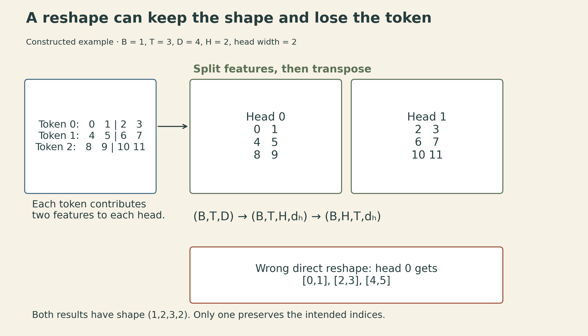
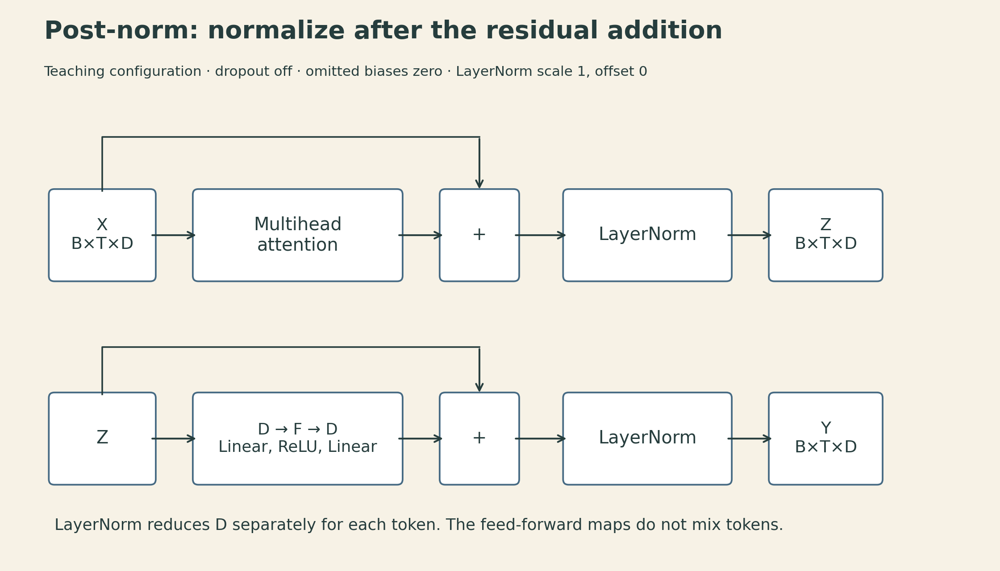
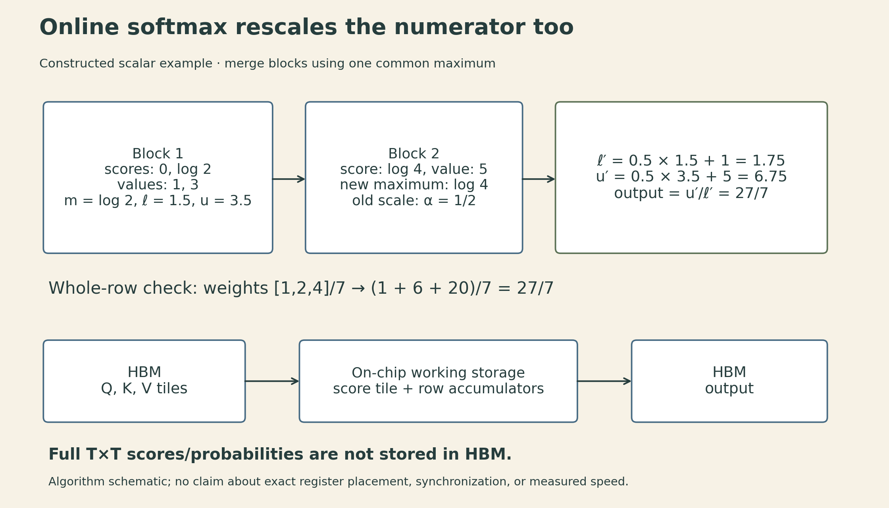

An attention implementation can produce an array with the expected shape and still mix up tokens and heads. It can also compute the right answer while writing a large intermediate matrix to memory that the final result never needed to retain.

These are two different implementation problems. The first is about **which elements interact**. The second is about **where intermediate results live**. CMU's Transformer implementation materials make a useful bridge between them: a small NumPy implementation exposes the tensor operations, while the newer slides introduce the tiled computation behind FlashAttention.

The [Fall 2026 course schedule](https://dlsyscourse.org/lectures/) calls this Lecture 18. Its linked [2022 recording](https://www.youtube.com/watch?v=OzFmKdAHJn0) is titled Lecture 21, and the [public notebook](https://github.com/dlsyscourse/public_notebooks/blob/1a2a7939e629d35b6e86962ea7dad7a324f7dbc4/transformer_implementation.ipynb) contains the NumPy reference below. The [current slides](https://dlsyscourse.org/slides/transformer_implementation.pdf) also cover named axes and FlashAttention. The block discussed here is a teaching implementation, not a complete language model or a GPU kernel.

## Start with the index that each axis represents

Let the input be $X\in\mathbb{R}^{B\times T\times D}$: batch size $B$, sequence length $T$, and model width $D$. With $H$ heads, assume $D$ is divisible by $H$ and write $d_h=D/H$.

Use the conventional query, key, value ordering:

$$
[Q\;K\;V]=XW_{QKV},\qquad W_{QKV}\in\mathbb{R}^{D\times3D}.
$$

This is one packed projection, followed by a split along the last axis. It is algebraically equivalent to three separate projections; packing does not imply any fixed speedup. Each projection initially has shape $(B,T,D)$.

Each head must see the whole sequence but only its assigned slice of the projected features. The transformation is therefore

$$
(B,T,D)\longrightarrow(B,T,H,d_h)\longrightarrow(B,H,T,d_h).
$$

The first step splits features. The second moves the head index before the token index. A direct reshape from $(B,T,D)$ to $(B,H,T,d_h)$ generally changes that assignment.

For example, take one batch, three tokens, width four, and two heads. Number the projected entries from 0 to 11. Head 0 should receive $[0,1]$, $[4,5]$, and $[8,9]$ from the three tokens. A direct reshape instead gives it $[0,1]$, $[2,3]$, and $[4,5]$: the dimensions look right, but the grouping is wrong.

{fig-alt="Constructed example with three tokens, width four, and two heads. Token rows are 0 1 2 3, 4 5 6 7, and 8 9 10 11. Correct reshape then transpose gives head zero rows 0 1, 4 5, 8 9 and head one rows 2 3, 6 7, 10 11. Direct reshape wrongly gives head zero rows 0 1, 2 3, 4 5."}

After reshaping, the scores for head $h$ in batch item $b$ are

$$
S_{bhij}=\frac{1}{\sqrt{d_h}}\sum_{r=1}^{d_h}Q_{bhir}K_{bhjr}+M_{ij}.
$$

Here $i$ is a query position and $j$ is a key position. The sum contracts the head feature dimension, producing scores of shape $(B,H,T,T)$. Softmax acts over $j$, the last axis. The scale is $\sqrt{d_h}$, not $\sqrt D$, because each dot product has $d_h$ terms.

The slide's named-axis expression makes this contract visible: `b heads s d, b heads z d -> b heads s z`. Both `b` and `heads` are preserved; only `d` is summed. The slide shows unmasked attention. A causal model must additionally exclude future key positions.

### A naming trap in the public notebook

The notebook names its first two projected arrays `K,Q` and computes `K @ Q.swapaxes(-1,-2)`. But its comparison imports PyTorch's packed projection weights, whose order is **query, key, value**. In that comparison, the array named `K` is the conventional query and the array named `Q` is the conventional key. This is why the calculation can agree with PyTorch despite the names.

To use PyTorch's `(3D,D)` packed weights in the right-multiplication convention above, pass `in_proj_weight.T`. The code below uses `q,k,v` consistently. Swapping names consistently is harmless; swapping the operands while keeping their meanings fixed is not. Row-wise softmax does not make $QK^\top$ interchangeable with $KQ^\top$. The packing order is explicit in [PyTorch's projection source](https://github.com/pytorch/pytorch/blob/v2.9.0/torch/nn/functional.py).

## Batch multiplication preserves separate attention problems

A shared linear layer can flatten the batch and token axes:

$$
\operatorname{reshape}(X,(BT,D))W.
$$

Every row multiplies the same $W$. Attention instead pairs each item's queries with that same item's keys:

$$
S_{bh}=Q_{bh}K_{bh}^{\top}/\sqrt{d_h}+M.
$$

Flattening all batches' tokens into one matrix and multiplying it by all flattened keys would also produce cross-example scores. Those extra interactions do not belong to the attention problem. Batch matrix multiplication keeps the $(b,h)$ pairs separate.

NumPy's `@` operates on the last two axes and broadcasts the leading axes. In this example the leading $(B,H)$ dimensions match exactly. More generally, they need to be broadcast-compatible, not necessarily identical. This is the [documented `matmul` behavior](https://numpy.org/doc/stable/reference/generated/numpy.matmul.html); it does not promise how a particular backend schedules its kernels.

## Mask before normalization, then join the heads

For causal self-attention, retain the current token and all earlier tokens:

$$
M_{ij}=\begin{cases}0,&j\leq i,\\-\infty,&j>i.\end{cases}
$$

For a row with at least one allowed finite score and all other scores either finite or masked, compute stable softmax by subtracting its maximum:

$$
A_{bhij}=\frac{\exp(S_{bhij}-m_{bhi})}{\sum_k\exp(S_{bhik}-m_{bhi})},\qquad
m_{bhi}=\max_j S_{bhij}.
$$

Masked entries contribute zero after exponentiation. Multiplying probabilities by a mask *after* softmax would leave an incorrectly normalized row unless it were normalized again. An entirely masked row needs explicit handling: subtracting $-\infty$ from itself in this simple implementation produces NaNs. The triangular mask with a valid diagonal avoids that case; combining causal and padding masks can reintroduce it.

Here is a NumPy reference for the equal-width, bias-free, dropout-free case. `mask` is an additive floating-point array, for example a shared $(T,T)$ mask. This is not a statement about every API's Boolean-mask convention.

```python
import numpy as np

def attention(x, w_qkv, w_out, heads, mask):
    b, t, width = x.shape
    assert heads > 0 and width % heads == 0
    dh = width // heads
    q, k, v = np.split(x @ w_qkv, 3, axis=-1)
    q, k, v = [a.reshape(b, t, heads, dh).swapaxes(1, 2)
               for a in (q, k, v)]
    scores = q @ k.swapaxes(-1, -2) / np.sqrt(dh) + mask
    weights = np.exp(scores - scores.max(axis=-1, keepdims=True))
    weights /= weights.sum(axis=-1, keepdims=True)
    joined = (weights @ v).swapaxes(1, 2).reshape(b, t, width)
    return joined @ w_out, weights
```

Multiplying $A$ by $V$ contracts the key-position axis and returns $(B,H,T,d_h)$. Transpose back to $(B,T,H,d_h)$ before joining the feature dimensions. Finally, $W_O\in\mathbb{R}^{D\times D}$ mixes the concatenated head outputs. This output projection is not the operation that averages attention maps across heads.

The notebook compares its output against `nn.MultiheadAttention`. With `need_weights=True` and the default `average_attn_weights=True`, PyTorch returns an averaged map of shape $(B,T,T)$, while this reference returns $(B,H,T,T)$. Compare the returned map to `weights.mean(axis=1)`, or request unaveraged maps explicitly. Compare the output tensors independently. The [API documentation](https://docs.pytorch.org/docs/2.15/generated/torch.nn.MultiheadAttention.html) specifies both behaviors.

## A block comparison has configuration assumptions

The notebook builds a **post-norm** block:

$$
Z=\operatorname{LN}(X+\operatorname{MHA}(X)),\qquad
Y=\operatorname{LN}\!\left(Z+\operatorname{ReLU}(ZW_1)W_2\right).
$$

With feed-forward width $F$, $W_1$ has shape $(D,F)$ and $W_2$ has shape $(F,D)$. They act independently at each token position; attention is the part that mixes positions. Both residual additions require an output width of $D$.

{fig-alt="Post-norm Transformer block. X of shape B by T by D passes through multihead attention, adds the original X, and then applies layer normalization to form Z. Z passes through a D-to-F linear map, ReLU, and an F-to-D linear map, adds Z, and applies layer normalization. Layer normalization reduces only the D axis for each batch item and token. Dropout is off and omitted biases and affine normalization parameters must match the reference."}

For one token vector $z\in\mathbb{R}^D$, the notebook's normalization is

$$
\mu=\frac1D\sum_r z_r,\qquad
\sigma^2=\frac1D\sum_r(z_r-\mu)^2,\qquad
\operatorname{LN}_0(z)_r=\frac{z_r-\mu}{\sqrt{\sigma^2+\epsilon}}.
$$

It omits learned scale and offset. A general LayerNorm instead applies $\gamma_r\operatorname{LN}_0(z)_r+\beta_r$. Matching the teaching function therefore requires $\gamma=1$ and $\beta=0$, as at the reference layer's initialization. The notebook also sets dropout to zero and explicitly zeros the feed-forward biases; its attention biases are zero at initialization. Once those omitted parameters change during training, copying only the weight matrices no longer reproduces the full layer.

The reference is named `TransformerEncoderLayer`, but the supplied mask determines which positions it can read. Passing a causal mask does not add a cross-attention module. Nor does this small block include token embeddings, positional information, a vocabulary output head, a training loop, or a KV-cache implementation.

A forward comparison establishes agreement for the tested configuration and inputs. It does not establish a correct backward pass in a different autodiff framework. Batch-matmul gradients, broadcasting reductions, and parameter gradients still need their own checks.

## The quadratic intermediate is a separate systems problem

For dense attention, $QK^\top$ and $AV$ together require order $BT^2D$ arithmetic. Materializing every head's attention map requires $BHT^2$ elements. At fixed $B,T,D$, more heads keep the leading matrix-product arithmetic in the same order but increase the number of attention-map elements; softmax work and execution overhead still matter.

A constructed example shows the scale: $B=2$, $H=8$, and $T=4096$ give $268{,}435{,}456$ map entries. At two bytes per entry, **one** such tensor occupies 512 MiB. This is a logical tensor-size calculation, not a peak-memory measurement. Scores, probabilities, other activations, gradients, allocator behavior, and fusion choices can change the actual footprint.

The notebook's closing discussion considers sparse and low-rank attention. For unmasked attention, removing softmax permits the reassociation

$$
(QK^\top)V=Q(K^\top V),
$$

which can reduce arithmetic from $O(T^2d_h)$ to $O(Td_h^2)$ per head when $T\gg d_h$. But it changes the operation: ordinary row-wise softmax cannot simply be moved through that product. A causal restriction also prevents this simple global reassociation; the no-softmax causal version would require prefix accumulations. A low-rank score matrix also does not guarantee low-rank probabilities after a nonlinear softmax. Approximate or sparse mechanisms need their own accuracy and runtime comparisons.

The newer slides introduce a different route: compute dense softmax attention without retaining the full score or probability matrix in HBM. [FlashAttention](https://arxiv.org/abs/2205.14135) tiles the computation and maintains normalization statistics. Its dense form preserves the attention operation, up to floating-point rounding, rather than relying on low-rank approximation. It does not turn dense attention's quadratic arithmetic into linear arithmetic.

## Online softmax keeps the old and new blocks on the same scale

For one query row, let $s_j$ be its allowed score for key $j$ and $v_j\in\mathbb{R}^{d_h}$ the corresponding value. Over keys processed so far, maintain

$$
m=\max_j s_j,\qquad
\ell=\sum_j e^{s_j-m},\qquad
u=\sum_j e^{s_j-m}v_j.
$$

The output is $u/\ell$. For a new nonempty block of allowed keys $\mathcal B$, set $m'=\max(m,\max_{j\in\mathcal B}s_j)$ and $\alpha=e^{m-m'}$. Then

$$
\ell'=\alpha\ell+\sum_{j\in\mathcal B}e^{s_j-m'},\qquad
u'=\alpha u+\sum_{j\in\mathcal B}e^{s_j-m'}v_j.
$$

Both the old denominator **and** the old weighted numerator need rescaling. Otherwise they refer to a different maximum from the new block. Initialize from the first nonempty allowed block; skip blocks with no allowed keys. A fully masked row requires a separately defined policy.

Take scalar values to make the arithmetic visible. In a constructed two-block example, scores $[0,\log2]$ with values $[1,3]$ produce $m=\log2$, $\ell=1.5$, and $u=3.5$. The next score is $\log4$ with value 5. The new maximum is $\log4$, so $\alpha=1/2$:

$$
\ell'=0.5(1.5)+1=1.75,\qquad
u'=0.5(3.5)+5=6.75,\qquad
y=\frac{6.75}{1.75}=\frac{27}{7}.
$$

Computing softmax over all three scores gives weights $[1,2,4]/7$ and the same weighted result. Averaging each block's separately normalized output would not preserve those weights.

{fig-alt="Constructed online-softmax example. First block scores zero and log two, values one and three: maximum log two, denominator 1.5, numerator 3.5. Next block score log four and value five raises the maximum, so both old accumulators are multiplied by one half. Updated denominator 1.75 and numerator 6.75 yield 27 divided by 7. Conceptual memory path loads Q, K and V tiles from HBM into on-chip working storage, maintains row accumulators, and writes the output without storing the full T by T attention matrix in HBM. This is an algorithm schematic, not a GPU placement or timing trace."}

This recurrence explains how blocks can be combined. A fast kernel additionally needs a hardware-aware tile layout, data movement, reductions, and synchronization. The paper's algorithm uses on-chip working storage and recomputes attention blocks during backward rather than saving the full matrix. In the 2022 paper's Algorithm 1, row statistics and partial outputs are also read from and written to HBM between key/value blocks. Avoiding the full attention matrix does not mean keeping every accumulator permanently on-chip. A Python loop using this recurrence alone is not a FlashAttention performance result.

The useful implementation boundary is now clear. Axis checks establish which queries read which keys. Masking and normalization establish the weights. A block comparison checks a particular forward contract. Tiling then changes how that same computation moves through memory. Each layer of the argument needs its own evidence.

## Lecture and implementation references

- [CMU DLSys Lecture 18 schedule and materials](https://dlsyscourse.org/lectures/): current numbering and links to the 2022 recording.
- [Transformer implementation notebook, fixed revision](https://github.com/dlsyscourse/public_notebooks/blob/1a2a7939e629d35b6e86962ea7dad7a324f7dbc4/transformer_implementation.ipynb): attention, batch matmul, multihead layout, and post-norm comparison.
- [Current Transformer implementation slides](https://dlsyscourse.org/slides/transformer_implementation.pdf): named-axis implementation and online-softmax diagrams.
- [PyTorch packed projections](https://github.com/pytorch/pytorch/blob/v2.9.0/torch/nn/functional.py) and [MultiheadAttention API](https://docs.pytorch.org/docs/2.15/generated/torch.nn.MultiheadAttention.html): weight ordering and returned attention-map options.
- [Dao et al., FlashAttention (2022)](https://arxiv.org/abs/2205.14135): exact tiled attention, online normalization, and recomputation.



```{=html}
<style>.math.display{display:block;overflow-x:auto;max-width:100%;padding-bottom:.35rem}mjx-container[display="true"]{overflow-x:auto;overflow-y:hidden;max-width:100%}pre{overflow-x:auto}figure img{max-width:100%;height:auto}</style>
```
