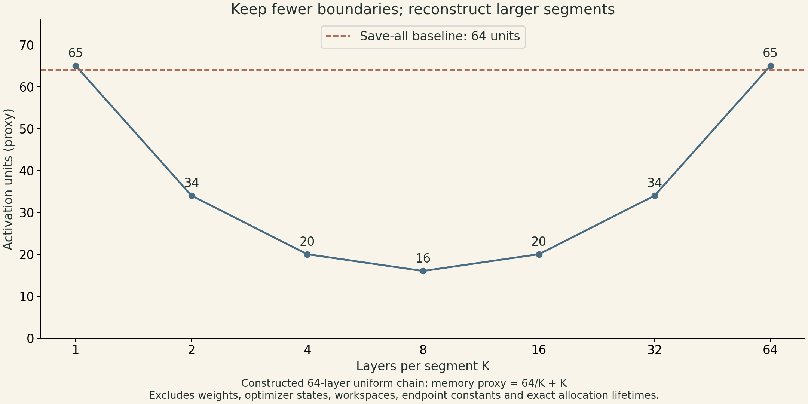
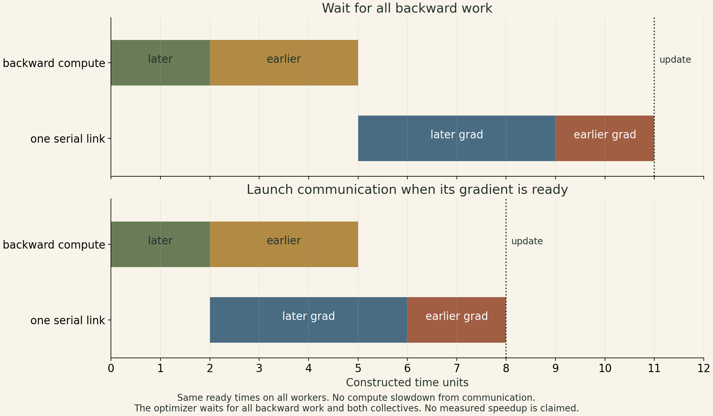
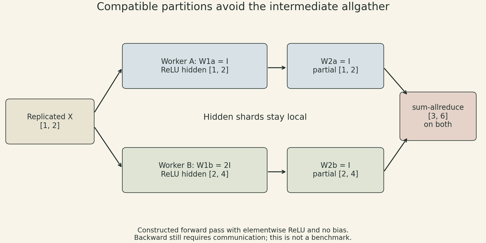

A training job can fail because its tensors do not fit, or run slowly because useful computation waits for data. Adding GPUs does not automatically fix either problem. Replicating a model can leave its per-device memory unchanged; partitioning it can introduce communication on every forward and backward pass.

CMU's Training Large Models lecture connects these problems through the computation graph. Checkpointing changes **when an activation exists**. Parallelism changes **where an operation runs**. Communication overlap changes **when a dependency becomes available**. The useful unit of analysis is a tensor's lifetime and its consumers, not just the number of devices.

## Start with the live tensors

The lecture separates model weights, optimizer state, and intermediate activations. A practical accounting also includes gradients, input batches, temporary workspaces, and allocator overhead. These terms behave differently as depth, width, and batch size change. Reducing saved activations does not imply an equal reduction in total GPU memory. [Slides 5–6](https://dlsyscourse.org/slides/15-training-large-models.pdf); [recording 4:40–6:13](https://www.youtube.com/watch?v=HSzVogM5IPo&t=280s).

For a simple chain $x_{i+1}=f_i(x_i)$, inference can alternate between two activation buffers once the previous value has no remaining consumer. The lecture's constant-memory argument concerns **activation storage versus depth**, assuming bounded layer sizes and local dependencies. It does not remove the weights, make arbitrary skip connections free, or apply unchanged to an autoregressive KV cache. A tensor can be recycled only after its last use.

Training extends those lifetimes. For a row-batched linear layer $Y=XW$, with upstream adjoint $\bar Y$, reverse mode needs

$$
\bar X=\bar YW^\top,\qquad \bar W=X^\top\bar Y.
$$

The weight gradient needs the forward input $X$. Discarding it without a recovery plan breaks backward computation. Saving all required intermediates in a uniform $N$-layer chain gives an activation-storage term proportional to $N$. [Slides 7–8](https://dlsyscourse.org/slides/15-training-large-models.pdf); [recording 6:52–13:03](https://www.youtube.com/watch?v=HSzVogM5IPo&t=412s).

## Checkpoint boundaries replace a full activation history

Activation checkpointing saves selected boundaries during the forward pass. During backward, it starts from one saved boundary, recomputes the missing intermediates in that segment, uses them to propagate adjoints, and releases them before processing the preceding segment. This is activation rematerialization, distinct from saving a training checkpoint to disk for crash recovery. [Slides 9–10](https://dlsyscourse.org/slides/15-training-large-models.pdf); [recording 14:45–22:42](https://www.youtube.com/watch?v=HSzVogM5IPo&t=885s).

With a checkpoint every $K$ layers, a simple uniform-chain storage model is

$$
M_{\mathrm{act}}(K)\approx a\frac{N}{K}+bK+M_0.
$$

The first term counts retained boundaries; the second is the live segment being reconstructed. Constants $a$ and $b$ account for bytes per stored value, and $M_0$ collects fixed terms within this simplified activation model. For equal costs, minimizing $N/K+K$ gives

$$
\frac{d}{dK}\left(\frac{N}{K}+K\right)=-\frac{N}{K^2}+1=0,
\qquad K=\sqrt N.
$$

This explains the lecture's $O(\sqrt N)$ activation-memory result. With unequal constants, the continuous optimum is $\sqrt{aN/b}$, followed by a feasible integer choice. Unequal activation sizes, branches, operator workspaces, and saved-tensor requirements change the optimization problem.

For a constructed 64-layer example, the proxy $64/K+K$ gives 65, 34, 20, 16, 20, 34, and 65 activation units at $K=1,2,4,8,16,32,64$. The minimum is at eight layers per segment. This is a scaling illustration, not an exact allocation trace: it ignores endpoints and can count a boundary twice. The no-checkpoint baseline has 64 saved activation units in the same simplified comparison.

{fig-alt="Constructed uniform chain with 64 layers. At segment lengths 1, 2, 4, 8, 16, 32, 64, the proxy 64 divided by K plus K is 65, 34, 20, 16, 20, 34, 65 activation units. The minimum is 16 at K equals 8. A dashed 64-unit baseline shows saving all activations. This is an asymptotic proxy, not measured GPU memory."}

The extra computation also needs an explicit denominator. If an ordinary step costs forward $F$ plus backward $B$, and rematerialization adds $R$, its arithmetic overhead relative to that step is $R/(F+B)$. In the simplified case $R=F$ and $B=2F$, the overhead is one third. The recording gives these same cost assumptions but quotes about 20–25% extra computation relative to the original algorithm; that estimate does not follow from the stated assumptions. The value $R/(F+B+R)=1/4$ describes a different quantity—the share of the new step spent recomputing—and does not establish the lecturer's intended calculation. Neither fraction is a universal percentage or a measured slowdown. [Recording 23:00–25:46](https://www.youtube.com/watch?v=HSzVogM5IPo&t=1380s). Selective recomputation, communication overlap, and different kernels can change elapsed time substantially.

Recomputation must recover values compatible with the original forward. Random operations and mutable state need care. PyTorch's checkpoint documentation describes RNG-state preservation and warns that changes in global state can make recomputation differ. That is an implementation constraint, not permission to rerun an arbitrary stateful function and assume its gradient is unchanged. [PyTorch checkpoint](https://docs.pytorch.org/docs/2.15/checkpoint.html).

## Data parallelism must preserve the loss normalization

Data parallel workers hold replicas of the model and process different parts of a minibatch. For a batch of $B$ examples, the mean loss has gradient

$$
g=\frac1B\sum_{i=1}^{B}\nabla_\theta\ell_i(\theta).
$$

If worker $r$ computes the **sum** $s_r$ over its examples, summing $s_r$ across workers and dividing by $B$ recovers $g$. If it instead computes a local mean $m_r$ over $B_r$ examples, the correct combination is

$$
g=\sum_r\frac{B_r}{B}m_r,\qquad B=\sum_r B_r.
$$

Equal local example counts guarantee that an unweighted mean of worker means matches the global example mean. With unequal counts, the two can happen to agree, for example when all worker means are equal, but they are not equivalent in general. Equal weighting of workers is also valid if that is the intended objective. For a constructed scalar example, one worker has one example with gradient 1; another has three examples whose mean gradient is 9. The global example mean is $(1+3\times9)/4=7$, while averaging the two worker means gives 5. Variable token counts require the same attention to the loss denominator.

The lecture's sum-allreduce maps local arrays $[1,2,3]$ and $[1,0,1]$ to $[2,2,4]$ on both workers. A collective's reduction operation and a training objective's normalization are separate choices. Synchronized replicas must also use compatible parameter and optimizer states to apply the same update. This argument assumes the intended loss can be split as stated; batch-coupled operations need additional treatment. [Slides 13–15](https://dlsyscourse.org/slides/15-training-large-models.pdf); [recording 32:20–38:02](https://www.youtube.com/watch?v=HSzVogM5IPo&t=1940s).

A parameter server moves aggregation and weight updates to a server abstraction: workers push gradients and pull updated weights. In contrast, the lecture's allreduce design returns the combined gradient for each replica to update locally. A server can support policies that tolerate missing or delayed workers, but dropping a worker or accepting stale gradients changes the update semantics. That policy is not automatically equivalent to the synchronous full-minibatch gradient. [Slides 16–17](https://dlsyscourse.org/slides/15-training-large-models.pdf); [recording 38:05–40:52](https://www.youtube.com/watch?v=HSzVogM5IPo&t=2285s).

## Overlap starts when a gradient is ready

Backpropagation usually makes later-layer gradients available before earlier-layer gradients. A system can launch their communication while other backward work continues. The computation that consumes a collective result must still wait for completion. Asynchronous communication does not, by itself, mean asynchronous SGD.

Consider a constructed two-group schedule. Backward produces the later group's gradient at time 2 and finishes the earlier group at time 5. Their communication takes four and two units on one serial link. Waiting for all backward work before communicating ends at time 11. Launching the first transfer at time 2 lets it run until time 6, followed by the second until time 8. The step can update at time 8 in this simplified schedule.

{fig-alt="Constructed schedule, not a hardware measurement. Compute runs from time 0 to 2 for the later layer group and from 2 to 5 for the earlier group. Serialized communication after backward runs from 5 to 9 and 9 to 11. Overlapped communication runs from 2 to 6 and 6 to 8 on one serial link. The optimizer waits until both backward and communications are complete: 11 versus 8 time units."}

The example assumes those readiness times hold on every participating worker and that communication does not slow the remaining computation. Real collectives share network, memory bandwidth, and launch resources. Small messages incur overhead; large buckets may delay readiness. The lecture also notes that earlier-layer weights are needed earlier in the next forward pass, which can motivate communication priorities. Updating a weight prematurely can invalidate backward operations that still need its old value. [Slide 18](https://dlsyscourse.org/slides/15-training-large-models.pdf); [recording 41:08–44:41](https://www.youtube.com/watch?v=HSzVogM5IPo&t=2468s).

## A graph partition creates messages in both directions

Model parallelism places different graph operations on different workers. A cut edge becomes a forward send/receive of an activation and, when needed, a backward transfer of its adjoint. Partitioning a sequential chain lets a larger model fit across devices, but one microbatch may still leave most devices idle. [Slides 19–21](https://dlsyscourse.org/slides/15-training-large-models.pdf).

The recording introduces pipeline microbatches to keep stages busy: while one stage processes a previous microbatch, another begins the next. Dependencies remain, and the pipeline has fill/drain periods. Stage imbalance and communication can limit utilization. Microbatching therefore supplies scheduling opportunities; it does not guarantee linear speedup. [Recording 29:21–31:42](https://www.youtube.com/watch?v=HSzVogM5IPo&t=1761s).

Tensor parallelism partitions individual tensors and operations. The Fall 2025 slides add a useful two-matrix pattern. Using row-batched notation, let $X$ have shape $T\times d$, $W_1$ have shape $d\times f$, and $W_2$ have shape $f\times d$. Split $W_1$ by output columns and $W_2$ by matching input rows:

$$
W_1=[W_{1a}\ W_{1b}],\qquad
W_2=\begin{bmatrix}W_{2a}\\W_{2b}\end{bmatrix}.
$$

For an elementwise nonlinearity $\phi$, each device computes a local hidden shard and a partial output:

$$
H_a=\phi(XW_{1a}),\quad H_b=\phi(XW_{1b}),\qquad
Y=H_aW_{2a}+H_bW_{2b}.
$$

The hidden shards need not be allgathered before the second multiplication. A sum-allreduce can instead combine the two partial outputs. This layout works because the elementwise nonlinearity preserves the hidden partition; an operation that couples all hidden features may require additional communication. Biases also need consistent placement: a replicated output bias belongs after the sum, rather than being counted once per worker.

{fig-alt="Constructed row-vector example. Replicated input X is [1,2]. Worker A computes hidden shard [1,2] and partial output [1,2]. Worker B computes hidden shard [2,4] and partial output [2,4]. The shards are nonnegative so ReLU leaves them unchanged. Sum-allreduce gives [3,6] on both workers. Hidden shards are not concatenated before the second matrix multiplication. The figure describes the forward pass."}

For a constructed example matching the figure, use $X=[1,2]$, $W_{1a}=I$, $W_{1b}=2I$, and $W_{2a}=W_{2b}=I$. ReLU leaves both hidden shards unchanged; the partial outputs sum to $[3,6]$. Backward has its own dependencies: the two contributions to the replicated input gradient must be combined, while each weight shard receives its corresponding gradient. Avoiding one forward allgather does not eliminate all communication. [Slides 22–26](https://dlsyscourse.org/slides/15-training-large-models.pdf).

Checkpointing, data parallelism, and model parallelism act on different parts of the same schedule. A useful design first identifies the memory term that prevents the job from fitting, then the dependency that leaves compute idle. The Fall 2025 slides list ZeRO, GSPMD, FSDP, and *Beyond Data and Model Parallelism for Deep Neural Networks* as optional reading; their names alone do not establish which state is sharded in a particular implementation.

## Lecture and sources

This note follows the current course's Lecture 19 topic. The public recording is the 2022 edition titled **Lecture 15 — Training Large Models**. A same-topic slide deck on the course site is labelled **Fall 2025**; it is not the deck shown in the 2022 recording. The tensor-parallel section above follows that PDF. Throughout this note, matrix formulas use row-batched notation.

- [Official course schedule](https://dlsyscourse.org/lectures/).
- [Training Large Models, 29-page slides](https://dlsyscourse.org/slides/15-training-large-models.pdf).
- [Official recording](https://www.youtube.com/watch?v=HSzVogM5IPo).


