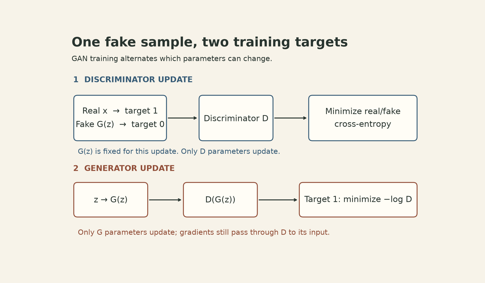
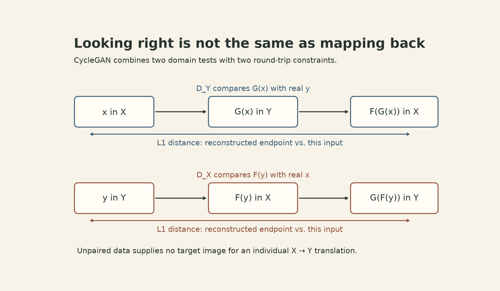
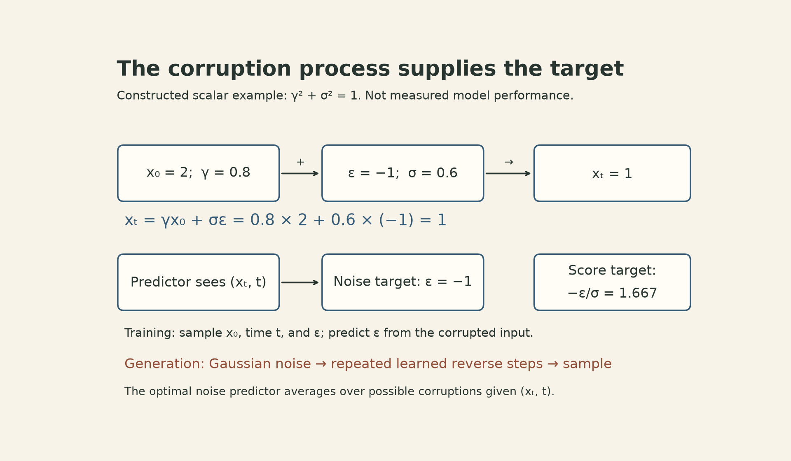

```{=html}
<style>
.math.display {display:block;max-width:100%;overflow-x:auto;overflow-y:hidden;padding:.35rem 0;}
mjx-container[display="true"] {max-width:100%;overflow-x:auto;overflow-y:hidden;}
main a {overflow-wrap:anywhere;}
.lecture-video {position:relative;width:100%;padding-top:56.25%;margin:1.5rem 0;}
.lecture-video iframe {position:absolute;inset:0;width:100%;height:100%;border:0;}
</style>
```

A classifier has a target for each example. An image generator usually has a collection of real images and a source of randomness. There is no particular photograph that a sampled random vector must reproduce.

The training signal has to come from somewhere else. A GAN learns a discriminator that distinguishes real samples from generated ones. A diffusion model creates supervised targets by adding known noise to real data. Both approaches turn access to samples into gradients, but they ask the network to solve different problems.

CMU's [Fall 2026 Lecture 20 materials](https://dlsyscourse.org/lectures) cover these two approaches. The [accompanying 2022 recording](https://www.youtube.com/watch?v=iIx_8_pxzhs), titled *Lecture 16 — Generative Adversarial Networks*, develops adversarial training and its use in DCGAN and CycleGAN. The diffusion discussion follows the 2026 slides and the score-based SDE formulation cited below.

## A discriminator supplies a changing objective

Let $z\sim p_z$ be a random vector, and let $G_\theta(z)$ be a generated sample. For an image with $d$ scalar pixel values, a simple shape description is $G_\theta:\mathbb R^k\to\mathbb R^d$. The discriminator $D_\phi:\mathbb R^d\to(0,1)$ predicts the probability that its input is real under the real-versus-generated classification task.

For a fixed generator, the discriminator minimizes binary cross-entropy:

$$
L_D(\phi;\theta)
=-\mathbb E_{x\sim p_{\rm data}}\log D_\phi(x)
-\mathbb E_{z\sim p_z}\log[1-D_\phi(G_\theta(z))].
$$

Real examples have target 1; generated examples have target 0. The generator can then change its outputs to make that classification harder. The original [GAN objective](https://arxiv.org/abs/1406.2661), written with the discriminator maximizing log-likelihood, is

$$
\min_\theta\max_\phi V(\phi,\theta),\qquad
V=\mathbb E_x\log D_\phi(x)+\mathbb E_z\log[1-D_\phi(G_\theta(z))].
$$

The lecture assigns the same opposing roles using negative log-likelihood: the discriminator minimizes it and the generator maximizes it. These player directions do not, by themselves, justify interchanging the order of a nested minimum and maximum.

In practice, the lecture uses the **non-saturating generator objective**:

$$L_G(\theta;\phi)=-\mathbb E_z\log D_\phi(G_\theta(z)).$$

This is a different generator loss from the original minimax expression. It encourages the same desired outcome—generated samples classified as real—but provides a stronger signal when the discriminator confidently rejects them.

{fig-alt="Two training lanes. The discriminator step receives real x with target one and a generated G(z) with target zero; only discriminator parameters update. The generator step passes z through G and then D with target one; only generator parameters update, while gradients still pass through D to its input."}

### Why changing the target helps

Write the discriminator's logit on a generated sample as $a$, with $D=\operatorname{sigmoid}(a)$. For one sample, the minimax generator loss and the non-saturating alternative have derivatives

$$
\frac{\partial\log(1-D)}{\partial a}=-D,
\qquad
\frac{\partial(-\log D)}{\partial a}=D-1.
$$

As a constructed example, if $D=0.01$, these derivatives are $-0.01$ and $-0.99$. Both encourage a larger realness logit under gradient descent, but their magnitudes differ substantially. These are derivatives with respect to the logit, **not measured generator gradient norms or training speedups**. The generator gradient also contains the derivatives of the discriminator and generator networks.

Training alternates between the two updates. During the discriminator update, generated samples are treated as fixed inputs. During the generator update, discriminator parameters stay fixed, but the path through the discriminator to its input must remain differentiable. Freezing its parameters is different from severing that path.

This changing opponent explains why a GAN is not an ordinary fixed loss function. The lecture emphasizes the tuning and convergence difficulties of the alternating game. A discriminator reporting approximately one-half is not, by itself, evidence that the generator learned the data distribution: an ineffective discriminator could also produce that output. The ideal result in the original paper assumes sufficient capacity and the appropriate optimal discriminator.

## A GAN can be composed with other constraints

The adversarial objective does not dictate the generator architecture. In DCGAN, transposed convolutions grow spatial feature maps into images, while a convolutional discriminator scores them. A transposed convolution is the transpose of the corresponding linear convolution operator; it is not generally an inverse that reconstructs an arbitrary original image.

The lecture then treats adversarial training as a reusable module: given generated and real collections, train a discriminator to distinguish them and a generator to reduce that distinction. Calling it a “GAN loss” is convenient, provided the alternating update procedure is retained.

CycleGAN makes the usefulness—and the limit—of distribution matching concrete. Suppose $X$ contains horse images and $Y$ contains zebra images, without paired examples. We learn $G:X\to Y$ and $F:Y\to X$. A discriminator $D_Y$ judges whether $G(x)$ resembles domain $Y$; another, $D_X$, judges whether $F(y)$ resembles domain $X$.

Those two tests constrain collections of outputs. They do not specify which output belongs to each input. [CycleGAN](https://arxiv.org/abs/1703.10593) adds a round-trip constraint:

$$
L_{\rm cyc}(G,F)
=\mathbb E_x\|F(G(x))-x\|_1
+\mathbb E_y\|G(F(y))-y\|_1.
$$

The formulation combines two adversarial terms with $\lambda L_{\rm cyc}$, where $\lambda>0$ controls their relative weight. The first kind of term asks whether translated images fit the destination distribution. The second asks whether translating out and back preserves the input.

{fig-alt="CycleGAN has two paths: x to G(x) to F(G(x)), and y to F(y) to G(F(y)). D_Y compares translated G(x) with real y; D_X compares translated F(y) with real x. L1 cycle losses compare each reconstructed endpoint with its own starting image. Unpaired training supplies no per-image x-to-y target."}

Cycle consistency still does not identify a unique semantic correspondence. For a small constructed counterexample, take two equally likely items in each domain. Either bijection between the domains, paired with its inverse, matches both distributions and has zero cycle error. The objectives do not decide which bijection expresses the intended meaning. They add a useful constraint without turning unpaired data into paired ground truth.

## Diffusion makes a target by corrupting the data

Diffusion takes a different route. Start with a real sample $x_0\in\mathbb R^d$, gradually weaken its signal, and add Gaussian noise. The variance-preserving SDE in the lecture is

$$
dx_t=-\tfrac12\beta(t)x_t\,dt+\sqrt{\beta(t)}\,dW_t,
$$

where $\beta(t)\geq0$ is the noise schedule and $W_t$ is a $d$-dimensional Wiener process. The drift shrinks the signal toward zero. The stochastic term adds noise.

For this linear process, its conditional distribution is available in closed form:

$$
q(x_t\mid x_0)=\mathcal N(\gamma_t x_0,\sigma_t^2 I),
\qquad
\gamma_t=e^{-\frac12\int_0^t\beta(s)ds},\quad
\sigma_t^2=1-\gamma_t^2.
$$

Consequently, a training example at time $t$ can be sampled directly:

$$x_t=\gamma_t x_0+\sigma_t\epsilon,\qquad\epsilon\sim\mathcal N(0,I).$$

There is no need to simulate all earlier corruption steps to obtain this training pair. For positive noise levels, the conditional score—the derivative of the log conditional density—is

$$
\nabla_{x_t}\log q(x_t\mid x_0)
=-\frac{x_t-\gamma_t x_0}{\sigma_t^2}
=-\frac{\epsilon}{\sigma_t}.
$$

The target is computable because the training process sampled the noise. The learned network, however, receives $x_t$ and $t$, not the clean example or the sampled noise.

### Conditional targets teach a marginal score

Generation needs the marginal score $\nabla_x\log q_t(x)$, where $q_t$ mixes over all clean examples. Why does training against the conditional score help?

At a fixed $x_t,t$, the minimizer of a squared-error prediction problem is the conditional mean of its target. Under the regularity conditions that permit differentiating the density integral,

$$
\mathbb E\!\left[\nabla_{x_t}\log q(x_t\mid x_0)\mid x_t\right]
=\nabla_{x_t}\log q_t(x_t).
$$

This is the connection used by [denoising score matching in Song et al.](https://arxiv.org/abs/2011.13456), rather than a claim that each noisy image reveals its unique original noise realization.

Parameterizing the score as $s_\theta(x_t,t)=-\epsilon_\theta(x_t,t)/\sigma_t$ gives the weighted objective

$$
\mathbb E_{t,x_0,\epsilon}
\frac{\lambda(t)}{\sigma_t^2}
\|\epsilon_\theta(x_t,t)-\epsilon\|_2^2.
$$

Here the positive time-dependent weight specifies the contribution of each noise level. The lecture sets $\lambda(t)=\sigma_t^2$ to obtain the familiar unweighted noise-prediction loss. That choice changes the weighting across noise levels; it is not an algebraic cancellation that preserves an originally unweighted score loss. The displayed division by $\sigma_t$ applies at $t>0$ with $\sigma_t>0$; numerical implementations typically avoid evaluating the singular zero-noise endpoint this way.

{fig-alt="Constructed scalar diffusion training example: x0 equals two, gamma equals 0.8, sigma equals 0.6 and sampled epsilon equals minus one, producing xt equals one. The predictor sees xt and t and is trained toward the sampled noise, epsilon equals minus one. The conditional score target is 1.667. A separate generation lane starts from Gaussian noise and repeatedly applies a learned reverse step before producing a sample."}

For the figure's constructed scalar example,

$$x_0=2,\quad\gamma_t=0.8,\quad\sigma_t=0.6,\quad\epsilon=-1
\quad\Longrightarrow\quad x_t=1.$$

The conditional score target is $-\epsilon/\sigma_t=5/3$. If the noise predictor outputs $-0.7$, its squared error for this sampled target is $0.09$. The corresponding squared score error is $0.09/0.36=0.25$. Weighting that score error by $\lambda=0.36$ recovers $0.09$. This is arithmetic illustrating the objective, not an experiment measuring model quality.

## Reverse time needs an explicit sign convention

For a forward SDE $dx=f(x,t)dt+g(t)dW$, the reverse-time SDE in Song et al., Eq. 6, is

$$dx=[f(x,t)-g(t)^2\nabla_x\log q_t(x)]dt+g(t)d\bar W,$$

where time runs from $T$ down to $0$ and **$dt$ is negative**. With the variance-preserving process above, an Euler–Maruyama step of positive length $h$ toward time $t-h$ is

$$
x_{t-h}\approx x_t+h\!\left[\tfrac12\beta(t)x_t+\beta(t)s_\theta(x_t,t)\right]
+\sqrt{\beta(t)h}\,\xi,\qquad \xi\sim\mathcal N(0,I).
$$

Substituting the noise parameterization makes the correction term

$$h\!\left[\tfrac12\beta(t)x_t-\frac{\beta(t)}{\sigma_t}\epsilon_\theta(x_t,t)\right].$$

This notation separates the direction of time from the sign of the predicted-noise correction. It also shows why stochastic reverse sampling is more than subtracting a noise estimate once: the process includes the drift, time-dependent scaling, and new stochastic increments. Other numerical samplers can use different updates.

Sampling often begins with an approximately standard Gaussian $x_T$. In this forward process that approximation requires sufficiently strong total corruption so that $\gamma_T$ is small. Finite noise, imperfect score estimates, and discretization all limit how closely the generated distribution matches the data. An exact reverse process with an exact terminal distribution is an idealization, not a general guarantee for a trained model.

## Move repeated denoising into a smaller representation

The lecture's latent diffusion example changes the space in which these repeated updates happen. An encoder compresses an image into a latent representation; a diffusion model learns and samples in that space; a decoder converts the generated latent back to pixels. [Latent Diffusion Models, Sections 3.1–3.2](https://arxiv.org/abs/2112.10752) separate this perceptual compression stage from diffusion training.

A smaller spatial representation can reduce the work of each denoising evaluation, but the compression also limits what the decoder can reconstruct. The compression factor alone is not a measured end-to-end speedup: network shape, number of sampling steps, and decoding cost still matter.

For the basic models compared in this lecture, a GAN generates a sample with one generator forward pass, whereas diffusion performs repeated learned refinement. That is a description of their sampling procedures, not a universal ranking of quality or latency. The useful distinction is where their training signals come from: a learned opponent, an added consistency constraint, or a known corruption process.

## Sources and lecture recording

- [CMU DLSys Fall 2026 schedule](https://dlsyscourse.org/lectures) and [Generative Models slides](https://dlsyscourse.org/slides/16-generative-models.pdf): GAN, PDF pp. 4–9; diffusion, pp. 11–19; modularity, DCGAN, and CycleGAN, pp. 21–29. PDF page numbers are used because the final slide labels are offset.
- [Official course recording](https://www.youtube.com/watch?v=iIx_8_pxzhs): GAN objectives and alternating updates, 7:07–20:36; modularity and DCGAN, 20:53–27:19; CycleGAN, 27:51–37:55.
- [Goodfellow et al., *Generative Adversarial Nets*](https://arxiv.org/abs/1406.2661), Section 3: minimax training and the non-saturating generator objective.
- [Zhu et al., *Unpaired Image-to-Image Translation using Cycle-Consistent Adversarial Networks*](https://arxiv.org/abs/1703.10593), Section 3: two adversarial objectives and cycle consistency.
- [Song et al., *Score-Based Generative Modeling through Stochastic Differential Equations*](https://arxiv.org/abs/2011.13456), Sections 3.2–3.4: reverse time, denoising score matching, and variance-preserving diffusion.
- [Rombach et al., *High-Resolution Image Synthesis with Latent Diffusion Models*](https://arxiv.org/abs/2112.10752), Sections 3.1–3.2: compression and latent-space diffusion.

```{=html}
<div class="lecture-video"><iframe src="https://www.youtube.com/embed/iIx_8_pxzhs" title="CMU Deep Learning Systems — Generative Adversarial Networks" loading="lazy" allow="accelerometer; autoplay; clipboard-write; encrypted-media; gyroscope; picture-in-picture" allowfullscreen></iframe></div>
```
