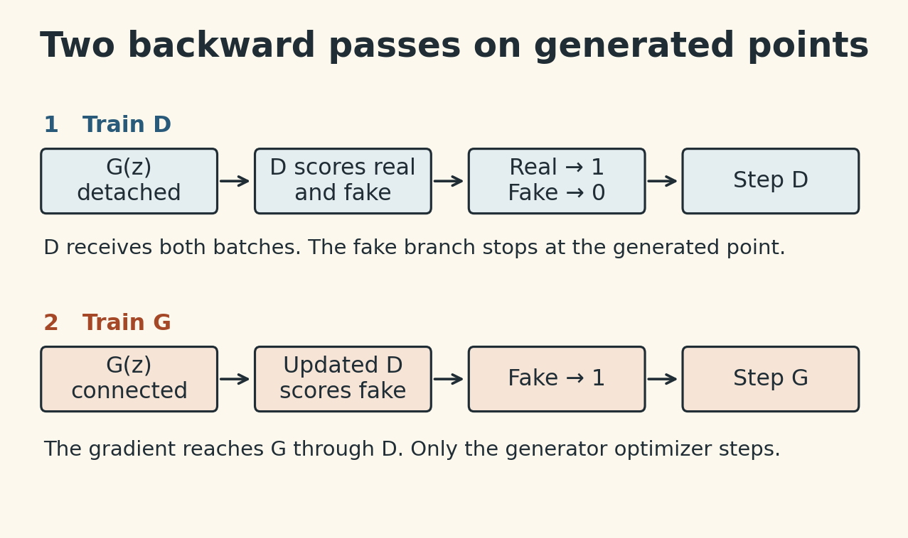
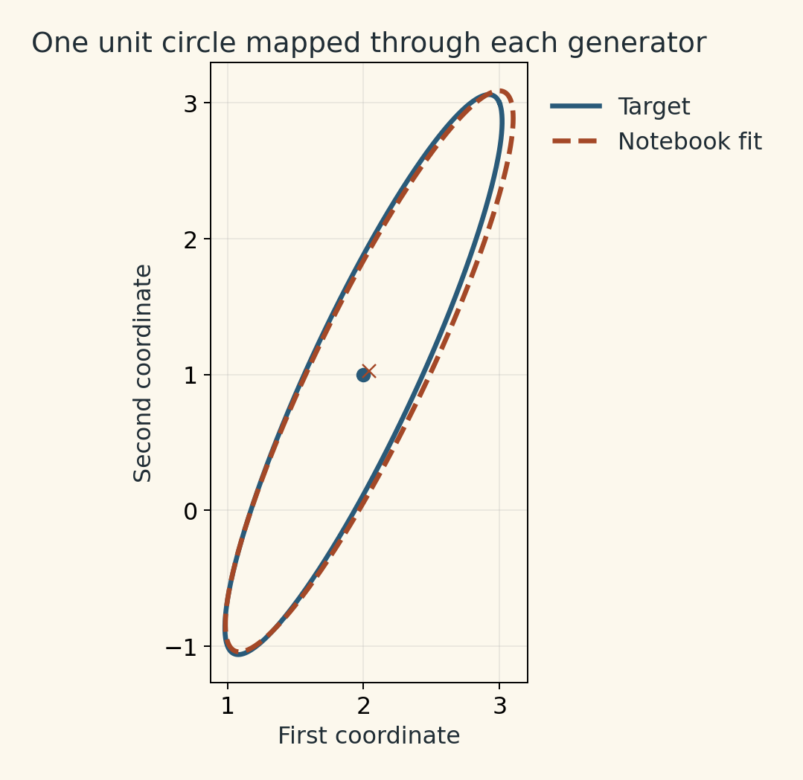

The weights look wrong. The data generator in CMU’s GAN exercise has a first row of $(1,2)$. After training, the learned generator has a first row of about $(0.43,-0.07)$. Yet the two point clouds have almost the same tilt and spread. Which comparison tells us whether training worked?

This example from CMU’s Deep Learning Systems course makes that question unusually easy to investigate. The samples are points on a plane. The generator has just six scalar parameters. We can trace the signal that changes those parameters and then calculate exactly which features of the distribution they determine.

## A target we can calculate

The notebook creates 3,200 reference points. For each one, draw a row vector $z$ with two independent standard normal entries and compute $x=zA+\mu$, with

$$
A=\begin{pmatrix}1&2\\-0.2&0.5\end{pmatrix},\qquad \mu=(2,1).
$$

Writing out one point makes the tilt of the cloud predictable. Its coordinates are $z_1-0.2z_2+2$ and $2z_1+0.5z_2+1$. When $z_1$ is large, both tend to be large. Their covariance is $1\times2+(-0.2)\times0.5=1.9$. The two variances are $1.04$ and $4.25$. Together these give the population covariance

$$
\Sigma=A^\top A=\begin{pmatrix}1.04&1.90\\1.90&4.25\end{pmatrix}.
$$

A single affine layer $G(z)=zW+b$ can represent this target exactly. Its output is Gaussian with mean $b$ and covariance $W^\top W$. During training the generator has access to neither $A$ nor the latent draw behind any reference point. There is no target coordinate to regress to for a given noise vector. The discriminator supplies a loss using examples from the two clouds.

## One generated point, two different gradients

The discriminator maps two coordinates through widths 20 and 10 with ReLU activations, then returns two logits. Call them $s_0$ for *fake* and $s_1$ for *real*. What matters to the two-class softmax is their difference $a=s_1-s_0$. The probability assigned to *real* is $p=1/(1+e^{-a})$.

Take a constructed example where a generated point gets $p=0.2$. For cross-entropy with target $y$, the derivative with respect to $a$ is $p-y$. The two training steps use that same rule to ask different questions.

::: {.gradient-table}

| Step | Target for this point | Derivative at $p=0.2$ | Parameters stepped |
|:--|:--|:--|:--|
| Train the discriminator | 0 | $+0.2$ | Discriminator |
| Train the generator | 1 | $-0.8$ | Generator |

:::

The table holds the score fixed to isolate the label change. In the actual loop the discriminator takes a step between those evaluations, so the second probability can differ.

{fig-alt="Two training passes. The discriminator learns from real and detached generated points. The generator learns through the updated discriminator with a real target."}

In the discriminator step, one batch of real points carries label 1 and one generated batch carries label 0. The loss adds the two batch cross-entropies. Calling `detach()` on the generated tensor preserves its coordinates while cutting its gradient path back to $G$. The discriminator still needs those coordinates to adjust its own weights.

In the generator step, generated points carry label 1. The loss is $-\log p$ per point, the non-saturating generator objective. At $p=0.2$, gradient descent would push the logit difference upward if it could adjust $a$ directly. The generator can only move the point. Backpropagation therefore needs the derivative of the discriminator’s score with respect to its *input*, followed by the derivative of the point with respect to $W$ and $b$. Detaching the point on this pass would sever that path. The generator optimizer owns only $G$’s parameters, so its step leaves the discriminator weights in place even though the backward pass traverses the discriminator.

## What happens inside one call to the loss

In the notebook’s explicit loop, each iteration takes 32 consecutive reference points, draws 32 fresh noise vectors, updates $D$, then updates $G$ using the same noise. Each network has its own Adam optimizer with a learning rate of 0.01. The loop variable is called `epoch`, but each iteration consumes one minibatch. The 2,000 iterations in one call cover $2{,}000\times32/3{,}200=20$ passes through the reference array.

The second version wraps the discriminator and its optimizer in a class called `GANLoss`. Its `forward` method has a side effect. It computes a discriminator loss using a detached view of the generated points, calls backward, and steps $D$. It then scores the original, still-connected points with the **updated discriminator** and returns the generator loss. The outer loop calls backward on that returned scalar and steps $G$.

This ordering explains a subtle implementation choice. The generated coordinates can be reused because the inner step has only changed $D$. The old logits have two problems. They came from the previous classifier weights, and their input was detached. Backpropagating from them cannot reach the generator. A fresh evaluation of the connected points fixes both problems. Calling this particular `forward` again merely to log a loss would also take another discriminator step. For a port to a framework that accumulates parameter gradients, the training loop also needs to clear the appropriate gradient buffers between updates.

## Why different weights can give the same cloud

Consider swapping the two rows of $A$. This exchanges which independent noise coordinate multiplies each row. For a fixed draw, the generated point generally moves. Across all draws, swapping the two identically distributed coordinates leaves the distribution unchanged. More generally, for any orthogonal matrix $Q$,

$$
(QA)^\top(QA)=A^\top Q^\top Q A=A^\top A.
$$

The notebook’s stored output gives a concrete scale for the fit. The learned bias was approximately $(2.042,1.024)$, and the covariance implied by the learned weights was approximately

$$
W^\top W=\begin{pmatrix}1.121&1.972\\1.972&4.266\end{pmatrix}.
$$

{fig-alt="Equal-scale comparison of the target and saved fit. A solid target ellipse and dashed fitted ellipse nearly coincide; their centers are close to (2,1)."}

The dashed curve uses the saved parameters from the first training loop.

The learned first row looks unfamiliar because the individual weights depend on a choice of latent coordinates that the samples cannot identify. The fitted covariance shows a difference in the first-coordinate variance, about $1.121$ versus the population target of $1.040$. Those values come from the two matrices. The training set itself is a finite draw, and its empirical variance can differ from the population value.

Here the mean and covariance determine the whole population distribution because both generators are affine maps of Gaussian noise. A nonlinear image generator can match the same two moments and still miss an entire class of images. The value of the two-dimensional exercise is that it gives us a case with a known answer, where we can check the training loop and tell which differences in its output matter.

## Lecture and notebook



[CMU course schedule, Lecture 21](https://dlsyscourse.org/lectures/) · [Implementation notebook, fixed revision](https://github.com/dlsyscourse/public_notebooks/blob/5bdfa992c25189e2188042b85f9013748831ded2/21_generative_adversarial_networks_implementation.ipynb) · [Watch the companion recording, numbered Lecture 17 in the 2022 course](https://www.youtube.com/watch?v=DmBw8SEeAc0)

