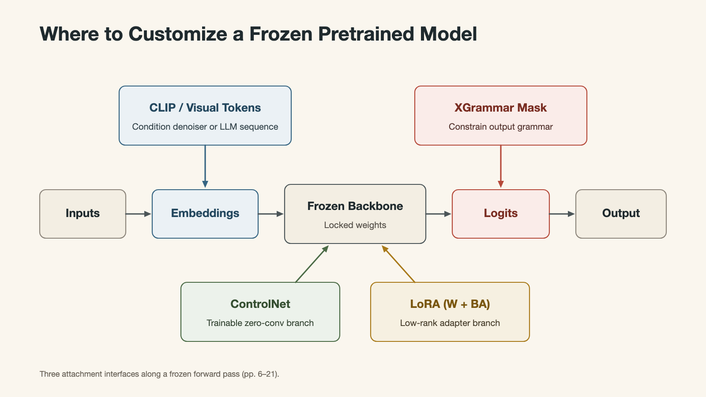
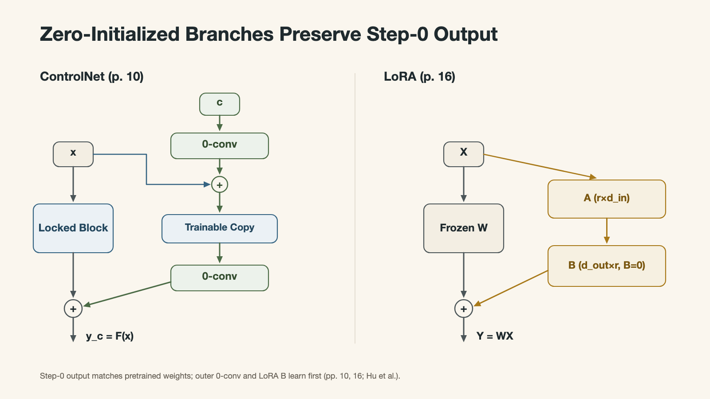
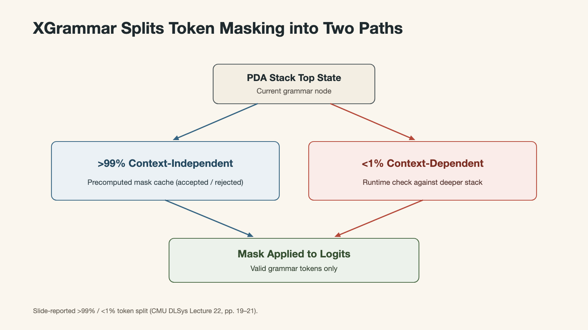

Training a specialized model from scratch for every downstream domain breaks down once the base model grows to billions of parameters. You cannot afford to collect a full pretraining corpus per task, nor store an independent multi-gigabyte weight checkpoint for every user workflow or output format.

CMU's [Fall 2026 Lecture 22 slides](https://dlsyscourse.org/slides/augment-pretrained-models.pdf) (*Customizing Pretrained models*, Tianqi Chen and Tim Dettmers; note that the course schedule links slides only and no public video recording) frame customization as an architectural choice: **where along a frozen forward pass should adaptation attach?** Across image generation and large language models (LLMs), all techniques in the lecture attach at one of **three interfaces** along a frozen forward pass: input and conditioning embeddings (CLIP conditioning or multimodal visual tokens), frozen backbone weights augmented with parallel branches (ControlNet or LoRA), or output logits (XGrammar and repetition penalties).

{fig-alt="Diagram titled Where to Customize a Frozen Pretrained Model, showing a horizontal pretrained forward pass from Inputs to Embeddings, Frozen Backbone with locked weights, Logits, and Output, with three interface groups: CLIP or Visual Tokens entering Embeddings, ControlNet zero-conv branch and LoRA W plus B A adapter attaching to Frozen Backbone, and XGrammar Mask filtering Logits."}

## Why keep the backbone frozen

The standard supervised recipe fixes a hypothesis class $h_\theta(x)$, a multi-class cross-entropy loss $l(h_\theta(x), y) = -h_y(x) + \log\sum_{j=1}^k \exp(h_j(x))$, and a mini-batch update ([slides, p. 4](https://dlsyscourse.org/slides/augment-pretrained-models.pdf)):

$$
\theta := \theta - \frac{\alpha}{B}\sum_{i=1}^B \nabla_\theta \ell\!\left(h_\theta(x^{(i)}), y^{(i)}\right).
$$

Collecting separate training data and training an isolated model per domain loses cross-domain knowledge ([slides, p. 5](https://dlsyscourse.org/slides/augment-pretrained-models.pdf)). Pretraining reverses that flow: fit a single large backbone on broad data once, then adapt it cleanly to domain constraints ([slides, pp. 5, 14](https://dlsyscourse.org/slides/augment-pretrained-models.pdf)). Even before adding new layers, prompts and context shape what an LLM produces without altering weights ([slides, p. 15](https://dlsyscourse.org/slides/augment-pretrained-models.pdf)). When prompts alone are insufficient, each customization method trades expressiveness, step-0 stability, and serving cost differently.

## Conditioning diffusion through aligned embeddings

In image generation, customization begins by injecting an external signal into the denoising predictor. **CLIP** (Radford et al.; [slides, p. 6](https://dlsyscourse.org/slides/augment-pretrained-models.pdf)) trains a text encoder and an image encoder jointly over batches of $N$ paired captions and images, producing embeddings $T_1,\dots,T_N$ and $I_1,\dots,I_N$ in a shared vector space. Maximizing similarity along the matched diagonal pairs $I_i \cdot T_i$ relative to off-diagonal mismatches aligns natural language with visual concepts so downstream generators can reuse text embeddings directly.

From [Lecture 20](cmu-dlsys-lecture-20-generative-models.qmd), unconditional diffusion sampling integrates the reverse-time variance-preserving SDE ([slides, p. 7](https://dlsyscourse.org/slides/augment-pretrained-models.pdf)):

$$
dx_t = -\left[\frac{1}{2}\beta(t)x_t - \frac{\beta(t)\epsilon_\theta(x_t, t)}{\sigma_t}\right]dt + \sqrt{\beta(t)}\,dW_t,
$$

where generation runs backward from prior noise $q(x_T)$ to data $q(x_0)$ with $dt < 0$, $\beta(t) \ge 0$ is the noise schedule, $\sigma_t > 0$ is the forward noise scale, and $\nabla_{x_t}\log q_t(x_t) \approx -\epsilon_\theta(x_t,t)/\sigma_t$ supplies the score estimate (`dW_t` denotes the reverse-time Wiener increment on the slide). Adding a condition $c$ simply routes an embedding $\tau_\theta(c)$—such as a CLIP text embedding—into the noise predictor $\epsilon_\theta(x_t, \tau_\theta(c), t)$ ([slides, p. 8](https://dlsyscourse.org/slides/augment-pretrained-models.pdf)).

Because pixel-space denoising is expensive, **Latent Diffusion Models** (Rombach et al., CVPR 2022; [slides, p. 9](https://dlsyscourse.org/slides/augment-pretrained-models.pdf); [paper](https://arxiv.org/abs/2112.10752)) compress pixels $x$ through a perceptual encoder $z = \mathcal{E}(x)$, run the denoising U-Net $\epsilon_\theta$ in latent space, inject conditioning tokens $\tau_\theta(c)$ (text, semantic maps, representations, or images) via cross-attention ($Q, K, V$), and reconstruct pixels via $\tilde{x} = \mathcal{D}(z)$.

## Zero-initialized residual branches protect step-0 behavior

Prompt embeddings steer high-level semantics, yet they struggle to enforce pixel-aligned spatial structure like edge maps or body poses, and naive full fine-tuning risks erasing pretrained visual knowledge. Both **ControlNet** ([slides, pp. 10–12](https://dlsyscourse.org/slides/augment-pretrained-models.pdf)) and **LoRA** ([slides, p. 16](https://dlsyscourse.org/slides/augment-pretrained-models.pdf)) attach a parallel residual branch alongside locked weights so that, when the branch is initialized to zero, the step-0 output equals the untouched pretrained model.

{fig-alt="Side-by-side schematics of ControlNet (p. 10) and LoRA (p. 16). Left shows ControlNet: input x enters Locked Block in parallel with condition c passing through a 0-conv, summed with x, passed through a Trainable Copy and a second 0-conv, and added to produce y_c equals F(x). Right shows LoRA: input X enters Frozen W in parallel with A (r by d_in) and B (d_out by r, with B initialized to 0 per Hu et al.), added to produce Y equals W X."}

### ControlNet: locked copy plus zero convolutions

Slide 10 sketches ControlNet's locked block alongside a trainable copy gated by two zero convolutions and notes: *"Initialized as original model (due to zero weight convolution)"* (Zhang, Rao, and Agrawala; [slides, p. 10](https://dlsyscourse.org/slides/augment-pretrained-models.pdf)). In the notation of the cited paper—not printed symbolically on slide 10—locking $\Theta$, cloning a trainable copy $\Theta_c := \Theta$, and inserting two $1\times 1$ zero-initialized convolutions $\mathcal{Z}(\cdot; \Theta_{z1})$ and $\mathcal{Z}(\cdot; \Theta_{z2})$ (both weights and biases initialized to $0$) yields

$$
y_c = \mathcal{F}(x; \Theta) + \mathcal{Z}\!\left(\mathcal{F}\!\left(x + \mathcal{Z}(c; \Theta_{z1}); \Theta_c\right); \Theta_{z2}\right).
$$

At step $0$, both zero convolutions output $0$, so $y_c = \mathcal{F}(x; \Theta)$ identically. Even with sparse or noisy spatial conditions $c$ such as Canny edge maps or human pose skeletons ([slides, p. 12](https://dlsyscourse.org/slides/augment-pretrained-models.pdf)), the trainable copy starts in an uncorrupted pretrained state. In Stable Diffusion ([slides, p. 11](https://dlsyscourse.org/slides/augment-pretrained-models.pdf)), ControlNet duplicates the locked encoder blocks ($64\times 64$ down to $8\times 8$) and the $8\times 8$ middle block, then injects zero-convolved residuals back into both the locked middle block and the U-Net decoder skip paths.

Why doesn't zero initialization freeze learning forever? Tracing the **author's step-by-step backward derivation** (not printed on slide 10), write the copy's output as $h = \mathcal{F}(x + \mathcal{Z}(c; \Theta_{z1}); \Theta_c)$ and the outer $1\times 1$ convolution at batch element $n$ and spatial position $p$ as $\mathcal{Z}(h_{n,p}; W_{z2}, b_{z2}) = W_{z2} h_{n,p} + b_{z2}$ with $W_{z2}=0$ and upstream loss gradient $g_{n,p} = \nabla_{y_{c,n,p}}\mathcal{L}$. On the very first backward pass:

- Because $W_{z2} = 0$, backpropagating through the outer convolution multiplies by $W_{z2}^\top g_{n,p} = 0$, blocking gradients from reaching $\Theta_c$ and $\Theta_{z1}$ at step $0$.
- Meanwhile, the outer zero convolution itself receives a kernel gradient summed over batch and spatial positions:

$$
\left.\frac{\partial \mathcal{L}}{\partial W_{z2}}\right|_{W_{z2}=0} = \sum_{n,p} g_{n,p} h_{n,p}^\top.
$$

Because $x$ enters the pretrained-initialized copy unchanged ($x + 0 = x$), $h_{n,p}$ is typically nonzero at step $0$; whenever that sum across batch and space is nonzero, step $0$ updates $W_{z2}$ away from $0$, unlocking nonzero gradients for $\Theta_c$ and $\Theta_{z1}$ on step $1$. As a **constructed scalar check** (not a diffusion measurement), set $\mathcal{F}(u) = u + 1$ with $x = 2.0$ ($\mathcal{F}(2.0) = 3.0$), $c = 5.0$, $w_{z1} = w_{z2} = 0$, $g = 1.0$, and SGD step $\eta = 0.1$: at step $0$, $y_c = 3.0 + 0\cdot 3.0 = 3.0$ and $\partial\mathcal{L}/\partial w_{z2} = 1.0 \times 3.0 = 3.0$, moving $w_{z2} \leftarrow -0.3$; holding $x, c, g$ fixed on step $1$, the inner zero convolution immediately receives $\partial\mathcal{L}/\partial w_{z1} = (-0.3)(1)(5.0) = -1.5 \neq 0$.

### LoRA: low-rank weight adaptation

For linear projections in LLMs and attention or diffusion blocks, [slide 16](https://dlsyscourse.org/slides/augment-pretrained-models.pdf) freezes the pretrained weight matrix $W \in \mathbb{R}^{d_{\text{out}} \times d_{\text{in}}}$ and attaches two low-rank matrices $A \in \mathbb{R}^{r \times d_{\text{in}}}$ and $B \in \mathbb{R}^{d_{\text{out}} \times r}$ with $r \ll \min(d_{\text{in}}, d_{\text{out}})$ (**LoRA**, Hu et al.):

$$
y = W x + B A x,
$$

using column-vector convention $x \in \mathbb{R}^{d_{\text{in}}}$ matching the forward diagram on [slide 16](https://dlsyscourse.org/slides/augment-pretrained-models.pdf) (noting that writing $W + BA$ sets unit scaling $\alpha/r = 1$ or absorbs $\alpha/r$ into a factor; in Hu et al.'s full convention, not printed on slide 16, $W_{\text{eff}} = W + (\alpha/r)BA$ with $B=0$ and Gaussian $A$ at initialization so $BA=0$ at step $0$). Just like ControlNet in the author's step-0 gradient check, $B=0$ zeroes $\nabla_A\mathcal{L} = 0$ at step $0$ while $\nabla_B\mathcal{L} = (\nabla_y\mathcal{L})(Ax)^\top$ can update $B$ immediately and unlock $A$ on step $1$. At deployment, a single customized model can merge weights offline into $W_{\text{eff}}$ for zero added inference latency, whereas [slide 14](https://dlsyscourse.org/slides/augment-pretrained-models.pdf)'s challenge of shipping domain variants motivates a multi-adapter serving design where frozen $W$ stays shared in GPU memory and small $(A, B)$ adapters swap per request.

For a **constructed dimension and parameter check** on a square projection $W \in \mathbb{R}^{4096 \times 4096}$ with rank $r = 16$:

- **Frozen base weights:** $4096 \times 4096 = 16{,}777{,}216$ parameters.
- **Trainable LoRA weights:** $4096 \times 16 + 4096 \times 16 = 131{,}072$ parameters—$0.781\%$ ($1/128$) of $W$.

This reduction shrinks per-task checkpoint storage and trainable optimizer states directly, though activation memory during backpropagation still scales with sequence length and batch size; activation checkpointing can reduce the amount retained.

## Multi-modality via embedding mapping

What if the model needs a new input modality—such as images inside an autoregressive text LLM—rather than a spatial condition inside diffusion? **MiniGPT-4** (Zhu, Chen et al.) and **LLaVA** (Liu, Li et al.) project encoded image features into `"visual tokens"` that share the LLM's embedding dimension and enter **alongside text embeddings in the LLM input sequence** ([slides, p. 17](https://dlsyscourse.org/slides/augment-pretrained-models.pdf)). Once projected into that common token space, visual and text embeddings flow through the same transformer layers without changing the LLM's text vocabulary.

## Enforcing output syntax at logit time with XGrammar

Prompting and LoRA steer *probabilities*, not *hard syntax guarantees*. When an application requires strictly valid JSON or a typed schema (`class Task(BaseModel): done: bool; name: str; steps: List[int]`; [slides, p. 19](https://dlsyscourse.org/slides/augment-pretrained-models.pdf)), disallowed tokens must be forced to probability zero after the LLM emits raw logits $z \in \mathbb{R}^{|V|}$ ([slides, p. 18](https://dlsyscourse.org/slides/augment-pretrained-models.pdf)):

$$
z'_v =
\begin{cases}
z_v & \text{if token } v \text{ matches mask}, \\
-\infty & \text{otherwise.}
\end{cases}
$$

Applying softmax to $z'$ (alongside optional repetition penalties, [slides, p. 18](https://dlsyscourse.org/slides/augment-pretrained-models.pdf)) guarantees every sampled step respects the constraint without touching a single weight. Yet constrained decoding introduces three systems bottlenecks named on [slide 19](https://dlsyscourse.org/slides/augment-pretrained-models.pdf):

1. **Large vocabulary size:** every decoding step scores tens or hundreds of thousands of candidate subword tokens.
2. **Unbounded grammar states:** recursive context-free grammars (CFGs)—modeled by pushdown automata (PDA) with a stack, such as [slide 20](https://dlsyscourse.org/slides/augment-pretrained-models.pdf)'s nested-array grammar (written literally on the slide without outer grouping around `<str> | <array>`, which under unambiguous EBNF grouping for its nonempty-array automaton is `item ::= <str> | <array>` and `array ::= '[' <item> (',' <item>)* ']'`)—create infinitely many stack configurations, making static tables over full stack histories impossible.
3. **CPU–GPU speed mismatch:** GPUs generate logits quickly, so computing masks on the CPU cannot keep up with GPU decoding ([slides, p. 19](https://dlsyscourse.org/slides/augment-pretrained-models.pdf)).

{fig-alt="Flowchart of XGrammar token masking. PDA Stack Top State splits into two branches: over 99 percent Context-Independent tokens resolved via a Precomputed Mask Cache (accepted or rejected), and under 1 percent Context-Dependent tokens checked at runtime against deeper stack transitions. Both paths merge into Mask Applied to Logits for valid grammar tokens."}

**XGrammar** ([slides, p. 21](https://dlsyscourse.org/slides/augment-pretrained-models.pdf)) mitigates this bottleneck using one structural property of subword vocabularies: **most tokens (`>99%`, as reported on slide 21) are context-independent given only the top state of the PDA stack.** At the active string node (`Node (1)` in rule `<str>` for partial input `["a`; [slides, pp. 20–21](https://dlsyscourse.org/slides/augment-pretrained-models.pdf)), ordinary substrings like `a` or `ab"` stay accepted regardless of what sits lower on the stack, while tokens like `\` or `\ab` are rejected in the slide's simplified string grammar (`str ::= '"' [^"\]* '"'`) regardless of deeper history (note that full JSON syntax permits `\` to begin escape sequences). Only a tiny set of **context-dependent** outlier tokens (such as `"ab` or `a"b`, which close the string and pop back to deeper stack rules; [slides, p. 21](https://dlsyscourse.org/slides/augment-pretrained-models.pdf)) depends on deeper stack entries.

XGrammar therefore splits masking into two stages ([slides, p. 21](https://dlsyscourse.org/slides/augment-pretrained-models.pdf)):

- **Compile time (stack-top adaptive cache):** Precompute bitmasks for the context-independent tokens per PDA stack-top node.
- **Decode time (tiny outlier check):** Retrieve the cached bitmask by indexing the current parsing state, then test only the remaining context-dependent outlier tokens efficiently.

For a **constructed arithmetic check** (not a universal slide bound or benchmark), suppose an illustrative vocabulary has $|V| = 128{,}000$ tokens and `>99%` are context-independent at a given stack-top node: strictly `< 1%` leaves **fewer than `1,280` outlier tokens (at most `1,279` tokens)** to check at runtime, while a dense $1$-bit-per-token precomputed mask takes $128{,}000 / 8 = 16{,}000\text{ bytes} = 15.625\text{ KiB}$ per cached stack-top node before metadata.

## Choosing the customization interface

::: {.comparison-table}

| Method | Attachment Interface | Parameters Trained for Customization | Step-0 Behavior | Extra Runtime Work | Slide Example |
|:--|:--|:--|:--|:--|:--|
| **Prompting / CLIP condition** | Conditioning / embeddings | None (context or $\tau_\theta(c)$ encoder) | Zero backbone changes | Condition encoding + cross-attention | Text-to-image SDE (`pp. 6–8`) |
| **Visual token projection** | Input embedding sequence | Vision encoder and/or projector (setup-dependent) | Extends input token sequence | Visual encoder pass + extra tokens | MiniGPT-4, LLaVA (`p. 17`) |
| **ControlNet** | Parallel zero-conv blocks | Encoder copy + zero-convs | Exact original output ($y_c = \mathcal{F}$) | Parallel encoder + middle/decoder skip paths | Canny / pose Stable Diffusion (`pp. 10–12`) |
| **LoRA** | Parallel low-rank weights | Matrices $A, B$ (rank $r$) | Exact original output ($B=0$, Hu et al.) | Zero if merged; tiny $BAx$ if unmerged | LLMs & diffusion (`p. 16`) |
| **XGrammar masking** | Post-LLM raw logits | None | Weights untouched; disallowed tokens receive $-\infty$ | Cached bitmask lookup + outlier stack check | Typed JSON / CFG decoding (`pp. 18–21`) |

:::

Across all three interfaces, the systems pattern is consistent: touch only the narrow interface needed for the missing capability. Keep the pretrained forward pass intact at step $0$ when adapting weights, project new modalities cleanly into shared token space when inputs change, and enforce deterministic syntax at the logits rather than hoping gradient descent never emits an invalid comma.

## Sources

- [CMU 10-414/714 Fall 2026 Lecture Schedule](https://dlsyscourse.org/lectures/) and [Lecture 22 slides: *Customizing Pretrained models* (22 pp.)](https://dlsyscourse.org/slides/augment-pretrained-models.pdf) (Tianqi Chen and Tim Dettmers; no public video recording is listed for Lecture 22).
- Diffusion SDE figures (`pp. 7–8`): [CVPR 2022 Tutorial on Diffusion Models](https://cvpr2022-tutorial-diffusion-models.github.io/).
- Cited works from the slides: Radford et al., *Learning Transferable Visual Models From Natural Language Supervision* (`p. 6`); Rombach et al., *High-Resolution Image Synthesis with Latent Diffusion Models*, CVPR 2022 ([arXiv:2112.10752](https://arxiv.org/abs/2112.10752), `p. 9`); Zhang, Rao, and Agrawala, *Adding Conditional Control to Text-to-Image Diffusion Models* (`pp. 10–12`); Hu et al., *LoRA: Low-Rank Adaptation of Large Language Models* (`p. 16`); Zhu, Chen et al., *MiniGPT-4* & Liu, Li et al., *Visual Instruction Tuning (LLaVA)* (`p. 17`); and XGrammar (`p. 21`).
