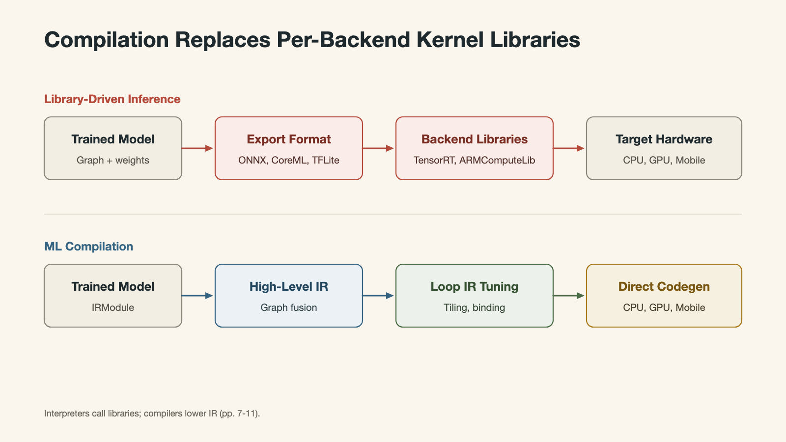
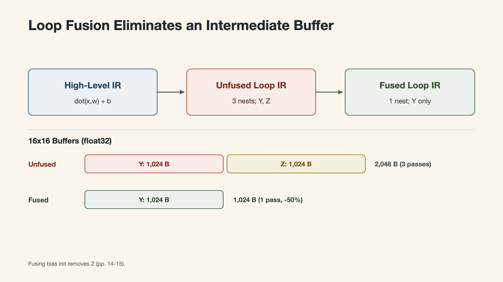
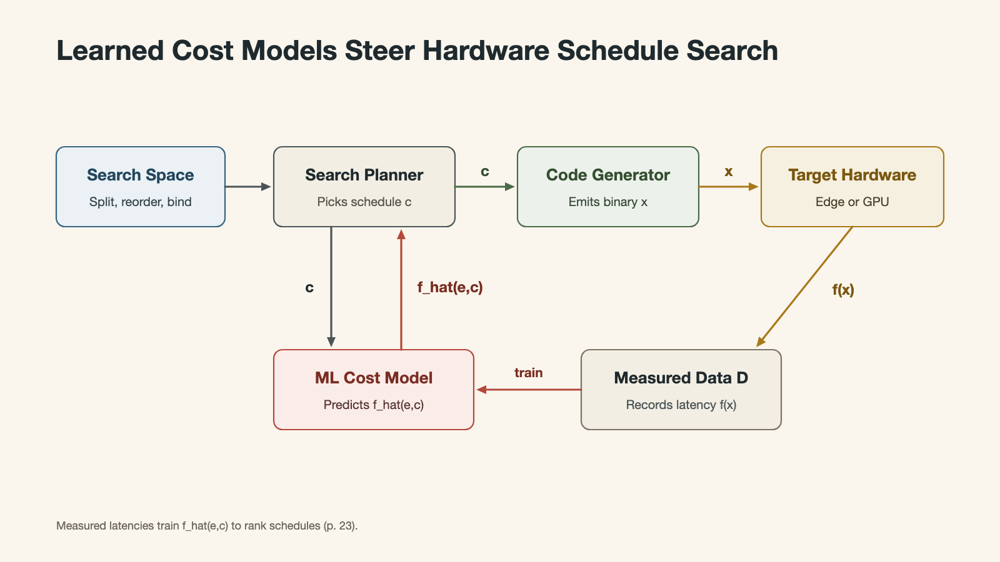

Training a model in Python on a workstation GPU is only half of the systems problem. Once weights converge, deployment moves that model out of a Python training loop and onto servers, mobile phones, and edge boards that impose tight memory budgets, omit Python runtimes, and rely on diverse accelerators ([slides, pp. 4–6](https://dlsyscourse.org/slides/23-model-deployment.pdf#page=4)).

CMU's [Fall 2026 Lecture 23 slides](https://dlsyscourse.org/slides/23-model-deployment.pdf) (*Model Deployment*, Tianqi Chen and Tim Dettmers; 25 pp., paired on the [course schedule](https://dlsyscourse.org/lectures/) with the linked [2022 lecture recording](https://youtu.be/jCBrUisBQ0A), 42 min 53 sec) trace the architectural shift from **library-driven inference engines** to **machine learning compilation**. Instead of writing specialized operator libraries for every accelerator, an ML compiler places high-level computation graphs and low-level loop nests inside one intermediate representation (`IRModule`), transforms loops systematically, and uses hardware measurements to train a cost model that guides schedule search.

{fig-alt="Two-lane comparison titled Compilation Replaces Per-Backend Kernel Libraries. Top lane Library-Driven Inference flows from Trained Model (Graph + weights) to Export Format (ONNX, CoreML, TFLite), Backend Libraries (TensorRT, ARMComputeLib), and Target Hardware (CPU, GPU, Mobile). Bottom lane ML Compilation flows from Trained Model (IRModule) to High-Level IR (Graph fusion), Loop IR Tuning (Tiling, binding), and Direct Codegen (CPU, GPU, Mobile)."}

::: {.lecture-video}
<iframe src="https://www.youtube.com/embed/jCBrUisBQ0A" title="CMU 10-414/714 Lecture 23: Model Deployment (2022 recording)" allowfullscreen></iframe>
:::

*Linked 2022 course recording (`Video (2022 version)` on the official schedule); equation and slide page citations below refer to the Fall 2026 PDF deck.*

## Why deployment leaves Python behind

Across earlier lectures, Needle trained Transformers, ResNets, and LSTMs on standard GPU environments using automatic differentiation and optimization ([slides, pp. 4–5](https://dlsyscourse.org/slides/23-model-deployment.pdf#page=4)). Shipping a trained model into production changes three constraints ([slides, p. 6](https://dlsyscourse.org/slides/23-model-deployment.pdf#page=6)):

1. **Runtime restrictions:** Edge and mobile environments restrict model footprint and frequently disallow a Python runtime (`no-python`).
2. **Local hardware acceleration:** Target devices expose heterogeneous compute units—mobile GPUs, accelerated CPU vector instructions, and NPUs—rather than uniform server GPUs.
3. **Application integration:** Inference sits inside a larger pipeline alongside data preprocessing and postprocessing.

To cross from training to device execution, the conventional path exports the computation graph and learned weights (`input -> linear(w_1) -> relu -> linear(w_2) -> softmax`) into an interchange format such as **ONNX**, **CoreML**, or **TFLite**, then hands that graph to backend inference frameworks such as **TensorRT**, **ARMComputeLib**, **TFLite**, or **CoreML** ([slides, p. 7](https://dlsyscourse.org/slides/23-model-deployment.pdf#page=7)).

### How inference interpreters work—and where they stall

Inside many inference engines, execution still follows a **computational graph interpreter** pattern ([slides, p. 8](https://dlsyscourse.org/slides/23-model-deployment.pdf#page=8)):

- Allocate memory buffers for intermediate activations between graph nodes.
- Traverse the computation graph and dispatch each operator one by one.
- Support only a fixed catalog of operators and limited programming dynamism (such as data-dependent control flow).

That design hits an engineering scaling wall ([slides, p. 10](https://dlsyscourse.org/slides/23-model-deployment.pdf#page=10)). Every new hardware backend needs its own specialized operator library, and achieving high utilization requires hand-tuning kernels across each combination of operator, tensor shape, and device.

## Machine learning compilation and the `IRModule`

Machine learning compilation replaces per-backend operator catalogs with a multi-level lowering pipeline from ML models through **high-level IR optimizations and transformations**, then **tensor operator-level optimization**, down to **direct code generation** across CPUs, GPUs, phones, edge boards, and clusters ([slides, p. 11](https://dlsyscourse.org/slides/23-model-deployment.pdf#page=11)).

The central compiler abstraction is an **`IRModule`**: a collection of interdependent functions representing the entire model at multiple levels of detail ([slides, p. 12](https://dlsyscourse.org/slides/23-model-deployment.pdf#page=12)). On [slide 12](https://dlsyscourse.org/slides/23-model-deployment.pdf#page=12), one `IRModule` holds two functions side by side:

- `@model(x, w, b)`, a high-level graph function that passes `(x, w, b)` into a call node `@dot-add` and sends its output to `softmax`.
- `@dot-add(x, w, b)`, a sub-function containing `dot(x, w)` followed by `add(..., b)`.

Because both the whole-model call graph and individual fused subgraphs live inside the same `IRModule`, compiler passes can optimize graph structure first and lower selected functions to imperative loops later without leaving a single representation.

{fig-alt="Two-part diagram titled Loop Fusion Eliminates an Intermediate Buffer. Top shows three boxes: High-Level IR (dot(x,w) + b) to Unfused Loop IR (3 nests, buffers Y, Z) to Fused Loop IR (1 nest, buffer Y). Bottom compares 16x16 float32 buffer footprints: Unfused shows Y (1,024 B) plus Z (1,024 B) totaling 2,048 B and 3 passes; Fused shows Y (1,024 B) alone for 1,024 B and 1 pass (-50%)."}

### Tracing `@model(x, w, b)` from import to runtime execution

Slides 13–17 walk one linear-plus-bias-plus-softmax model through four compilation stages:

1. **Import and high-level transformation (`pp. 13, 17`):** Importing the model creates a single high-level graph `@model(x, w, b)` (`dot -> add -> softmax`). High-level IR transformations—which most ML frameworks support for operator fusion and annotations such as device placement ([slides, p. 17](https://dlsyscourse.org/slides/23-model-deployment.pdf#page=17))—outline `dot` and `add` into `@dot-add(x, w, b)` so `@model` calls `@dot-add` directly.
2. **Lowering `@dot-add` to loop IR (`p. 14`):** `@model` stays a high-level call graph (`@dot-add -> softmax`), while `@dot-add(x, w, b)` lowers to explicit loop nests over a `16 x 16` output grid (note that [slide 14](https://dlsyscourse.org/slides/23-model-deployment.pdf#page=14) prints a typographical `w[j, x]` for `w[j, k]` and `return z` for `return Z`; the dimensionally consistent indices are $x \in \mathbb{R}^{16 \times 16}$, $w \in \mathbb{R}^{16 \times 16}$, and $b \in \mathbb{R}^{16}$):

   ```python
   for i, j in grid(16, 16):
       Y[i, j] = 0
   for i, j, k in grid(16, 16, 16):
       Y[i, j] += x[i, k] * w[j, k]   # slide prints w[j, x]
   for i, j in grid(16, 16):
       Z[i, j] = Y[i, j] + b[j]
   return Z                           # slide prints return z
   ```

3. **Low-level loop fusion (`p. 15`):** A low-level transformation folds zero-initialization and bias addition directly into the reduction nest:

   ```python
   for i, j in grid(16, 16):
       Y[i, j] = b[j]
       for k in range(16):
           Y[i, j] += x[i, k] * w[j, k]
   return Y
   ```

4. **Code generation and hybrid runtime (`p. 16`):** Compiled operator functions (`dot-add`, `softmax`, `...`) emit machine kernels, while a lightweight runtime interprets the top-level `@model` call graph to invoke those compiled operators.

For a **constructed memory and pass check** on the slide's $16 \times 16$ example (assuming `float32`, $4$ bytes per element; not printed on the slide):

- **Unfused loop IR (`p. 14`):** Allocates two $16 \times 16$ arrays (`Y` and `Z`, totaling $512$ elements = $2{,}048\text{ bytes}$) and executes three separate $16 \times 16$ grid traversals ($256$ zero writes, $16^3 = 4{,}096$ multiply-adds, and $256$ bias additions writing `Z`).
- **Fused loop IR (`p. 15`):** Allocates one $16 \times 16$ array (`Y`, $256$ elements = $1{,}024\text{ bytes}$, a **$50\%$ reduction** in $16 \times 16$ array storage) and collapses three loop nests into one `grid(16, 16)` pass with an inner `range(16)` reduction.

Mathematically, initializing `Y[i, j] = b[j]` before the `k` loop preserves exact real-valued arithmetic because addition is associative and commutative and `b[j]` does not depend on `k`, though in floating-point arithmetic adding `b[j]` first slightly changes rounding order relative to adding `b[j]` last.

## Tensor operator optimization and loop transformations

Low-level loop IR is built from three explicit elements annotated on [slide 19](https://dlsyscourse.org/slides/23-model-deployment.pdf#page=19): **multi-dimensional buffers** (such as `Y[i, j]`), **loop nests** (`for i, j, k in grid(16, 16, 16)`), and **array computations** (`Y[i, j] += ...`).

Crucially, an automated compiler separates *what* a tensor operator computes from *how* loops execute on hardware ([slides, p. 18](https://dlsyscourse.org/slides/23-model-deployment.pdf#page=18)). Slide 18 starts from one declarative matrix-multiplication specification:

$$
C[y, x] = \sum_{k} A[k, y]\, B[k, x],
$$

written with `tvm.compute((m, n), lambda y, x: tvm.sum(A[k, y] * B[k, x], axis=k))` (so $C = A^\top B$ for $A \in \mathbb{R}^{K \times m}$, $B \in \mathbb{R}^{K \times n}$, and $C \in \mathbb{R}^{m \times n}$). From that single specification, a search space of schedule transformations generates three very different `1024 x 1024` implementations ([slides, p. 18](https://dlsyscourse.org/slides/23-model-deployment.pdf#page=18)):

- **Naive three-loop nest:** `for y in range(1024): for x in range(1024): ... for k in range(1024):` executing $1024^3 = 1{,}073{,}741{,}824$ multiply-adds directly against main memory.
- **Blocked $8 \times 8$ CPU/general loop nest:** Outer tile loops `yo, xo, ko` in `range(128)` ($128 \times 8 = 1024$) and inner tile loops `yi, xi, ki` in `range(8)` operating on $8 \times 8$ submatrices.
- **Accelerator DMA + microkernel program:** Explicit local scratchpad buffers `inp_buffer AL[8][8], BL[8][8]` and `acc_buffer CL[8][8]` driven by `vdla.fill_zero(CL)`, `vdla.dma_copy2d(...)`, and `vdla.fused_gemm8x8_add(CL, AL, BL)`.

For a **constructed arithmetic and reuse check** on one `(yo, xo, ko)` tile of the $8 \times 8$ blocked schedule (not printed on slide 18): loading `AL[8][8]` ($64$ elements) and `BL[8][8]` ($64$ elements) transfers $128$ operand elements to perform $8^3 = 512$ multiply-adds ($1{,}024$ FLOPs), yielding **$4.0$ multiply-adds ($8.0$ FLOPs) per loaded operand element** while holding the $64$ accumulators of `CL[8][8]` stationary across all $128$ `ko` iterations before writing each $8 \times 8$ tile back once.

### Three primitive loop transformations (`pp. 20–22`)

Slides 20–22 build a GPU kernel for `for x in range(128): C[x] = A[x] + B[x]` from three schedule primitives:

1. **Splitting (`p. 20`):** `x = get_loop("x"); xo, xi = split(x, 4)` factors the $128$-iteration loop into `for xo in range(32):` and `for xi in range(4):`, indexing `xo * 4 + xi` ($32 \times 4 = 128$).
2. **Reordering (`p. 21`):** `reorder(xi, xo)` places `xi` outside `xo`. This preserves semantics because all $128$ iterations write to distinct elements `C[xo * 4 + xi]` with no loop-carried dependence.
3. **Thread binding (`p. 22`):** `bind_thread(xo, "threadIdx.x")` and `bind_thread(xi, "blockIdx.x")` eliminate both Python-style loops and emit a GPU kernel body indexing `C[threadIdx.x * 4 + blockIdx.x]` (printed literally on [slide 22](https://dlsyscourse.org/slides/23-model-deployment.pdf#page=22) as `threadId.x * 4 + blockIdx.x`).

Notice an instructive systems consequence of step 2 + step 3 on [slide 22](https://dlsyscourse.org/slides/23-model-deployment.pdf#page=22): because `xo` (multiplied by `4`) is bound to `threadIdx.x`, adjacent threads `threadIdx.x = 0, 1, 2, ...` inside one block read and write elements `0, 4, 8, ...`—a **stride-`4` memory access pattern** rather than unit-stride coalesced memory access across adjacent threads. Swapping which axis binds to `threadIdx.x` (or choosing an inner split factor aligned with warp width) flips the memory layout immediately, which is exactly why compiler search must explore combinations of `split`, `reorder`, and `bind_thread`.

## Automated search via a learned cost model

Even a small set of loop primitives produces a combinatorially large search space across tile sizes, loop orders, and hardware bindings. Benchmarking every candidate binary on an edge board or phone is too slow, so modern ML compilers close the loop with a learned cost model ([slides, p. 23](https://dlsyscourse.org/slides/23-model-deployment.pdf#page=23)):

{fig-alt="Closed-loop flowchart titled Learned Cost Models Steer Hardware Schedule Search. Top row runs left to right: Search Space (Split, reorder, bind) to Search Planner (Picks schedule c) via c to Code Generator (Emits binary x) via x to Target Hardware (Edge or GPU). Target Hardware outputs f(x) down to Measured Data D (Records latency f(x)), which trains ML Cost Model (Predicts f_hat(e,c)). Search Planner queries ML Cost Model with c and receives f_hat(e,c)."}

1. A **Search Planner** samples candidate schedule configurations $c$ from the **Search Space**.
2. Instead of compiling and running every $c$ on hardware, the planner queries an **ML Cost Model** $\hat{f}(e, c)$, which predicts execution cost given hardware environment features $e$ and candidate configuration $c$.
3. Top candidates are sent to the **Code Generator**, which emits target code $x$ to measure real latency $f(x)$ on **Target Hardware**.
4. Measured pairs enter **Training Data** $\mathcal{D}$, updating $\hat{f}(e, c)$ iteratively.

Slide 24 distills an automated ML compiler into three design elements ([slides, p. 24](https://dlsyscourse.org/slides/23-model-deployment.pdf#page=24)):

- **Program representation:** Capture both graph-level structure and dense tensor linear algebra / data structures cleanly.
- **Search space via transformations:** Cover standard loop and memory optimizations while giving domain experts a way to inject hardware-specific rules.
- **Effective search:** Design accurate, transferable cost models—explicitly flagged on [slide 24](https://dlsyscourse.org/slides/23-model-deployment.pdf#page=24) as *"Still an open research area!"*

## Comparing library-driven engines and ML compilation

::: {.comparison-table}

| Dimension | Library-Driven Inference Engine | ML Compiler (`IRModule` + Loop IR) |
|:--|:--|:--|
| **Core abstraction** | Exported graph (`ONNX`, `CoreML`, `TFLite`) + fixed op catalog (`pp. 7–8`) | Unified `IRModule` holding high-level graphs and loop IR (`pp. 12–16`) |
| **Execution mechanism** | Graph interpreter allocates buffers and calls backend libraries (`p. 8`) | Graph transformations + loop optimization + compiled ops / direct codegen (`pp. 11–16`) |
| **Buffer & fusion control** | Limited to pre-written fused library kernels | Cross-op fusion eliminates intermediates like `Z` in `@dot-add` (`pp. 13–15`) |
| **New hardware support** | Requires writing and hand-tuning a new backend library (`p. 10`) | Separates `tvm.compute` spec from schedule transforms and codegen (`pp. 18–22`) |
| **Optimization effort** | Manual kernel engineering per target (`p. 10`) | Transformation search space guided by a learned cost model $\hat{f}(e, c)$ (`pp. 23–24`) |

:::

The central lesson of Lecture 23 mirrors the rest of the course: high-level model graphs describe *what* to compute, while deployment performance depends on *how* buffers, loops, and hardware threads are scheduled. Putting both inside one `IRModule` turns kernel optimization from a per-backend manual rewrite into a programmable search problem.

## Sources

- [CMU 10-414/714 Fall 2026 Lecture Schedule](https://dlsyscourse.org/lectures/)
- [Lecture 23 slides: *Model Deployment* (25 pp.)](https://dlsyscourse.org/slides/23-model-deployment.pdf) (Tianqi Chen and Tim Dettmers, Fall 2026)
- [Lecture 23 video recording (2022 version, 42 min 53 sec)](https://youtu.be/jCBrUisBQ0A)
