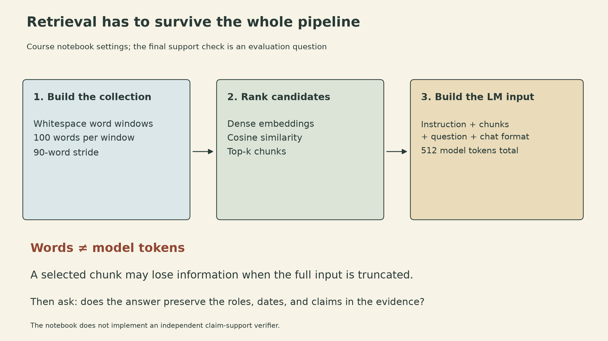
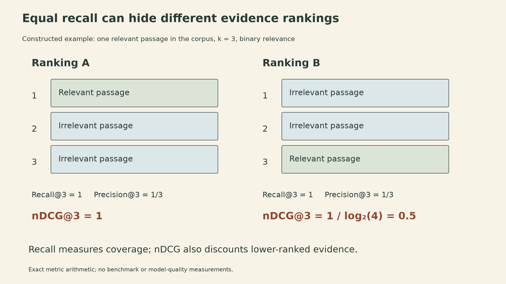
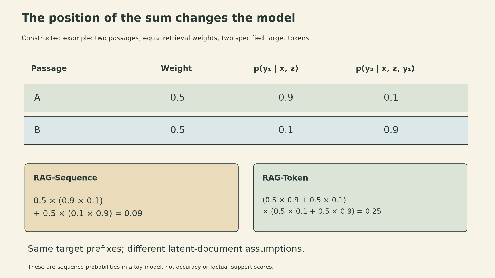

The course's RAG notebook retrieves a passage that names Sean Welleck as instructor and lists eight teaching assistants. For the question about who teaches the course, one saved answer lists Welleck and seven assistants without labeling their roles. The omitted assistant appears in the retrieved passage. The broader question can reasonably include teaching assistants; the observable difference is between the retrieved list and the unlabeled, incomplete list in that saved answer.

The saved answer is one sampled output, not a controlled test of question wording. It makes the scope of retrieval worth examining. A system must find useful material, preserve it in the generator's input, and produce claims that the material supports. Success at the first step does not establish success at the last.

[Akari Asai's guest lecture for CMU Advanced NLP](https://cmu-l3.github.io/anlp-fall2025/static_files/akari_anlp_2025_rag_lecture.pdf) develops this connection through three components: the datastore, the retriever, and the language model. The same separation helps explain both the mathematics of trained RAG models and the behavior of a small retrieval-and-prompting notebook.

## The datastore determines which evidence can be found

A retriever searches the collection it is given. If a needed document is absent, changing the ranking function cannot retrieve it from that collection. If a document is stale, retrieving it accurately can still supply the wrong version of a fact. Updating an external collection can make new information available without changing the generator's weights, but the index and the subsequent answer must actually use that update.

The datastore is also a choice of units. Documents may be cleaned, split into passages, and filtered before indexing. Short chunks can isolate an answer, while also separating it from a heading, date, or qualification. Overlap can preserve context across boundaries at the cost of repeated material. A larger store changes both the available coverage and the search problem; its benefit is an empirical question about the queries and corpus.

The [course notebook at commit `7aa39df`](https://github.com/cmu-l3/anlp-fall2025-code/blob/7aa39dfad7a6480987afa5a922ab25a714c4dc10/10_rag/rag.ipynb) loads already parsed course documents from JSON. Its chunker splits each string on whitespace, takes windows of 100 words, and advances by 90 words. These are word windows, not model-token windows. A 205-word document therefore produces windows covering words 1–100, 91–190, and 181–205: 225 word occurrences are stored because two boundaries overlap. This is a constructed chunking calculation, not a measurement of retrieval quality.

{fig-alt="Three stages of a retrieval-augmented answer: documents are split into 100-word windows with a 90-word stride; the retriever ranks chunks and selects candidates; the assembled prompt is truncated to at most 512 model tokens before the generator answers. Claim-support checking is a separate evaluation question, not an implemented notebook stage. Word windows and model-token budgets are different units."}

## Retrieval scores express a matching rule

Sparse retrieval represents text using vocabulary coordinates. A simple TF–IDF weight combines a within-document term frequency with a penalty for terms that occur in many documents. With nonempty document $d$, corpus size $N$, term count $f(t,d)$, and document frequency $\operatorname{df}(t)>0$, one convention is

$$
\operatorname{tfidf}(t,d)=\frac{f(t,d)}{\sum_u f(u,d)}\log\frac{N}{\operatorname{df}(t)}.
$$

The convention matters: smoothing, term-frequency scaling, and normalization vary. BM25 adds term-frequency saturation and document-length normalization. For a query term, its contribution has the form

$$
\operatorname{IDF}(t)\frac{f(t,d)(k_1+1)}{f(t,d)+k_1(1-b+b|d|/\operatorname{avgdl})}.
$$

Here $k_1>0$ controls saturation, $0\leq b\leq1$ controls length normalization, and $\operatorname{avgdl}>0$ is average document length. A query score combines term contributions. The IDF convention must be specified when reproducing numbers; the lecture's simplified IDF and a library's BM25 default need not coincide.

Dense retrieval uses learned representations of a query and a passage. For a single-vector bi-encoder with vectors in $\mathbb R^m$, common scoring rules are

$$
s_{\mathrm{dot}}(q,d)=e_q(q)^\top e_d(d),\qquad
s_{\mathrm{cos}}(q,d)=\frac{e_q(q)^\top e_d(d)}{\|e_q(q)\|\,\|e_d(d)\|}.
$$

Cosine requires nonzero vectors. The rankings coincide when all document vectors have the same norm; they need not coincide otherwise. With a constructed query $(1,0)$, documents $(2,2)$ and $(1,0)$ have dot products 2 and 1, but cosines $1/\sqrt2$ and 1. Normalization reverses their order. Neither score is automatically a probability that a passage supports a proposed answer.

A bi-encoder can precompute document vectors. A cross-encoder instead processes the query and each candidate together, allowing richer interactions at a greater per-candidate computation cost. It is often used to rerank a shortlist. It cannot rescue a document excluded from that shortlist. Multi-vector methods such as ColBERT add another design point; they should not be reduced to the single-vector formula above.

Exact search and approximate nearest-neighbor indexes trade search work, memory, and retrieval accuracy differently. Quantization can reduce representation storage while changing scores. “Approximate” is not a universal claim that an index uses more memory or always runs faster: that depends on the index, dimensions, corpus, hardware, and search settings.

## Training and evaluation answer different questions

A contrastive objective encourages a query to score its labeled positive above a chosen collection of negatives. Let $s_+$ be the positive score and $s_j$ the negative scores, using temperature one for this expression:

$$
L=-\log\frac{e^{s_+}}{e^{s_+}+\sum_j e^{s_j}}.
$$

Writing $\pi$ for the softmax over these candidates gives

$$
\frac{\partial L}{\partial s_+}=\pi_+-1,\qquad
\frac{\partial L}{\partial s_j}=\pi_j.
$$

For scores $(2,1,0)$, the positive probability is about 0.6652 and the loss is about 0.4076. The score gradients are approximately $(-0.3348,0.2447,0.0900)$. These derivatives concern the sampled candidate set. A softmax probability inside that set is not a calibrated probability of factual support.

In-batch negatives reuse other examples' passages; hard negatives are high-scoring distractors. Both make the candidate construction part of learning. An unlabeled passage can still be relevant, so treating it as a negative can provide misleading supervision. The lecture also covers unsupervised contrastive training through cropped views and instruction-conditioned retrieval, where the requested task changes what counts as a useful result.

Evaluation then asks whether the learned ranking recovers the relevant items for a particular query set. For a nonempty judged relevant set $R$ and a retrieved set $S_k$ of exactly $k$ items,

$$
\operatorname{Precision@}k=\frac{|R\cap S_k|}{k},\qquad
\operatorname{Recall@}k=\frac{|R\cap S_k|}{|R|}.
$$

Recall ignores order within the selected set. With relevance grade $r_i$, a common ranking-sensitive measure is

$$
\operatorname{DCG@}k=\sum_{i=1}^{k}\frac{2^{r_i}-1}{\log_2(i+1)},\qquad
\operatorname{nDCG@}k=\frac{\operatorname{DCG@}k}{\operatorname{IDCG@}k},
$$

where IDCG uses the ideal top-k ordering of the collection’s judged relevance grades, not just those in the retrieved set, and must be nonzero for this ratio. Consider a corpus with one relevant passage. Rankings with relevance labels $(1,0,0)$ and $(0,0,1)$ both have Recall@3 equal to 1 and Precision@3 equal to $1/3$. Their nDCG@3 values are 1 and 0.5. This constructed example explains why finding the same evidence is not the same as ranking it equally well.

{fig-alt="Constructed retrieval example with one relevant passage in the corpus and k equal to three. Ranking A places it first; Ranking B places it third. Both have recall one and precision one third, while nDCG at three is one for A and one half for B, because the relevant item receives discount one over log base two of four at rank three. These are exact metric calculations, not benchmark results."}

The lecture uses BEIR and MTEB to show that retrieval performance depends on the task and domain. A benchmark ranking answers a question about its datasets and protocol. It does not establish that the same model retrieves the right passages from a new private collection, or that a downstream answer is supported.

## The notebook exposes the boundary between retrieval and generation

The course implementation at this commit embeds its chunks with `Qwen/Qwen3-Embedding-0.6B`, scores them by cosine similarity, and uses `Qwen/Qwen3-0.6B` for generation. The saved embedding output has 48 rows and 1024 columns. The comparison loop requests two retrieved chunks. These counts describe that notebook’s configuration and saved output.

Two implementation details matter when interpreting it. First, the notebook passes `prompt_name="query"` for both chunks and queries. The [embedding model's own usage example](https://huggingface.co/Qwen/Qwen3-Embedding-0.6B#sentence-transformers-usage) applies that prompt to queries and encodes documents without it. This is a configuration difference, not proof that a specific result would improve after changing it.

Second, the complete retrieval-augmented prompt is tokenized with `truncation=True, max_length=512`. That budget includes the instruction, retrieved context, question, and chat formatting. A 100-word chunk is not guaranteed to fit in 100 model tokens. The question follows the context, so a long assembled prompt can lose information during truncation; which portion is removed depends on the tokenizer's truncation side. The selected chunk list alone therefore does not show exactly what the generator consumed.

The generator samples with `do_sample=True`, temperature 0.1, and top-p 0.95. A low temperature does not make that procedure deterministic. Its output helper decodes the entire returned sequence and then splits on two delimiters. At the linked revision of the [Qwen3 tokenizer configuration](https://huggingface.co/Qwen/Qwen3-0.6B/blob/c1899de289a04d12100db370d81485cdf75e47ca/tokenizer_config.json), the chat-start marker is special, but `</think>` is not; with thinking disabled, the template appends an empty think block. That second split can therefore extract a clean answer even when the chat-start marker has been removed. The notebook does not pin the tokenizer revision. This is a dependence on the template and delimiters, not an observed corruption of the saved answers. The helper’s `except IndexError` branch is unreachable from these split calls: Python’s `str.split(...)[-1]` still returns a string in that case.

The notebook illustrates a working idea: append retrieved text to a prompt. It does not train the retriever and generator jointly, implement Self-RAG reflection tokens, or implement a claim-support verifier. Its saved teacher-list example shows why the generated output must be examined separately from the retrieved list.

## Original RAG marginalizes over documents

The phrase RAG now commonly includes retrieval followed by prompting an off-the-shelf model. The [original RAG paper](https://arxiv.org/abs/2005.11401) defines a more specific probabilistic model: the retrieved passage is a latent variable.

Let $x$ be the input, $y_{1:T}$ a target sequence, and $z$ a passage. For a fixed top-$k$ set $S(x)$, write normalized retrieval weights as

$$
\widetilde p_\eta(z\mid x)=\frac{e^{s_\eta(x,z)}}{\sum_{z'\in S(x)}e^{s_\eta(x,z')}}\quad(z\in S(x)).
$$

This defines a distribution within the selected set; restricting the document marginalization to this set approximates summing over the full collection. Finding the top-k set can introduce a separate search approximation; the original paper uses HNSW for that search. The generator provides $p_\theta(y_t\mid x,z,y_{<t})$. Two marginalizations give different sequence probabilities:

$$
p_{\mathrm{seq}}(y\mid x)=\sum_{z\in S(x)}\widetilde p_\eta(z\mid x)\prod_{t=1}^{T}p_\theta(y_t\mid x,z,y_{<t}),
$$

$$
p_{\mathrm{tok}}(y\mid x)=\prod_{t=1}^{T}\sum_{z\in S(x)}\widetilde p_\eta(z\mid x)p_\theta(y_t\mid x,z,y_{<t}).
$$

RAG-Sequence keeps one latent passage for the whole target sequence, then sums over passages. RAG-Token marginalizes the latent passage separately at each token. The lecture's product-of-sums expression is the token variant. It does not require a fresh corpus search after every token: the original formulation reuses the retrieved top-$k$ set for the input.

A constructed two-token example makes the order of operations visible. Give passages A and B weights of 0.5 each. For the specified target tokens, let A assign conditional probabilities $(0.9,0.1)$ and B assign $(0.1,0.9)$, with the second probability evaluated at the same target prefix in both cases. Then

$$
p_{\mathrm{seq}}=0.5(0.9\cdot0.1)+0.5(0.1\cdot0.9)=0.09,
$$

$$
p_{\mathrm{tok}}=(0.5\cdot0.9+0.5\cdot0.1)(0.5\cdot0.1+0.5\cdot0.9)=0.25.
$$

The difference comes from the latent-document assumption. It is not a measured quality gain, and it does not say that any real passage supports the target statement.

{fig-alt="Constructed two-document, two-target-token example. Each document has retrieval weight one half. Document A assigns token probabilities 0.9 then 0.1; B assigns 0.1 then 0.9, evaluated on the same target prefixes. Summing the two whole-sequence likelihoods gives 0.09. Mixing document-conditioned probabilities at each token and then multiplying gives 0.25. The figure compares probability models, not accuracy or factual support."}

Training minimizes the negative marginal log-likelihood of target answers. In Lewis et al.'s implementation, the query encoder and generator are fine-tuned while the document encoder and index stay fixed. “End-to-end” does not mean that every component or the discrete top-$k$ selection is differentiable and updated. Within a selected set, gradients can change the weights assigned to passages and the generator's predictions; discrete candidate membership is a separate boundary.

## Self-RAG makes retrieval and support explicit predictions

[Self-RAG](https://arxiv.org/abs/2310.11511) adds learned reflection tokens to generation. The paper distinguishes whether to retrieve, whether a passage is relevant, whether the generated segment is supported, and how useful the response is. Relevance is a relation between the task and the passage; support also depends on the claim being made.

In the lecture’s literature-synthesis example, a passage about research-idea generation is labeled relevant. A candidate sentence then claims both idea generation and literature synthesis, and is labeled partially supported. The passage supports one part of the sentence, not the added literature-synthesis claim. Relevance and support are different judgments even for the same question and passage.

A critic supplies reflection-token annotations to training data offline. The final generator learns to emit these tokens along with text, so it need not call that critic as a separate inference model. During generation, it can choose to retrieve and rank passage-conditioned candidate segments using learned critique signals. The prediction that a segment is fully supported remains a model judgment, not a proof of truth or an independent source audit.

The lecture then extends the idea to tool-based search and reasoning interleaved with retrieval. Such a loop can revise what it searches for after seeing earlier results. These search-and-generation mechanisms do not themselves specify an access-control policy or a defense against instructions found inside retrieved documents. Those are separate system properties, not established capabilities of the notebook or the reflection tokens described here.

## Retrieval can enter the model in different places

Input augmentation exposes passages through the prompt. Intermediate-fusion systems such as RETRO incorporate retrieved information through learned internal attention mechanisms. Output-interpolation methods such as kNN-LM instead combine a model distribution with a neighbor-based distribution:

$$
p(y_t\mid h)=(1-\lambda)p_{\mathrm{LM}}(y_t\mid h)+\lambda p_{\mathrm{kNN}}(y_t\mid h),\qquad 0\leq\lambda\leq1.
$$

Here $h$ denotes the preceding context. In kNN-LM, stored context representations act as keys and their following tokens as values; nearby contexts contribute weight to those tokens. The mixture is normalized when both component distributions are normalized over the same vocabulary. It is a different operation from placing retrieved paragraphs in the input.

These designs impose different costs: index storage and search, candidate reranking, encoding retrieved context, and generation. Longer context can increase work without adding usable evidence. A retrieval metric, an answer-accuracy metric, and a claim-support check therefore measure different outcomes. The course notebook’s saved staff-list example illustrates why inspecting the retrieved passages cannot substitute for checking the generated answer. Evidence has to survive the whole path from collection to claim.

## Sources

- [CMU Advanced NLP Fall 2025, Lecture 10, Akari Asai](https://cmu-l3.github.io/anlp-fall2025/static_files/akari_anlp_2025_rag_lecture.pdf). Printed slides 15–20 cover the datastore; 22–43 cover retrieval and evaluation; 45–71 cover generation architectures, Self-RAG, and alternatives. The PDF includes incremental builds, so printed slide numbers differ from PDF page numbers.
- [Course RAG notebook and documents, fixed commit `7aa39df`](https://github.com/cmu-l3/anlp-fall2025-code/tree/7aa39dfad7a6480987afa5a922ab25a714c4dc10/10_rag). Notebook cells 3, 5, 7, 9, 11, 13, 15, and 17 (which contain code), using zero-based indexing, define the pipeline discussed here.
- [Qwen3-Embedding-0.6B model card](https://huggingface.co/Qwen/Qwen3-Embedding-0.6B#sentence-transformers-usage), query and document encoding conventions.
- [Lewis et al., Retrieval-Augmented Generation for Knowledge-Intensive NLP Tasks](https://arxiv.org/abs/2005.11401), Sections 2.1–2.4 and 3, for document marginalization, the frozen document index, and HNSW search.
- [Asai et al., Self-RAG](https://arxiv.org/abs/2310.11511), Table 1 and Sections 3.1–3.3, for reflection tokens, critic supervision, and inference.
