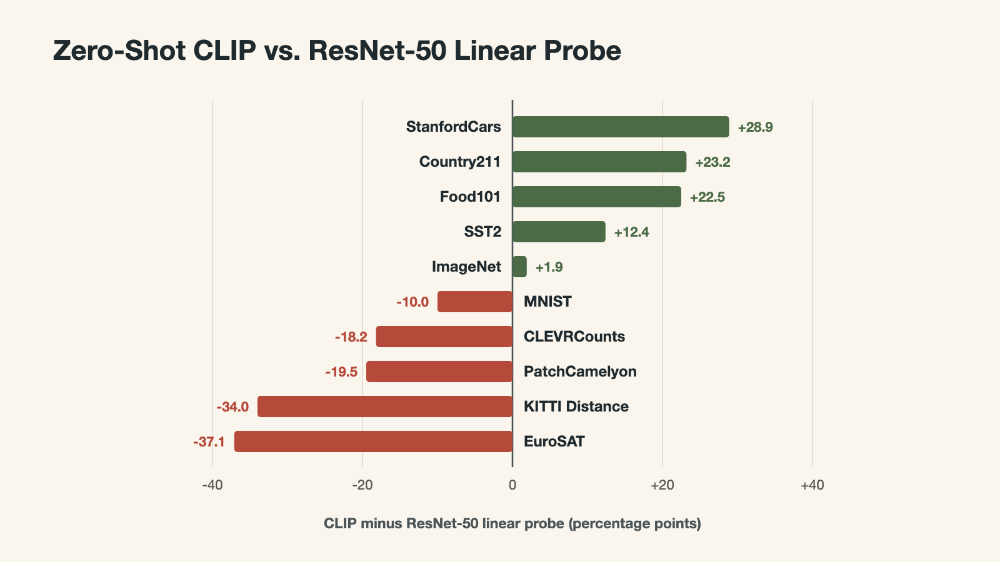

A text-only language model reads a prompt as a sequence of embedding vectors, one vector per token. Extending that model to read photographs, screenshots, web pages, or mathematical plots requires solving a representation bottleneck first: how to turn an image array $x_{\text{image}} \in \mathbb{R}^{H \times W \times C}$ into a sequence of vectors $z_1, \dots, z_L = f_{\text{enc}}(x_{\text{image}})$ that a transformer can process alongside words ([slides, p. 8](https://cmu-l3.github.io/anlp-fall2025/static_files/anlp-f2025-11-multimodal.pdf#page=8)).

Sean Welleck's Lecture 11 on the [CMU Advanced NLP Fall 2025 schedule](https://cmu-l3.github.io/anlp-fall2025/) ([slides PDF](https://cmu-l3.github.io/anlp-fall2025/static_files/anlp-f2025-11-multimodal.pdf), [code directory `11_multimodal_i`](https://github.com/cmu-l3/anlp-fall2025-code/tree/main/11_multimodal_i)) traces this progression across three building blocks:

1. **Vision Transformer (ViT)** turns spatial pixel grids into patch token sequences using a standard transformer encoder ([slides, pp. 9–17](https://cmu-l3.github.io/anlp-fall2025/static_files/anlp-f2025-11-multimodal.pdf#page=9)).
2. **CLIP** aligns image and text representations in a shared normalized vector space using web-scale `(image, text)` pairs rather than fixed class labels ([slides, pp. 19–28](https://cmu-l3.github.io/anlp-fall2025/static_files/anlp-f2025-11-multimodal.pdf#page=19)).
3. **LLaVA and Molmo** project a pretrained CLIP ViT's patch vectors into a language model's embedding dimension, trading spatial resolution against token budget ([slides, pp. 30–40](https://cmu-l3.github.io/anlp-fall2025/static_files/anlp-f2025-11-multimodal.pdf#page=30)).

{fig-alt="Three horizontal pipelines starting on the left from Image (H by W by C) and Caption y (Text pairs). Top blue row shows Patch + Project (N by D embeddings) to ViT Encoder (Transformer) to Class Logits (Supervised labels). Middle green row sends Image into Image Encoder f_I(x) and Caption y into Text Encoder f_T(y), feeding Cosine Matrix (B by B batch scores) and Symmetric InfoNCE (Mean row + col CE). Bottom ochre and terracotta row sends Image to CLIP ViT (Patch tokens) to Connector W (LLM dimension) to Language Model (Text loss only)."}

## Vision Transformers replace convolutions with patch tokens

Instead of sliding convolutional filters across pixels, a Vision Transformer splits an image $x_{\text{image}} \in \mathbb{R}^{H \times W \times C}$ into $N$ non-overlapping square patches of side $P$ ([Dosovitskiy et al. 2020](https://arxiv.org/abs/2010.11929); [slides, pp. 9–10](https://cmu-l3.github.io/anlp-fall2025/static_files/anlp-f2025-11-multimodal.pdf#page=9)). Assuming $P$ divides both height $H$ and width $W$:

$$
N = \frac{H W}{P^2}, \qquad X_p \in \mathbb{R}^{N \times (P^2 \cdot C)}.
$$

Each flattened patch vector has dimension $P^2 \cdot C$, and a single learned linear projection maps those $N$ patch vectors into model dimension $D$. [Slide 10](https://cmu-l3.github.io/anlp-fall2025/static_files/anlp-f2025-11-multimodal.pdf#page=10) states $W_e \in \mathbb{R}^{D \times (P^2 \cdot C)}$ and writes $x = W x_p$ symbolically; writing one flattened patch per row in $X_p \in \mathbb{R}^{N \times (P^2 \cdot C)}$ and prepending one learnable `[class]` vector $c \in \mathbb{R}^{1 \times D}$ (`0*` on [slide 9](https://cmu-l3.github.io/anlp-fall2025/static_files/anlp-f2025-11-multimodal.pdf#page=9)) gives the full input sequence with learned position embeddings $E_{\text{pos}} \in \mathbb{R}^{(N+1) \times D}$:

$$
X_{\text{in}} = \operatorname{concat}_{\text{rows}}\!\left(c,\, X_p W_e^\top\right) + E_{\text{pos}} \in \mathbb{R}^{(N+1) \times D}.
$$

This sequence of $N + 1$ vectors enters an $L$-layer Pre-LN transformer encoder (`Norm -> Multi-Head Attention -> Residual` followed by `Norm -> MLP -> Residual`), yielding contextualized vectors $z_0, z_1, \dots, z_N$. For classification, an MLP head maps the `[class]` output $z_0$ to label logits ([slides, p. 11](https://cmu-l3.github.io/anlp-fall2025/static_files/anlp-f2025-11-multimodal.pdf#page=11)).

Two lecture-reported configurations illustrate how patch size governs sequence length:

- **Slide worked calculation ([slides, p. 10](https://cmu-l3.github.io/anlp-fall2025/static_files/anlp-f2025-11-multimodal.pdf#page=10)):** A $120 \times 120 \times 3$ image partitioned into $40 \times 40$ patches yields $N = \frac{120 \times 120}{40 \times 40} = 9$ patches, each of dimension $40 \times 40 \times 3 = 4{,}800$. Projecting with $W_e \in \mathbb{R}^{1024 \times 4800}$ gives $9$ patch embeddings in $\mathbb{R}^{9 \times 1024}$.
- **Course ViT-B/16 code example ([slides, p. 17](https://cmu-l3.github.io/anlp-fall2025/static_files/anlp-f2025-11-multimodal.pdf#page=17)):** A $224 \times 224 \times 3$ image (`torch.Size([1, 3, 224, 224])`) with $16 \times 16$ patches produces $N = (224/16)^2 = 196$ patches; each flattened RGB patch has dimension $16 \times 16 \times 3 = 768$, and the post-projection patch embedding tensor printed on the slide also has shape `torch.Size([1, 196, 768])` because the model hidden size is $768$. Passing those $196$ patch embeddings plus $1$ CLS token through $12$ layers with $12$ attention heads (head dimension $768 / 12 = 64$) outputs `torch.Size([1, 197, 768])` and a CLS representation of `torch.Size([1, 768])`. On the slide's two-cats image, the classifier predicts `Egyptian cat` (`93.74%`), `tabby, tabby cat` (`3.84%`), `tiger cat` (`1.44%`), `lynx, catamount` (`0.33%`), and `Siamese cat, Siamese` (`0.07%`).

{fig-alt="Four patch-grid comparisons. Left blue section shows Slide Example (120 by 120 image, P equals 40, yielding 9 patch embeddings of shape 9 by 1024) and ViT-B/16 Code (224 by 224 image, P equals 16, yielding 197 tokens from 196 patches plus CLS). Right ochre and green section shows Molmo View (336 by 336 image, P equals 14, yielding 576 patches pooled 2 by 2 into 144 per view) and Pooled Grid times 13 (1 full plus 12 crops totaling 1,872 vectors before markers)."}

Across pretraining experiments in [Dosovitskiy et al. (2020)](https://arxiv.org/abs/2010.11929), ViT exhibits four empirical patterns shown in the lecture ([slides, pp. 12–16](https://cmu-l3.github.io/anlp-fall2025/static_files/anlp-f2025-11-multimodal.pdf#page=12)):

- **Compute-dependent scaling ([p. 12](https://cmu-l3.github.io/anlp-fall2025/static_files/anlp-f2025-11-multimodal.pdf#page=12)):** At comparable plotted compute budgets, CNN-Transformer hybrids lead at lower pre-training compute (around $10^2$ to $3 \times 10^2$ exaFLOPs visually), while ViT and hybrid points sit close together at higher compute (around $10^3$ exaFLOPs and above), and ViT stays above the plotted BiT ResNet points across budgets.
- **Emergent 2D structure without 2D convolutions ([pp. 13–14](https://cmu-l3.github.io/anlp-fall2025/static_files/anlp-f2025-11-multimodal.pdf#page=13)):** Visualizing the first $28$ principal components of $W_e$ reveals oriented edge and color-opponent filters, and cosine similarities between 1D learned position embeddings recover a 2D row-and-column grid neighborhood across the $7 \times 7$ patch array.
- **Foreground saliency in classification ([p. 15](https://cmu-l3.github.io/anlp-fall2025/static_files/anlp-f2025-11-multimodal.pdf#page=15)):** In two visualization examples (a dog and an airplane), the model's attention highlights the foreground object over the surrounding background.
- **Per-head mean attention distance ([p. 16](https://cmu-l3.github.io/anlp-fall2025/static_files/anlp-f2025-11-multimodal.pdf#page=16)):** In the `ViT-L/16` scatter plot of mean attention distance in pixels across depth, early layers (`0–5`) show heads spanning both low values (visually around $10\text{–}20$ px) and high values (above $100$ px), whereas deeper layers (`>= 12`) cluster at higher mean attention distances (visually around $100\text{–}120$ px).

## CLIP learns visual representations from text pairs

Training ViT on ImageNet still ties visual representations to a fixed set of hand-labeled categories. A single class name discards object attributes, relationships, scenes, and actions, and hand-labeling caps dataset scale ([slides, p. 19](https://cmu-l3.github.io/anlp-fall2025/static_files/anlp-f2025-11-multimodal.pdf#page=19)).

**CLIP** ([Radford et al. 2021](https://arxiv.org/abs/2103.00020); [slides, pp. 20–24](https://cmu-l3.github.io/anlp-fall2025/static_files/anlp-f2025-11-multimodal.pdf#page=20)) replaces fixed-class supervision with contrastive learning over web-scale datasets such as $400\text{ million}$ `(image, text)` pairs ([slides, p. 21](https://cmu-l3.github.io/anlp-fall2025/static_files/anlp-f2025-11-multimodal.pdf#page=21)). Following the pseudocode on [slide 24](https://cmu-l3.github.io/anlp-fall2025/static_files/anlp-f2025-11-multimodal.pdf#page=24) with one sample per row, an image encoder $f_I(x) \in \mathbb{R}^{1 \times d_i}$ and a text encoder $f_T(y) \in \mathbb{R}^{1 \times d_t}$ are linearly projected via $W_i \in \mathbb{R}^{d_i \times d_e}$ and $W_t \in \mathbb{R}^{d_t \times d_e}$ into a shared embedding dimension $d_e$ and $L_2$-normalized:

$$
\hat{z}_I(x) = \frac{f_I(x) W_i}{\|f_I(x) W_i\|_2} \in \mathbb{R}^{1 \times d_e}, \qquad
\hat{z}_T(y) = \frac{f_T(y) W_t}{\|f_T(y) W_t\|_2} \in \mathbb{R}^{1 \times d_e}.
$$

Given a minibatch of $B$ aligned pairs $\{(x_n, y_n)\}_{n=1}^B$, stacking the normalized row vectors into $\hat{Z}_I, \hat{Z}_T \in \mathbb{R}^{B \times d_e}$ forms the $B \times B$ pairwise logit matrix $S = e^t \hat{Z}_I \hat{Z}_T^\top$ with scalar entries

$$
s_{n,m} = e^t\,\hat{z}_{I,n}\hat{z}_{T,m}^\top,
$$

where $e^t = 1/\tau > 0$ is the learned inverse temperature (`np.exp(t)` on [slide 24](https://cmu-l3.github.io/anlp-fall2025/static_files/anlp-f2025-11-multimodal.pdf#page=24)). With mean reduction over the $B$ examples in each axis, the symmetric contrastive loss averages image-to-text and text-to-image cross-entropy over the diagonal positives ([slides, pp. 23–24](https://cmu-l3.github.io/anlp-fall2025/static_files/anlp-f2025-11-multimodal.pdf#page=23)):

$$
\mathcal{L}_{\text{CLIP}} = -\frac{1}{2B}\sum_{n=1}^{B} \left[
\log \frac{\exp(s_{n,n})}{\sum_{j=1}^{B}\exp(s_{j,n})}
+
\log \frac{\exp(s_{n,n})}{\sum_{j=1}^{B}\exp(s_{n,j})}
\right].
$$

Two notation details on [slide 23](https://cmu-l3.github.io/anlp-fall2025/static_files/anlp-f2025-11-multimodal.pdf#page=23) are worth keeping straight when implementing from the deck: the slide omits the $1/B$ batch-mean normalization and temperature scale in its display formula and writes $p_\theta \propto f_I(x)^\top f_T(y)$ as shorthand, whereas the actual softmax distribution in both the loss fraction and the NumPy code on [slide 24](https://cmu-l3.github.io/anlp-fall2025/static_files/anlp-f2025-11-multimodal.pdf#page=24) is $p_\theta(m \mid n) \propto \exp(s_{n,m})$ (with `cross_entropy_loss` reduction left implicit in the snippet; here we use mean reduction).

**Constructed $2 \times 2$ InfoNCE verification (not lecture data):** Suppose $B=2$ with $e^t = 2$, matched cosine similarity $0.8$, and mismatched cosine similarity $0.2$. The logit matrix is $S = \begin{pmatrix} 1.6 & 0.4 \\ 0.4 & 1.6 \end{pmatrix}$. Along either axis, the matched softmax probability is $p_+ = \frac{e^{1.6}}{e^{1.6}+e^{0.4}} \approx 0.768525$, giving batch-mean symmetric cross-entropy $-\log(0.768525) \approx 0.263282$ nats. Because each logit enters one row term and one column term with weight $\frac{1}{2B} = \frac{1}{4}$, its gradient under the batch-mean symmetric loss is $\frac{1}{2}(p_+ - 1) \approx -0.115738$ on the diagonal and $\frac{1}{2}(1 - p_+) \approx +0.115738$ off the diagonal:

$$
\nabla_S \mathcal{L}_{\text{CLIP}} \approx \begin{pmatrix} -0.115738 & +0.115738 \\ +0.115738 & -0.115738 \end{pmatrix},
$$

pulling matched pairs together while pushing unmatched pairs apart.

### Zero-shot classification turns prompts into classifier weights

At test time, CLIP classifies an image into any label set $\{c_1, \dots, c_K\}$ without gradient updates by embedding prompt templates such as `"A photo of a {object}."` through the text branch once to obtain projected, normalized vectors $\hat{z}_{T,1}, \dots, \hat{z}_{T,K}$, embedding the test image into $\hat{z}_{I,1}$, and scoring $e^t\,\hat{z}_{I,1}\hat{z}_{T,k}^\top$ ([slides, p. 25](https://cmu-l3.github.io/anlp-fall2025/static_files/anlp-f2025-11-multimodal.pdf#page=25)). The temperature scale $e^t$ leaves the argmax ranking unchanged while sharpening or flattening the resulting softmax probabilities.

In the lecture's CLIP code output ([slides, p. 28](https://cmu-l3.github.io/anlp-fall2025/static_files/anlp-f2025-11-multimodal.pdf#page=28)) on the same two-cats image, `"a photo of a cat"` scores raw logit `18.904` against `"a photo of a dog"` at `11.716`. Applying a two-class softmax gives $\frac{1}{1 + e^{-(18.904 - 11.716)}} \approx 99.9245\%$ (`99.9%` vs. `0.1%` printed on the slide). Yet when `10` candidate prompts compete simultaneously on the right panel of [slide 28](https://cmu-l3.github.io/anlp-fall2025/static_files/anlp-f2025-11-multimodal.pdf#page=28), `"cats on a couch"` captures `89.08%` and `"two cats sitting together"` captures `5.39%`, dropping `"a photo of a cat"` to `0.33%`—demonstrating that zero-shot probabilities depend directly on the competing prompt set.

{fig-alt="Horizontal diverging bar chart showing 10 representative score differences in percentage points (pp) between zero-shot CLIP and a supervised ResNet-50 linear probe from slide 26 (27-dataset evaluation, CLIP wins on 16 of 27). Positive sage bars show StanfordCars +28.9 pp, Country211 +23.2 pp, Food101 +22.5 pp, SST2 +12.4 pp, and ImageNet +1.9 pp. Negative terracotta bars show MNIST -10.0 pp, CLEVRCounts -18.2 pp, PatchCamelyon -19.5 pp, KITTI Distance -34.0 pp, and EuroSAT -37.1 pp."}

Zero-shot CLIP also reveals a clear capability boundary in [Radford et al. (2021)](https://arxiv.org/abs/2103.00020):

- **Selected gains across the 27-dataset evaluation ([p. 26](https://cmu-l3.github.io/anlp-fall2025/static_files/anlp-f2025-11-multimodal.pdf#page=26)):** Zero-shot CLIP beats a fully supervised ResNet-50 linear probe on **16 of 27** datasets, led by `StanfordCars` (`+28.9 pp`), `Country211` (`+23.2 pp`), `Food101` (`+22.5 pp`), `Kinetics700` (`+14.5 pp`), `SST2` (`+12.4 pp`), and `ImageNet` (`+1.9 pp`).
- **Spatial, counting, and domain-shift deficits ([p. 26](https://cmu-l3.github.io/anlp-fall2025/static_files/anlp-f2025-11-multimodal.pdf#page=26)):** Zero-shot CLIP trails the supervised linear probe sharply on satellite land cover (`EuroSAT -37.1 pp`, `RESISC45 -11.9 pp`), depth estimation (`KITTI Distance -34.0 pp`), histopathology (`PatchCamelyon -19.5 pp`), traffic signs (`GTSRB -18.4 pp`), object counting (`CLEVRCounts -18.2 pp`), and handwritten digits (`MNIST -10.0 pp`).
- **Pre-training compute scaling ([p. 27](https://cmu-l3.github.io/anlp-fall2025/static_files/anlp-f2025-11-multimodal.pdf#page=27)):** Across model scales (`39` evaluations on `36` datasets in [Radford et al. 2021, Fig. 9](https://arxiv.org/pdf/2103.00020#page=11)), average zero-shot error drops smoothly with model GFLOPs—from a visual reading of roughly `45%` for `RN50` (`6.1` GFLOPs) to roughly `30%` for `RN50x64` (`265.9` GFLOPs).

## LLaVA and Molmo turn visual patches into LLM inputs

CLIP produces a single pooled image vector for similarity scoring, whereas this family of vision-language models supports open-ended visual reasoning by feeding a sequence of spatial patch embeddings into an autoregressive language model.

**LLaVA** ([Liu et al. 2023](https://arxiv.org/abs/2304.08485); [slides, pp. 30–32](https://cmu-l3.github.io/anlp-fall2025/static_files/anlp-f2025-11-multimodal.pdf#page=30)) connects a pretrained CLIP ViT directly to a pretrained LLM $f_\phi$. Using one token per row with $W \in \mathbb{R}^{d_{\text{LLM}} \times d_v}$:

$$
Z_v = g(X_v) \in \mathbb{R}^{N \times d_v}, \qquad H_v = Z_v W^\top \in \mathbb{R}^{N \times d_{\text{LLM}}},
$$

where [slide 32](https://cmu-l3.github.io/anlp-fall2025/static_files/anlp-f2025-11-multimodal.pdf#page=32) takes $Z_v$ from the last ViT layer and [slide 30](https://cmu-l3.github.io/anlp-fall2025/static_files/anlp-f2025-11-multimodal.pdf#page=30) diagrams the projection ($H_v = W Z_v$ in [Liu et al. 2023, Eq. 1](https://arxiv.org/pdf/2304.08485#page=4)). Following the ordering illustrated on [slide 30](https://cmu-l3.github.io/anlp-fall2025/static_files/anlp-f2025-11-multimodal.pdf#page=30), the LLM receives the concatenated sequence $[H_v; H_q]$ of projected image tokens $H_v$ and text instruction embeddings $H_q$, generating response tokens $X_a$ autoregressively. During training on `(image, instruction, response)` data, cross-entropy loss skips the image positions ([slides, p. 32](https://cmu-l3.github.io/anlp-fall2025/static_files/anlp-f2025-11-multimodal.pdf#page=32)) and supervises only the assistant answers and their stop tokens ([Liu et al. 2023, §4.2 & Table 2](https://arxiv.org/pdf/2304.08485)).

| Stage | ViT (Classification) | CLIP (Contrastive) | LLaVA / Molmo (VLM) |
|---|---|---|---|
| **Visual input** | $N$ patches + `[class]` | One projected, normalized image vector | Sequence of patch vectors $Z_v$ |
| **Bridge to text** | Fixed label head | Shared $L_2$-norm dot product | Linear projection $W$ (LLaVA) or attention pooling + MLP (Molmo) |
| **Supervision** | Cross-entropy on class labels | Symmetric InfoNCE on $(x, y)$ pairs | Next-token loss on text only |
| **Main failure mode** | Closed label vocabulary | Prompt sensitivity; weak spatial counting | Fixed-res crops blur small text / details |

**Molmo** ([Deitke et al. 2024](https://arxiv.org/abs/2409.17146); [slides, pp. 33–40](https://cmu-l3.github.io/anlp-fall2025/static_files/anlp-f2025-11-multimodal.pdf#page=33)) addresses two bottlenecks in LLaVA-style models: **resolution loss** and **human-grounded supervision**.

First, compressing a high-resolution chart or document into a single `336 x 336` encoder frame blurs fine text. Molmo uses `CLIP ViT-L/14 336px`, where each `336 x 336` view splits into a $24 \times 24$ grid of $14 \times 14$ patches ($576$ patches per view). Pooling each $2 \times 2$ patch group before projection halves grid dimensions to $12 \times 12 = 144$ visual vectors per view, interleaved with `<im_col>` row markers and `<im_start>`/`<im_end>` delimiters ([slides, pp. 34–35](https://cmu-l3.github.io/anlp-fall2025/static_files/anlp-f2025-11-multimodal.pdf#page=34)). For the [slide-35](https://cmu-l3.github.io/anlp-fall2025/static_files/anlp-f2025-11-multimodal.pdf#page=35) configuration of `1` full image plus `12` crops, retaining all pooled positions gives $13 \times 144 = 1{,}872$ visual vectors before special tokens (while [Deitke et al. 2024](https://arxiv.org/html/2409.17146) also note dropping overlap features before the connector, so actual LLM sequence length depends on crop handling and delimiters).

Second, Molmo builds its **PixMo** training suite across four branches ([slides, p. 36](https://cmu-l3.github.io/anlp-fall2025/static_files/anlp-f2025-11-multimodal.pdf#page=36)):

- **PixMo-Captions ([pp. 36–37](https://cmu-l3.github.io/anlp-fall2025/static_files/anlp-f2025-11-multimodal.pdf#page=36)):** Spoken voice descriptions are transcribed and rewritten by an LLM into detailed captions.
- **PixMo-AskModelAnything ([p. 36](https://cmu-l3.github.io/anlp-fall2025/static_files/anlp-f2025-11-multimodal.pdf#page=36)):** Annotators write questions, an LLM drafts answers from the caption and OCR, and annotators review and suggest edits.
- **PixMo-Points ([pp. 33, 36, 38](https://cmu-l3.github.io/anlp-fall2025/static_files/anlp-f2025-11-multimodal.pdf#page=33)):** Annotators click target points so the model learns to emit image-relative coordinates normalized to `0–100`, such as `<point x="63.5" y="44.5" alt="Mt Rainier">` ([p. 33](https://cmu-l3.github.io/anlp-fall2025/static_files/anlp-f2025-11-multimodal.pdf#page=33)) or a multi-point counting trace listing points through `x14, y14` on the orchestra photo ([p. 38](https://cmu-l3.github.io/anlp-fall2025/static_files/anlp-f2025-11-multimodal.pdf#page=38)).
- **PixMo-Synthetic ([p. 36](https://cmu-l3.github.io/anlp-fall2025/static_files/anlp-f2025-11-multimodal.pdf#page=36)):** Synthetic data generated from object-detector crops, dense captions, rendered watch faces (`8:26:12`), and LLM-generated code plots.

Putting these pieces together makes multimodal answers inspectable. On [slide 40](https://cmu-l3.github.io/anlp-fall2025/static_files/anlp-f2025-11-multimodal.pdf#page=40), given a Pew Research bar chart and the question *"What percentage of parents use Facebook?"*, the lecture shows Molmo outputting `<point x="66.6" y="24.2" alt="Percentage of parents using Facebook">74 percent</point>`, anchoring the extracted number directly to the bar it read.
