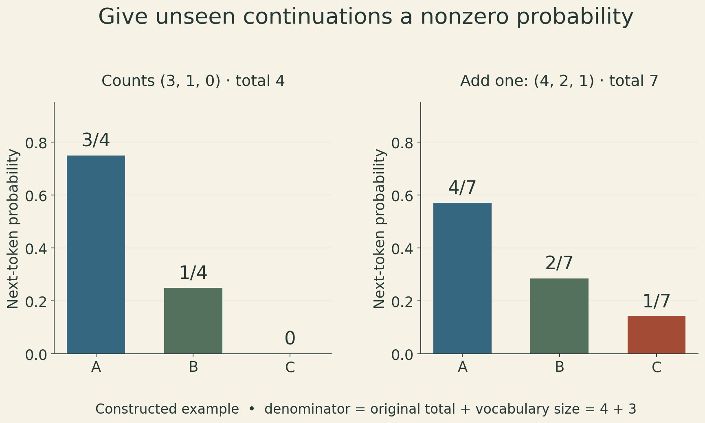
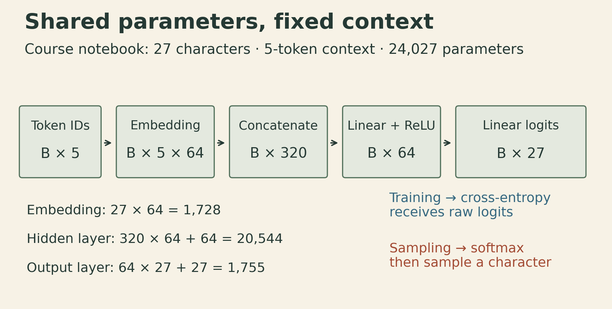
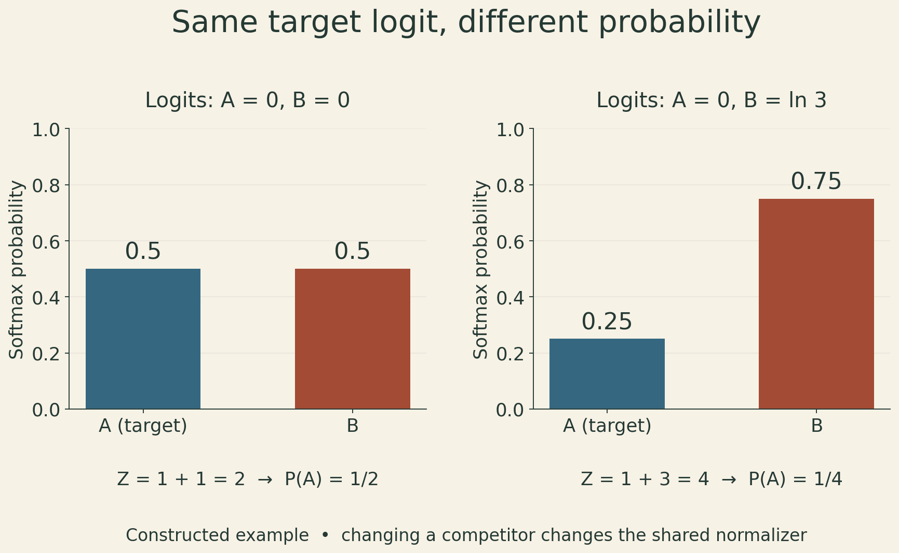

Suppose a model gives a familiar sentence a high score. What should that score mean? Could we compare it with a longer sentence, use it to generate text, or interpret it as a probability?

A language model answers by assigning probabilities to token sequences. A table of counts and a neural network can implement the same next-token interface. The difference is how they estimate its probabilities and how much information they share between contexts.

Sean Welleck’s CMU Advanced NLP Lecture 3 develops that connection: factor a sequence probability, estimate the factors, learn a shared representation, and evaluate the resulting distribution. The equations also explain several implementation details that are easy to lose behind a training loop.

## A product of conditionals is an exact identity

For tokens $x_1,\ldots,x_T$, the chain rule gives

$$
p(x_1,\ldots,x_T)=\prod_{t=1}^{T}p(x_t\mid x_{<t}).
$$

This factorization does not assume that tokens are independent. Each factor can depend on the whole prefix. A **bigram model** makes an additional modeling assumption:

$$
p(x_t\mid x_{<t})\approx p(x_t\mid x_{t-1}).
$$

An $n$-gram model retains the previous $n-1$ tokens. It is the context restriction, rather than the product itself, that discards information. [Lecture slides, pp. 9–12, 29–30](https://cmu-l3.github.io/anlp-fall2025/static_files/anlp-f2025-03-lm.pdf).

Boundary conventions matter. With an initial marker BOS and an end marker EOS, the probability of a finite sequence includes the prediction that it ends:

$$
p(x_1,\ldots,x_T,\mathrm{EOS}\mid\mathrm{BOS})
=\left[\prod_{t=1}^{T}p(x_t\mid\mathrm{BOS},x_{<t})\right]
p(\mathrm{EOS}\mid\mathrm{BOS},x_{1:T}).
$$

BOS supplies context; EOS is a predicted outcome. The course's character-level examples use the same symbol, `[S]`, in both roles. A model over finite strings also needs to terminate with probability one to put all its probability mass on finite strings; normalized next-token rows alone do not establish that for every possible model.

The same distribution supports different tasks. Scoring evaluates a supplied sequence. Generation selects tokens from the conditionals. Conditional generation supplies an extra input, such as a document or a prompt. Those uses share a probability model, but choosing the most likely token and sampling a token are different decoding procedures.

## Counts are maximum-likelihood estimates

Let $c(h,w)$ count how often token $w$ follows context $h$, and let $C(h)=\sum_{v\in V}c(h,v)$. A separate categorical distribution for each context has log-likelihood

$$
\ell_h=\sum_{w\in V}c(h,w)\log p(w\mid h),
\qquad \sum_w p(w\mid h)=1.
$$

For positive-count outcomes, introduce a Lagrange multiplier:

$$
\mathcal L_h=\sum_w c(h,w)\log p(w\mid h)
+\lambda\left(1-\sum_w p(w\mid h)\right).
$$

Differentiating gives $c(h,w)/p(w\mid h)=\lambda$. Summing the resulting probabilities sets $\lambda=C(h)$, so, when $C(h)>0$,

$$
\widehat p(w\mid h)=\frac{c(h,w)}{C(h)}.
$$

Zero-count outcomes receive zero probability at the unsmoothed maximum-likelihood solution, on the boundary of the probability simplex. If the context itself never occurred, the ratio is undefined and the likelihood provides no estimate for that row. These are two related but distinct sparsity problems. [Slides, pp. 18–19, 29–31](https://cmu-l3.github.io/anlp-fall2025/static_files/anlp-f2025-03-lm.pdf).

The likelihood view is also a distribution-matching view. If $\widehat q$ is the empirical distribution of observed sequences, minimizing its cross-entropy with $p_\theta$ minimizes

$$
D_{\mathrm{KL}}(\widehat q\Vert p_\theta)
=\sum_x\widehat q(x)\log\widehat q(x)
-\sum_x\widehat q(x)\log p_\theta(x),
$$

because the first term does not depend on the model. This does not mean we know the true distribution of language: the optimization sees an empirical sample.

## Smoothing changes both the numerator and the denominator

A held-out sequence containing a zero-probability transition has probability zero under the unsmoothed model. Its log-likelihood is negative infinity. Additive smoothing avoids this by assigning a positive pseudocount $\alpha$ to every vocabulary outcome:

$$
p_\alpha(w\mid h)=\frac{c(h,w)+\alpha}{C(h)+\alpha |V|},\qquad\alpha>0.
$$

The denominator is the sum of all adjusted counts. For the constructed count vector $(3,1,0)$ over three outcomes, add-one smoothing produces

$$
(3,1,0)\longrightarrow(4,2,1),\qquad
p_1=(4/7,2/7,1/7).
$$

The total must increase from four to seven, not merely reuse the original total. The denominator printed on slide 31 is a typo: summing the adjusted counts gives the additive form above. An entirely unseen context becomes uniform under this rule. This is a particular estimate, not evidence that the unseen context truly has a uniform continuation distribution.

{fig-alt="Constructed three-outcome example. Counts A=3, B=1, C=0 yield maximum-likelihood probabilities 0.75, 0.25, and zero. Adding one to every count yields 4, 2, 1 with total seven and probabilities 4/7, 2/7, 1/7. Both bar-chart axes start at zero. The denominator is original total plus vocabulary size."}

Smoothing makes the distribution less brittle, but it does not teach the model that similar contexts should have similar continuations. As the context window grows, the number of possible contexts grows exponentially. Most will be rare or absent. Neural representations address this lack of sharing; additive smoothing alone does not. [Slides, pp. 29–35](https://cmu-l3.github.io/anlp-fall2025/static_files/anlp-f2025-03-lm.pdf).

## Log-likelihood measures the probabilities of the observed targets

Multiplying many probabilities can underflow. Log space converts the product into a sum:

$$
\log p(x_{1:T})=\sum_{t=1}^{T}\log p(x_t\mid x_{<t}).
$$

For a corpus with $N$ predicted targets, define token-average negative log-likelihood using natural logarithms:

$$
\overline L=-\frac1N\sum_{i=1}^{N}\log p(y_i\mid h_i),
\qquad \mathrm{PPL}=\exp(\overline L).
$$

Count EOS targets in $N$ if their losses are included. Do not count a BOS marker that is only an input. For base-two logarithms, the equivalent formula is $\mathrm{PPL}=2^{H_2}$, where H₂ is the token-average negative log-likelihood in bits.

Perplexity is the geometric mean of the inverse probabilities assigned to the correct targets. For a constructed three-target example with probabilities $1/2$, $1/4$, and $1/8$,

$$
\overline L=\frac{\log2+\log4+\log8}{3}=\log4,
\qquad \mathrm{PPL}=4.
$$

The arithmetic mean of the inverse probabilities is instead $(2+4+8)/3=14/3$. Perplexity is not generally that arithmetic mean, nor is it literally the number of guesses needed to produce the answer. For a uniform distribution over $K$ outcomes, it does equal $K$, which gives the “effective number of choices” intuition.

Raw sentence log-likelihood also depends on length. Averaging changes the question from total sequence probability to average predictive surprise. Compare perplexities only under compatible tokenization, target inclusion, and evaluation data; a character-level value is not directly comparable with a subword-level value. A model can assign high probability to familiar training text without generalizing well. [Slides, pp. 24–28](https://cmu-l3.github.io/anlp-fall2025/static_files/anlp-f2025-03-lm.pdf).

## A neural model shares the machinery that makes predictions

A feed-forward neural language model still predicts one categorical distribution for a context. Instead of allocating a separate count row to every context, it learns a shared embedding table and shared transformations.

For a fixed context of $m$ tokens, let $E\in\mathbb R^{|V|\times d}$ be the embedding table. Concatenate the selected rows into $z\in\mathbb R^{md}$. With hidden width $H$,

$$
h=\phi(W_1z+b_1),\qquad
s=W_2h+b_2,\qquad
p(w\mid z)=\frac{e^{s_w}}{\sum_{v\in V}e^{s_v}},
$$

where $W_1\in\mathbb R^{H\times md}$ and $W_2\in\mathbb R^{|V|\times H}$. The lecture's schematic uses $\tanh$; the accompanying neural notebook uses ReLU. These are different activation choices for the same general architecture. [Slides, pp. 36–43](https://cmu-l3.github.io/anlp-fall2025/static_files/anlp-f2025-03-lm.pdf).

At the [fixed course-code revision](https://github.com/cmu-l3/anlp-fall2025-code/tree/7aa39dfad7a6480987afa5a922ab25a714c4dc10/03_lm_fundamentals), the character model has $|V|=27$, $m=5$, $d=64$, and $H=64$. For a batch of $B$ contexts, the shapes are

$$
(B,5)\to(B,5,64)\to(B,320)\to(B,64)\to(B,27).
$$

The parameter count, including both linear-layer biases, is

$$
27\cdot64+(320\cdot64+64)+(64\cdot27+27)=24{,}027.
$$

{fig-alt="Architecture from the pinned course notebook: five character IDs per example select five 64-dimensional embeddings. The embeddings concatenate to 320 features, pass through a 64-unit ReLU layer, then produce 27 logits. Softmax converts logits to probabilities for sampling; cross-entropy receives raw logits during training. The vocabulary has 27 entries and the model has 24,027 trainable parameters including biases."}

The lookup is an input representation, not a contextualized encoder output. Concatenation preserves the five positions, and the learned layers can combine them. Updates to shared parameters can affect many contexts, including contexts not seen verbatim during training. That is a mechanism for generalization, not a guarantee of correct predictions.

The context remains five tokens. Replacing counts with a neural network does not, by itself, give this architecture access to an arbitrarily distant word.

## Cross-entropy connects the target to every output logit

For target class $y$, the one-example loss is

$$
L=-\log p_y=-s_y+\log\sum_v e^{s_v}.
$$

Differentiating with respect to logit $s_k$ gives

$$
\frac{\partial L}{\partial s_k}=p_k-\mathbf1[k=y].
$$

The gradient increases the target's relative score and reduces competitors' relative scores when taking a small direct gradient step in logit space. Backpropagation then maps this signal into shared parameters, so the effect of a parameter update on other contexts is coupled.

In the notebook, `CrossEntropyLoss` receives the raw logits. It performs the log-softmax and negative log-likelihood calculation internally. Applying an extra softmax before that call would change the intended computation. For sampling, the notebook explicitly applies softmax to obtain a probability vector.

The normalization also matters when comparing contexts. For an output-layer hidden state h, let $s_w(h)$ denote a target's logit and $Z(h)=\sum_v\exp(s_v(h))$. Then

$$
\frac{p(w\mid h_j)}{p(w\mid h_k)}
=\exp\left(s_w(h_j)-s_w(h_k)\right)\frac{Z(h_k)}{Z(h_j)}.
$$

Equal target logits do not imply equal target probabilities. In a constructed two-outcome example, logits $(0,0)$ give target A probability $1/2$, while logits $(0,\log3)$ give A probability $1/4$. A's score stayed fixed; B's score changed the normalizer.

{fig-alt="Constructed two-class comparison. Context one has logits A=0 and B=0, exponentiated scores 1 and 1, partition function 2, and probability of A one-half. Context two has logits A=0 and B=ln 3, exponentiated scores 1 and 3, partition function 4, and probability of A one-quarter. Equal target logits therefore do not imply equal target probabilities."}

The lecture connects representation similarity with prediction similarity. Identical hidden states under the same output layer do produce identical distributions. But an argument about a single output vector's dot product must also account for the other logits through $Z$. Slide 44’s ratio-equals-one condition omits that additional requirement. [Slides, pp. 42–45](https://cmu-l3.github.io/anlp-fall2025/static_files/anlp-f2025-03-lm.pdf).

## The demonstration code separates several kinds of model

The [bigram notebook](https://github.com/cmu-l3/anlp-fall2025-code/blob/7aa39dfad7a6480987afa5a922ab25a714c4dc10/03_lm_fundamentals/lm_basics_bigrams.ipynb) starts with a $27\times27$ count table for names. It normalizes rows and reports likelihood on the same data used to count transitions. Smoothing and held-out evaluation appear as exercises; they are not already implemented in that base count model. An unobserved row would need separate handling before division.

Its neural bigram section replaces counts with a learned $27\times27$ logit matrix. A one-hot previous character selects a row. That is a learnable categorical table, rather than the five-character embedding-and-hidden-layer model in the [neural notebook](https://github.com/cmu-l3/anlp-fall2025-code/blob/7aa39dfad7a6480987afa5a922ab25a714c4dc10/03_lm_fundamentals/lm_basics_neural.ipynb).

The latter shuffles names with a fixed seed and splits them 80/10/10 before constructing prediction windows. Splitting at the name level keeps windows from one name together, although duplicate names, if present, would still need separate treatment for strict deduplication. The fixed Python seed controls the name shuffle; the notebook does not set a PyTorch seed for initialization and training permutations. The notebook creates development and test tensors but does not include their evaluation loop. Creating a test split is not the same as reporting a test result.

For generation, the neural model starts from a context, samples the next character, shifts the context, and repeats until `[S]` or its maximum-length cap of 100. An EOS stop follows the model's termination probability. A length cap is an implementation cutoff; it does not prove the uncapped stochastic process always terminates. [Generation in the slides, p. 21](https://cmu-l3.github.io/anlp-fall2025/static_files/anlp-f2025-03-lm.pdf), and the [fixed notebooks](https://github.com/cmu-l3/anlp-fall2025-code/tree/7aa39dfad7a6480987afa5a922ab25a714c4dc10/03_lm_fundamentals).

## Training choices affect what the reported loss means

The lecture closes with practical training issues: separate training, development, and test data; monitor overfitting; initialize sensibly; choose a learning-rate schedule; and batch examples without treating padding as genuine text. [Slides, pp. 48–56](https://cmu-l3.github.io/anlp-fall2025/static_files/anlp-f2025-03-lm.pdf).

Training data fit parameters. Development data support model and hyperparameter selection. Test data estimate generalization after those choices. Repeatedly selecting on the test set turns it into another development set. A falling training loss accompanied by rising development loss is a warning that fitting the training sample is no longer improving that evaluation criterion.

For initialization, the slides illustrate Xavier uniform weights,

$$
W_{ij}\sim\mathcal U\left[-\sqrt{\frac6{n_{\mathrm{in}}+n_{\mathrm{out}}}},\;
\sqrt{\frac6{n_{\mathrm{in}}+n_{\mathrm{out}}}}\right],
$$

as a variance-balancing initialization. This scales variance with layer dimensions; activation-dependent gain conventions can modify the scale. It should not be read as a statement that the neural language-model notebook explicitly initializes its ReLU layers this way. That notebook uses its modules' defaults.

Learning-rate warmup gradually raises the rate at the start, and a decay schedule lowers it later. These are optimization choices, not guarantees of better held-out performance. The particular neural notebook uses Adam with learning rate 0.001, batch size 32, and ten epochs; its demonstration is not a comparison of schedules.

For variable-length sequences with a target-validity mask $M_{bt}$, token-average loss is

$$
L_{\mathrm{tokens}}=
\frac{\sum_{b,t}M_{bt}\left[-\log p_\theta(y_{bt}\mid h_{bt})\right]}
{\sum_{b,t}M_{bt}}.
$$

A padding symbol inserted to align a batch is excluded from this loss. A real EOS target remains included. In the fixed-window name example, the leading `[S]` symbols provide boundary context; they are not additional target losses merely because they occupy input positions.

The aggregation rule also matters across batches. If batch $b$ contains $n_b$ valid targets and reports mean loss $L_b$, the corpus mean is $\sum_b n_bL_b/\sum_b n_b$. Averaging batch means gives a different weighting when sizes differ. The pinned neural notebook's epoch display sums batch means and divides by `len(X_train) // batch_size`, the number of full batches. If there is a partial final batch, its mean enters the sum without increasing that denominator, inflating the result relative to the unweighted mean over the actual batches. It also accumulates losses while parameters change, so even a correctly weighted running average would not be the final fixed model’s training NLL. This concerns the displayed epoch statistic; the per-batch cross-entropy used for optimization is still a valid batch mean.

A language model is therefore more than a next-token function with a training loop. Its context, boundary markers, probability normalization, data split, and loss denominator together determine the claim made by its score. Neural parameter sharing changes how the probabilities are learned; it does not remove the need to define those quantities.

## Lecture and implementation

- [CMU Advanced NLP Fall 2025 course](https://cmu-l3.github.io/anlp-fall2025/).
- [Lecture 3 slides by Sean Welleck, adapted from Graham Neubig’s Fall 2024 course: Language Modeling](https://cmu-l3.github.io/anlp-fall2025/static_files/anlp-f2025-03-lm.pdf).
- [Official lecture recording](https://www.youtube.com/watch?v=wr7Yzj5M_HA).
- [Course notebooks at revision 7aa39df](https://github.com/cmu-l3/anlp-fall2025-code/tree/7aa39dfad7a6480987afa5a922ab25a714c4dc10/03_lm_fundamentals).



```{=html}
<style>
.math.display{display:block;overflow-x:auto;max-width:100%;padding:.25rem 0}.quarto-figure img{height:auto;max-width:100%}pre{overflow-x:auto}
</style>
```
