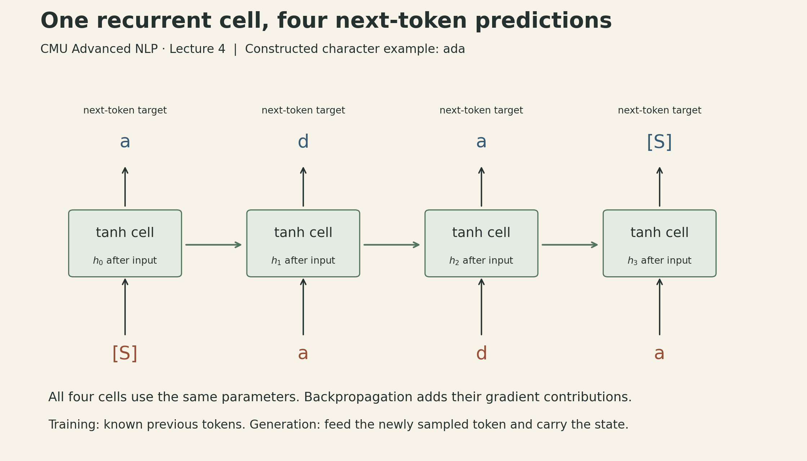

An RNN can read a sequence of arbitrary length while carrying a fixed-size hidden state. That is a useful computational property. It does not mean that every earlier token remains recoverable, or that training can easily discover a dependency hundreds of steps back.

Sean Welleck's [CMU Advanced NLP Lecture 4](https://cmu-l3.github.io/anlp-fall2025/static_files/anlp-f2025-04-rnns.pdf) develops three related mechanisms: recurrence carries history forward, gates change how a state is retained, and encoder–decoder attention lets each output retrieve an output-dependent mixture of source states. Their differences become clearer when we follow both the information and the gradients.

## Read a token, predict the next one

Let $x_t$ denote a token, $e_t=E[x_t]\in\mathbb{R}^{d_e}$ its embedding, and $h_t\in\mathbb{R}^{d_h}$ the state **after** reading it. A tanh RNN computes

$$
h_t=\tanh(W_hh_{t-1}+W_xe_t+b),
$$

where $W_h\in\mathbb{R}^{d_h\times d_h}$, $W_x\in\mathbb{R}^{d_h\times d_e}$, and $b\in\mathbb{R}^{d_h}$. The same parameters are used at every position. With vocabulary size $V$, output matrix $W_o\in\mathbb{R}^{V\times d_h}$, and bias $b_o\in\mathbb{R}^{V}$,

$$
p_\theta(x_{t+1}\mid x_{\le t})
=\operatorname{softmax}(W_oh_t+b_o)_{x_{t+1}}.
$$

The one-position shift matters. Feeding `a` and supervising the output with `a` would describe a different task from predicting the next character.

The lecture's character-language-model notebook uses `[S]` for both start and stop. For a constructed example using the name `ada`, this rule produces:

::: {.table-scroll}

| Position | 0 | 1 | 2 | 3 |
|---|---|---|---|---|
| Input | `[S]` | `a` | `d` | `a` |
| Target | `a` | `d` | `a` | `[S]` |

:::

These are known input tokens during training. During sampling, the predicted token becomes the next input. The sampler first consumes the supplied prefix, then carries the returned hidden state while feeding one newly sampled token at a time. It does not reprocess the whole prefix at every step. [Slides, pp. 8–21](https://cmu-l3.github.io/anlp-fall2025/static_files/anlp-f2025-04-rnns.pdf); [pinned language-model notebook](https://github.com/cmu-l3/anlp-fall2025-code/blob/7344963bcad96a2181e375261273146c06498b9c/04_recurrent/recurrent_lm.ipynb).

{#fig-state fig-alt="Four recurrent steps consume start, a, d, a and predict a, d, a, stop. Each step uses the same recurrent parameters. Arrows carry hidden states forward; losses supervise next-token predictions."}

### Shared weights, separate uses in the graph

For a sequence $x_0=\text{[S]},x_1,\ldots,x_T$ with stop target $x_{T+1}$, the negative log-likelihood is

$$
\mathcal L=-\sum_{t=0}^{T}\log p_\theta(x_{t+1}\mid x_{0:t}).
$$

Unrolling the recurrence makes an ordinary acyclic computation graph. Backpropagation through time is backpropagation through that graph. The repeated cells are uses of one parameter set, so gradient contributions from all those uses accumulate into the same parameters. They are not separately trained networks.

There is still a sequential dependency: $h_t$ needs $h_{t-1}$. Batching several examples exploits parallel work across examples and within matrix operations; it does not remove that dependency across time. [Slides, pp. 11–16, 53](https://cmu-l3.github.io/anlp-fall2025/static_files/anlp-f2025-04-rnns.pdf).

### What “constant memory” means here

A plain RNN language model can generate using one current state, which is $O(d_h)$ storage per layer and example. With model dimensions and vocabulary fixed, its recurrent work grows linearly with sequence length. This excludes storing the generated transcript and assumes an inference implementation that discards old activations.

Full backpropagation through time usually retains activations from many steps. Its activation storage grows with sequence length unless recomputation or a different training scheme is used. A fixed-size inference state is therefore neither constant-memory training nor an unlimited archive of the input. [Slides, pp. 16–18](https://cmu-l3.github.io/anlp-fall2025/static_files/anlp-f2025-04-rnns.pdf).

## A long dependency is a product of Jacobians

For the tanh recurrence, the local state Jacobian is

$$
J_t=\frac{\partial h_t}{\partial h_{t-1}}
=\operatorname{diag}(1-h_t^2)W_h.
$$

The derivative through $T-k$ recurrent transitions is

$$
\frac{\partial h_T}{\partial h_k}=J_TJ_{T-1}\cdots J_{k+1}.
$$

For a loss depending on $h_T$, its gradient with respect to $h_k$ contains the transpose of this product. Intermediate losses add other paths, but they do not eliminate the long product for a distant dependency.

One sufficient condition for decay is $\|J_t\|_2\le\rho<1$ at every relevant step:

$$
\left\|\frac{\partial h_T}{\partial h_k}\right\|_2
\le\prod_{t=k+1}^{T}\|J_t\|_2
\le\rho^{T-k}.
$$

This bound is a way to understand the mechanism, not a claim that every RNN meets the condition. The activation derivatives depend on the trajectory, and matrix products can behave differently in different directions. Looking only at an eigenvalue of $W_h$ does not fully characterize those products. Saturated tanh coordinates also have small derivatives even when the recurrent weights are large. [Derivation from the recurrence in slides, pp. 24–25](https://cmu-l3.github.io/anlp-fall2025/static_files/anlp-f2025-04-rnns.pdf).

For a constructed scalar example with derivative $0.9$ at every step, the sensitivity after 50 steps is $0.9^{50}\approx0.00515$. If the derivative were $1.1$, the corresponding product would be about $117.4$. These are arithmetic examples, not measured learning curves.

## Gates create a controllable carry path

The lecture writes a gated update as

$$
h_t=(1-z_t)\odot h_{t-1}+z_t\odot\widetilde h_t,
$$

where $z_t$ is a sigmoid gate and $\widetilde h_t$ is a candidate state. In this convention, a small $z_t$ favors carrying the old state. A larger value favors replacing it with the candidate.

Holding the gate and candidate fixed, the direct carry-path derivative is $\operatorname{diag}(1-z_t)$. A fixed scalar gate $z=0.01$ gives a carry coefficient of $0.99^{50}\approx0.605$ across 50 steps. That explains why an additive path can preserve a signal much better than repeated strongly contractive transformations.

{#fig-gradient fig-alt="Constructed scalar sensitivity products over 0 to 50 steps on a logarithmic vertical axis. Constant factors 0.9, 0.99, and 1.1 end at 0.00515, 0.605, and 117.4. The 0.99 curve represents only the direct carry path with update gate z equals 0.01 in the lecture convention, giving carry weight 1 minus z equals 0.99, not a trained GRU's full gradient."}

The full derivative is more than the carry term. Applying the product rule,

$$
\frac{\partial h_t}{\partial h_{t-1}}
=\operatorname{diag}(1-z_t)
+\operatorname{diag}(\widetilde h_t-h_{t-1})\frac{\partial z_t}{\partial h_{t-1}}
+\operatorname{diag}(z_t)\frac{\partial\widetilde h_t}{\partial h_{t-1}}.
$$

The gate and candidate generally depend on the previous state. Thus, “there is a near-identity carry path” does not establish that the total gradient is exactly one, or that the network will learn perfect long-term recall. [Slides, pp. 26–32](https://cmu-l3.github.io/anlp-fall2025/static_files/anlp-f2025-04-rnns.pdf).

### Keep the GRU convention attached to its equation

With biases omitted and the candidate matrices renamed $W_c,U_c$ to distinguish them from the plain RNN weights, the lecture's GRU uses

$$
\begin{aligned}
z_t&=\sigma(W_ze_t+U_zh_{t-1}),\\
r_t&=\sigma(W_re_t+U_rh_{t-1}),\\
\widetilde h_t&=\tanh(W_ce_t+U_c(r_t\odot h_{t-1})).
\end{aligned}
$$

Here the update gate controls replacement, while the reset gate controls how the previous state enters the candidate. The lecture also introduces LSTMs, which carry a separate cell state. Their usual formulation has three sigmoid gates—input, forget, and output—and a tanh candidate update.

The encoder–decoder notebook uses PyTorch `nn.GRU`. PyTorch's update convention gives $z_t$ to the **old** state: $h_t=(1-z_t)\odot n_t+z_t\odot h_{t-1}$. Its candidate also applies the reset gate after the recurrent affine transform. Those details differ from the displayed lecture equations. Gate names alone are not enough to translate an implementation. [Slides, pp. 30–31](https://cmu-l3.github.io/anlp-fall2025/static_files/anlp-f2025-04-rnns.pdf); [PyTorch GRU equations and implementation note](https://docs.pytorch.org/docs/2.15/generated/torch.nn.GRU.html).

## Conditional generation adds a second sequence

In an encoder–decoder model, the source $x_{1:S}$ and target $y_{1:U}$ need not have equal lengths. Training maximizes

$$
p_\theta(y\mid x)=\prod_{t=1}^{U}p_\theta(y_t\mid y_{<t},x),
$$

including a stop symbol in the target. A basic recurrent encoder compresses the source into a context vector, such as its last state. A decoder uses that context to generate the target. The context can initialize the decoder, enter its recurrent update, or enter its output layer.

During teacher-forced training, the decoder receives the correct previous target tokens. During generation, it receives its own selected tokens. A correct teacher-forced next-token prediction therefore does not establish that a long freely generated sequence will remain correct.

The fixed-context bottleneck is concrete: every output step must recover the source information it needs through the same vector. A gated encoder may retain information more effectively, but the decoder still has no separate address for each source position. [Slides, pp. 35–38](https://cmu-l3.github.io/anlp-fall2025/static_files/anlp-f2025-04-rnns.pdf).

## Attention retrieves a different context at each step

Retain all encoder states $H=(h^{enc}_1,\ldots,h^{enc}_S)$ instead of exposing only one summary. A decoder query $q_t$ scores each source state:

$$
e_{t,j}=q_t^\top h^{enc}_j,\qquad
\alpha_{t,j}=\frac{\exp(e_{t,j})}{\sum_{k=1}^{S}\exp(e_{t,k})},\qquad
c_t=\sum_{j=1}^{S}\alpha_{t,j}h^{enc}_j.
$$

The score $e_{t,j}$ and the normalized weight $\alpha_{t,j}$ are different quantities; the notation here makes explicit the softmax step implemented in the notebook. This is content-based soft retrieval over per-position states, not a hard position index. Softmax normalizes over **source positions for a fixed output position**. The resulting context can change as the query changes. [Slides, pp. 40–46](https://cmu-l3.github.io/anlp-fall2025/static_files/anlp-f2025-04-rnns.pdf); [encoder–decoder notebook](https://github.com/cmu-l3/anlp-fall2025-code/blob/7344963bcad96a2181e375261273146c06498b9c/04_recurrent/recurrent_encdec.ipynb).

This is the retrieval idea behind Bahdanau, Cho, and Bengio's attention model: source annotations are combined with normalized, output-dependent weights. Their paper uses a learned alignment function and a bidirectional encoder. The paper scores the previous decoder state and uses the retrieved context in the decoder transition. The lecture notebook instead queries its current decoder output with a projected dot product and uses unidirectional GRUs. It is a simpler architecture, not an exact reproduction of that model. [Paper, §3.1–3.2, equations 5–6](https://arxiv.org/html/1409.0473v7#S3).

### A two-dimensional example

Take three constructed encoder states, used as both keys and values:

$$
h^{enc}_1=(1,0),\quad h^{enc}_2=(0,1),\quad h^{enc}_3=(1,1).
$$

For $q=(2,0)$, the scores are $(2,0,2)$, giving weights approximately $(0.4683,0.0634,0.4683)$ and

$$
c\approx(0.9366,0.5317).
$$

For $q=(0,2)$, the same stored states give weights $(0.0634,0.4683,0.4683)$ and $c\approx(0.5317,0.9366)$. Nothing in the source memory changed; the retrieval question changed. Neither query selects just one state.

{#fig-attention fig-alt="Three fixed two-dimensional encoder states are queried twice. Query 2,0 produces scores 2,0,2, weights 0.4683,0.0634,0.4683, and context 0.9366,0.5317. Query 0,2 produces scores 0,2,2, weights 0.0634,0.4683,0.4683, and context 0.5317,0.9366. Values equal keys; this is a constructed dot-product example."}

## Follow the notebook's actual tensor axes

The pinned `DotAttention` implementation stores source positions before target positions in its score tensor. With batch size $B$, source length $S$, target length $U$, and hidden width $D$:

::: {.table-scroll}

| Tensor or operation | Shape |
|---|---|
| Encoder states, used as keys and values | $B\times S\times D$ |
| Projected decoder queries | $B\times U\times D$ |
| `torch.bmm(keys, query.transpose(1, 2))` | $B\times S\times U$ |
| `torch.softmax(dot, dim=1)` | $B\times S\times U$ |
| `torch.bmm(weights.transpose(1, 2), values)` | $B\times U\times D$ |
| Concatenate decoder state and context | $B\times U\times 2D$ |
| Output linear layer | $B\times U\times V$ |

:::

That `dim=1` is correct **for this layout**. In the often-used layout $B\times U\times S$, the source normalization would instead use the last dimension.

The decoder is initialized with `henc_last`; its hidden sequence is projected to queries, and the retrieved contexts are concatenated with decoder states before the output linear layer. This implementation does not feed the attention context back into the next recurrent update. It also uses unscaled dot products, not Transformer-style division by $\sqrt D$.

The teaching task reverses names while ignoring an inserted random character after each original character. For a constructed example following this rule, `sophia` can become `suorpxhziwaq`, with target `aihpos`. Source length is twice the name length; decoder input and target add the appropriate start/stop shift. Generation is greedy and the demonstration routine handles one example at a time. The separate language-model notebook uses multinomial sampling. The variable named `scores` inside `generate` receives the already-normalized weights returned by `DotAttention`, not raw dot products. [Pinned encoder–decoder notebook, dataset construction, `forward`, and `generate`](https://github.com/cmu-l3/anlp-fall2025-code/blob/7344963bcad96a2181e375261273146c06498b9c/04_recurrent/recurrent_encdec.ipynb).

### Output masking does not mask source memory

Both notebooks use `CrossEntropyLoss(ignore_index=PAD)`. This excludes padded **target positions** from the loss. It does not make padded **source positions** disappear from the encoder or the attention softmax.

In this pinned encoder–decoder code, the source batch is right-padded, the GRU processes the whole padded tensor, and `henc_last` is passed directly to the decoder. There is no source-length packing, no selection of the last valid state for each example, and no source mask in `DotAttention`. Consequently, the initializer can include recurrent steps over padding, and the attention distribution can assign weight to those positions. Setting a padding embedding to zero alone would not stop a recurrent state update. This matters in padded training and validation batches; the demonstration generates individual unpadded inputs. Slide 54 likewise notes that input padding may require masking operations.

These are distinct implementation boundaries: loss masking chooses which predictions receive supervision; source masking chooses what can be retrieved; length handling determines which encoder state initializes the decoder. The notebook demonstrates the architecture, but its output-loss mask should not be read as complete variable-length handling. [Pinned code, `pad_batch`, `EncoderDecoder.forward`, `DotAttention.forward`, and training cell](https://github.com/cmu-l3/anlp-fall2025-code/blob/7344963bcad96a2181e375261273146c06498b9c/04_recurrent/recurrent_encdec.ipynb).

## Training choices and the cost of keeping history

The final slides discuss overfitting, initialization, learning-rate schedules, and batching. Training loss falling while validation loss rises is evidence of overfitting; a held-out test set serves a different purpose from the validation set used to choose settings. The encoder–decoder notebook has a cosine schedule stepped once per epoch. The warmup curve shown in the slides is not implemented there. Likewise, the slides discuss Xavier initialization, while these two notebook model definitions do not explicitly apply it.

The notebooks' displayed epoch losses also average batch means using `len(data) // batch_size`. When a remainder batch exists, that denominator is smaller than the number of processed batches. Even without a remainder, averaging batch means is not generally a token-weighted corpus loss when valid token counts vary. Those printouts should not be treated as exact corpus negative log-likelihood or used to derive precise perplexity comparisons without fixing the aggregation. [Slides, pp. 50–55](https://cmu-l3.github.io/anlp-fall2025/static_files/anlp-f2025-04-rnns.pdf); [language-model training cell](https://github.com/cmu-l3/anlp-fall2025-code/blob/7344963bcad96a2181e375261273146c06498b9c/04_recurrent/recurrent_lm.ipynb); [encoder–decoder training cell](https://github.com/cmu-l3/anlp-fall2025-code/blob/7344963bcad96a2181e375261273146c06498b9c/04_recurrent/recurrent_encdec.ipynb).

Attention changes the memory tradeoff. The plain recurrent language model carries a fixed-size state at inference. This encoder–decoder with attention retains $S$ source states, requiring $O(SD)$ source-state storage. Each of $U$ decoder queries scores the source and forms a weighted sum, costing $O(SD)$ per query and $O(SUD)$ over the target, excluding recurrent, query-projection, and vocabulary-output work. The batched training implementation also materializes $B\times S\times U$ attention weights. These are scaling relationships, not measured latency claims.

Recurrence gives a compact running representation. Gating helps control its update and provides a direct carry path. Attention spends storage and retrieval work to give the decoder access to multiple source representations. Understanding which of those mechanisms a model actually implements is more useful than treating all three as interchangeable forms of “memory.”

## Lecture and sources



[Watch the official lecture](https://www.youtube.com/watch?v=S6tAXYegbZA).

- Sean Welleck, [CMU CS11-711 Advanced NLP, Fall 2025](https://cmu-l3.github.io/anlp-fall2025/), Lecture 4, September 4, 2025; [56-page lecture slides](https://cmu-l3.github.io/anlp-fall2025/static_files/anlp-f2025-04-rnns.pdf), adapted from Graham Neubig’s Fall 2024 course.
- [Lecture 4 notebooks, pinned commit `7344963`](https://github.com/cmu-l3/anlp-fall2025-code/tree/7344963bcad96a2181e375261273146c06498b9c/04_recurrent): recurrent language modeling and noisy-name reversal with encoder–decoder attention.
- Bahdanau, Cho, and Bengio, [Neural Machine Translation by Jointly Learning to Align and Translate](https://arxiv.org/abs/1409.0473), §3.1–3.2.
- [PyTorch GRU documentation](https://docs.pytorch.org/docs/2.15/generated/torch.nn.GRU.html), for the library's gate convention and reset placement.
