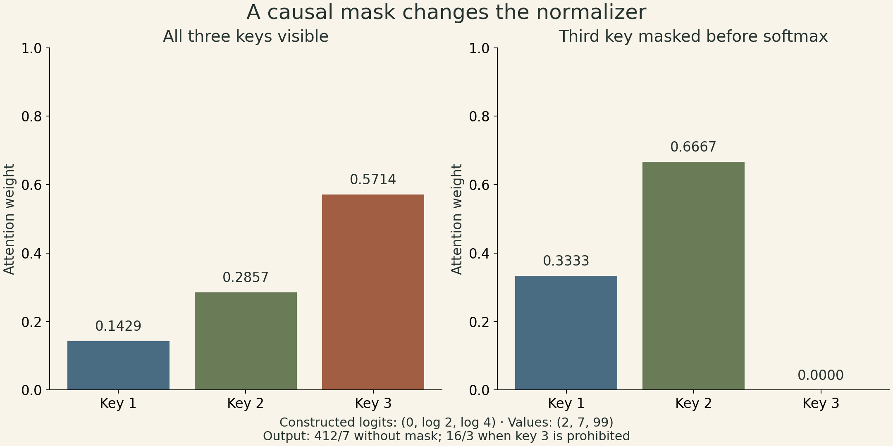
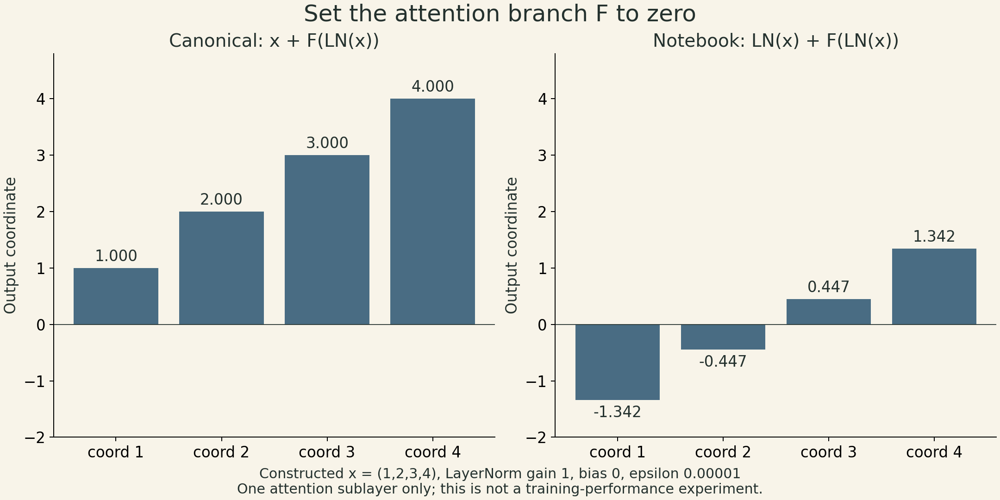
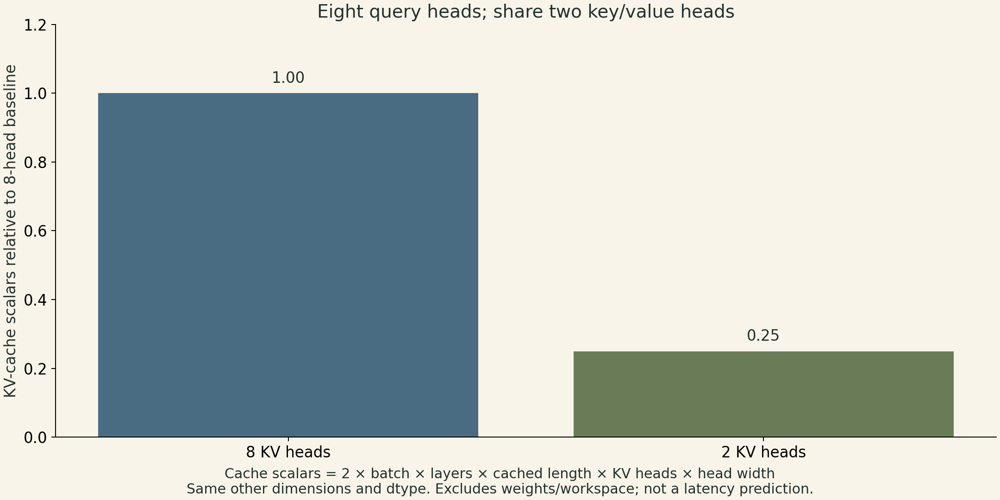

A Transformer layer has two different jobs. Attention mixes information across token positions. The feed-forward network transforms each position's features. Residual connections determine which tensor bypasses each transformation. Moving normalization across an addition changes that last job even if every tensor retains the same shape.

Sean Welleck's fifth Advanced NLP lecture builds the architecture from attention, then examines positional representations, normalization, and shared key/value heads. Its accompanying notebook makes the architecture concrete—and makes it important to distinguish a component's name from the operations actually executed.

## Attention normalizes over the positions a query may use

In cross-attention, queries and keys come from different sequences; self-attention uses representations from the same sequence. Neither requires queries, keys, and values to be numerically identical after their learned projections. For one head, write

$$
Q\in\mathbb R^{T_q\times d_k},\quad K\in\mathbb R^{T_k\times d_k},\quad V\in\mathbb R^{T_k\times d_v},
$$

$$
A=\operatorname{softmax}_{j}\left(\frac{QK^\top}{\sqrt{d_k}}+M\right),\qquad O=AV.
$$

Each row of $A$ distributes a query's weight over key positions. Its shape is $T_q\times T_k$; the output is $T_q\times d_v$. The mask $M$ is zero for permitted positions and negative infinity for prohibited ones. At least one permitted key is needed in each row. Masking after softmax without renormalizing would produce a different operation.

A simple derivation explains the scale. If query and key coordinates are mutually independent, zero-mean, and unit-variance, the sum $q^\top k$ has variance $d_k$. Dividing by $\sqrt{d_k}$ keeps that variance at one. Those assumptions explain the heuristic; they are not a claim that learned coordinates remain independent. The lecture motivates scaling; the variance argument above is a derivation of that heuristic, rather than a proof given on the slides. See the [lecture, pp. 9–13 and 26](https://cmu-l3.github.io/anlp-fall2025/static_files/anlp-f2025-05-transformers.pdf).

For a constructed example, take already-scaled logits $(0,\log 2,\log 4)$ and scalar values $(2,7,99)$. Unmasked weights are $(1,2,4)/7$, giving $412/7$. If the third position is in the future, its weight must be zero and the allowed weights become $(1,2,0)/3$. The result is $16/3$. A mask changes the normalizer as well as removing a value.

{fig-alt="Constructed logits 0, log 2, log 4 yield attention weights 1/7,2/7,4/7. Masking key 3 before softmax yields 1/3,2/3,0. On equal zero-to-one axes the weights are shown as bars. Values 2, 7, 99 produce output 412/7 unmasked and 16/3 masked."}

## Several heads create several mixtures

Head $i$ uses its own projections:

$$
\mathrm{head}_i=\mathrm{Attention}(HW_i^Q,HW_i^K,HW_i^V),\quad
\mathrm{MultiHead}(H)=\mathrm{Concat}(\mathrm{head}_1,\ldots,\mathrm{head}_h)W^O.
$$

For batch size $B$, sequence length $T$, width $D$, and $h$ heads of width $D/h$, projected tensors are rearranged from $(B,T,D)$ to $(B,h,T,D/h)$. Reshape first exposes the head axis; transpose moves it. A reshape alone does not generally preserve the intended token/head assignment. Separate heads can learn different attention patterns, but they are not guaranteed to acquire distinct, human-readable roles. The lecture's syntax/semantics examples are an intuition for capacity, not a constraint on a trained model. [Slides 30–34](https://cmu-l3.github.io/anlp-fall2025/static_files/anlp-f2025-05-transformers.pdf).

An encoder–decoder architecture additionally has decoder queries attend to encoder keys and values. A decoder-only language model uses causal self-attention. With shifted targets, the output at a position predicts the following token using the current and earlier input tokens. Training can compute all positions together because those inputs are known; generation still depends on previously generated tokens.

## Position must enter the computation explicitly

A learned absolute table supplies one vector per supported position. Adding that vector to the token embedding distinguishes two occurrences of the same token at different positions. A finite table has no learned entry beyond its configured length; extending it requires another choice.

Relative attention can instead add an offset-dependent score. With one sign convention, a term is $q_i^\top r_{i-j}/\sqrt{d_k}$. Reversing the offset convention changes the table indexing and must be done consistently. A finite relative table also needs a rule for offsets outside its range; the table alone is not an extrapolation mechanism.

RoPE rotates pairs of coordinates in queries and keys. For a two-dimensional rotation $R(\theta)$ and frequency $\omega$,

$$
(R(m\omega)q)^\top R(n\omega)k=q^\top R((n-m)\omega)k.
$$

This follows from $R(a)^\top R(b)=R(b-a)$. Equivalently, the same dot product is $(R((m-n)\omega)q)^\top k$: the sign depends on which vector carries the remaining rotation. Absolute rotations produce a relative displacement in the dot product. The identity does not establish reliable performance at context lengths absent from training. The lecture also includes sinusoidal absolute encodings; these define positions beyond a fixed table, while generalization remains an empirical question. [Slides 22–23, 48–49 and 66](https://cmu-l3.github.io/anlp-fall2025/static_files/anlp-f2025-05-transformers.pdf).

## The residual branch is not interchangeable with the normalized input

LayerNorm normalizes a token's feature vector, then applies learned gain and bias. With $D$ features,

$$
\mu=\frac1D\sum_i x_i,\quad \sigma^2=\frac1D\sum_i(x_i-\mu)^2,\quad
\mathrm{LN}(x)=g\odot\frac{x-\mu}{\sqrt{\sigma^2+\epsilon}}+b.
$$

Here the small positive $\epsilon$ is the implementation stabilizer used by [PyTorch LayerNorm](https://docs.pytorch.org/docs/stable/generated/torch.nn.LayerNorm.html); it is omitted in the lecture’s schematic formula. A canonical pre-normalized sublayer computes $y=x+F(\mathrm{LN}(x))$. A post-normalized one computes $y=\mathrm{LN}(x+F(x))$. In the first expression, the derivative includes a direct identity term. That route helps explain the training motivation, but does not guarantee that gradients can never vanish or explode.

The course notebook at commit `7aa39df` has a `Block.forward` that overwrites `x` with `ln1(x)`, then adds attention to that normalized tensor. It repeats this pattern with `ln2`. Its first update is therefore

$$
u=\mathrm{LN}_1(x),\qquad y=u+\mathrm{Attn}(u,u,u),
$$

rather than $x+\mathrm{Attn}(u,u,u)$. The comment says “Pre-normalization,” but the residual addition does not preserve the original incoming tensor. Setting the attention branch to zero makes the difference visible: the canonical block returns $x$ at this sublayer; the notebook returns $\mathrm{LN}_1(x)$. This is a statement about the linked implementation, not a report of an accuracy experiment. The [lecture's pre/post diagram is on p. 50](https://cmu-l3.github.io/anlp-fall2025/static_files/anlp-f2025-05-transformers.pdf).

{fig-alt="One attention sublayer with branch F set to zero. For constructed input 1, 2, 3, 4, canonical x plus F of LN(x) returns 1, 2, 3, 4. The notebook uses LN(x) plus F of LN(x), returning approximately -1.342,-0.447,0.447,1.342 with gain 1, bias 0, epsilon 0.00001. Both charts use the same axis. This is not a training experiment."}

The feed-forward network is positionwise: $\mathrm{FFN}(x)=f(xW_1+b_1)W_2+b_2$. It mixes feature coordinates, while attention supplies cross-position communication. RMSNorm omits mean subtraction and uses a root-mean-square scale; the lecture's form also omits an additive bias. Those are distinct choices from where normalization is placed.

## Sharing key/value heads changes a specific memory cost

Grouped-query attention assigns several query heads to each key/value head. If there are $h_q$ query heads and $h_{kv}$ key/value heads with the same head dimension $d_h$, a conventional stored KV cache contains

$$
2BLTh_{kv}d_h
$$

scalars for $L$ layers and $T$ cached positions. Relative to storing $h_q$ KV heads, the cache-size ratio is $h_{kv}/h_q$. For eight query heads and two KV heads, that part of the cache is one quarter as large. This counts logical cache storage without replication and assumes evenly grouped query heads, so $h_q$ is divisible by $h_{kv}$. It excludes model weights, activations, metadata, and temporary workspace. It is not a prediction of a fourfold latency improvement. [GQA, §2.2](https://arxiv.org/abs/2305.13245).

{fig-alt="For eight query heads, changing from eight KV heads to two reduces KV-cache scalar storage from relative 1.00 to 0.25, holding batch, layers, cached length and head width fixed. Bars start at zero. Weights and workspace are excluded; this is not a latency measurement."}

The lecture contrasts older Transformer designs with Llama-style choices. Such summaries must remain configuration-specific: a family label does not prove that every size or release uses identical attention settings. Similarly, the approximately tenfold efficiency remark on slide 55 accompanies a particular perplexity-versus-FLOPs comparison; it is not a universal wall-clock speedup from changing one layer. [Slides 51–55](https://cmu-l3.github.io/anlp-fall2025/static_files/anlp-f2025-05-transformers.pdf).

## The notebook defines a small experiment, not every production convention

The character-level notebook uses learned token and absolute-position embeddings, two attention heads, width 64, two blocks, and a 64-wide ReLU feed-forward layer. It creates shifted input/target sequences, right-pads batches, applies a causal upper-triangular mask, and excludes padding targets from cross-entropy. It uses Adam with learning rate 0.001.

Although the attention call has no key-padding mask, a valid token in these right-padded causal batches cannot attend to later padding positions. That argument depends on the padding direction and causal mask. It should not be generalized to left padding or bidirectional attention. The embeddings, LayerNorm, and feed-forward layers are tokenwise, so the visibility argument holds through every layer. Padded query outputs are computed but their target losses are ignored. In this [PyTorch MultiheadAttention API](https://docs.pytorch.org/docs/stable/generated/torch.nn.MultiheadAttention.html), a boolean True in the attention mask prohibits attending to that position.

The notebook's reported epoch loss averages batch losses using a floor-divided batch count. It is not an exact corpus token-weighted mean, and the divisor can differ from the number of iterations when the final batch is partial. A test split is constructed, but the displayed loop evaluates the development split. Sampling recomputes the growing prefix; it does not implement a KV cache. The position table and block masks both default to 128 positions. The constructor does not forward a changed positional-table max_len to Block, so changing one does not automatically change the other.

Adam keeps exponential-moving-average estimates of the gradient and its elementwise square. After initialization-bias correction, its update is

$$
\theta_t=\theta_{t-1}-\eta\frac{\hat m_t}{\sqrt{\hat v_t}+\epsilon}.
$$

The stabilizer is outside the square root and $\eta$ is the learning rate. These optimizer states are separate from the model's token state and from an inference KV cache. [Slides 58–60](https://cmu-l3.github.io/anlp-fall2025/static_files/anlp-f2025-05-transformers.pdf).

## Parallel training still has costs

Dense attention's score and value products cost $O(T^2D)$ in the usual equal-width setup. Projections and feed-forward layers add costs such as $O(TD^2)$ and $O(TDd_{ff})$. The quadratic term is not the whole layer's runtime. A conventional implementation materializes attention scores; tiled exact-attention implementations can avoid storing the entire matrix while still computing all pairwise attention scores. [FlashAttention, §2.2–3.1](https://arxiv.org/abs/2205.14135).

A recurrent model has a sequential hidden-state dependency across positions. A Transformer permits parallel computation across known training positions, but autoregressive generation remains sequential across newly sampled tokens. These are separate claims about dependency structure, storage, arithmetic, and observed speed. The lecture's final comparison is most useful when those quantities stay separate.

## Lecture and sources

- [CMU Advanced NLP Fall 2025, Lecture 5](https://cmu-l3.github.io/anlp-fall2025/).
- [Official 66-page lecture slides](https://cmu-l3.github.io/anlp-fall2025/static_files/anlp-f2025-05-transformers.pdf).
- [Course notebook](https://github.com/cmu-l3/anlp-fall2025-code/blob/7aa39dfad7a6480987afa5a922ab25a714c4dc10/05_transformers/transformer.ipynb).
