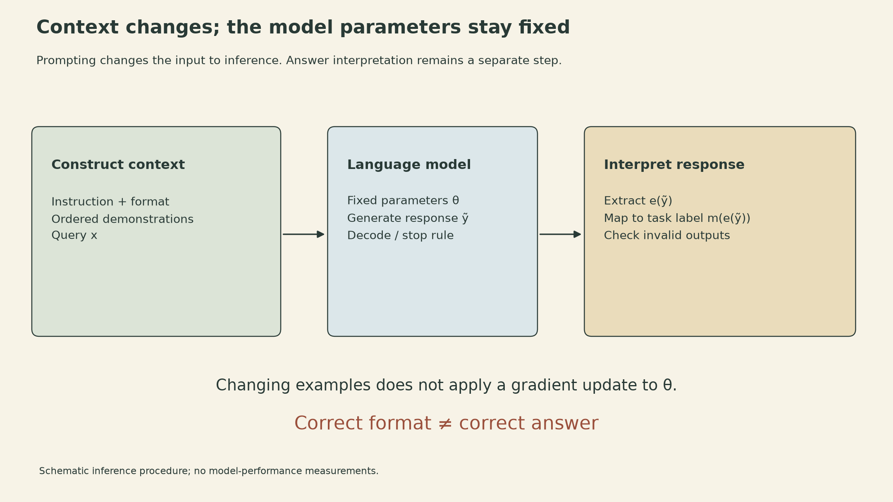
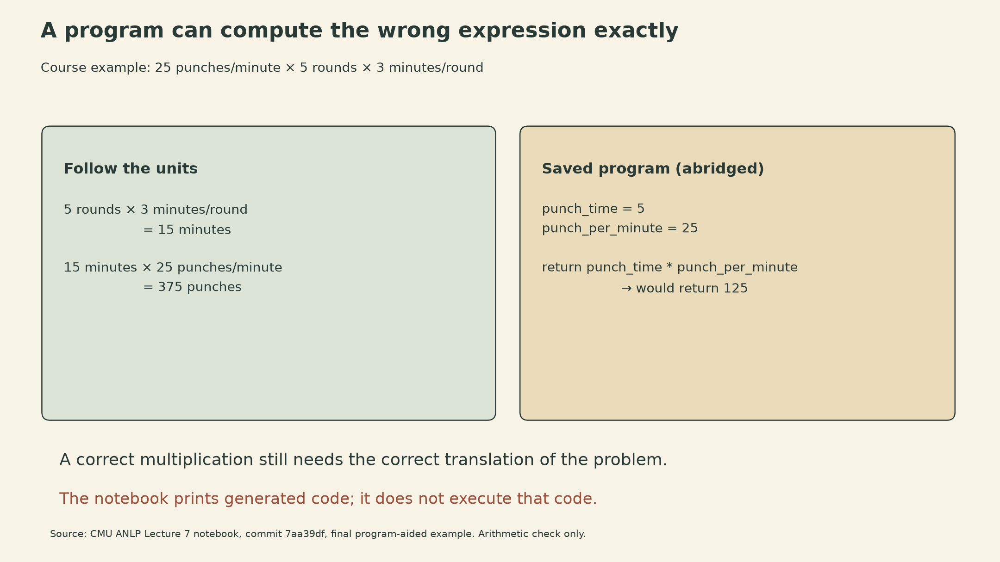
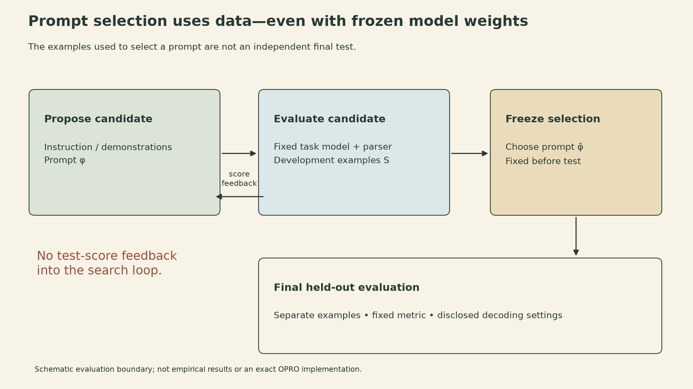

An instruction-tuned language model is asked to count punches: 25 per minute, five rounds, three minutes per round. It writes several lines of explanation and answers 15. Asked for Python instead, it produces a program that would return 125. The correct calculation is $25\times5\times3=375$.

These are saved examples in the [CMU Advanced NLP Lecture 7 notebook](https://github.com/cmu-l3/anlp-fall2025-code/blob/7aa39dfad7a6480987afa5a922ab25a714c4dc10/07_icl_prompting/icl_prompting.ipynb), not a benchmark comparison. They expose a distinction that runs through Sean Welleck's Fall 2025 lecture: changing the prompt can change the model's behavior without making its output correct. A useful explanation, a well-formed answer, and a correct computation are different properties.

The lecture moves from text completion to instructions and demonstrations, then to chat formats, reasoning, program assistance, and prompt search. Each method changes what information or computation surrounds the model. Keeping those changes explicit makes their benefits and limitations easier to understand.

## The task includes more than the model's response

Let $x$ be a task input, $f_\phi$ a prompt-construction rule, and $\theta$ the model's parameters. The symbol $\phi$ can stand for ordinary text and formatting choices; it need not be a differentiable parameter vector. The model defines

$$
p_\theta(y\mid f_\phi(x)).
$$

Autoregressive generation factors this distribution into next-token conditionals:

$$
p_\theta(y_{1:T}\mid c)
=\prod_{t=1}^{T}p_\theta(y_t\mid c,y_{<t}),\qquad c=f_\phi(x).
$$

A decoding rule turns that distribution into a response $\widetilde y$. Sampling, greedy decoding, stop conditions, and output-length limits affect the result. An application may then extract an answer and map it into its own label space:

$$
\widehat y=m(e(\widetilde y)).
$$

Here $e$ extracts a relevant span and $m$ maps it to a task label. The lecture's sentiment example maps an extracted descriptive word to a positive class. A parser that selects the wrong span can spoil a semantically correct response; a cleanly parsed response can still be factually wrong. [Slides 5–11](https://cmu-l3.github.io/anlp-fall2025/static_files/anlp-f2025-07-icl-prompting.pdf#page=5)

For example, an application could accept exactly `Positive` or `Negative` after a specified marker and assign all other outputs an invalid status. That is an illustrative parsing policy, not a guarantee supplied by a natural-language instruction. Its invalid-output rate and its classification accuracy measure different things. Quietly dropping malformed responses would also change the denominator of an accuracy calculation.

{fig-alt="Schematic inference pipeline. An instruction, ordered demonstrations, and a query form a context. A language model with fixed parameter theta generates a response. Separate extraction and label mapping produce the task answer. Changing context does not update model weights, and formatting validity is separate from answer correctness."}

## Demonstrations change conditioning, not parameters

A bare prefix invites continuation. A zero-shot instruction describes the task without input-output examples in the prompt. Few-shot prompting additionally provides demonstrations

$$
D_K=((x_1,y_1),\ldots,(x_K,y_K)),\qquad
c=f_\phi(x;D_K).
$$

The resulting prediction depends on those examples, but ordinary in-context learning does not apply an optimizer update to $\theta$. Fine-tuning would change parameters; placing another example in the context changes the input to the existing model. “Zero-shot” describes the prompt's example count, not an absence of relevant information in pretraining. [Slides 7–15](https://cmu-l3.github.io/anlp-fall2025/static_files/anlp-f2025-07-icl-prompting.pdf#page=7)

Demonstrations can communicate input style, output format, label meanings, and a relationship to apply. Those contributions can overlap. If a pretrained model already recognizes a sentiment task, examples may help it identify the expected task and presentation. If the requested labels have unfamiliar or deliberately changed meanings, the examples must communicate that mapping as well.

Agarwal and colleagues' **Many-Shot In-Context Learning** provides the lecture's evidence that these effects depend on the setting. Its Financial PhraseBank experiment rotates sentiment labels or replaces them with abstract letters; many examples help the tested model overcome its default label associations. That is evidence of changed behavior in context, not permanent removal of a bias from the weights.

The paper's “Unsupervised ICL” uses many unsolved inputs plus instructions or a small output-format prompt. In its MATH experiment, that final prompt contains four solved examples. “Input-only” therefore describes the large added block, not necessarily every token of the full prompt. “Reinforced ICL” instead selects model-generated rationales using correct final answers; a correct final answer does not certify every rationale step. These methods sometimes outperform human-written demonstrations in the reported tasks, but neither result says labels or solutions are generally unnecessary. [Agarwal et al., §§4–5](https://arxiv.org/html/2404.11018v1)

## More examples create a budget and a selection problem

The model receives a sequence, not an unordered dataset. Reordering the same demonstrations changes that sequence and can change the prediction. Label coverage and balance also change the evidence presented to the model. The lecture highlights all three effects, and does not claim that performance must improve whenever another example fits. [Slides 16–20](https://cmu-l3.github.io/anlp-fall2025/static_files/anlp-f2025-07-icl-prompting.pdf#page=16)

There are $K!$ orderings of $K$ distinct demonstrations—six examples already permit 720 orders. This is a combinatorial count, not the number of experiments needed or a recommendation to enumerate them. In the many-shot paper, ten permutations of a fixed 50-example MATH prompt produce different strengths across mathematical subareas. The overall averages varied less than the subarea scores, so an average can conceal those differences.

Context capacity adds a separate constraint. In a simplified accounting with a shared context budget $B$, instruction/template cost $I$, query cost $Q$, reserved output budget $R$, and demonstration lengths $\ell_i$,

$$
I+Q+R+\sum_{i=1}^{K}\ell_i\le B.
$$

For a constructed budget of 8,192 tokens, with $I=192$, $Q=160$, $R=512$, and 220 tokens per demonstration including separators,

$$
K\le\left\lfloor\frac{8192-192-160-512}{220}\right\rfloor=33.
$$

This tells us what fits under those assumptions, not which examples help. Actual tokenization and model/service limits determine the real budget; some services expose input and output limits separately. Shortening demonstrations may admit more of them while removing exactly the information needed to specify the task.

## Chat roles are serialized model input

Chat interfaces represent a conversation as messages with roles such as system, user, and assistant. A model-specific template turns those messages into the token sequence used at inference. The role markers, separators, and placement of the assistant continuation are part of that representation. The slides show Llama 3's tags, while the notebook's SmolLM2 template uses different `<|im_start|>` and `<|im_end|>` markers. These formats are not interchangeable. [Slides 22–28](https://cmu-l3.github.io/anlp-fall2025/static_files/anlp-f2025-07-icl-prompting.pdf#page=22)

At the pinned notebook revision, the chat examples switch from `HuggingFaceTB/SmolLM2-360M` to `HuggingFaceTB/SmolLM2-360M-Instruct`, then use this call sequence:

```python
input_text = tokenizer.apply_chat_template(messages, tokenize=False)
inputs = tokenizer(input_text, return_tensors="pt")
outputs = model.generate(**inputs, max_new_tokens=50, do_sample=True)
```

In the saved template output, the input ends after the user message; the model generates the assistant header itself. This call does not request `add_generation_prompt=True`. Formatting must match the particular model and tokenizer. The notebook's saved sentiment responses also vary in correctness and presentation despite explicit instructions. Those examples illustrate possible behavior; three sampled responses do not establish a model's accuracy or a universal advantage of one prompt.

A system message can request a language, task, or response format. In the lecture's mathematical view, it is still part of the conditioning input. A practical implication of that representation is that the prompt itself does not establish external access control, cumulative spending limits, or constraints on where data may be sent. Those guarantees depend on mechanisms beyond the conditioning input; the lecture does not specify such an enforcement system.

## A reasoning trace adds computation, not a certificate

Chain-of-thought prompting elicits intermediate text before an answer. The original few-shot approach supplies worked reasoning demonstrations; the lecture also discusses instruction-based elicitation without such demonstrations. Generating additional intermediate tokens allows more autoregressive computation, but the resulting explanation can contain mistakes. [Slides 30–32](https://cmu-l3.github.io/anlp-fall2025/static_files/anlp-f2025-07-icl-prompting.pdf#page=30); [Wei et al.](https://arxiv.org/abs/2201.11903)

If $r$ denotes an intermediate text sequence, one mathematical decomposition is

$$
p_\theta^{\mathrm{answer}}(y\mid c)=\sum_r p_\theta(r,y\mid c)
=\sum_r p_\theta(y\mid c,r)p_\theta(r\mid c),
$$

where the joint distribution and the boundary between intermediate text and answer must be specified. Generating one $r$ and then an answer follows one trajectory; it does not perform the full marginalization. This equation is an explanatory probability identity, not a claim that a prompt exposes the model's complete internal reasoning.

The notebook's punches example makes the correctness issue concrete. Its saved instruct-model response computes 15 minutes, then reports 15 punches. Dimensional analysis reveals the missing factor:

$$
\underbrace{25\,\frac{\text{punches}}{\text{minute}}}_{\text{rate}}
\times\underbrace{5\,\text{rounds}}_{\text{count}}
\times\underbrace{3\,\frac{\text{minutes}}{\text{round}}}_{\text{duration}}
=375\,\text{punches}.
$$

The stated average rate is assumed to apply throughout those rounds. The missing factor is the rate: minutes become a count of punches only after multiplication by punches per minute.

## Writing a program and executing it are separate steps

Program-aided language models move a calculation into an external runtime: the language model produces a program, and an interpreter computes its result. This can separate problem interpretation from exact arithmetic, but the interpreter executes the program it receives, including a wrongly translated problem. [Slides 33–35](https://cmu-l3.github.io/anlp-fall2025/static_files/anlp-f2025-07-icl-prompting.pdf#page=33); [Gao et al., PAL](https://arxiv.org/abs/2211.10435)

The course notebook's final cell generates Python and prints the decoded response. It does **not** execute the generated program. The saved program sets `punch_time = 5` and multiplies it by 25, so its return value would be 125. A comment refers to 15 minutes, but comments do not change the assignment. This is a source-code distinction between a program-writing demonstration and an implemented executor.

{fig-alt="Worked unit check for the course notebook's punches problem. Five rounds times three minutes per round gives fifteen minutes; multiplying by twenty-five punches per minute gives three hundred seventy-five punches. A separate panel shows the saved generated program's assignment punch_time equals five and multiplication by twenty-five, which would return one hundred twenty-five. The notebook prints generated code and does not execute it."}

A minimal calculation that matches the problem is:

```python
rounds = 5
minutes_per_round = 3
punches_per_minute = 25
total_punches = rounds * minutes_per_round * punches_per_minute
assert total_punches == 375
```

This arithmetic illustration is not a reproduction of model inference. It checks the specification independently of any generated explanation. Executing arbitrary generated programs also requires an appropriately restricted environment; a code block in a response is neither execution permission nor evidence that execution occurred.

Prompt chains generalize this pattern by connecting model calls and external functions. A sub-question, retrieved result, and subsequent answer become distinct intermediate objects. Failures can propagate across those interfaces. In an illustrative chain where all three stages must be correct and each has conditional success probability 0.9 given that earlier stages were correct, the probability all three succeed is $0.9^3=0.729$. The chain rule gives this product without an independence assumption. It is not a general model of real systems, where recovery and verification can change the success structure, and actual conditional success rates need not stay at 0.9.

## Searching prompts is optimization, so the evaluation matters

The final part of the lecture turns prompt construction into a search problem: propose a candidate, evaluate its downstream performance, and use the feedback to propose another. Clear instructions help define the task, but their quality must be judged on the task's outputs rather than how persuasive they sound. [Slides 37–42](https://cmu-l3.github.io/anlp-fall2025/static_files/anlp-f2025-07-icl-prompting.pdf#page=37)

For a fixed model, parsing rule, and decoding procedure, define an empirical score on a development set $S$:

$$
\widehat J_S(\phi)=\frac1{|S|}\sum_{(x_i,y_i)\in S}
u\!\left(m(e(\widetilde y_i^\phi)),y_i\right).
$$

The utility $u$ could be exact-match correctness, with malformed outputs counted explicitly. If decoding samples, the score is itself random; a single draw is not the expected task performance. Selecting

$$
\widehat\phi\in\arg\max_{\phi\in\Phi}\widehat J_S(\phi)
$$

does not make $S$ an independent test set. It has influenced the selection, even though no model weights changed. The distinction is between adapting parameters and adapting the surrounding prediction procedure.

OPRO uses an optimizer language model to propose instructions and a scorer language model to measure task accuracy. These can be different models. Its prompt search uses training examples; test accuracy is measured after optimization. Its scorer uses temperature 0 (greedy decoding) in the reported setup. The paper's default setting does not reserve a validation set, and a separate analysis explicitly examines overfitting. The diagram below uses a generic search/development split and a held-out final test to make the evaluation boundary visible; it is not an exact OPRO implementation. [Yang et al., §§4.1, 5.1, 5.4](https://arxiv.org/html/2309.03409v3)

{fig-alt="Schematic prompt-search loop. Candidate instructions are evaluated with a fixed task model and fixed answer parser on development examples. Scores feed back into candidate proposal. The selected prompt is then frozen and evaluated on a separate final test set; no test-score feedback arrow returns to the search loop. This is an evaluation design illustration, not measured model performance or an exact OPRO implementation."}

Prompting offers a lightweight way to adapt how an existing model is used. Its scope is still specific: it changes conditioning, formatting, and sometimes the computation arranged around the model. A dependable result requires the answer mapping, program semantics, and evaluation boundary to be right as well.

## Sources

- [CMU Advanced NLP Fall 2025, Lecture 7 slides](https://cmu-l3.github.io/anlp-fall2025/static_files/anlp-f2025-07-icl-prompting.pdf), Sean Welleck, 43 pages; slides adapted from Graham Neubig's Fall 2024 course.
- [Lecture notebook at commit 7aa39dfad7a6480987afa5a922ab25a714c4dc10](https://github.com/cmu-l3/anlp-fall2025-code/blob/7aa39dfad7a6480987afa5a922ab25a714c4dc10/07_icl_prompting/icl_prompting.ipynb), especially the chat, chain-of-thought, and program-aided examples.
- [Agarwal et al., Many-Shot In-Context Learning (2024, v1)](https://arxiv.org/html/2404.11018v1).
- [Wei et al., Chain-of-Thought Prompting Elicits Reasoning in Large Language Models (2022)](https://arxiv.org/abs/2201.11903).
- [Gao et al., PAL: Program-aided Language Models (2022)](https://arxiv.org/abs/2211.10435).
- [Yang et al., Large Language Models as Optimizers (2023; v3, 2024)](https://arxiv.org/html/2309.03409v3).
