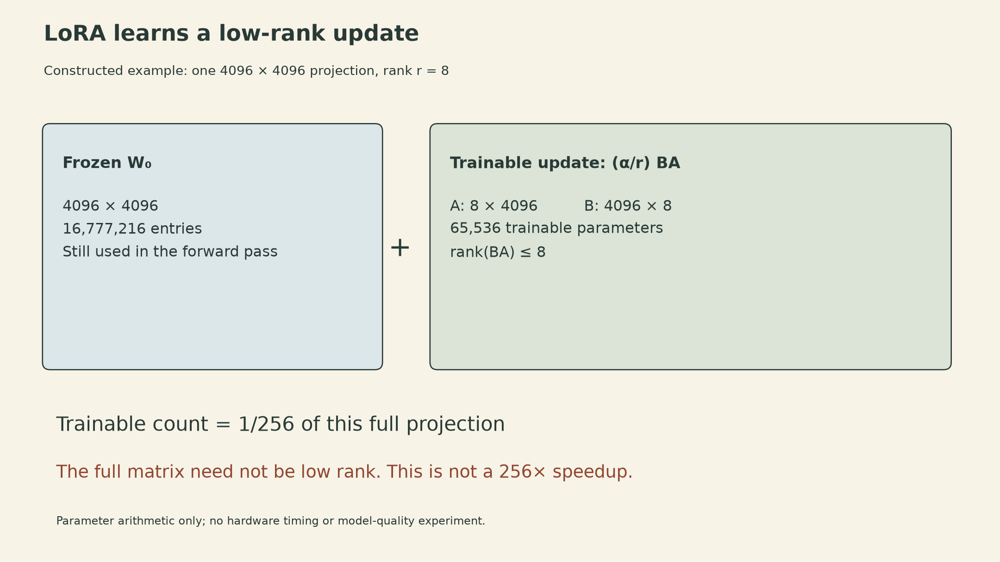
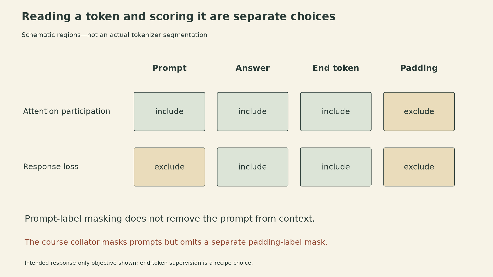
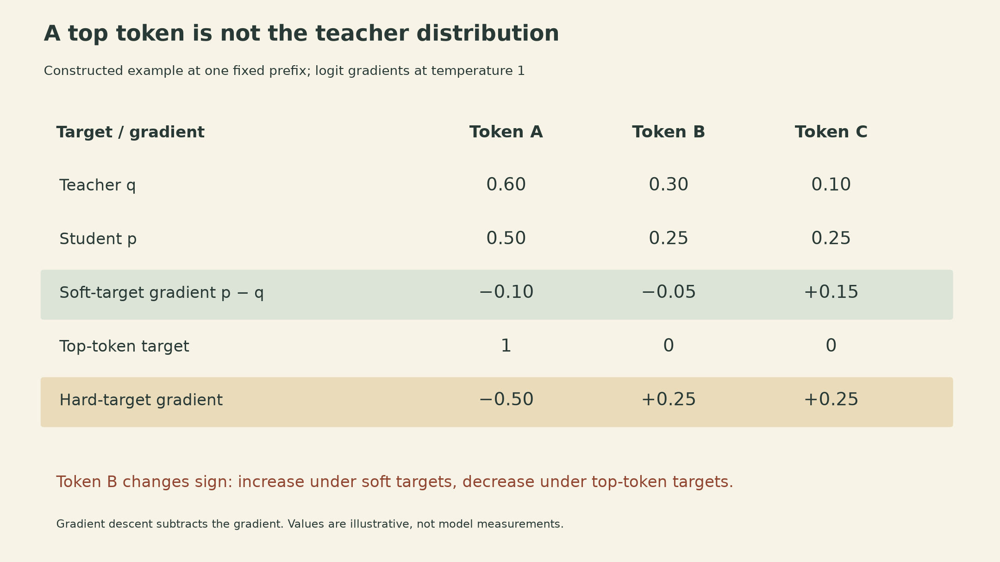

A model can read a prompt without being trained to reproduce it. A weight matrix can remain frozen while gradients pass through its computation. A student can learn from a teacher's generated answers without seeing the teacher's full probability distribution.

These distinctions connect the three parts of [CMU Advanced NLP Lecture 8](https://cmu-l3.github.io/anlp-fall2025/static_files/anlp-f2025-08-finetuning.pdf): fine-tuning, instruction tuning, and knowledge distillation. Each changes a different part of learning: the parameters allowed to move, the examples and positions that contribute to the loss, or the distribution supplying the targets.

## A new task can change the head, the representations, or both

Fine-tuning continues gradient-based training from pretrained parameters. For supervised pairs $(x,y)$, the basic objective is

$$
J(\theta)=\frac1N\sum_{i=1}^{N}\mathcal L(f_\theta(x_i),y_i).
$$

A gradient-based optimizer minimizes this objective starting from the pretrained weights. Its final iterate depends on initialization, the optimizer, and when training stops; it need not be a global minimizer. The learner starts from an existing representation rather than discovering everything from the task data. It does not remove the possibility of overfitting. Data selection, regularization, and evaluation on held-out examples still matter.

For classification, a sequence model supplies a hidden vector $h\in\mathbb R^d$. A new head with $K$ classes defines

$$
p(y\mid x)=\operatorname{softmax}(Wh+b)_y,
\qquad W\in\mathbb R^{K\times d},\quad b\in\mathbb R^K.
$$

Training only this head uses $Kd+K$ trainable parameters. It learns an affine decision rule on the existing representation. Full fine-tuning also changes the backbone, so it can alter the representation itself. Parameter-efficient fine-tuning occupies a third position: allow selected changes inside the backbone while keeping most weights fixed.

The [classification notebook](https://github.com/cmu-l3/anlp-fall2025-code/blob/7aa39dfad7a6480987afa5a922ab25a714c4dc10/08_finetuning/finetuning_classification.ipynb) makes this concrete with vowel counts in names. It caps labels at 10, giving 11 classes including “10 or more,” and applies a linear head to the final non-padding hidden state. The training setup places all model parameters in the optimizer, including the backbone. Its index calculation, `attention_mask.sum(dim=1) - 1`, assumes right padding; it is not a general last-valid-position rule for left-padded batches.

One practical caveat about that commit: the training and evaluation functions pass `labels=labels` to `LMClassifier.forward`, whose signature does not accept that keyword. As written, that call raises a keyword-argument error. The intended classification objective is clear, but the listing is not evidence of a clean end-to-end training run.

## LoRA restricts the update, not the rank of the adapted matrix

For a frozen projection $W_0\in\mathbb R^{d_{\rm out}\times d_{\rm in}}$, LoRA introduces two trainable matrices:

$$
W=W_0+sBA,\qquad
B\in\mathbb R^{d_{\rm out}\times r},\quad
A\in\mathbb R^{r\times d_{\rm in}},\quad s=\alpha/r.
$$

The update has rank at most $r$. The complete matrix $W$ need not have low rank. For a column-vector input $u$, the computation is $W_0u+sB(Au)$: the additional path first maps the input into an $r$-dimensional space, then maps it back to the output dimension.

Ignoring biases and other layers, the trainable count changes from $d_{\rm out}d_{\rm in}$ to $r(d_{\rm out}+d_{\rm in})$. A constructed square example with width 4096 and rank 8 gives

$$
4096^2=16{,}777{,}216,\qquad
8(4096+4096)=65{,}536,\qquad
\frac{65{,}536}{16{,}777{,}216}=\frac1{256}.
$$

{fig-alt="Constructed LoRA example for one 4096 by 4096 projection. The frozen matrix has 16,777,216 entries. Trainable A is 8 by 4096 and B is 4096 by 8, totaling 65,536 parameters, one 256th of the full matrix count. The added update has rank at most eight; the total matrix need not. The parameter ratio is not a runtime speedup."}

This is a parameter count, not a 256-fold reduction in training time or total memory. Frozen weights still have to be available for the forward computation. Activations and gradient paths through frozen operations can still be needed to train adapters elsewhere. Optimizer state and weight-gradient buffers for frozen parameters can be omitted, but that is only one part of training memory.

The [LoRA paper, Section 4.1](https://arxiv.org/abs/2106.09685), initializes one factor randomly and the other to zero, making the initial update zero. Initializing both factors to zero would also make both factor gradients zero for this bilinear branch. The lecture highlights adapting attention query and value projections; LoRA's factorization can also be applied to other selected linear maps. For a fixed adapter, merging the update into a compatible dense weight matrix removes the separate adapter branch at inference. That algebraic statement does not guarantee that every quantized or multi-adapter serving setup has identical latency.

## The loss mask says what the model is asked to predict

For a prompt $x$ and a target response $y_{1:T}$, conditional language-model fine-tuning minimizes

$$
\mathcal L_{\rm response}=-\sum_{t=1}^{T}\log p_\theta(y_t\mid x,y_{<t}).
$$

The input includes the prompt. The loss need not include predicting the prompt. Teacher forcing supplies the earlier target tokens during training; at generation time, later predictions instead depend on the model's own earlier outputs.

The [generation notebook](https://github.com/cmu-l3/anlp-fall2025-code/blob/7aa39dfad7a6480987afa5a922ab25a714c4dc10/08_finetuning/finetuning_lm.ipynb) uses name reversal, such as `emma` to `amme`. It concatenates an instruction, answer, and end token, then uses `labels[i, :prompt_len] = -100` to mask the prompt. This slice assumes right padding and that the separately tokenized prompt is an exact prefix of the full tokenization. The model still reads those prompt tokens as context.

Padding requires a separate decision. In that collator, labels are copied from `input_ids` and prompt positions are masked, but padded label positions are not subsequently set to `-100`. An attention mask controls which positions participate in attention; it does not by itself erase padding IDs from a cross-entropy target tensor. For response-only training, the intended loss mask excludes both prompt and padding positions while retaining the response and, when intended, the end token.

{fig-alt="Schematic sequence with prompt, answer, end token, and padding columns. The attention row includes prompt, answer, and end token but excludes padding. The response-loss row excludes prompt and padding, while including answer and end token. These are symbolic regions, not the actual tokenizer segmentation. The course collator masks prompt labels but omits the separate padding-label mask."}

Masking a prompt's labels does not freeze all computations associated with that prompt. A response loss can still backpropagate through the context representations used to predict the response. The mask chooses supervised prediction positions, not an arbitrary boundary in the computation graph.

The lecture describes fine-tuning as narrowing the data distribution. The important change is the training target distribution: a specialized corpus can reward particular tasks and formats much more often than pretraining did. This is not a theorem that entropy decreases for every prompt. Poor transfer to other tasks, format sensitivity, or reduced few-shot ability are possible consequences to evaluate, rather than inevitable properties of every fine-tuned model.

## Instruction tuning changes the training examples

Instruction tuning uses pairs of the form `(instruction + input, output)` across tasks. Translation, classification, question answering, and problem solving can share the same conditional language-model interface. The instructions, inputs, and outputs can each come from templates, people, existing datasets, or model generations.

The lecture contrasts FLAN's templated tasks, Super-NaturalInstructions' crowdsourced tasks, and Self-Instruct's generated examples. These are different data-construction procedures, not different definitions of gradient descent. Generalization to an unseen task must be evaluated on tasks held out from the tuning process; a collection of many task names alone does not establish it.

[Self-Instruct](https://aclanthology.org/2023.acl-long.754/) starts from human-written seed tasks, generates additional instructions and instances, and filters invalid or overly similar material before tuning. The filtering step matters: synthetic targets can repeat errors as well as useful behavior. Self-Instruct uses generations from the same base model that it later fine-tunes. Outputs from that model—or from a stronger teacher—still require quality checks.

Chat tuning further specifies how a conversation becomes a token sequence: role markers, system text, user turns, and assistant turns. Which turns are prediction targets depends on the training recipe. The format and the loss mask are separate choices, and neither is an access-control mechanism merely because one role is called “system.”

## Distillation depends on which teacher distribution is preserved

At a fixed prompt and prefix, let $q(v)$ be the teacher's next-token distribution and $p_\theta(v)$ the student's distribution over the same vocabulary. Token-level distillation uses soft targets:

$$
\mathcal L_{\rm token}=-\sum_{v\in V}q(v)\log p_\theta(v)
=H(q)+D_{\rm KL}(q\Vert p_\theta).
$$

With the teacher fixed, its entropy does not depend on the student's parameters. Minimizing this cross-entropy therefore minimizes the forward KL at that context.

Consider a constructed three-token example with teacher probabilities $(0.6,0.3,0.1)$ and student probabilities $(0.5,0.25,0.25)$. Using natural logarithms,

$$
\mathcal L_{\rm token}\approx0.9704,\qquad
H(q)\approx0.8979,\qquad D_{\rm KL}(q\Vert p_\theta)\approx0.0725.
$$

For student logits $z_v$ at temperature one, the derivative is $p_\theta(v)-q(v)$. Here it is $(-0.1,-0.05,0.15)$. Keeping only the teacher's top token changes the target to $(1,0,0)$ and the derivative to $(-0.5,0.25,0.25)$: the second token changes from something to increase to something to decrease.

{fig-alt="Constructed three-token distillation example. Teacher probabilities are 0.6, 0.3, 0.1 and student probabilities 0.5, 0.25, 0.25. The soft-target logit gradient p minus q is minus 0.10, minus 0.05, plus 0.15. Replacing the teacher with a one-hot top-token target produces minus 0.50, plus 0.25, plus 0.25. The second token changes gradient sign. These are exact illustrative calculations, not model measurements."}

### Prefixes are part of the objective

For complete responses at a fixed prompt $x$, assume a common tokenization, proper normalized distributions over terminating sequences, and finite relevant expectations. The sequence forward KL equals the expected student negative log-likelihood under teacher samples minus the teacher entropy:

$$
D_{\rm KL}(q(y\mid x)\Vert p_\theta(y\mid x))
=-H(q(\cdot\mid x))+\mathbb E_{y\sim q}[-\log p_\theta(y\mid x)].
$$

Expanding autoregressively also gives an expectation of token-level KL terms over **teacher-distributed prefixes**:

$$
D_{\rm KL}(q(\cdot\mid x)\Vert p_\theta(\cdot\mid x))
=\sum_t\mathbb E_{y_{<t}\sim q}
\left[D_{\rm KL}\big(q(\cdot\mid x,y_{<t})\Vert p_\theta(\cdot\mid x,y_{<t})\big)\right],
$$

where terms for prefixes that have already emitted the end token are defined as zero. If the prefixes instead come from a fixed reference corpus, matching token distributions on those prefixes is a different expectation. Soft labels alone do not make it the full sequence KL.

Sequence-level distillation can train on complete teacher-generated answers using ordinary conditional negative log-likelihood. Independent samples from the unchanged teacher provide an unbiased Monte Carlo estimate of the teacher-to-student cross-entropy. But greedy decoding, beam search, temperature changes, and filtering generally change the effective target distribution.

[Kim and Rush, Section 3.2](https://aclanthology.org/D16-1139/), explicitly approximate the teacher's sequence distribution by a point mass on a high-scoring output found with beam search. Training on that output is useful as a distillation procedure, but it is not an unbiased sample estimate of the original teacher distribution. It also avoids requiring the student to consume the teacher's full token probability vector; tokenizers can differ when the transferred object is decoded text.

### A verifier changes the teacher being distilled

The lecture's augmented-teacher view writes a model distribution multiplied by an acceptance or weighting function. With a nonnegative weight $A(x,y)$, the normalized target is

$$
q_A(y\mid x)=\frac{p_{\rm LLM}(y\mid x)A(x,y)}{Z(x)},\qquad
Z(x)=\sum_y p_{\rm LLM}(y\mid x)A(x,y),\quad 0<Z(x)<\infty.
$$

For binary acceptance, this is the model's distribution conditioned on acceptance. In a constructed example, a base model assigns 0.6 probability to correct answers and 0.4 to incorrect ones. An ideal filter that accepts every correct answer and rejects every incorrect one has acceptance probability $Z=0.6$ and yields an accepted distribution containing only correct answers, preserving their relative probabilities. That does not establish that a real verifier is ideal, that enough accepted examples exist, or that a finite student will reproduce the distribution.

Distillation can therefore transfer a procedure more selective than the raw model. Whether the student improves depends on what the procedure selects, the prompts it covers, and how well the student learns it. The training loss alone cannot establish those conditions.

## Sources

- [CMU ANLP Fall 2025 Lecture 8 slides](https://cmu-l3.github.io/anlp-fall2025/static_files/anlp-f2025-08-finetuning.pdf): pp. 6–16, fine-tuning and LoRA; pp. 20–31, instruction and chat tuning; pp. 33–38, distillation.
- [Course code, fixed commit 7aa39df](https://github.com/cmu-l3/anlp-fall2025-code/tree/7aa39dfad7a6480987afa5a922ab25a714c4dc10/08_finetuning): `LMClassifier`, `train_epoch` / `evaluate`, and `NameReversalDataset.collate_fn` distinguish intended objectives from the displayed implementation.
- [Hu et al., LoRA](https://arxiv.org/abs/2106.09685), Sections 4.1–4.2: factorization, initialization, merging, and resource boundaries.
- [Kim and Rush, Sequence-Level Knowledge Distillation](https://aclanthology.org/D16-1139/), Sections 3.1–3.2: reference-prefix token loss and beam-based sequence approximation.
- [Wang et al., Self-Instruct](https://aclanthology.org/2023.acl-long.754/), Section 2: seed tasks, generated instances, and filtering.
