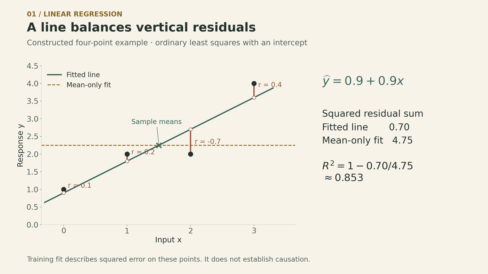
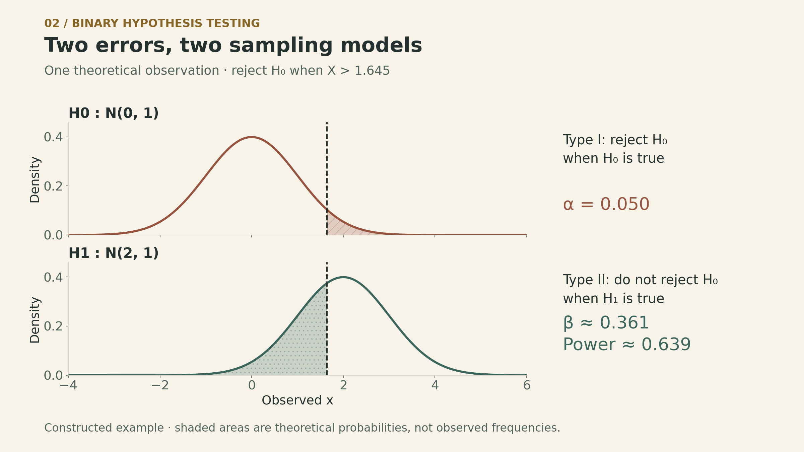
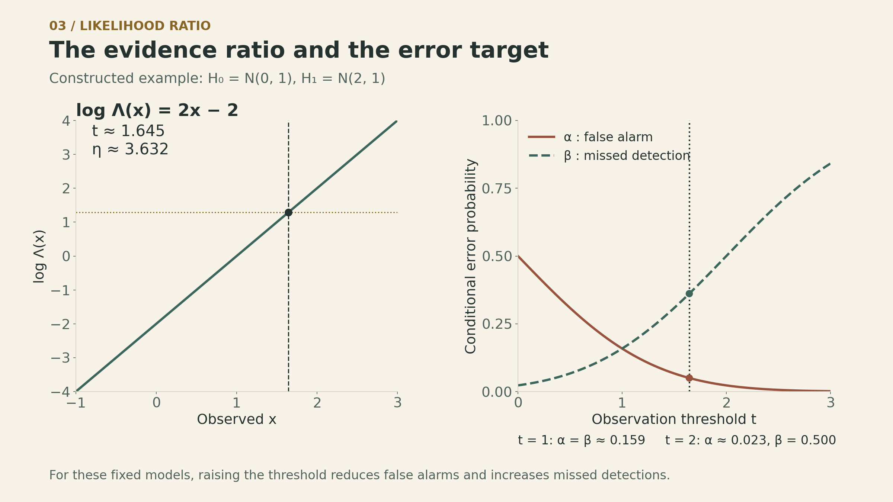

What makes a fitted line reasonable? What makes a decision between two distributions reasonable?

Both questions become more precise when we specify how the observations are generated. In regression, that model can connect a sum of squared residuals to a likelihood. In hypothesis testing, it tells us how often a decision rule makes each kind of mistake.

[John Tsitsiklis's Lecture 24](https://ocw.mit.edu/courses/6-041sc-probabilistic-systems-analysis-and-applied-probability-fall-2013/pages/unit-iv/lecture-24/) connects linear regression with maximum likelihood, then introduces binary hypothesis testing and likelihood ratios. The unknown parameters remain fixed; probabilities describe data generated under a specified model.

<iframe style="width:100%;aspect-ratio:16/9;border:0" src="https://www.youtube-nocookie.com/embed/tBUHRpFZy0s" title="MIT 6.041SC Lecture 24 — Classical Inference II" loading="lazy" allow="accelerometer; clipboard-write; encrypted-media; gyroscope; picture-in-picture; web-share" allowfullscreen></iframe>

## Keep the direction of the probability clear

In [Lecture 23](https://ickma2311.github.io/Math/Probability/mit-6041-lecture23-classical-inference-i.html), maximum likelihood chooses the parameter under which the observed data have the largest likelihood. It does not assign a probability distribution to that parameter.

Bayesian MAP estimation instead maximizes a posterior density, proportional to likelihood times prior density. A constant prior can give the same maximizer in a given parameterization, but the interpretations differ. A constant density over an unbounded parameter space is generally an improper prior; a posterior must still be well defined. Flatness also depends on the parameterization.

The same distinction matters for confidence intervals. The parameter is fixed, and the interval is random before sampling. A nominal 95% confidence procedure aims to cover the parameter in 95% of repeated samples, exactly or approximately under its assumptions. It does not turn a realized interval into a 95% posterior statement.

## A line minimizes vertical residuals

Suppose the data are pairs $(x_i,y_i)$, for $i=1,\ldots,n$. We want a line

$$
\widehat y_i=\widehat\theta_0+\widehat\theta_1 x_i.
$$

The residual is the observed response minus its fitted value: $r_i=y_i-\widehat y_i$. Ordinary least squares chooses the intercept and slope to minimize

$$
S(\theta_0,\theta_1)
=\sum_{i=1}^n(y_i-\theta_0-\theta_1x_i)^2.
$$

These are **vertical** discrepancies in $y$, measured at the observed $x_i$. This criterion does not minimize perpendicular distances to the line or explicitly model measurement error in $x$.

Let $\bar x$ and $\bar y$ denote sample means. Setting the derivatives to zero gives

$$
\begin{aligned}
\sum_i(y_i-\theta_0-\theta_1x_i)&=0,\\
\sum_i x_i(y_i-\theta_0-\theta_1x_i)&=0.
\end{aligned}
$$

The first equation gives $\theta_0=\bar y-\theta_1\bar x$. Substitute it into the second equation to obtain

$$
\begin{aligned}
\widehat\theta_1
&=\frac{\sum_i(x_i-\bar x)(y_i-\bar y)}
        {\sum_i(x_i-\bar x)^2},\\
\widehat\theta_0&=\bar y-\widehat\theta_1\bar x.
\end{aligned}
$$

The denominator must be positive: at least two $x_i$ values must differ. Then the quadratic objective has a unique minimizer. If all $x_i$ are identical, the data cannot distinguish an intercept change from a slope change.

The fitted line passes through $(\bar x,\bar y)$. With an intercept, its residuals also satisfy $\sum_i r_i=0$ and $\sum_i x_i r_i=0$. These are algebraic properties of the fit, not evidence that future errors will vanish.

### A small fit you can calculate by hand

Take the **constructed** data $(0,1),(1,2),(2,2),(3,4)$. Then $\bar x=1.5$, $\bar y=2.25$, the centered cross-product sum is $4.5$, and the centered square sum for $x$ is $5$.

The fitted line is $\widehat y=0.9+0.9x$:

| $x_i$ | $y_i$ | $\widehat y_i$ | $r_i$ |
|---:|---:|---:|---:|
| 0 | 1 | 0.9 | 0.1 |
| 1 | 2 | 1.8 | 0.2 |
| 2 | 2 | 2.7 | −0.7 |
| 3 | 4 | 3.6 | 0.4 |

The squared residuals sum to $0.70$. A horizontal line at $\bar y=2.25$ has squared residual sum $4.75$.

{fig-alt="Four constructed points at (0,1), (1,2), (2,2), and (3,4) are fitted by y-hat equals 0.9 plus 0.9x. Vertical residual segments are 0.1, 0.2, minus 0.7, and 0.4. Their squared sum is 0.70, compared with 4.75 for the horizontal sample-mean fit."}

## Gaussian noise gives a likelihood interpretation

Least squares is a valid optimization criterion without a probability model. For a particular likelihood interpretation, treat the $x_i$ as fixed and assume

$$
\begin{aligned}
Y_i&=\theta_0+\theta_1x_i+W_i,\\
W_i&\overset{\mathrm{iid}}\sim\mathcal N(0,\sigma^2),
\qquad \sigma^2>0.
\end{aligned}
$$

Here the errors are independent, Gaussian, and have the same variance. With $\sigma^2$ held fixed, the conditional log-likelihood is

$$
\begin{aligned}
\ell(\theta_0,\theta_1)
&=-\frac n2\log(2\pi\sigma^2)\\
&\quad-\frac{1}{2\sigma^2}
\sum_i(y_i-\theta_0-\theta_1x_i)^2.
\end{aligned}
$$

Only the squared-residual term depends on the two line parameters. Maximizing this log-likelihood therefore gives the least-squares fit.

The assumptions explain the objective. Squaring comes from the Gaussian exponent; adding comes from multiplying independent densities; equal weighting comes from the common variance. If independent Gaussian errors have known unequal variances $\sigma_i^2$, the corresponding likelihood instead minimizes $\sum_i r_i^2/\sigma_i^2$.

A related population identity supplies intuition for the slope. If $Y=\theta_0+\theta_1X+W$, with finite second moments, $\operatorname{Var}(X)>0$, $\mathbb E[W]=0$, and $W$ independent of $X$, then

$$
\operatorname{Cov}(X,Y)=\theta_1\operatorname{Var}(X).
$$

Thus $\theta_1=\operatorname{Cov}(X,Y)/\operatorname{Var}(X)$. The fitted slope replaces these population quantities with sample counterparts; the common normalization cancels. Independence can be weakened to zero covariance for this identity. Neither Gaussianity nor the likelihood argument is needed for the algebraic least-squares formula itself.

## More predictors do not remove the need for judgment

Multiple linear regression predicts a response using several features. Features may also be transformations of one input:

$$
\widehat y_i=\widehat\theta_0
+\widehat\theta_1 h_1(x_i)
+\widehat\theta_2 h_2(x_i).
$$

Choosing $h_1(x)=x$ and $h_2(x)=x^2$ gives a quadratic curve, but the model is still linear **in its coefficients**. The least-squares objective remains quadratic in those coefficients. A unique coefficient vector requires linearly independent columns in the design matrix. Highly related columns can make coefficients unstable even when fitted predictions change little.

The lecture highlights several limits:

- **Too many features can overfit.** A small training residual does not establish good prediction on new data. A sufficiently flexible polynomial can interpolate distinct training inputs and still behave poorly between or beyond them.
- **Heteroskedasticity changes the noise model.** When error variance depends on the input, the common-variance Gaussian likelihood no longer applies. Under zero conditional mean and a full-rank fixed design, ordinary least squares can still be unbiased; its efficiency and the usual uncertainty formulas need attention.
- **A good fit does not establish causation.** A relation between two variables can arise from either causal direction or a third variable affecting both.

Regression output also distinguishes uncertainty about a coefficient from the spread of a future response. Even with the correct line parameters, a new response still contains noise $W$.

For an unweighted ordinary least-squares fit with an intercept and positive total variation, the usual training statistic is

$$
\begin{aligned}
R^2&=1-\frac{\mathrm{SSE}}{\mathrm{SST}},\\
\mathrm{SSE}&=\sum_i r_i^2,
\quad \mathrm{SST}=\sum_i(y_i-\bar y)^2.
\end{aligned}
$$

Our four-point example gives $R^2=1-0.70/4.75\approx0.853$. This says how much the training squared error improves relative to predicting the sample mean. It does not mean an individual response is 85.3% predictable or that $x$ causes 85.3% of $y$.

## Testing partitions the possible observations

Estimation chooses a value from a parameter family. A **simple binary test** compares two fully specified sampling distributions, $H_0$ and $H_1$.

A rejection region $\mathcal R$ is a set of possible observations. If $X\in\mathcal R$, reject $H_0$ and select $H_1$; otherwise, do not reject $H_0$. For several measurements, $X$ can be the whole data vector.

There are two conditional error probabilities:

$$
\begin{aligned}
\alpha&=P_{H_0}(X\in\mathcal R),\\
\beta&=P_{H_1}(X\notin\mathcal R).
\end{aligned}
$$

| True sampling model | Reject $H_0$ | Do not reject $H_0$ |
|---|---|---|
| $H_0$ | Type I error, probability $\alpha$ | Probability $1-\alpha$ |
| $H_1$ | Power, probability $1-\beta$ | Type II error, probability $\beta$ |

$\alpha$ is the chance of rejection **when $H_0$ generates the data**. It is not the probability that $H_0$ is true after a rejection. Likewise, not rejecting $H_0$ does not prove it true. The two errors condition on different models; there is no overall error probability without a way to weight those models.

### Two normal models make the tradeoff visible

Consider a **constructed theoretical example** with one observation:

$$
H_0:X\sim\mathcal N(0,1),\qquad
H_1:X\sim\mathcal N(2,1).
$$

Reject $H_0$ when $X>t$. Writing $\Phi$ for the standard normal CDF,

$$
\alpha(t)=1-\Phi(t),\qquad
\beta(t)=\Phi(t-2).
$$

To target $\alpha=0.05$, choose $t=\Phi^{-1}(0.95)\approx1.645$. The resulting $\beta\approx0.361$, so power is about $0.639$. Controlling the false-alarm probability at 5% does not make the missed-detection probability 5%.

{fig-alt="The top panel shows the standard normal null density with the right tail beyond t equals 1.645 shaded as alpha equals 0.050. The bottom panel shows a normal alternative with mean 2 and variance 1, with the area to the left of the same threshold shaded as beta equals 0.361. Power is 0.639. These are theoretical probabilities for a constructed example."}

Raising the threshold shrinks the rejection region: $\alpha$ decreases and $\beta$ increases. Lowering it reverses that tradeoff. This statement concerns nested threshold regions for these fixed distributions; it does not say that better measurements or a larger sample cannot improve both errors.

## Likelihood ratios organize the decision

For continuous observations with $f_0(x)>0$, define

$$
\Lambda(x)=\frac{f_1(x)}{f_0(x)}.
$$

Use probability masses for discrete observations. A likelihood ratio test rejects $H_0$ when $\Lambda(x)>\eta$, for a chosen threshold $\eta$.

A large ratio means the observed data have a larger density under $H_1$ relative to $H_0$. It is not a posterior probability. Where the null density is zero and the alternative density is positive, the ratio can be treated as infinite; points impossible under both models do not affect the test's error probabilities.

For the two normal models above,

$$
\begin{aligned}
\log\Lambda(x)
&=-\frac{(x-2)^2}{2}+\frac{x^2}{2}\\
&=2x-2.
\end{aligned}
$$

The log ratio increases with $x$. Therefore $\Lambda(x)>\eta$ is equivalent to

$$
x>t,\qquad t=1+\frac12\log\eta.
$$

Our 5% false-alarm threshold $t\approx1.645$ corresponds to $\eta\approx3.632$. The ratio gives the decision's structure; the desired error control determines its threshold.

{fig-alt="For the constructed normal models, log likelihood ratio equals 2x minus 2. A threshold t equals 1.645 gives log eta about 1.290 and eta about 3.632. As t rises, alpha equals one minus Phi of t decreases while beta equals Phi of t minus 2 increases. At t equals 1 both errors are 0.159; at t equals 2 they are 0.023 and 0.500."}

In a Bayesian comparison with positive prior probabilities and equal costs for the two mistakes, MAP selects $H_1$ when $\Lambda(x)>P(H_0)/P(H_1)$. With equal priors, $\eta=1$, so this example uses $t=1$ and has $\alpha=\beta\approx0.159$.

The classical setup supplies no prior probabilities. One common choice is to select a false-alarm bound in advance and calibrate the threshold using the null distribution. For continuous models like this example, exact calibration is possible. With discrete data, jumps in tail probabilities can require conservative error control or randomization to attain an exact target.

Likelihood ratios need not increase with the raw observation in every problem. The threshold is always on the ratio; a single right-tail cutoff in $x$ is specific to models with the required monotonicity.

## What the two methods have in common

Regression turns observed discrepancies into a fitting criterion. Testing turns possible observations into a decision region. A sampling model supplies a likelihood interpretation for the first and conditional error probabilities for the second.

For a fitted line, ask which noise assumptions support its uncertainty statements. For a test, ask which error is controlled, under which distribution, and what happens to the other error. Neither a small training residual nor a small false-alarm rate, by itself, supplies the rest of that answer.

## Sources

- [MIT 6.041SC Lecture 24: Classical Inference II](https://ocw.mit.edu/courses/6-041sc-probabilistic-systems-analysis-and-applied-probability-fall-2013/pages/unit-iv/lecture-24/), John Tsitsiklis.
- [Lecture slides](https://ocw.mit.edu/courses/6-041sc-probabilistic-systems-analysis-and-applied-probability-fall-2013/7c44465438ef319fcbd2332114bd0013_MIT6_041SCF13_L24.pdf): p. 1, regression and its likelihood interpretation; p. 2, extensions, pitfalls, and likelihood ratio tests.
- [Official transcript](https://ocw.mit.edu/courses/6-041sc-probabilistic-systems-analysis-and-applied-probability-fall-2013/d092583263d0de9eabef6c58edad1c7d_MIT6_041SCF13_lec24_300k.pdf): pp. 3–11, regression; pp. 11–13, testing and threshold selection.
- [Lecture video](https://www.youtube.com/watch?v=tBUHRpFZy0s).

The four-point fit and the normal-model calculations are constructed examples. The displayed least-squares derivation, training $R^2$ calculation, and normal-test thresholds make the underlying algebra explicit.
