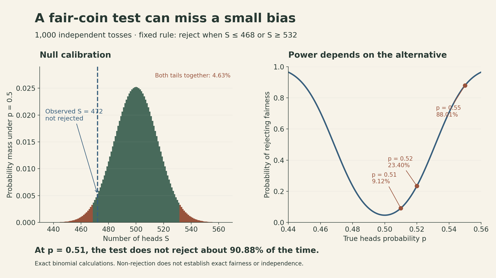
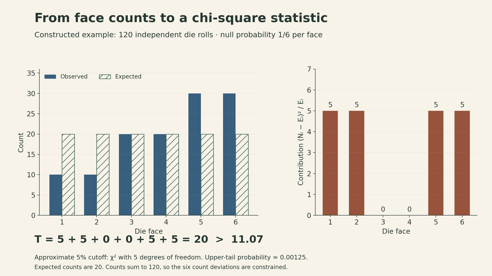
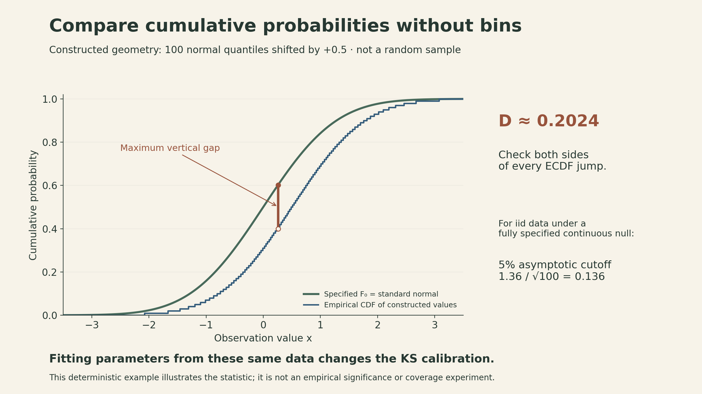

A coin produces 472 heads in 1,000 tosses. That is fewer than the 500 we expect from a fair coin. Is the discrepancy large enough to reject fairness?

At the 5% level, the test in [John Tsitsiklis's final MIT 6.041SC lecture](https://ocw.mit.edu/courses/6-041sc-probabilistic-systems-analysis-and-applied-probability-fall-2013/pages/unit-iv/lecture-25/) does not reject the fair-coin model. Yet a coin with heads probability 0.51 would usually pass that same test. A procedure can control false alarms while having little ability to detect a small departure from its assumptions.

The lecture develops a reusable approach: **choose what discrepancy matters, find its sampling distribution under the null model, and calibrate a rejection threshold.** The same structure appears in tests for a normal mean, a normal variance, a fair die, and an entire distribution. What changes is the statistic—and the assumptions needed to interpret it.

<iframe style="width:100%;aspect-ratio:16/9;border:0" src="https://www.youtube-nocookie.com/embed/rYefUsYuEp0" title="MIT 6.041SC Lecture 25 — Classical Inference III" loading="lazy" allow="accelerometer; clipboard-write; encrypted-media; gyroscope; picture-in-picture; web-share" allowfullscreen></iframe>

[Official lecture recording](https://www.youtube.com/watch?v=rYefUsYuEp0) · [Lecture slides](https://ocw.mit.edu/courses/6-041sc-probabilistic-systems-analysis-and-applied-probability-fall-2013/6c879ec7e72ba6921b395b529b4c6eb0_MIT6_041SCF13_L25.pdf)

## A test chooses a region, then calibrates its size

Let $X=(X_1,\ldots,X_n)$ be the observations. A test specifies a rejection region $R$ and rejects the null hypothesis $H_0$ when $X\in R$. Its false-rejection probability is

$$
\alpha=P_{H_0}(X\in R).
$$

For a specified alternative $H_1$, the missed-detection probability is $\beta=P_{H_1}(X\notin R)$, and power is $1-\beta$. These probabilities concern repeated samples under specified models. They are not posterior probabilities that a hypothesis is true after seeing the data.

There are two design decisions. First choose the **shape** of $R$: what observations count as evidence against $H_0$? Then choose its **size** by setting a cutoff using the null distribution. A statistic $T(X)$ condenses the data into the quantity used by the decision.

When both hypotheses specify a complete distribution, the likelihood ratio is

$$
\Lambda(x)=\frac{f(x;H_1)}{f(x;H_0)}.
$$

Use probability masses instead of densities for discrete data. Large ratios favor $H_1$ relative to $H_0$, giving a rule $\Lambda(x)>\eta$. For simple versus simple hypotheses, the Neyman–Pearson result gives a most powerful likelihood-ratio test at a prescribed size, with boundary randomization when needed. It does not say that one such test is best against every possible composite alternative.

For continuous null distributions, a cutoff can often achieve the chosen $\alpha$ exactly. With discrete observations, attainable tail probabilities jump. A nonrandomized test commonly guarantees a size **at most** the target instead of exactly equal to it.

## Different alternatives call for different summaries

[Lecture 24](mit-6041-lecture24-classical-inference-ii.qmd) introduced the likelihood-ratio tradeoff. Here, two normal examples show how the alternative determines what to measure. In both examples the observations are independent and identically distributed, and the stated means and variances are known under each hypothesis.

### A larger mean makes the sum informative

Compare $H_0:X_i\sim N(0,1)$ with $H_1:X_i\sim N(1,1)$. The normalizing constants cancel, so

$$
\begin{aligned}
\log\Lambda(x)
&=-\frac12\sum_{i=1}^n(x_i-1)^2+\frac12\sum_{i=1}^n x_i^2\\
&=\sum_{i=1}^n x_i-\frac n2.
\end{aligned}
$$

Thus the ratio increases with $S=\sum_i X_i$. Under $H_0$, $S\sim N(0,n)$ exactly, so a size-$\alpha$ test rejects when

$$
S>\sqrt n\,z_{1-\alpha},
\qquad\text{or}\qquad
\bar X>\frac{z_{1-\alpha}}{\sqrt n},
$$

where $z_q$ is the $q$ quantile of a standard normal. This is a one-sided test because the specified alternative shifts the mean upward.

### A larger variance makes squared magnitude informative

Now compare $H_0:X_i\sim N(0,1)$ with $H_1:X_i\sim N(0,4)$. Here 4 is the variance, so the alternative standard deviation is 2. The log likelihood ratio is

$$
\log\Lambda(x)=-n\log 2+\frac38\sum_{i=1}^n x_i^2.
$$

The useful statistic is $Q=\sum_i X_i^2$. Large positive and negative observations both increase it. Under $H_0$,

$$
Q\sim\chi_n^2,
\qquad
\text{reject when }Q>\chi^2_{n,1-\alpha}.
$$

Here $\chi^2_{n,1-\alpha}$ denotes the $(1-\alpha)$ quantile of the chi-square distribution with $n$ degrees of freedom. This chi-square distribution is exact for independent standard normals. It has $n$ degrees of freedom because the mean is specified as zero. Estimating and subtracting an unknown mean leads to a different statistic and different calibration.

The two examples make the choice of summary concrete: adding signed observations detects a mean shift; adding squares detects increased spread about the known mean. A generic instruction to look for an “unusual observation” does not specify either test.

## A composite alternative turns power into a function

For independent Bernoulli tosses with a common heads probability $p$, consider

$$
H_0:p=\tfrac12,
\qquad
H_1:p\ne\tfrac12.
$$

The alternative includes every other value of $p$. There is no single alternative distribution or single missed-detection probability. Power is now a function of $p$.

Let $S$ be the number of heads. Under the null,

$$
S\sim\operatorname{Binomial}(1000,\tfrac12),
\quad E_0[S]=500,
\quad\operatorname{SD}_0(S)=\sqrt{250}\approx15.81.
$$

Because deviations in either direction matter, a natural rejection region is $|S-500|>c$. A normal approximation gives a 95% central interval with half-width

$$
1.96\sqrt{250}\approx30.99.
$$

The lecture uses the rounded rule **reject if $|S-500|>31$**. With integer counts, that means $S\le468$ or $S\ge532$. For the observed $S=472$, the distance from 500 is 28, so this rule does not reject.

The distinction between the approximation and the actual integer rule is useful. Exact binomial summation gives

$$
P_{1/2}(S\le468\text{ or }S\ge532)\approx0.04629.
$$

Its actual size is about 4.63%, rather than exactly 5%. Using $|S-500|>30$ would instead give about 5.37%. The stricter integer cutoff supplies conservative 5% control.

For the two-sided discrepancy $|S-500|$, an exact tail probability at the observed value is

$$
p_{\text{tail}}
=P_{1/2}(|S-500|\ge28)
=2P_{1/2}(S\le472)
\approx0.08194.
$$

The symmetry of this particular null distribution justifies doubling that tail. This is about results at least as far from 500 as the observation, under the null. It is not an 8.19% probability that the coin is fair, or that a decision is wrong.

{fig-alt="For 1,000 independent tosses, reject fairness at S at most 468 or at least 532. The observed 472 is inside the non-rejection region. Exact false-rejection probability is 4.63%. The same test has 9.12% power at p=0.51, 23.40% at p=0.52 and 88.01% at p=0.55. Curves are exact binomial calculations."}

### Non-rejection can coexist with low sensitivity

For this fixed rule, power at a true heads probability $p$ is

$$
\pi(p)=P_p(S\le468)+P_p(S\ge532).
$$

Exact calculations give:

| True heads probability | Probability of rejection |
|---|---:|
| $p=0.50$ | 4.63%: the false-rejection rate |
| $p=0.51$ | 9.12% |
| $p=0.52$ | 23.40% |
| $p=0.55$ | 88.01% |

At $p=0.51$, the model is false, but the test does not reject about 90.88% of the time. Non-rejection therefore means that this test, at this sample size, did not find sufficient evidence against the model. It does not establish exact fairness.

The independence assumption matters too. A sequence that alternates heads and tails can have an entirely ordinary head count while violating the independent-toss model. A count-based statistic discards order; an ordinary count does not validate the dependence structure.

## A fair die leads to weighted count discrepancies

For $k$ categories with fully specified null probabilities $p_1,\ldots,p_k>0$, independent trials give counts $N_i$ with $\sum_iN_i=n$. Their expected counts are $E_i=np_i$. Pearson's statistic is

$$
T=\sum_{i=1}^k\frac{(N_i-E_i)^2}{E_i}.
$$

Each term compares an observed count with its expected value, scaled by the expected count. Squaring prevents positive and negative discrepancies from canceling. The denominator makes a given absolute discrepancy matter more in a category expected to be rare.

The counts are **not independent**: they must sum to $n$, and for distinct categories $\operatorname{Cov}(N_i,N_j)=-np_ip_j$. With fixed $k$, positive fixed probabilities, and sufficiently large expected counts, the null distribution approaches $\chi^2_{k-1}$. One degree of freedom is lost to the total-count constraint. Unlike the normal sum-of-squares example, this reference distribution is generally approximate.

Consider a **constructed** example of 120 die rolls with counts

$$
(N_1,\ldots,N_6)=(10,10,20,20,30,30).
$$

Under a fair-die null, every expected count is 20. The contributions are $(5,5,0,0,5,5)$, giving $T=20$. The 95th percentile of $\chi^2_5$ is about 11.07, so the approximate 5% test rejects. The chi-square upper-tail probability is approximately 0.00125; this is an asymptotic reference calculation, not an exact multinomial tail probability.

{fig-alt="Constructed 120-roll die example. Observed counts 10,10,20,20,30,30 versus expected 20 each. Contributions to Pearson T are 5,5,0,0,5,5, summing to 20. Chi-square with 5 degrees of freedom has approximate 5% critical value 11.07. The test rejects; the count pattern does not identify a physical cause."}

The conclusion challenges the specified independent-roll, equal-probability model. It does not identify a physical cause of the discrepancy or supply posterior probabilities for the six face probabilities.

Small expected counts can make the approximation inaccurate. Choose categories and the testing rule in advance, and use a suitable exact or null-simulation calibration when the chi-square approximation is inadequate. If parameters are fitted from the same data, the reference distribution also changes. In regular multinomial settings, fitting $r$ identifiable parameters by an appropriate procedure can give $k-1-r$ degrees of freedom; blindly subtracting parameters is not a universal repair. [NIST's chi-square discussion](https://www.itl.nist.gov/div898/handbook/eda/section3/eda35f.htm) describes the assumptions behind fitted bin probabilities.

## Test a whole distribution with bins—or cumulative probabilities

A continuous null distribution can be turned into a categorical model. Choose bin boundaries $b_0<\cdots<b_k$ covering the support. For a specified continuous CDF $F_0$, the null probability of bin $i$ is

$$
p_i=F_0(b_i)-F_0(b_{i-1}).
$$

Count observations in each bin, compute $E_i=np_i$, and apply the count-discrepancy method. The choice of bins affects what the test detects: broad bins can hide differences, while very narrow bins produce sparse counts. Fitting the distribution or choosing bins after looking for unusual features changes the procedure that needs calibration.

The lecture then introduces an approach that avoids bins. Define the empirical CDF

$$
\widehat F_n(x)=\frac1n\sum_{j=1}^n\mathbf1\{X_j\le x\}.
$$

At each $x$, it is the fraction of observations at or below $x$. The one-sample, two-sided Kolmogorov–Smirnov statistic measures the largest vertical gap:

$$
D_n=\sup_x|\widehat F_n(x)-F_0(x)|.
$$

For distinct sorted observations $X_{(1)}<\cdots<X_{(n)}$, the empirical CDF jumps from $(i-1)/n$ to $i/n$ at $X_{(i)}$. Check both sides of every jump:

$$
D_n=\max_{1\le i\le n}\left\{
\frac{i}{n}-F_0(X_{(i)}),\quad
F_0(X_{(i)})-\frac{i-1}{n}
\right\}.
$$

The lecture gives the 5% threshold below. Its large-sample calibration assumes independent identically distributed observations under a **fully specified continuous** $F_0$:

$$
\sqrt n\,D_n>1.36,
\qquad\text{equivalently}\qquad D_n>\frac{1.36}{\sqrt n}.
$$

The cutoff is an asymptotic approximation. For $n=100$, it is about 0.136. The figure below uses 100 deliberately constructed shifted normal quantiles to show where the maximum gap comes from; these are not a random experimental sample.

{fig-alt="Standard normal CDF and empirical CDF of 100 constructed values x_i=Phi-inverse((i-0.5)/100)+0.5. The maximum vertical gap D is about 0.2024; the large-sample 5% cutoff for iid data from a fully specified continuous null is 0.136. The constructed points illustrate geometry, not an empirical false-alarm experiment."}

The ordinary KS calibration cannot be reused unchanged after estimating a normal mean and variance from the same observations. Discrete distributions and ties also require appropriate treatment. “Distribution-free” refers to the null distribution of the statistic within its assumptions; it does not mean assumption-free. [NIST's KS reference](https://www.itl.nist.gov/div898/handbook/eda/section3/eda35g.htm) makes these limitations explicit.

## Choosing what to report changes the error calculation

The lecture closes with a warning about selection. A 5% false-rejection rate describes a specified procedure under its null model. Searching many hypotheses and reporting only the successful ones is a larger procedure.

For a constructed example of 20 independent tests whose nulls are all true, each with size exactly 0.05,

$$
P(\text{at least one false rejection})
=1-0.95^{20}\approx0.642.
$$

The independence assumption is essential for that product. Even without independence, 1,000 true-null tests each with false-rejection probability 0.05 under its true null distribution have an expected 50 false rejections by linearity of expectation. The number actually observed can differ.

These calculations do not say that 64.2% of published claims are false. They describe a particular repeated-testing setup. Selective reporting, choosing a hypothesis because it already looks unusual in the data, and changing the analysis after inspecting results can all make a nominal single-test error rate misleading.

Specify the hypothesis, statistic, and decision rule before using the data to test them. Exploratory analysis can suggest a hypothesis; fresh confirmatory data or an analysis that accounts for selection is needed to give the subsequent test its intended interpretation.

## The course ends with a question about the model

The final lecture also points toward density estimation, recursive signal processing, model selection, and high-dimensional inference. All of them ask us to choose a representation or procedure before probability calculations can tell us how it behaves.

Across this course, probability has supplied distributions for counts, sums, processes, and estimators. In inference, those distributions become reference models for judging data. The final check is therefore larger than whether a computed statistic exceeds a cutoff: **which assumptions make that cutoff meaningful, what departures can the test detect, and how was the reported result selected?**

## Sources

- [MIT 6.041SC Lecture 25: Classical Inference III](https://ocw.mit.edu/courses/6-041sc-probabilistic-systems-analysis-and-applied-probability-fall-2013/pages/unit-iv/lecture-25/), John Tsitsiklis, Fall 2013 course materials.
- [Lecture slides](https://ocw.mit.edu/courses/6-041sc-probabilistic-systems-analysis-and-applied-probability-fall-2013/6c879ec7e72ba6921b395b529b4c6eb0_MIT6_041SCF13_L25.pdf), pp. 1–2; [official transcript](https://ocw.mit.edu/courses/6-041sc-probabilistic-systems-analysis-and-applied-probability-fall-2013/rYefUsYuEp0_transcript.pdf). Recording timestamps: 1:23–19:05 (simple tests), 19:08–35:31 (coin and die), 35:36–44:39 (goodness of fit), 44:42–52:05 (extensions and selection).
- [NIST: chi-square goodness of fit](https://www.itl.nist.gov/div898/handbook/eda/section3/eda35f.htm) and [Kolmogorov–Smirnov goodness of fit](https://www.itl.nist.gov/div898/handbook/eda/section3/eda35g.htm).
- The exact binomial power calculations, six-face count table, shifted-quantile diagram, and repeated-testing numbers are worked illustrations. They are not empirical measurements or additional classroom datasets.

```{=html}
<style>
main.content { min-width: 0; }
main mjx-container[display="true"] { overflow-x: auto; overflow-y: hidden; max-width:100%; padding-block:.2em; }
main pre { max-width:100%;overflow-x:auto; }
@media(max-width:600px) { main table {display:block;max-width:100%;overflow-x:auto;} }
</style>
```
